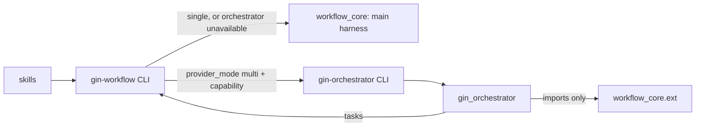

# Plan: gin-orchestrator as an extension of gin-workflow

Workflow: orchestrator-extension
Spec: .planning/specs/2026-10-21-orchestrator-extension-design.md

## Goal

gin-workflow runs the lifecycle with one main harness and no required external
tools. gin-orchestrator becomes a second plugin in this repository,
`plugins/gin-orchestrator/`, that adds worker harnesses. gin-workflow is the
only front door and delegates multi-harness work to `gin-orchestrator` through
a versioned CLI contract. gin-orchestrator imports gin-workflow only through
`workflow_core.ext`.

## Architecture

- `workflow_core` keeps single-harness resolution. Every role resolves to the
  main harness, and the tier picks the model from `DEFAULT_HARNESS_MODELS`. New
  CLI commands: `gin-workflow routes resolve`, `gin-workflow paths`, and
  `gin-workflow reviewer --json`.
- `workflow_core/orchestrator_client.py` speaks contract v2.
  - It reads `gin-orchestrator version --json` once per process.
  - `routes resolve`, `reviewer`, `setup doctor --probe` and `setup models`
    delegate when `provider_mode: multi`, the orchestrator is available, and the
    capability is listed.
  - Otherwise, or when the orchestrator fails, they resolve for the main
    harness and print a warning.
- `workflow_core/ext.py` is the facade. `EXT_VERSION = 1`, and a test pins its
  exported names.
- `plugins/gin-workflow/src/scripts/workflow_providers/` becomes
  `plugins/gin-orchestrator/src/scripts/gin_orchestrator/`. Changes:
  - It now owns multi-provider route resolution, `orchestrator.local.yaml`, the
    `orchestrator:` config section and its defaults, and the provider doctor.
  - It tracks tasks through `gin-workflow task ... --json`.
- Config schema 2.8:
  - Worker routing moves under `orchestrator:`, which gin-workflow passes
    through without validating.
  - `providers.task_tracking` defaults to `markdown`.
  - `_migrate_2_7_to_2_8` moves existing projects to the new layout.
- The release happens once, in the last track: gin-workflow 2.0.0 and
  gin-orchestrator 0.1.0.



## Tech Stack

Python 3 stdlib, PyYAML, `unittest`, bash and PowerShell installers, git.

## Global Constraints (copied from the spec)

- gin-workflow runs with one main harness and no external tools beyond Python
  stdlib, PyYAML and git. "One harness" means one agent harness; subagents of
  that harness running the model of a reasoning tier are part of gin-workflow.
- gin-orchestrator may import gin-workflow only through `workflow_core.ext`.
  gin-workflow never imports gin-orchestrator.
- The `orchestrate` and `gin-parallel-agents` skills stay in gin-workflow.
- Out of scope:
  - moving gin-orchestrator to its own repository;
  - a Beads database for gin-orchestrator;
  - wiring the worker library to run workers (`gin-orchestrator dispatch`);
  - `versions.lock`, `scripts/sync.sh`, gin-console changes.
- One release when every track is complete: gin-workflow 2.0.0 and
  gin-orchestrator 0.1.0. Tracks do not change a plugin version before Track 9.
- Each documentation change lands in the track that changes the behavior it
  describes.
- Concrete provider or model names never go into the plan or Beads.

## Model Guidance
- `default_model_class`: `standard_impl`
- `phase_guidance`:
  - `implement`: `standard_impl`
  - `review`: `high_reasoning`
  - `docs`: `cheap_simple`
- `override_rule`: Use `high_reasoning` for Tracks 1, 2, 3 and 7. They split
  module boundaries, migrate user config, or change fallback behavior.

## Requirement Analysis
- **Problem statement:** gin-workflow ships the multi-provider worker library
  and its configuration as core. It also defaults to Beads and multi mode, so a
  solo user has to understand workers and install Beads before running the
  lifecycle.
- **Success criteria:** US-1 to US-6 of the spec, and the "Errors and
  compatibility" table.
- **Constraints:** as above. This repository runs `provider_mode: multi` with
  schema `2.3` and a `providers.local.yaml`, so it is the migration test case
  (Track 9).
- **Non-goals:** the spec's out-of-scope list.

## Spec clarifications (decided while planning; confirm with the plan)

1. **`ext` exports more than the spec lists.** It also re-exports, from:
   - `assignments`: `AssignmentRequest`, `RouteCandidate`,
     `AssignmentResolutionError`, `validate_plan_assignments`;
   - `provider_config`: the shared tier constants and types;
   - `configuration`: `load_effective_config`, `require_yaml`;
   - `schemas`: `SUPPORTED_CONFIG_VERSIONS`, `validate_instance`.

   The moved code needs these. Each track that changes the list updates the
   pinned test. The list is final at Track 9.
2. **Routes output.** `gin-orchestrator routes resolve` exits 0 and reports
   unresolved tracks in a `diagnostics` list. A non-zero exit means the
   orchestrator failed, and gin-workflow then falls back to the main harness.
   `gin-workflow routes resolve` exits 2 and writes nothing when `diagnostics`
   is not empty. Only gin-workflow writes the assignment manifest.
3. **Reviewer routes include `effort`.** Each route is `{"provider", "model",
   "effort", "actor_id"}`, because a tier can carry an effort.
4. **Migration also preserves behavior.**
   - When it moves worker routing, it writes `provider_mode: multi` and
     `routing.review.independence: provider` if they are unset. Both defaults
     change in this epic.
   - A role it moves stays in `routing.roles` as `{preferred: [main_harness]}`,
     so plan validation still knows the role.
5. **New defaults.** `project_settings` now defaults to `provider_mode: single`
   and `independence: session`.
6. **Team mode keeps Beads.** With a `team:` block and `providers.task_tracking`
   unset, the backend is `beads`, because team mode supports only Beads.
7. **Setup no longer writes local provider files.**
   - `gin-workflow setup` drops `--provider-set` and no longer writes a local
     provider file.
   - `gin-orchestrator configure` writes `orchestrator.*` keys through
     `gin-workflow setup configure`, and writes `orchestrator.local.yaml`
     itself.
8. **Single-harness models.** In single-harness mode the tier's model comes only
   from `DEFAULT_HARNESS_MODELS`. The optional "model per tier" setup question
   moves to `/gin-orchestrator:providers`.
9. **Older configs keep working.** A config before 2.8 that keeps worker keys
   under `routing:` still validates. gin-workflow ignores those keys, and
   `setup doctor` suggests `setup update --to-version 2.8`. A 2.8 config that
   puts them under `routing:` fails validation with that command in the
   message.
10. **Upgrade notes** go in `docs/reference/upgrade-2.0.md`, linked from the
    README.

## Approach Options
### Option 1: Move the package first, then split the boundary
- Summary: move `workflow_providers` to the new plugin in Track 1, then fix the
  imports.
- Pros: the directory layout is final early.
- Cons: every later track touches both plugins. Core still imports
  multi-provider code that has moved, so the suite stays red across tracks.

### Option 2: Split inside the current tree, then move
- Summary: Tracks 1–2 cut the boundary in place: the facade, single-harness
  core, config 2.8 and orchestrator-owned config. Track 3 moves the package with
  `git mv` once it already imports only `ext`. Then come the plugin, delegation,
  docs and release.
- Pros: every track ends with a green suite. The move is mechanical and keeps
  history.
- Cons: `ext` changes across tracks before it is final.

### Recommended Approach
- **Selected option:** Option 2.
- **Reasoning:** each track stays independently reviewable and green, and the
  boundary test from Track 1 guards every later track.

## Scope
- **In scope:** Tracks 1–9 below.
- **Out of scope:** the spec's out-of-scope list.

## Execution Strategy

```yaml
execution_strategy:
  mode: direct
  workers:
    mode: sequential
  rationale: Nine tracks in a dependency chain on one feature branch; each changes files a later track builds on.
```

## Tasks

Every track works in `.planning/worktrees/orchestrator-extension` on branch
`feat/orchestrator-extension`.

- **Test command, abbreviated `$TEST <module>`:**
  `PYTHONPATH=plugins/gin-workflow/src/scripts python3 -m unittest <module>`.
- **Full suite:** `$TEST tests.test_all`.

### Track 1: Facade, single-harness routes and reviewer

- **Dependencies**: none
- **Provider role**: `backend`
- **Reasoning**: `high`
- **Estimated complexity**: high

**Files**

Create:
- `plugins/gin-workflow/src/scripts/workflow_core/ext.py`
- `plugins/gin-workflow/src/scripts/workflow_core/routes.py`
- `plugins/gin-workflow/src/scripts/workflow_providers/routes.py`
- `tests/workflow_core/test_ext.py`
- `tests/workflow_core/test_routes_cli.py`
- `tests/workflow_providers/test_routes.py`

Modify:
- `workflow_core/assignments.py`:
  - remove `resolve_assignment` and `resolve_all_assignments` (lines 159–243);
  - add `resolve_main_harness` and `write_assignments`;
  - make `write_assignment_manifest` a wrapper (lines 263–293).
- `workflow_core/reviewer.py`: whole file.
- `workflow_core/cli.py`: the command list at line 67, plus the `paths` and
  `routes` branches.
- Every `workflow_providers/*.py` import of `workflow_core.*`: 33 lines, listed
  by `grep -rn "workflow_core" plugins/gin-workflow/src/scripts/workflow_providers`.
- `workflow_providers/registry.py`: lines 10–19, import `resolve_assignment`
  from `.routes`.
- `tests/workflow_core/test_import_boundary.py`
- `tests/workflow_core/test_assignments.py`: multi-provider cases move to
  `tests/workflow_providers/test_routes.py`.
- `tests/workflow_core/test_reviewer.py`
- `plugins/gin-workflow/src/skills/orchestrate/SKILL.md`: step 3.
- `plugins/gin-workflow/src/skills/review/SKILL.md`: requesting step 2.
- `docs/reference/cli.md`: new `## \`gin-workflow routes\`` and
  `## \`gin-workflow paths\`` sections, plus `reviewer --json`.

**Interfaces produced**

```python
# workflow_core/assignments.py
def resolve_main_harness(request: AssignmentRequest) -> tuple[RouteCandidate, ...]
def write_assignments(repository: Path, workflow_id: str, entries: Sequence[Mapping[str, object]]) -> Path
# workflow_core/routes.py
def resolve(root: Path, workflow_id: str, tracks: Sequence[Mapping[str, str]], config: EffectiveConfig) -> dict
def main(argv: Sequence[str]) -> int          # `gin-workflow routes resolve ...`
# workflow_core/reviewer.py
def route(root: Path, base: str, *, tier: str, implementer: str, config: EffectiveConfig) -> dict
# workflow_providers/routes.py  (moved unchanged from workflow_core/assignments.py)
def resolve_assignment(request, config, local) -> tuple[RouteCandidate, ...]
def resolve_all_assignments(requests, config, local) -> tuple[AssignmentManifest, ...]
```

**JSON shapes**

`gin-workflow routes resolve --workflow-id W --tracks FILE [--repository DIR] --json`
prints:

```json
{"workflow_id": "W", "main_harness": "claude",
 "routes": [{"task_id": "t1", "requested": {"provider_role": "backend", "reasoning": "medium"},
             "resolved": {"provider": "claude", "selection_mode": "explicit", "model": "sonnet"},
             "fallback": []}],
 "diagnostics": [], "warnings": [], "manifest": ".agent-workflow/runtime/assignments/W.yaml"}
```

`gin-workflow reviewer ... --json` prints:

```json
{"tier": "medium", "reason": null, "warnings": [],
 "routes": [{"provider": "claude", "model": "sonnet", "effort": null,
             "actor_id": "reviewer:claude:session-1a2b3c4d"}]}
```

`gin-workflow paths --json` prints `{"lib_dir": "<directory that holds workflow_core>"}`.

**Steps**

1. Write `tests/workflow_core/test_ext.py`. It asserts that `ext.EXT_VERSION == 1`
   and that `sorted(ext.__all__)` equals this list:

   ```python
   EXPECTED = ["AcceptanceIdentity", "ApprovalAction", "AssignmentRequest", "AssignmentResolutionError",
               "CODEX_EFFORT_VALUES", "ContextManifest", "ContextRequest", "DEFAULT_HARNESS_MODELS",
               "EffectiveConfig", "PROVIDER_DEFAULT", "PROVIDER_DEFAULT_PROVIDERS", "PROVIDER_EXE_ALIASES",
               "ProviderLocalConfigError", "ProviderModelConfig", "REASONING_TIERS", "RepositorySnapshot",
               "RouteCandidate", "TierModelTarget", "WorkflowEvent", "WorkflowEventStore", "atomic_write_text",
               "authorize_protected_action", "create_context_manifest", "default_provider_model_config", "freeze",
               "main_checkout", "resolve_harness_executable", "task_markdown", "thaw", "validate_plan_assignments"]
   ```

   It also asserts that every name in `__all__` is an attribute of `ext`.
2. Extend `tests/workflow_core/test_import_boundary.py`:
   - Keep the existing test, and widen its regex to `workflow_providers|gin_orchestrator`.
   - Add `test_worker_library_imports_only_the_facade`. It walks
     `plugins/gin-workflow/src/scripts/workflow_providers/*.py`. For every line
     matching `^\s*(from|import)\s+(workflow_core(?:\.\w+)?)\b`, group 2 must be
     `workflow_core.ext`; any other value is an offender.
3. Run `$TEST tests.workflow_core.test_ext tests.workflow_core.test_import_boundary`.
   Expect failures: `ext` is missing, and there are 33 offenders.
4. Create `workflow_core/ext.py`:
   - Docstring: "The facade gin-orchestrator imports. Removing a name or
     changing a signature raises EXT_VERSION."
   - `EXT_VERSION = 1`.
   - One `from .module import names` per module for the names above, plus
     `from . import task_markdown`.
   - `__all__` set to the list.
5. Rewrite every `from workflow_core.X import ...` and
   `from workflow_core import task_markdown` in `workflow_providers/*.py` to
   `from workflow_core.ext import ...`.
6. Move `resolve_assignment` and `resolve_all_assignments` verbatim into
   `workflow_providers/routes.py`. It imports `AssignmentManifest` from
   `workflow_core.assignments`; add `AssignmentManifest` to `ext` and to
   `EXPECTED`. `registry.py` then imports `resolve_assignment` from `.routes`.
7. Rerun step 3. Expect OK.
8. Move the multi-provider cases into `tests/workflow_providers/test_routes.py`:
   every test in `test_assignments.py` that calls `resolve_assignment` or
   `resolve_all_assignments`. Keep their bodies and change only the imports.
   Then add these core tests to `test_assignments.py`:
   - `test_resolve_main_harness_uses_the_default_tier_model`: claude, `medium`
     gives `("claude", "sonnet", False, None)`. A codex `high` route carries
     effort `high`.
   - `test_resolve_main_harness_rejects_an_unknown_harness`.
   - `test_write_assignments_merges_by_task_id`: write `t2` and then `t1`. The
     file lists `t1` then `t2`, and a rewrite of `t1` replaces it.
9. Run `$TEST tests.workflow_core.test_assignments`. Expect failures.
10. Implement both functions in `assignments.py`:

    ```python
    def resolve_main_harness(request: AssignmentRequest) -> tuple[RouteCandidate, ...]:
        """Single-harness route: the main harness at the tier's default model."""
        if request.main_harness not in DEFAULT_HARNESS_MODELS:
            raise AssignmentResolutionError(f"unknown main harness: {request.main_harness}")
        target = default_provider_model_config(request.main_harness).models[request.reasoning]
        return (RouteCandidate(request.main_harness, target.model, False, effort=target.effort),)
    ```

    For `write_assignments`, move the body of `write_assignment_manifest`:
    - it takes `entries` (each with `task_id`) instead of one manifest;
    - it merges by `task_id` under the same lock;
    - it writes `{"workflow_id", "assignments": sorted by task_id}`.

    `write_assignment_manifest(repository, manifest)` becomes
    `return write_assignments(repository, manifest.workflow_id, [manifest.to_dict()])`.
    Run the test. Expect OK.
11. Write `tests/workflow_core/test_routes_cli.py`. Use a temp repository with
    `.agent-workflow/config.yaml`:

    ```yaml
    {harness: claude, provider_mode: single, schema_version: '2.7', routing: {roles: {backend: {preferred: [main_harness]}}}}
    ```

    Then run `gin-workflow setup refresh`, and call `routes.main` with a tracks
    file:
    - `test_single_harness_routes_every_track_to_the_main_harness`: two
      backend tracks give exit 0, both resolved `claude`, and the manifest
      exists.
    - `test_unknown_role_writes_nothing_and_lists_every_diagnostic`: an
      unknown role plus an invalid reasoning gives exit 2, two diagnostics, and
      no manifest.
    - `test_paths_prints_the_library_dir`: `cli.main(["paths", "--json"])`
      prints a `lib_dir` that contains `workflow_core/ext.py`.

    Run it. Expect failures.
12. Implement `workflow_core/routes.py`:
    - `main` parses `resolve --workflow-id --tracks --repository --json`.
    - It loads the effective config and reads the tracks JSON list.
    - `harness = config.harness or detect_project(root).get("harness")`. When
      none is found, exit 2 with "main harness unknown; run gin-workflow setup
      configure --harness <harness> --approve".
    - Each track becomes an `AssignmentRequest`. Any `AssignmentResolutionError`
      and every `validate_plan_assignments` error becomes a diagnostic
      `"<task_id>.<field>: <message>"`.
    - With diagnostics, print the JSON and exit 2.
    - Otherwise:
      `entries = [AssignmentManifest(w, r, resolve_main_harness(r)).to_dict() for r in requests]`.
      Write with `write_assignments`, print the JSON, exit 0.
13. In `cli.py`:
    - Add `"routes"` and `"paths"` to the command tuple and to the usage string.
    - `routes` dispatches to `routes.main(argv[1:])`.
    - `paths` prints
      `json.dumps({"lib_dir": str(Path(__file__).resolve().parents[1])})` and
      returns 0.

    Rerun step 11. Expect OK.
14. Rewrite `tests/workflow_core/test_reviewer.py`:
    - Keep the `review_tier` tests.
    - Replace the routing tests with:
      - `test_reviewer_runs_on_the_main_harness_in_a_fresh_session`: the
        implementer is claude, so `actor_id` matches
        `^reviewer:claude:session-[0-9a-f]{8}$`.
      - `test_reviewer_of_another_implementer_is_provider_independent`: the
        implementer is codex and the harness is claude, so `actor_id` is
        `reviewer:claude`.
      - `test_provider_independence_without_orchestrator_warns`: config
        `routing.review.independence: provider` gives one warning naming
        gin-orchestrator.
      - `test_json_flag_prints_the_routes_document`.

    Run it. Expect failures.
15. Rewrite `route` in `reviewer.py`:
    - Drop the `local` parameter and the `resolve_assignment` import.
    - Compute the tier with `review_tier`, then
      `harness = config.harness or implementer`.
    - Take the target from `default_provider_model_config(harness).models[tier]`.
    - `actor_id` is `f"reviewer:{harness}"` when `harness != implementer`,
      otherwise `f"reviewer:{harness}:session-{uuid.uuid4().hex[:8]}"`.
    - Add a warning when `independence == "provider"`.
    - `main` adds `--json`. Without it, the text output is unchanged: the
      `tier` line, the `reason` line, then one `provider model effort` line per
      route, with `warning: ...` lines on stderr.

    Rerun step 14. Expect OK.
16. Edit `orchestrate/SKILL.md` step 3 to:
    > Write the tracks as a JSON list of `{"task_id", "provider_role",
    > "reasoning"}` to `.agent-workflow/runtime/routes-<workflow>.json` and run
    > `gin-workflow routes resolve --workflow-id <workflow> --tracks <file> --json`.
    > Exit 2 lists every diagnostic; report them all and stop. It writes the
    > assignment manifest only when every track resolves.

    Edit `review/SKILL.md` requesting step 2 to use
    `gin-workflow reviewer ... --json` and dispatch each route with its
    `actor_id`.
17. Document `routes`, `paths` and `reviewer --json` in `docs/reference/cli.md`.
    Run
    `$TEST tests.workflow_core.test_docs_coverage tests.workflow_core.test_token_budget`.
    Expect OK.
18. Run the full suite: `$TEST tests.test_all`. Expect OK. Commit.

**Acceptance criteria**
- `ext` exports exactly the pinned list.
- `workflow_providers` imports only `workflow_core.ext`.
- `routes resolve` and `reviewer` resolve to the main harness, as in US-1
  criterion 3.
- `/orchestrate` imports no Python.
- The full suite passes.

### Track 2: Config schema 2.8 and the single-harness defaults

- **Dependencies**: Track 1
- **Provider role**: `backend`
- **Reasoning**: `high`
- **Estimated complexity**: high

**Files**

Modify, under `plugins/gin-workflow/src/scripts/workflow_core/`:
- `schemas.py`: line 10 `SUPPORTED_SCHEMA_VERSION`, line 11
  `SUPPORTED_CONFIG_VERSIONS`, and an `orchestrator` property in
  `CONFIG_SCHEMA`.
- `configuration.py`:
  - lines 27–28: the versions;
  - lines 181–231 (`validate_portable_config`): the 2.8 routing rule.
- `migrations.py`: line 15 `CURRENT_VERSION`, the new step, and `_MIGRATIONS`.
- `setup_service.py`:
  - `update` (lines 721–786): rename the local file after migrating;
  - `rollback` (lines 789–793): rename it back;
  - `_merged_provider_gitignore` (lines 89–97): add `orchestrator.local.yaml`;
  - `doctor`: the task-backend warning and the pre-2.8 routing hint;
  - `preset` (lines 885–914).
- `tasks.py`: lines 17–41 (`backend`, `backend_name`).
- `project.py`: `ProjectSettings` defaults, `project_settings`, and
  `preset_assignments`.
- `cli.py`:
  - line 17 `CLI_VERSION = "2.8"`;
  - replace `--provider-mode` with `--task-tracking {markdown,beads}`.

Also modify:
- `plugins/gin-workflow/src/examples/config.full.yaml`: move the worker keys
  under `orchestrator:`.
- `plugins/gin-workflow/src/skills/setup/SKILL.md`: quick setup questions 3
  and 6.

Tests:
- Create `tests/workflow_core/test_schema_2_8.py`.
- Modify `tests/workflow_core/test_project_settings.py`,
  `tests/workflow_core/test_tasks.py`, `tests/workflow_core/test_setup_cli.py`
  (the preset and doctor cases) and `tests/workflow_core/test_config_examples.py`.

Docs:
- `docs/reference/config.md`: `orchestrator:` ownership, the 2.8 migration, the
  `providers.task_tracking` default `markdown`, and `orchestrator.local.yaml`.
- `docs/reference/cli.md`: `setup preset` flags.

**Interfaces produced**
- `migrations._migrate_2_7_to_2_8(config: dict) -> dict`.
- `tasks.backend_name(config)`: `markdown` when unset, or `beads` when unset
  and `team` is configured.
- The config key `orchestrator:` is an opaque mapping.

**Steps**

1. Write `tests/workflow_core/test_schema_2_8.py` with this fixture:

   ```python
   LEGACY = {"schema_version": "2.7", "workflow_version": "2.7", "setup_cli_version": "2.7", "harness": "claude",
             "routing": {"concurrency": {"claude": 2, "codex": 1}, "queue": {"max_wait_seconds": 600},
                         "worker": {"max_retries": 2}, "circuit_breaker": {"failure_threshold": 3},
                         "review": {"max_cycles": 3, "role": "review"},
                         "roles": {"backend": {"preferred": ["main_harness"], "by_tier": {"high": ["codex"]},
                                               "fallback": ["main_harness"]},
                                   "review": {"preferred": ["main_harness"]}}}}
   ```

   Tests:
   - `test_migration_moves_worker_routing_under_orchestrator`. After the step:
     - `orchestrator` holds `concurrency`, `queue`, `worker`,
       `circuit_breaker`, and `roles.backend` equal to the original;
     - `routing.roles.backend == {"preferred": ["main_harness"]}`;
     - `routing.roles.review` is unchanged;
     - `routing` has no worker keys;
     - `providers.task_tracking == "beads"`, `provider_mode == "multi"`, and
       `routing.review.independence == "provider"`;
     - all three version fields are `2.8`.
   - `test_migration_keeps_explicit_values`: an existing
     `providers.task_tracking: markdown`, `provider_mode` and `independence`
     are kept.
   - `test_migration_without_workers_adds_only_the_backend`: a config with
     only main-harness roles gets no `orchestrator` and no `provider_mode`.
   - `test_migration_is_idempotent`: `migrate_config(migrate_config(LEGACY, "2.8"), "2.8")`
     equals one migration.
   - `test_2_8_rejects_worker_keys_under_routing`: `validate_portable_config`
     on a 2.8 config with `routing.concurrency` raises a message containing
     `orchestrator:` and `setup update --to-version 2.8`.
   - `test_2_8_rejects_a_routing_role_naming_a_provider`.
   - `test_orchestrator_section_is_not_validated`:
     `orchestrator: {anything: [1, {"x": "y"}]}` validates.
   - `test_update_renames_the_local_file_and_rollback_restores_it`. In a temp
     repo with a 2.7 config and `providers.local.yaml`:
     - `setup update --to-version 2.8 --approve` leaves
       `orchestrator.local.yaml` with the same bytes, and
       `.agent-workflow/.gitignore` lists it;
     - `setup rollback --backup <backup>` restores `providers.local.yaml` and
       the 2.7 config.
2. Run `$TEST tests.workflow_core.test_schema_2_8`. Expect failures.
3. Make the schema and version changes:
   - `schemas.py`: `SUPPORTED_SCHEMA_VERSION = "2.8"`; add `"2.8"` to
     `SUPPORTED_CONFIG_VERSIONS`; add
     `"orchestrator": {"type": "object"}` to `CONFIG_SCHEMA["properties"]`.
   - `configuration.py`: both versions become `"2.8"`.
   - In `validate_portable_config`, when `str(config["schema_version"]) == "2.8"`:
     - raise `ConfigValidationError(f"routing.{key} belongs under orchestrator:; run gin-workflow setup update --to-version 2.8 --approve")`
       for any of `concurrency`, `queue`, `worker`, `circuit_breaker` present
       under `routing`;
     - raise the same kind of message for a role provider other than
       `main_harness`.
   - Keep the pre-2.8 unknown-provider check unchanged for older versions.
4. Implement the migration step in `migrations.py`:

   ```python
   _WORKER_KEYS = ("concurrency", "circuit_breaker", "queue", "worker")


   def _migrate_2_7_to_2_8(config: dict[str, Any]) -> dict[str, Any]:
       """Worker routing moves under `orchestrator:`; an unset task backend stays Beads."""
       migrated = copy.deepcopy(dict(config))
       routing = dict(migrated.get("routing") or {})
       orchestrator = dict(migrated.get("orchestrator") or {})
       for key in _WORKER_KEYS:
           if key in routing:
               orchestrator[key] = routing.pop(key)
       roles = dict(routing.get("roles") or {})
       moved = {}
       for name, role in roles.items():
           tiers = role.get("by_tier") or {}
           named = [*role.get("preferred", ()), *role.get("fallback", ()), *(p for t in tiers.values() for p in t)]
           if any(provider != "main_harness" for provider in named):
               moved[name], roles[name] = role, {"preferred": ["main_harness"]}
       if moved:
           orchestrator["roles"] = {**orchestrator.get("roles", {}), **moved}
       if roles:
           routing["roles"] = roles
       if orchestrator:
           migrated["orchestrator"] = orchestrator
           migrated.setdefault("provider_mode", "multi")
           routing["review"] = {"independence": "provider", **(routing.get("review") or {})}
       if routing:
           migrated["routing"] = routing
       migrated["providers"] = {"task_tracking": "beads", **(migrated.get("providers") or {})}
       for field in ("schema_version", "workflow_version", "setup_cli_version"):
           migrated[field] = "2.8"
       return migrated
   ```

   Register `("2.7", "2.8")` and set `CURRENT_VERSION = "2.8"`.
5. Handle the local file in `setup_service.py`:
   - `update`: after `apply_migration` returns `migrated`, and when
     `target_version == "2.8"` with `providers.local.yaml` present and
     `orchestrator.local.yaml` absent:
     - `os.replace` the first to the second;
     - append `"rename .agent-workflow/providers.local.yaml to orchestrator.local.yaml"`
       to `actions`;
     - write the merged `.gitignore`.
   - `rollback`: when the restored version is not `2.8`, and
     `orchestrator.local.yaml` exists while `providers.local.yaml` does not,
     rename it back.
   - `_merged_provider_gitignore` adds both names.

   Rerun step 2. Expect OK.
6. In `tests/workflow_core/test_tasks.py`, add:
   - `test_backend_defaults_to_markdown`;
   - `test_backend_defaults_to_beads_with_a_team`;
   - `test_backend_without_setup_is_markdown`.

   Run them. Expect failures. Then:
   - `backend_name` uses `"beads" if "team" in config else "markdown"` as the
     default;
   - `backend()` returns `"markdown"` when no effective config exists.

   Run them. Expect OK.
7. In `tests/workflow_core/test_project_settings.py`:
   - `ProjectSettings()` and `project_settings({})` report
     `provider_mode == "single"` and `independence == "session"`.
   - `preset_assignments(stage=..., shape="backend", rigor="standard", task_tracking="markdown")`
     includes:
     - `provider_mode="single"`;
     - `routing.review.independence="session"`;
     - `providers.task_tracking="markdown"`;
     - one `routing.roles.<role>={"preferred": ["main_harness"]}` per role of
       the shape.

   Run them. Expect failures. Then change the defaults, and replace the
   `provider_mode` parameter of `preset_assignments` with
   `task_tracking: str = "markdown"` (allowed values: `markdown`, `beads`).
   Always write the single-harness block. In `setup_service.preset` and the CLI
   flag, use `--task-tracking`. Run them. Expect OK.
8. In `tests/workflow_core/test_setup_cli.py`, add:
   - `test_doctor_warns_when_beads_exists_and_backend_is_unset`: a repo with a
     `.beads` directory and no `providers.task_tracking` in `config.yaml` gives
     an action containing `providers.task_tracking=beads`.
   - `test_doctor_suggests_the_2_8_migration_for_legacy_worker_routing`.

   Implement both actions in `doctor`. Both read the user-authored
   `config.yaml`, not the effective config. Update the existing preset tests
   that pass `--provider-mode`. Run `$TEST tests.workflow_core.test_setup_cli`.
   Expect OK.
9. Update `examples/config.full.yaml`:
   - `schema_version: '2.8'`;
   - worker keys under `orchestrator:`;
   - `providers.task_tracking: markdown`.

   Run `$TEST tests.workflow_core.test_config_examples`. Expect OK.
10. Edit `setup/SKILL.md` quick setup:
    - Question 3 goes. Setup is single-harness, and a sentence says worker
      harnesses come from gin-orchestrator (`/gin-orchestrator:providers`).
    - Question 6 always asks: `markdown` (default) or `beads` (needs `bd`),
      passed as `--task-tracking`.
    - The preset command loses `--provider-mode`.
11. Update `docs/reference/config.md` and `docs/reference/cli.md`. Run
    `$TEST tests.workflow_core.test_docs_coverage tests.workflow_core.test_token_budget`,
    then the full suite. Expect OK. Commit.

**Acceptance criteria**
- The spec's Configuration requirements hold.
- The 2.7 → 2.8 migration moves and preserves settings, is idempotent, and can
  be rolled back, including the local file rename.
- A fresh preset writes the single-harness block and `markdown`, as in US-1
  criterion 1.
- The full suite passes.

### Track 3: Orchestrator-owned configuration and setup without provider files

- **Dependencies**: Track 2
- **Provider role**: `backend`
- **Reasoning**: `high`
- **Estimated complexity**: high

**Files**

Create, under `plugins/gin-workflow/src/scripts/workflow_providers/`:
- `local_config.py`, moved from `workflow_core/provider_config.py`
  lines 133–268;
- `config.py`;
- `doctor.py`.

Modify:
- `workflow_core/provider_config.py`: remove `validate_provider_local_config`
  and `load_provider_local_config`.
- `workflow_core/configuration.py` (lines 58–69): remove `routing` from
  `BUILT_IN_DEFAULTS`.
- `workflow_core/setup_service.py`:
  - remove `provider_assignments` and the local file writes from `initialize`,
    `configure` and `update`;
  - replace the doctor provider block (lines 428–573) with a main-harness
    check;
  - remove the import at lines 24–28.
- `workflow_core/cli.py`: remove `--provider-set`.
- `workflow_core/ext.py`: add `SUPPORTED_CONFIG_VERSIONS`, `require_yaml`,
  `load_effective_config`, `validate_instance`.
- `workflow_providers/routes.py`: read roles from `orchestrator.roles` over
  `routing.roles`.
- `workflow_providers/registry.py` (lines 231–241): read from `orchestrator:`
  with `ORCHESTRATOR_DEFAULTS`.
- `plugins/gin-workflow/src/skills/setup/SKILL.md`: remove "Advanced setup", the
  optional per-tier model paragraph, and `--provider-set`.

Tests:
- Create `tests/workflow_providers/test_local_config.py`, moved from the local
  parts of `tests/workflow_core/test_provider_config.py`.
- Create `tests/workflow_providers/test_orchestrator_config.py`.
- Create `tests/workflow_providers/test_doctor.py`.
- Modify `tests/workflow_core/test_setup_cli.py` and
  `tests/workflow_core/test_ext.py`.

Docs: `docs/reference/cli.md` (setup flags), `docs/reference/troubleshooting.md`
(entries that mention `providers.local.yaml`).

**Interfaces produced**

```python
# workflow_providers/local_config.py
LOCAL_FILE = ".agent-workflow/orchestrator.local.yaml"
def validate_local_config(value: Mapping[str, Any]) -> None              # body of validate_provider_local_config
def load_local_config(repository: Path) -> Mapping[str, ProviderModelConfig]   # raises ProviderLocalConfigError when absent
# workflow_providers/config.py
ORCHESTRATOR_DEFAULTS = {"circuit_breaker": {"failure_threshold": 3}, "queue": {"max_wait_seconds": 600},
                         "worker": {"max_retries": 2}}
def orchestrator_section(config: Mapping[str, Any]) -> dict          # defaults merged under config["orchestrator"]
def roles(config: Mapping[str, Any]) -> dict                         # {**routing.roles, **orchestrator.roles}
def validate_orchestrator_config(config: Mapping[str, Any]) -> None  # raises ValueError listing every problem
# workflow_providers/doctor.py
def doctor_report(root: Path, config: Mapping[str, Any], *, probe: bool) -> dict  # {"providers": {"<p>.<tier>"|"<p>.executable"|"<p>.mapping": {"available", "reason"}}}
```

**Steps**

1. Move the local-config tests to `tests/workflow_providers/test_local_config.py`.
   Each test now writes `orchestrator.local.yaml` and calls
   `load_local_config` or `validate_local_config`. Add
   `test_missing_file_raises`: there is no single-mode fallback anymore. Run
   them. Expect import failures.
2. Create `local_config.py`:
   - Move the two functions, renamed, together with the validation body.
   - Drop the single-mode branch that read the effective config.
   - Import from `workflow_core.ext` only.

   Remove both functions from `workflow_core/provider_config.py`. Rerun step 1.
   Expect OK.
3. Write `tests/workflow_providers/test_orchestrator_config.py`:
   - `test_roles_prefer_orchestrator_entries`.
   - `test_defaults_fill_missing_policy`.
   - `test_validation_reports_unknown_provider_and_bad_tier`. A role names
     `codex`, which is absent from `orchestrator.concurrency` and is not the
     harness, and a `by_tier` key is `extreme`. Expect both messages in one
     `ValueError`.
   - `test_routes_resolve_from_the_orchestrator_section`. `resolve_assignment`
     with the migrated LEGACY config from Track 2 and a local mapping for
     claude and codex gives codex for `backend`/`high` with a claude fallback.

   Run it. Expect failures.
4. Implement `config.py`:
   - Validate the `orchestrator` mapping with `ext.validate_instance` against
     `ORCHESTRATOR_SCHEMA`. Move the `roles`, `concurrency`, `queue`, `worker`
     and `circuit_breaker` subschemas from `schemas.py` lines 95–158 into this
     module. Do not delete them from `schemas.py`: pre-2.8 configs still
     validate there.
   - Then check that each role provider is `main_harness`, the harness, or a
     key of `concurrency`.

   In `routes.py`, read roles through `config.roles(config)`. In `registry.py`,
   read policy through `orchestrator_section(config)`. Rerun step 3. Expect OK.
5. Remove `routing` from `BUILT_IN_DEFAULTS`. Run
   `$TEST tests.test_all` and fix every registry or worker test that read the
   defaults from the effective config, so that it builds its config with an
   `orchestrator:` section.
6. Write `tests/workflow_providers/test_doctor.py`. Move the provider-mapping
   and probe cases from `test_setup_cli.py` (`grep -n "providers.local\|probe" tests/workflow_core/test_setup_cli.py`):
   - they now call `doctor_report(root, config, probe=...)` with
     `orchestrator.local.yaml`;
   - the probe uses `native_cli`/`*_health` directly instead of
     `orchestrator_client`.

   Then move the doctor provider block from `setup_service.py` into
   `doctor.py`, together with `_inspect_required_providers`, reading roles via
   `config.roles`.
7. Change core `doctor`:
   - It reports `checks["harness"]` and
     `checks_details["harness"] = {"name": h, "executable": path_or_None}`,
     with `h = effective harness or detected`.
   - The executable is
     `resolve_harness_executable(DEFAULT_HARNESS_MODELS[h]["executable"], provider=h)`.
   - Remove `provider_assignments` from `initialize`, `configure` and `update`,
     and remove `--provider-set` from `cli.py`.
   - Drop the single-mode default local-file write from `initialize`.

   Update `test_setup_cli.py`:
   - remove the provider-set cases;
   - add `test_init_writes_no_local_provider_file`;
   - add `test_doctor_reports_the_main_harness_executable`, which uses a fake
     `claude` on PATH.
8. Update `test_ext.py` `EXPECTED` with the four new names. Run
   `$TEST tests.workflow_core.test_ext tests.workflow_core.test_import_boundary`.
   Expect OK.
9. Edit `setup/SKILL.md` as listed under Files, and the CLI and troubleshooting
   docs. Run the full suite. Expect OK. Commit.

**Acceptance criteria**
- `workflow_core` holds no multi-provider routing, local-file parsing or
  provider probe.
- `workflow_providers` resolves the same routes from the migrated config as
  before.
- `gin-workflow setup` writes no local provider file.
- The full suite passes.

### Track 4: Move the worker library to `plugins/gin-orchestrator`

- **Dependencies**: Track 3
- **Provider role**: `backend`
- **Reasoning**: `medium`
- **Estimated complexity**: medium

**Files**
- Move, with `git mv`:
  - `plugins/gin-workflow/src/scripts/workflow_providers/` →
    `plugins/gin-orchestrator/src/scripts/gin_orchestrator/`;
  - `tests/workflow_providers/` → `tests/gin_orchestrator/`;
  - `tests/workflow_core/test_end_to_end.py` →
    `tests/gin_orchestrator/test_end_to_end.py`.
- Rename `gin_orchestrator/__main__.py` to `gin_orchestrator/cli.py`.
  `__main__.py` becomes
  `from .cli import main; raise SystemExit(main())`.
- Create `tests/gin_orchestrator/paths.py`.
- Create `tests/gin_orchestrator/test_ledger_evidence_authority.py`.
- Modify:
  - `tests/review_ledger/test_acceptance_identity.py`: remove line 31 and the
    two tests at lines 294 and 540.
  - `tests/test_all.py`: line 15 suite names.
  - `tests/workflow_core/test_import_boundary.py`: paths.
  - `workflow_core/orchestrator_client.py`: `_run` without the bundled
    fallback.
  - `tests/workflow_core/test_orchestrator_client.py`.
  - `install.sh` line 499 and `install.ps1` line 378: drop
    `workflow_providers` from the gin-workflow packages.
  - `tests/install_smoke_test.sh` lines 90–111, and the matching lines in
    `tests/install_smoke_test.ps1`: drop the `workflow_providers` paths.
  - `plugins/gin-workflow/src/skills/execute/references/worker-lifecycle.md`
    line 7: the path becomes
    `plugins/gin-orchestrator/src/scripts/gin_orchestrator/<provider>_worker.py`.
  - `docs/contributing.md` lines 21 and 73.
  - `docs/concepts/architecture.md` line 23.

**Interfaces produced**
- The package `gin_orchestrator`, with the same modules as
  `workflow_providers`.
- `python -m gin_orchestrator` serves contract v1 until Track 6.
- `tests/gin_orchestrator/paths.py` puts both script directories on
  `sys.path`:

  ```python
  ROOT = Path(__file__).resolve().parents[2]
  CORE_SCRIPTS = ROOT / "plugins/gin-workflow/src/scripts"
  ORCH_SCRIPTS = ROOT / "plugins/gin-orchestrator/src/scripts"
  for path in (CORE_SCRIPTS, ORCH_SCRIPTS):
      sys.path.insert(0, str(path))
  ```

**Steps**
1. `git mv` the three paths and rename `__main__.py` as above.
2. In the moved files:
   - `sed -i 's/workflow_providers/gin_orchestrator/g'` over
     `plugins/gin-orchestrator/src/scripts/gin_orchestrator/*.py` and
     `tests/gin_orchestrator/*.py`.
   - In each moved test, replace its `SCRIPTS = ...` / `sys.path.insert` lines
     with `import paths  # noqa: F401`, and keep any `SCRIPTS` usage pointing
     at `paths.CORE_SCRIPTS`.
   - Subprocess calls that set `PYTHONPATH` set
     `os.pathsep.join((str(paths.CORE_SCRIPTS), str(paths.ORCH_SCRIPTS)))`.
3. Create `tests/gin_orchestrator/test_ledger_evidence_authority.py`:
   - Load `tests/review_ledger/test_acceptance_identity.py` by path with
     `importlib.util`, as `tests/test_all.py` does.
   - Define subclasses of its two classes that hold
     `test_records_feed_composite_evidence_authority_unchanged` and
     `test_refresh_cycle_inherits_identity_and_feeds_evidence_authority`
     verbatim, importing `CompositeEvidenceAuthority` from
     `gin_orchestrator.evidence`.
   - Set the inherited tests of the base classes to `None` in the subclasses,
     so that they run only once.

   Then delete those two tests and the import from the original file.
4. `tests/test_all.py` iterates
   `("workflow_core", "gin_orchestrator", "review_ledger", "gin_qa")`.
5. Change the boundary test:
   - the worker-library walk now covers
     `plugins/gin-orchestrator/src/scripts/gin_orchestrator`;
   - add `test_workflow_providers_is_gone`: the old directory does not exist.
6. In `orchestrator_client._run`, remove the bundled fallback. With no
   `gin-orchestrator` on PATH it raises `OrchestratorError("orchestrator_missing")`,
   and `MISSING = "orchestrator_missing"` is added. In
   `test_orchestrator_client.py`:
   - replace `test_bundled_health_reports_unavailable_for_nonexistent` with
     `test_missing_orchestrator_raises_missing`, using an empty PATH directory;
   - `models` returns `[]` for a missing orchestrator.
7. Edit `install.sh`, `install.ps1` and both smoke tests as listed under Files.
   Run `bash tests/install_smoke_test.sh`. Expect a pass.
8. Edit the `worker-lifecycle.md`, `contributing.md` and `architecture.md`
   lines. Run
   `grep -rn "workflow_providers" --exclude-dir=.git --exclude-dir=.planning .`.
   Expect no output.
9. Run the full suite. Expect OK, with the same number of tests as before the
   move: record both counts in the commit message. Commit.

**Acceptance criteria**
- `workflow_providers/` no longer exists in gin-workflow.
- The moved suite runs from `tests/gin_orchestrator/`.
- The boundary tests (US-3 criteria 1–2) pass.
- The test count is unchanged.
- The install smoke test passes.

### Track 5: Task tracking through `gin-workflow task`

- **Dependencies**: Track 4
- **Provider role**: `backend`
- **Reasoning**: `medium`
- **Estimated complexity**: medium

**Files**
- Create `plugins/gin-orchestrator/src/scripts/gin_orchestrator/task_tracking_cli.py`.
- Delete:
  - `gin_orchestrator/task_tracking.py`
  - `gin_orchestrator/task_tracking_markdown.py`
  - `tests/gin_orchestrator/test_task_tracking_compatibility.py`
  - `tests/gin_orchestrator/test_task_tracking_markdown.py`
- Create `tests/gin_orchestrator/test_task_tracking_cli.py`.
- Modify:
  - `gin_orchestrator/registry.py` (lines 45–46 and 126–146).
  - `gin_orchestrator/__init__.py`: export `CliTaskTrackingProvider` instead of
    `BeadsTaskTrackingProvider`.
  - `tests/gin_orchestrator/test_end_to_end.py`: lines 57, 66 and the tests at
    lines 631 and 917.
  - `tests/gin_orchestrator/test_registry.py`: the task_tracking cases.
  - `workflow_core/ext.py` and `tests/workflow_core/test_ext.py`: remove
    `task_markdown`.

**Interfaces produced**

```python
class CliTaskTrackingProvider(ProviderBase):
    provider_name = "gin-workflow"
    provider_type = "task_tracking"
    def __init__(self, repository_root: Path, *, executable: str = "gin-workflow",
                 runner: Callable[[Sequence[str], Path], subprocess.CompletedProcess] | None = None) -> None
    # create_task, read_task, update_task, close_task, add_dependency, readiness, preflight, sync
```

**Steps**
1. Write `tests/gin_orchestrator/test_task_tracking_cli.py`. Port every case of
   `test_task_tracking_markdown.py` against a temp repository that has:
   - `providers.task_tracking: markdown`;
   - the in-repo launcher on PATH, as built by
     `tests/gin_qa/qa_fixtures.py:gin_workflow_bin`;
   - `CliTaskTrackingProvider(repo)`.

   Add `test_runner_receives_gin_workflow_task_argv`: a fake runner records
   `["gin-workflow", "task", "show", "t-1", "--json"]`. Run it. Expect import
   failure.
2. Create `task_tracking_cli.py`:
   - Copy `MarkdownTaskTrackingProvider` and rename it.
   - `_run(*argv)` runs `[executable, "task", *argv, "--json"]` in
     `repository_root`, through `runner` or `subprocess.run(..., capture_output=True, text=True)`.
     Exit 0 gives `ProviderResult.success(json.loads(stdout))`; anything else
     gives `ProviderResult.invalid(f"gin-workflow task {argv[0]} failed: {stderr.strip()}")`.
   - Copy `BeadsTaskTrackingProvider._task` (as a module function `_task_record`),
     `_closure_note` and `_EVIDENCE_PREFIX` from `task_tracking.py`.
   - `preflight` runs `task ready` and reports healthy on exit 0.
   - `sync` returns `ProviderResult.unsupported("sync is owned by the gin-workflow task backend")`.
     Use the existing `ProviderResult` helper for unsupported; if there is none,
     use `invalid`.
3. Rerun step 1. Expect OK.
4. `registry.py`:
   - `providers.task_tracking` values `beads` and `markdown` both build
     `CliTaskTrackingProvider(root)`; `fake` stays.
   - Delete the two imports and the two old modules and their tests.
   - In `test_end_to_end.py`, replace `BeadsTaskTrackingProvider(..., runner=...)`
     at lines 631 and 917 with `FakeTaskTrackingProvider()` and drop the
     compatibility import.
   - Update the registry cases.
5. Remove `task_markdown` from `ext` and `EXPECTED`. Run the full suite. Expect
   OK. Commit.

**Acceptance criteria**
- `task_tracking.py` and `task_tracking_markdown.py` are gone.
- The orchestrator tracks tasks only through `gin-workflow task ... --json`.
- `ext` no longer exports `task_markdown`.
- The full suite passes.

### Track 6: The gin-orchestrator plugin, contract v2 and install

- **Dependencies**: Track 5
- **Provider role**: `backend`
- **Reasoning**: `medium`
- **Estimated complexity**: high

**Files**

Create:
- `plugins/gin-orchestrator/plugin.meta.json`
- `plugins/gin-orchestrator/src/.claude-plugin/plugin.json`
- `plugins/gin-orchestrator/src/.codex-plugin/plugin.json`
- `plugins/gin-orchestrator/src/scripts/gin-orchestrator`: the launcher.
- `plugins/gin-orchestrator/src/skills/providers/SKILL.md`
- `plugins/gin-orchestrator/src/examples/orchestrator.local.example.yaml`:
  moved from `plugins/gin-workflow/src/examples/providers.local.example.yaml`.
- `plugins/gin-orchestrator/src/README.md`
- `tests/gin_orchestrator/test_contract_v2.py`
- `tests/gin_orchestrator/test_packaging.py`
- `tests/gin_orchestrator/test_launcher.py`

Modify:
- `gin_orchestrator/cli.py`: the commands.
- `.claude-plugin/marketplace.json`
- `tests/gin_qa/test_packaging.py` line 31: expect three plugins.
- `install.sh`:
  - lines 11–13: add `ORCH_LAUNCHER_VERSION="0.1"`;
  - lines 25–80: `--plugin gin-orchestrator` and `all`;
  - `install_launcher`;
  - the final loop.
- `install.ps1`: the same places.
- `tests/install_smoke_test.sh` and `tests/install_smoke_test.ps1`
- `tests/gin_orchestrator/test_contract_cli.py`: v2.
- `docs/reference/orchestrator-contract.md`: whole file.
- `docs/reference/skills.md`: the `providers` row.
- `docs/contributing.md`: the plugin tree, `tests/gin_orchestrator/`, and the
  release versions.

**Interfaces produced**

Contract v2, run as
`gin-orchestrator <command> ... --json` or `python -m gin_orchestrator`.

| Command | Output |
|---|---|
| `version --json` | `{"contract": 2, "orchestrator_version": "0.0.0", "requires_gin_workflow": ">=2.0,<3", "capabilities": ["health", "models", "routes", "reviewer", "doctor"]}` |
| `health ...` | unchanged |
| `models ...` | unchanged |
| `routes resolve --workflow-id W --tracks FILE --main-harness H [--repository DIR] --json` | `{"workflow_id", "main_harness", "routes": [...], "diagnostics": [...]}`, exit 0, writes nothing |
| `reviewer --base B --implementer P --tier T [--repository DIR] --json` | `[{"provider", "model", "effort", "actor_id"}]` in order (may be `[]`) |
| `doctor [--repository DIR] --json` | `{"providers": {...}}` from `doctor_report(..., probe=True)` |
| `configure --set K=V... [--local-set K=V...] [--dry-run] [--approve] [--repository DIR] --json` | `{"status", "actions"}` |

The launcher's errors, both with exit 1:
- `error: gin-workflow is not on PATH; install it with ./install.sh --plugin gin-orchestrator`
- `error: gin-workflow facade EXT_VERSION <n>; this gin-orchestrator supports 1`

**Steps**
1. Write `tests/gin_orchestrator/test_contract_v2.py`. Run `python -m gin_orchestrator`
   with both script directories on `PYTHONPATH` against a temp repo holding
   the migrated LEGACY config from Track 2, `orchestrator.local.yaml` for
   claude and codex, and `setup refresh`:
   - `test_version_reports_contract_2_and_capabilities`.
   - `test_routes_resolve_matches_the_library`: the output `routes` equals
     `[m.to_dict() for m in resolve_all_assignments(...)]` for the same tracks,
     and no manifest is written.
   - `test_routes_resolve_reports_diagnostics_with_exit_0`.
   - `test_reviewer_prefers_a_provider_other_than_the_implementer`: with
     `independence: provider`, implementer `claude` and an `orchestrator.roles.review`
     preferring codex then main_harness, the first route is codex with
     `actor_id` `reviewer:codex`.
   - `test_doctor_reports_each_provider_tier`: the fake executables come from
     `tests/gin_orchestrator/test_native_cli.py` helpers.
   - `test_configure_writes_orchestrator_keys_through_gin_workflow`, with the
     in-repo `gin-workflow` on PATH: `--set orchestrator.concurrency.codex=2 --local-set providers.codex.executable=codex --approve`
     updates `config.yaml` and `orchestrator.local.yaml`, and the effective
     config is refreshed.
   - `test_configure_rejects_keys_outside_orchestrator`.

   Run it. Expect failures.
2. Implement the commands in `gin_orchestrator/cli.py`:
   - **`routes resolve`:** build `AssignmentRequest`s, run
     `validate_plan_assignments` (roles from `config.roles`), then
     `resolve_assignment` per track with `load_local_config`. Collect errors as
     diagnostics, the same strings as Track 1.
   - **`reviewer`:** load the effective config and use the role
     `routing.review.role`. Read `independence`, `require_independent` and
     `allow_self_review_fallback` from `routing.review`. Filter the candidates
     exactly as the pre-Track-1 `workflow_core/reviewer.py` did
     (`git show ff408ab:plugins/gin-workflow/src/scripts/workflow_core/reviewer.py`,
     lines 48–55: drop routes on the implementer's provider when
     `require_independent`, tier is not `low` and independence is not
     `session`; with none left, use every candidate if
     `allow_self_review_fallback`, otherwise return `[]`).
     `actor_id` is as in Track 1.
   - **`doctor`:** `doctor_report(root, config, probe=True)`.
   - **`configure`:**
     - reject any `--set` key not starting with `orchestrator.`;
     - build the candidate config and run `validate_orchestrator_config`;
     - on `--dry-run`, return the actions;
     - with `--approve`, write `orchestrator.local.yaml` atomically (validated
       with `validate_local_config`, plus the gitignore merge), then run
       `gin-workflow setup configure --set <each> --approve --format json` and
       fail on a non-zero exit.
   - `ORCHESTRATOR_VERSION = "0.0.0"`.

   Rerun step 1. Expect OK.
3. Write `tests/gin_orchestrator/test_launcher.py`:
   - `test_launcher_runs_with_gin_workflow_on_path`: `version --json` with the
     in-repo `gin-workflow` on PATH.
   - `test_launcher_without_gin_workflow_exits_1`.
   - `test_launcher_rejects_an_unsupported_ext_version`: a fake `gin-workflow`
     prints a `lib_dir` whose `workflow_core/ext.py` says `EXT_VERSION = 99`.

   Write the launcher:

   ```python
   #!/usr/bin/env python3
   """Executable entry point for gin-orchestrator: load gin-workflow's facade, then run the CLI."""

   import json
   from pathlib import Path
   import shutil
   import subprocess
   import sys

   SUPPORTED_EXT_VERSION = 1
   INSTALL = "./install.sh --plugin gin-orchestrator"


   def main() -> int:
       gin_workflow = shutil.which("gin-workflow")
       if gin_workflow is None:
           print(f"error: gin-workflow is not on PATH; install it with {INSTALL}", file=sys.stderr)
           return 1
       done = subprocess.run([gin_workflow, "paths", "--json"], capture_output=True, text=True, check=False)
       if done.returncode != 0:
           print(f"error: gin-workflow paths failed; reinstall with {INSTALL}", file=sys.stderr)
           return 1
       sys.path[:0] = [str(Path(__file__).resolve().parent), json.loads(done.stdout)["lib_dir"]]
       from workflow_core import ext
       if ext.EXT_VERSION != SUPPORTED_EXT_VERSION:
           print(f"error: gin-workflow facade EXT_VERSION {ext.EXT_VERSION}; this gin-orchestrator supports "
                 f"{SUPPORTED_EXT_VERSION}", file=sys.stderr)
           return 1
       from gin_orchestrator.cli import main as cli_main
       return cli_main()


   if __name__ == "__main__":
       raise SystemExit(main())
   ```

   Run the test. Expect OK.
4. Add the plugin metadata:
   - `plugin.meta.json` and both `plugin.json`: name `gin-orchestrator`,
     version `0.0.0`, description "Worker harnesses for gin-workflow: route
     roles and tiers to other agent harnesses.", author `gin`, the repository
     URL, `"skills": "./skills/"` in codex.
   - The marketplace entry with `path: plugins/gin-orchestrator/src`.
   - `tests/gin_orchestrator/test_packaging.py`, modeled on
     `tests/gin_qa/test_packaging.py`: the manifests agree; the skill budget is
     within limits and its links resolve; `marketplace.json` lists three
     plugins.

   Fix the gin-qa packaging assertion.
5. Write `skills/providers/SKILL.md`. Frontmatter:
   `name: providers`, `description: Configure worker harnesses for gin-workflow: which harness runs each role and tier.`

   Body, one question at a time:
   1. Which installed harnesses may run work: `gin-orchestrator models --provider <p> --json` for each.
   2. A model per tier for each harness.
   3. Preferred and fallback harnesses per role and tier.
   4. Concurrency.
   5. Queue, worker and circuit-breaker limits.

   Then:
   - Run `gin-orchestrator configure ... --dry-run --json`, show it, and get
     approval.
   - Run it with `--approve`.
   - Run `gin-workflow setup configure --set provider_mode=multi --set routing.review.independence=provider --approve`.
   - Run `gin-workflow setup doctor --probe --format json`, report, and stop.
6. Changes to `install.sh`:
   - `--plugin` accepts `gin-orchestrator`; `all` means
     `(gin-workflow gin-qa gin-orchestrator)`.
   - `install_launcher`: `gin-orchestrator) packages=gin_orchestrator ;;`, and
     copy `templates/` only when it exists.
   - Before the main loop:

     ```bash
     if [[ " ${PLUGINS[*]} " == *" gin-orchestrator "* && " ${PLUGINS[*]} " != *" gin-workflow "* ]] &&
        [ "$(readlink "${HOME}/.local/bin/gin-workflow" 2>/dev/null)" != "${HOME}/.local/lib/gin-workflow/$LAUNCHER_VERSION/gin-workflow" ]; then
       echo "gin-orchestrator requires gin-workflow $LAUNCHER_VERSION; installing it first."
       PLUGINS=(gin-workflow "${PLUGINS[@]}")
     fi
     ```

   - The loop installs `gin-orchestrator` with `$ORCH_LAUNCHER_VERSION`.

   Mirror all of this in `install.ps1`.
7. Smoke tests, `.sh` and `.ps1`, with an empty fake HOME:
   - `./install.sh --platform claude --plugin gin-orchestrator --dry-run`
     prints the install-first line, then "would install gin-workflow launcher",
     then "would install gin-orchestrator launcher".
   - `--plugin all --dry-run` processes all three plugins.

   Run `bash tests/install_smoke_test.sh`. Expect a pass.
8. Write `src/README.md` (install, the `workflow_core.ext` dependency and
   `EXT_VERSION`, the contract table, the `providers` skill). Rewrite
   `orchestrator-contract.md` for v2: capabilities, no bundled fallback, and
   the error reasons `orchestrator_missing`, `orchestrator_contract_mismatch`
   and `orchestrator_failed`. Update `skills.md` and `contributing.md`. Run the
   full suite. Expect OK. Commit.

**Acceptance criteria**
- US-2 criteria 1–2 at the contract level.
- The launcher's error rows from the spec's errors table.
- `--plugin gin-orchestrator` installs gin-workflow first.
- The packaging tests and smoke tests pass.

### Track 7: gin-workflow as the front door

- **Dependencies**: Track 6
- **Provider role**: `backend`
- **Reasoning**: `high`
- **Estimated complexity**: high

**Files**

Modify, under `workflow_core/`:
- `orchestrator_client.py`: whole file.
- `routes.py`, `reviewer.py`: delegation.
- `setup_service.py`: `doctor` with `probe`, and `models`.
- `lifecycle_cli.py`: `_state_command`, plus text output warnings in `main`.

Create `tests/workflow_core/orchestrator_fakes.py`.

Modify these tests:
- `tests/workflow_core/test_orchestrator_client.py`
- `tests/workflow_core/test_routes_cli.py`
- `tests/workflow_core/test_reviewer.py`
- `tests/workflow_core/test_setup_cli.py`
- `tests/workflow_core/test_worktree_state.py`, or the existing state tests
  found with `grep -ln "_state_command\|\"state\"" tests/workflow_core`.

Docs:
- `docs/reference/cli.md`: the delegation table.
- `docs/concepts/state-model.md`: `extensions.orchestrator`.
- `docs/concepts/lifecycle.md`: independence per mode.
- `docs/reference/troubleshooting.md`: `orchestrator_missing`,
  `orchestrator_contract_mismatch`, `orchestrator_failed`, and the unset task
  backend with `.beads`.

**Interfaces produced**

```python
# workflow_core/orchestrator_client.py
CONTRACT_VERSION = 2
MISSING, MISMATCH, FAILED = "orchestrator_missing", "orchestrator_contract_mismatch", "orchestrator_failed"
INSTALL_COMMAND = "./install.sh --plugin gin-orchestrator"
class OrchestratorError(Exception): ...
def status() -> dict          # cached per process: {"available", "version", "contract", "capabilities", "reason"}
def delegates(config: Mapping[str, Any], capability: str) -> bool   # provider_mode multi, available, capability listed
def call(argv: Sequence[str], *, timeout: float = 120) -> Any        # raises OrchestratorError(FAILED|MISSING)
def warning(config: Mapping[str, Any]) -> str | None                # multi mode and unavailable: reason + INSTALL_COMMAND
```

**Steps**
1. Create `tests/workflow_core/orchestrator_fakes.py`. Its
   `fake_orchestrator(dir, *, contract=2, capabilities=(...), fail=(), replies={})`
   writes an executable `gin-orchestrator` shell script that:
   - prints the version JSON;
   - prints `replies[<command>]` for other commands;
   - exits 1 for commands in `fail`.

   The context manager `on_path(dir)` patches PATH and clears
   `orchestrator_client.status`'s cache.
2. Rewrite `test_orchestrator_client.py` with these cases:
   - `test_status_when_missing`: `available` false, reason `orchestrator_missing`.
   - `test_status_with_contract_1_is_mismatch`.
   - `test_status_lists_capabilities`.
   - `test_delegates_only_in_multi_mode_with_the_capability`.
   - `test_call_failure_raises_failed`.
   - `test_status_runs_version_once`: a call counter in the fake.

   Run it. Expect failures. Implement the client accordingly. The old
   `health` goes away; `models(provider)` stays, as
   `call(["models", "--provider", p])`, returning `[]` on `FAILED` or
   `MISSING`. Run it. Expect OK.
3. Routes delegation tests in `test_routes_cli.py`:
   - `test_multi_mode_delegates_and_writes_the_returned_routes`: the fake
     replies with codex routes, and the manifest holds codex.
   - `test_multi_mode_diagnostics_from_orchestrator_exit_2_and_write_nothing`.
   - `test_failing_orchestrator_falls_back_with_a_warning`.
   - `test_missing_routes_capability_falls_back`.
   - `test_single_mode_never_calls_the_orchestrator`: the fake fails every
     command.

   Implement: `routes.resolve` checks `orchestrator_client.delegates(config, "routes")`.
   - Write the tracks file path, then
     `call(["routes", "resolve", "--workflow-id", w, "--tracks", str(file), "--main-harness", harness, "--repository", str(root)])`.
   - On `OrchestratorError`, append
     `f"gin-orchestrator failed ({error}); routing every track to the main harness"`
     and resolve locally.
   - Otherwise resolve locally, and add `warning(config)` when not `None`.
4. Reviewer delegation tests in `test_reviewer.py`:
   - `test_multi_mode_returns_orchestrator_routes`.
   - `test_empty_orchestrator_routes_exit_2`.
   - `test_failing_orchestrator_reviews_on_the_main_harness_with_warning`.

   Implement in the same way.
5. Doctor and models tests in `test_setup_cli.py`:
   - `test_doctor_probe_delegates_in_multi_mode`: `checks_details.providers`
     equals the fake's reply.
   - `test_doctor_reports_orchestrator_missing_with_the_install_command`.
   - `test_doctor_probe_failure_reports_orchestrator_failed`.
   - `test_models_delegates_or_returns_an_empty_list`.

   Implement in `doctor`:
   - When `provider_mode` is `multi`, add
     `checks_details["orchestrator"] = status()`.
   - With `probe` and `delegates(config, "doctor")`, set
     `checks_details["providers"] = call(["doctor", "--repository", str(root)])["providers"]`
     and `checks["providers"] = all(v["available"] for v in ...)`.
   - On error, set `checks["providers"] = False` with reason
     `orchestrator_failed`.
   - In multi mode with no orchestrator, add an action with `warning(config)`.
6. State tests:
   - `test_state_reports_extensions_orchestrator`: `extensions.orchestrator`
     has the five keys, available and unavailable.
   - `test_state_warns_in_multi_mode_without_orchestrator`.

   Implement:
   - `payload["extensions"] = {"orchestrator": orchestrator_client.status()}`;
   - `payload["warnings"] = [w for w in (orchestrator_client.warning(config.to_dict()),) if w]`;
   - text output prints each warning as `Warning: ...`.
7. Update the four docs pages. Run the full suite. Expect OK. Commit.

**Acceptance criteria**
- The spec's "Front door and delegation" requirements.
- Every row of "Errors and compatibility" that concerns gin-workflow.
- US-1 criterion 4.
- US-4 criterion 3.
- US-5.
- The full suite passes.

### Track 8: Skills and documentation for a single-harness gin-workflow

- **Dependencies**: Track 7
- **Provider role**: `docs`
- **Reasoning**: `medium`
- **Estimated complexity**: medium

**Files**

Modify:
- `README.md`
- `AGENTS.md`
- `docs/getting-started.md`
- `docs/concepts/architecture.md`
- `docs/concepts/providers.md`
- `docs/concepts/lifecycle.md`
- `docs/guides/*.md`
- `docs/starters/*.md`
- `docs/contributing.md`
- `plugins/gin-workflow/src/skills/execute/SKILL.md`: section 3.
- `plugins/gin-workflow/src/skills/execute/references/*.md`
- `plugins/gin-workflow/src/skills/review/SKILL.md`: reviewing step 1.
- `plugins/gin-workflow/src/skills/gin-parallel-agents/SKILL.md`
- `tests/workflow_core/test_docs_coverage.py`

Create:
- `docs/orchestrator/README.md`
- `docs/orchestrator/routing.md`, moved with `git mv` from
  `docs/advanced/multi-agent-routing.md` and rewritten.
- `docs/reference/upgrade-2.0.md`

**Steps**
1. Add to `test_docs_coverage.py`:
   - `pages()` also returns `sorted(ROOT.glob("plugins/*/src/README.md"))`.
   - `test_no_doc_calls_beads_the_default`: no page matches
     `(?i)beads[^.\n]{0,40}\b(default|required)\b|\b(default|required)\b[^.\n]{0,40}beads`.
     A line containing `optional` is allowed.
   - `test_no_doc_mentions_workflow_providers`.

   Run `$TEST tests.workflow_core.test_docs_coverage`. Expect failures.
2. `git mv docs/advanced/multi-agent-routing.md docs/orchestrator/routing.md`.
   Rewrite it for:
   - the `orchestrator:` config;
   - `orchestrator.local.yaml`;
   - `/gin-orchestrator:providers`;
   - delegation through `gin-workflow routes resolve` and `reviewer`.

   Write `docs/orchestrator/README.md`:
   - what gin-orchestrator adds;
   - installing it (`./install.sh --plugin gin-orchestrator`, which installs
     gin-workflow too);
   - `provider_mode: multi`;
   - dispatch, fallback, circuit breaker and provider independence, moved from
     `docs/concepts/providers.md`;
   - a link to `routing.md` and `../reference/orchestrator-contract.md`.
3. Changes to the existing pages:
   - **`docs/concepts/providers.md`:** reduce it to the main harness and the
     tier models, with one link to `../orchestrator/README.md`.
   - **`README.md`:**
     - the dependency table lists only Python, PyYAML and git as required, and
       Beads as optional;
     - a new "Extensions" section names gin-qa (`--plugin gin-qa`) and
       gin-orchestrator (`--plugin gin-orchestrator`, "installs gin-workflow
       too");
     - the Documentation table replaces "Advanced" with "Orchestrator" and
       adds the upgrade notes.
   - **`docs/getting-started.md`:** the prerequisites drop Beads from the
     required list; setup describes the single-harness questions and the task
     backend choice; the multi-agent bullet points to `orchestrator/README.md`.
   - **`docs/concepts/architecture.md`:**
     - the components diagram shows gin-workflow, the gin-orchestrator
       extension, and the one-way `workflow_core.ext` edge;
     - "Provider routing" shows the delegation;
     - "Build and install" covers three plugins.
   - **`docs/concepts/lifecycle.md`:** independence per mode, if Track 7 left
     anything.
   - **Guides, starters, `contributing.md`, `AGENTS.md`:** correct each
     statement that Beads is the default or required, or that routes work to
     another provider without gin-orchestrator. Find them with
     `grep -rniE "beads|bd init|another provider|worker" docs/guides docs/starters docs/contributing.md AGENTS.md`.
   - **Skills:**
     - `execute` section 3 and `references/*`, `review` reviewing step 1, and
       `gin-parallel-agents`: each sentence about running a worker on another
       provider, provider independence or worker capacity says it applies with
       gin-orchestrator.
     - `review` step 1 explains that without gin-orchestrator independence is
       `session`.
4. Write `docs/reference/upgrade-2.0.md`:
   1. Reinstall (`./install.sh --platform all`).
   2. `gin-workflow setup update --to-version 2.8 --approve` in each
      repository, with what it moves and the rollback command.
   3. To keep worker harnesses, `./install.sh --plugin gin-orchestrator`, then
      `gin-workflow setup doctor --probe`.
   4. Without migrating, tasks use markdown and doctor warns.
5. Run `$TEST tests.workflow_core.test_docs_coverage tests.workflow_core.test_token_budget`.
   Expect OK. Then run
   `grep -rln "advanced/multi-agent-routing" --exclude-dir=.git --exclude-dir=.planning .`.
   Expect no output. Run the full suite. Commit.

**Acceptance criteria**
- US-6 criteria 1–4.
- Every doc listed in the spec's Documentation section matches the product.

### Track 9: Release and migration of this repository

- **Dependencies**: Track 8
- **Provider role**: `general`
- **Reasoning**: `medium`
- **Estimated complexity**: medium

**Files**
- Versions:
  - `plugins/gin-workflow/plugin.meta.json`,
    `plugins/gin-workflow/src/.claude-plugin/plugin.json` and
    `src/.codex-plugin/plugin.json`: `2.0.0`.
  - `plugins/gin-orchestrator/plugin.meta.json`, both `plugin.json`, and
    `gin_orchestrator/cli.py` `ORCHESTRATOR_VERSION`: `0.1.0`.
  - `install.sh` `LAUNCHER_VERSION="2.8"` and `install.ps1`
    `$LauncherVersion = '2.8'`.
  - The version assertions in `tests/install_smoke_test.sh`,
    `tests/install_smoke_test.ps1` and
    `tests/gin_orchestrator/test_harness_packaging.py`.
- `.agent-workflow/config.yaml`: migrated by the CLI.
- `docs/contributing.md`: the release step lists gin-orchestrator's version
  files.

**Steps**
1. Run `grep -rn '"1.6.0"\|LAUNCHER_VERSION="2.7"\|LauncherVersion = .2.7.' --exclude-dir=.git --exclude-dir=.planning .`
   and bump each hit as listed. Set gin-orchestrator to `0.1.0`. Run the smoke
   test and the full suite. Expect a pass.
2. US-4 check on a copy of this repository's config, never the main checkout:
   - `CLONE=$(mktemp -d)`, `git clone -q /home/gin/gin-workflow "$CLONE"`,
     then copy `/home/gin/gin-workflow/.agent-workflow/config.yaml` and
     `providers.local.yaml` into `$CLONE/.agent-workflow/` and symlink
     `/home/gin/gin-workflow/.beads` to `$CLONE/.beads`.
   - Before the update, record with the installed 2.7 CLI in `$CLONE`:
     - `gin-workflow task ready --json | python3 -c "import json,sys; print(sorted(i['id'] for i in json.load(sys.stdin)))"`;
     - routes for the probe tracks
       `[{"task_id":"probe-1","provider_role":"backend","reasoning":"high"},{"task_id":"probe-2","provider_role":"general","reasoning":"medium"}]`,
       through `resolve_all_assignments` as the 2.7 orchestrate skill does.
   - With the in-repo launchers on PATH, run
     `gin-workflow setup update --to-version 2.8 --approve --repository "$CLONE"`,
     and check:
   - the worker keys are under `orchestrator:`;
   - `providers.task_tracking: beads`;
   - `orchestrator.local.yaml` exists;
   - with the in-repo `gin-orchestrator` on PATH, `routes resolve` returns the
     same routes as before;
   - `gin-workflow task ready --json` lists the same ids;
   - running the update again reports `up_to_date`.

   Save both outputs as evidence (US-4 criteria 1–2), then delete `$CLONE`.
3. US-1 check:
   - In a fresh temp repository with no `bd` on PATH, run
     `setup preset ... --task-tracking markdown` and `setup init --approve`.
   - Then create a markdown epic and track through `gin-workflow task`,
     `record orchestration-ready`, and close them.
   - Confirm that `gin-workflow state --format json` reports
     `implementation_complete` and `shipped` satisfied, and
     `extensions.orchestrator.available: false`.
   - Save the output as evidence.
4. US-2 check: run `./install.sh --plugin gin-orchestrator --dry-run` with a
   fake HOME that has no gin-workflow, and save the output.
5. Commit the version bumps. Migrating the main checkout's
   `.agent-workflow/config.yaml` happens in ship, after the merge: run
   `gin-workflow setup update --to-version 2.8 --approve` there, then
   `./install.sh --platform all --plugin all`.

**Acceptance criteria**
- Versions read gin-workflow `2.0.0` and gin-orchestrator `0.1.0`.
- US-1, US-2 and US-4 evidence is recorded.
- The smoke test and the full suite pass.

## Integration
- **Branch**: `feat/orchestrator-extension`, in worktree
  `.planning/worktrees/orchestrator-extension`.
- **Merge strategy**: sequential. Each track commits on the branch after its
  tests and review pass. The branch merges to `master` once, in ship, with user
  approval. After the merge:
  - migrate this repository (Track 9 step 5);
  - reinstall;
  - tag `v2.0.0`.

## Validation
- [ ] Full suite passes after every track (`$TEST tests.test_all`).
- [ ] `bash tests/install_smoke_test.sh` passes after Tracks 4, 6 and 9.
- [ ] US-1 to US-6 evidence recorded (Track 9 steps 2–4, plus the tests named
      in each track).
- [ ] `grep -rn "workflow_providers" --exclude-dir=.git --exclude-dir=.planning .`
      is empty.

## Notes
- Parent bead: the deliverable. It stays open until the human-confirmed merge
  of `feat/orchestrator-extension`.
- Track beads close when their tests and review pass, so the next track
  unblocks.
- The installed `gin-workflow` (`~/.local/lib/gin-workflow/2.7/`) stays on the
  old code until the reinstall after the merge. Lifecycle commands during this
  epic (review, task, state) therefore keep working while the tree changes.
