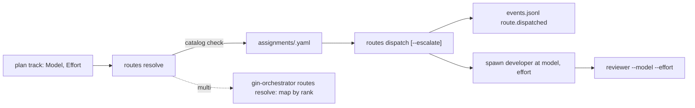

# Plan: model and effort selection per track

Epic: gin-workflow-btt3
Spec: `.planning/specs/2026-10-29-model-effort-selection-design.md`

## Objective

Each plan track names a model and effort from a model catalog in `config.yaml`. `gin-workflow routes resolve` validates them against the catalog and writes them into the assignment manifest. Execute spawns `gin-workflow:developer` at that route for every track and escalates one step on `failed`; review runs at the implementer's final route. gin-orchestrator maps the route by rank onto worker harnesses. Every agent file spawns on Claude Code, and `gin-workflow usage report` splits tokens by main session and subagent.

## Goal

Copied from the spec: each plan track recommends a concrete model and effort, chosen from a model catalog the team shares in configuration. The main session coordinates; implementation, review, and code exploration run in subagents spawned at the model and effort their work needs.

## Architecture

- A new module `workflow_core/catalog.py` owns the catalog: built-in defaults, lookup from the effective config, route validation, tier from rank, rank mapping, and escalation. Every other module calls it; none re-implements rank arithmetic.
- The `models` key is validated by the JSON schema in `schemas.py`; `configuration.py` only exempts `models.<harness>.models` from the concrete-model-name ban.
- The assignment manifest is the single source of a track's route. `gin-workflow routes dispatch` reads it, escalates it in place within the resolved harness's catalog, appends a `route.dispatched` runtime event, and prints the route the skill spawns with. Escalation therefore works the same for the main harness and for worker harnesses.
- gin-orchestrator imports the catalog through the `ext.py` facade (`EXT_VERSION` 2) and keeps only executables in `orchestrator.local.yaml`.
- Skills read routes from the CLI (`routes dispatch`, `reviewer`) and never compute them.



## Tech Stack

Python 3 stdlib, PyYAML and jsonschema (already required by `workflow_core`), unittest, POSIX shell (`install.sh`), PowerShell (`install.ps1`), Markdown skills.

## Global Constraints

Copied from the spec:
- In scope: Claude Code as the main harness, dispatching to native subagents; gin-orchestrator routing worker tracks by the catalog (R10).
- Out of scope: subagent dispatch when the main harness is Codex, Antigravity, OpenCode, or Copilot (epic gin-workflow-dura); a team-shared override layer for configuration; `/quick`, which keeps implementing in the main session; the decks under `docs/presentations/`.
- Concrete model names are allowed only under `models.<harness>.models`. Everywhere else they stay forbidden, and executables and secrets stay forbidden everywhere.
- Unclear requirements never raise the model or effort.
- A requested route is never lowered.
- Manifests already written for open workflows stay valid and are not rewritten.
- Both plugins move to `EXT_VERSION` 2 together.
- gin-console needs no change.

Plan-level rules:
- No commits on `master`. Each track commits on its own branch in its own worktree; the coordinator merges into `feat/btt3-model-selection` in dependency order.
- Before editing, each track runs `gin-workflow rules --files <its files>` and follows the output.
- Every track runs, in its worktree, the tests it names and then the full suite: `PYTHONPATH=plugins/gin-workflow/src/scripts python3 -m unittest tests.test_all`. Expected: `OK`.
- Steps are test first: write the failing test, run it and see it fail, write the code, run it and see it pass.
- This plan still uses the current routing vocabulary (`Reasoning:` and model guidance), because the new one is what it builds.

## Model Guidance
- `default_model_class`: `standard_impl`
- `phase_guidance`:
  - `implement`: `standard_impl`
  - `review`: `high_reasoning`
  - `docs`: `standard_impl`
- `override_rule`: Use `high_reasoning` for the facade, gin-orchestrator, and execute-skill tracks (T3, T4, T7), which cross module or plugin boundaries.

## Requirement Analysis
- Problem statement: the main session does most of the work at the strongest model; the resolved route is never applied at spawn; four agent files carry a tier name as `model:` and fail on Claude Code; two routing vocabularies exist and one is dead.
- Success criteria: spec US-1 to US-12.
- Constraints: see Global Constraints.
- Non-goals: see Global Constraints.

## Approach Options
### Option 1: core first, then the facade consumers, with independent tracks in parallel
- Summary: catalog (T1) → schema 2.9 (T2) → routes and facade (T3) → gin-orchestrator (T4) and skills (T7, T8); agents (T5) and usage (T6) run in parallel from the start; docs (T9) last.
- Pros: each track has its own test cycle; the facade changes once.
- Cons: a four-step chain on the critical path.

### Option 2: one track per plugin
- Summary: one gin-workflow track, one gin-orchestrator track, one docs track.
- Pros: fewer merges.
- Cons: tracks too large to review independently.

### Recommended Approach
- Selected option: Option 1.
- Reasoning: the facade and the catalog are shared contracts; they must land before their consumers, and the tracks that do not touch them can run alongside.

## Scope
- In scope: spec R1 to R11.
- Out of scope: see Global Constraints.

## Execution Strategy

```yaml
execution_strategy:
  mode: worker
  workers:
    mode: parallel
  rationale: Nine tracks; T1, T5, and T6 start in parallel, T4, T7, and T8 run in parallel after T3, each in its own worktree.
```

## Shared interfaces

`plugins/gin-workflow/src/scripts/workflow_core/catalog.py` (T1 creates it; T2, T3, T4 consume it):

```python
@dataclass(frozen=True)
class Catalog:
    models: tuple[str, ...]   # weakest to strongest, non-empty
    efforts: tuple[str, ...]  # lowest to highest, may be empty

DEFAULT_CATALOGS: Mapping[str, Catalog] = MappingProxyType({
    "claude": Catalog(("haiku", "sonnet", "opus"), ("low", "medium", "high", "xhigh", "max")),
    "codex": Catalog(("gpt-6-astra",), ("low", "medium", "high", "xhigh")),
    "antigravity": Catalog(("provider_default",), ()),
    "opencode": Catalog(("provider_default",), ()),
})

def catalog_for(config: Mapping[str, Any], harness: str) -> Catalog
    # config["models"][harness] when present (efforts default to ()), else DEFAULT_CATALOGS[harness];
    # KeyError for an unknown harness.
def route_diagnostics(catalog: Catalog, model: str, effort: str | None) -> list[str]
    # "model 'x' is not in the catalog; allowed: haiku, sonnet, opus"
    # "effort 'x' is not in the catalog; allowed: low, medium, ..."
    # "effort 'x' given, but the catalog lists no efforts"
def tier_of(catalog: Catalog, model: str) -> str
    # one-entry catalog -> "medium"; index 0 -> "low"; last index -> "high"; else "medium"
def map_index(position: int, source_length: int, target_length: int) -> int
    # source_length == 1 -> (target_length - 1) // 2
    # else round half up of position*(target_length-1)/(source_length-1), in integers:
    # (2*position*(target_length-1) + (source_length-1)) // (2*(source_length-1))
def map_route(source: Catalog, target: Catalog, model: str, effort: str | None) -> tuple[str, str | None]
    # model by map_index; effort: None if target.efforts is empty or effort is None;
    # kept by name if in target.efforts; else target.efforts[map_index(source.efforts.index(effort), ...)]
def escalate(catalog: Catalog, model: str, effort: str | None) -> tuple[str, str | None] | None
    # next model at the same effort; at the strongest model the next effort;
    # None at the strongest model with the highest effort, or with effort None
```

Tracks file for `routes resolve` (T3; consumed by the orchestrate skill in T7 and by gin-orchestrator in T4):

```json
[{"task_id": "gin-workflow-btt3.1", "provider_role": "backend", "model": "sonnet", "effort": "medium"}]
```

`effort` is `null` or absent when the main harness's catalog lists no efforts.

Manifest entry (T3 writes; `routes dispatch` and gin-orchestrator read):

```yaml
tracks:
  gin-workflow-btt3.1:
    requested: {provider_role: backend, model: sonnet, effort: medium}
    resolved: {provider: claude, model: sonnet, effort: medium, selection_mode: explicit}
    fallback: []
    escalations: []   # appended by routes dispatch --escalate: {from: {model, effort}, to: {model, effort}, reason}
```

## Tasks

### Track 1: model catalog and its validation
- **Dependencies**: none
- **Files**:
  - Create `plugins/gin-workflow/src/scripts/workflow_core/catalog.py` (the shared interface above)
  - Modify `plugins/gin-workflow/src/scripts/workflow_core/schemas.py:60-95` (add the `models` property)
  - Modify `plugins/gin-workflow/src/scripts/workflow_core/configuration.py:121-166` (exempt `models.<harness>.models` in `_validate_portable`)
  - Modify `plugins/gin-workflow/src/scripts/workflow_core/lifecycle_cli.py:240-258` (state JSON `catalog`)
  - Modify `plugins/gin-workflow/src/examples/config.full.yaml` (a commented `models:` example for `claude`)
  - Test `tests/workflow_core/test_catalog.py` (create)
  - Test `tests/workflow_core/test_configuration.py`
  - Test `tests/workflow_core/test_config_examples.py`
  - Test `tests/workflow_core/test_lifecycle_cli.py`
- **Provider role**: `backend`
- **Reasoning**: `medium`
- **Model guidance**: `standard_impl`
- **Acceptance criteria**: spec US-2; `state --format json` has `catalog: {harness, models, efforts}` for the main harness; `test_catalog.py` covers every function of the interface; named tests and full suite OK.
- **Estimated complexity**: medium

Steps:
1. In `test_catalog.py`, write tests:
   - `catalog_for({}, "claude")` equals `DEFAULT_CATALOGS["claude"]`; `catalog_for({"models": {"claude": {"models": ["sonnet", "opus"]}}}, "claude")` is `Catalog(("sonnet", "opus"), ())`.
   - `route_diagnostics` returns `[]` for `("sonnet", "medium")` on the Claude default, one diagnostic for an unknown model, one for an unknown effort, one for any effort on the Antigravity default.
   - `tier_of`: `haiku` low, `sonnet` medium, `opus` high, `provider_default` medium.
   - `map_index(1, 3, 3) == 1`, `map_index(1, 3, 2) == 1`, `map_index(2, 3, 2) == 1`, `map_index(0, 3, 5) == 0`, `map_index(1, 3, 4) == 2`, `map_index(0, 1, 3) == 1`, `map_index(0, 1, 4) == 1`.
   - `map_route(claude, antigravity3, "sonnet", "medium")` gives the middle Antigravity model and `None` when `antigravity3.efforts` is empty; `map_route(claude, codex, "opus", "max")` gives `("gpt-6-astra", "xhigh")` (rank 4 of 5 maps to index 3 of 4); `map_route(claude, codex, "haiku", "high")` keeps `"high"`.
   - `escalate(claude, "haiku", "low") == ("sonnet", "low")`; `escalate(claude, "opus", "low") == ("opus", "medium")`; `escalate(claude, "opus", "max") is None`; `escalate(antigravity_default, "provider_default", None) is None`.
   Run `PYTHONPATH=plugins/gin-workflow/src/scripts python3 -m unittest tests.workflow_core.test_catalog`. Expected: import error.
2. Create `catalog.py` with the interface above. Run step 1's command. Expected: `OK`.
3. In `test_configuration.py`, add: a config with `models.claude.models: [sonnet, opus]` validates; `models.claude.models: [sonnet, sonnet]` and `models.claude.models: [""]` fail with a message naming `models`; `models.claude: {efforts: [low]}` fails (missing `models`); `models.unknown: {models: [x]}` fails; `models.codex.models: [gpt-6-astra]` validates while `routing.roles.backend.model: gpt-6-astra` still fails. Run `python3 -m unittest tests.workflow_core.test_configuration` (same `PYTHONPATH`). Expected: failures.
4. In `schemas.py` add to `CONFIG_SCHEMA["properties"]`:
   ```python
   "models": {
       "type": "object",
       "propertyNames": {"enum": ["claude", "codex", "antigravity", "opencode"]},
       "additionalProperties": {
           "type": "object",
           "required": ["models"],
           "properties": {
               "models": {"type": "array", "minItems": 1, "uniqueItems": True,
                          "items": {"type": "string", "minLength": 1}},
               "efforts": {"type": "array", "uniqueItems": True,
                           "items": {"type": "string", "minLength": 1}},
           },
           "additionalProperties": False,
       },
   },
   ```
   In `configuration.py` `_validate_portable`, skip the `_MODEL_VALUE` check (line 159) when `len(path) == 4 and path[0] == "models" and path[2] == "models"`, the same way `in_team` exempts team paths. Run step 3's command. Expected: `OK`.
5. In `lifecycle_cli.py`, add `"catalog": {"harness": config.harness, **asdict(catalog_for(config.to_dict(), config.harness))}` to the state payload, with tuples turned into lists. Add a test in `tests/workflow_core/test_lifecycle_cli.py` that `gin-workflow state --format json` prints `catalog.models == ["haiku", "sonnet", "opus"]` for a Claude repository without `models`. Add the `models:` example to `config.full.yaml` and run `tests.workflow_core.test_config_examples`. Expected: `OK`.
6. Full suite; commit `feat(config): model catalog per harness with validation and state JSON`.

### Track 2: schema 2.9, migration, and doctor
- **Dependencies**: Track 1
- **Files**:
  - Modify `plugins/gin-workflow/src/scripts/workflow_core/migrations.py:17,95-133` (`CURRENT_VERSION`, `_migrate_2_8_to_2_9`, `_MIGRATIONS`)
  - Modify `plugins/gin-workflow/src/scripts/workflow_core/configuration.py:27-49,218` (versions, drop `model_tiers` from `BUILT_IN_DEFAULTS`, reject it at 2.9, legacy-routing check for 2.8 and 2.9)
  - Modify `plugins/gin-workflow/src/scripts/workflow_core/schemas.py:10-11` (`SUPPORTED_SCHEMA_VERSION`, `SUPPORTED_CONFIG_VERSIONS`)
  - Modify `plugins/gin-workflow/src/scripts/workflow_core/cli.py:19` (`CLI_VERSION`)
  - Modify `plugins/gin-workflow/src/scripts/workflow_core/setup_service.py:376-392,553-622` (doctor checks; `update` builds catalog entries from local tiers; `rollback` version check)
  - Modify `install.sh:12` and `install.ps1:17` (launcher version)
  - Modify `plugins/gin-workflow/src/examples/config.full.yaml` (`schema_version: "2.9"`, no `model_tiers`)
  - Test `tests/workflow_core/test_migrations.py`
  - Test `tests/workflow_core/test_configuration.py`
- **Provider role**: `backend`
- **Reasoning**: `high`
- **Model guidance**: `standard_impl`
- **Acceptance criteria**: spec R9 and US-11; a 2.8 config with `model_tiers` still loads; doctor reports `model_tiers` and a remaining local `models:`; named tests and full suite OK.
- **Estimated complexity**: medium

Steps:
1. In `test_migrations.py`, add tests:
   - `migrate_config` from 2.8 with `model_tiers` and `routing` gives 2.9 in all three version fields, no `model_tiers`, and `routing` unchanged.
   - `setup_service.update(root, target_version="2.9", approve=False)` on a repository whose `orchestrator.local.yaml` has `providers.codex.models: {low: {model: m1, effort: low}, medium: {model: m1, effort: medium}, high: {model: m2, effort: high}}` and `providers.antigravity.models: {low: a, medium: b, high: b}` previews `configuration.models.codex.models == ["m1", "m2"]` and `configuration.models.antigravity.models == ["a", "b"]`, an action naming `orchestrator.local.yaml`, and writes nothing.
   - The same with `approve=True` writes both entries to `config.yaml`, removes `models:` from each provider in `orchestrator.local.yaml`, keeps `executable`, and writes a backup.
   - A provider already under `models` in `config.yaml` is not overwritten, and its local `models:` is still removed.
   - Doctor: a layer with `model_tiers` yields an action naming `models`; an `orchestrator.local.yaml` with a provider `models:` key yields an action naming `gin-workflow setup update --to-version 2.9 --approve`.
   In `test_configuration.py`: a 2.9 config with `model_tiers` fails with a message naming `models`; a 2.8 config with `model_tiers` passes.
   Run both modules. Expected: failures.
2. Versions: `"2.9"` in `migrations.py:17`, `configuration.py:27-28`, `schemas.py:10`, `cli.py:19`, `install.sh:12`, `install.ps1:17`; append `"2.9"` to `SUPPORTED_CONFIG_VERSIONS`. Remove `model_tiers` from `BUILT_IN_DEFAULTS` (`configuration.py:42-49`). Keep the `model_tiers` schema property so 2.8 configs load; in `validate_portable_config` raise `ConfigValidationError("model_tiers was removed in schema 2.9; list models per harness under models:")` when `schema_version` is `2.9` and `model_tiers` is present. Change `configuration.py:218` to `in ("2.8", "2.9")`.
3. Add `_migrate_2_8_to_2_9`: deep copy, `pop("model_tiers", None)`, set the three version fields to `"2.9"`; register `("2.8", "2.9")`.
4. In `setup_service.update`, when `target_version == "2.9"` and the main checkout's `orchestrator.local.yaml` exists: for each provider with a `models:` mapping and no entry in `migrated["models"]`, build `{"models": [...]}` from the tier targets in `low`, `medium`, `high` order without duplicates (a mapping target contributes its `model`), add an action `"catalog entry for <provider> from orchestrator.local.yaml"`, and add the rewritten local file (every provider without `models:`) to `additional_writes`. Validate `migrated` again after adding entries. Change `rollback` (line 616) to rename back only when the restored version is not in `("2.8", "2.9")`, and doctor line 389 to `not in ("2.8", "2.9")`.
5. Doctor (lines 376-392): add the `model_tiers` action when any configuration layer sets it, and the local `models:` action when `orchestrator.local.yaml` has a provider with `models:`.
6. Update `config.full.yaml`; run the named modules and `tests.workflow_core.test_config_examples`; full suite; commit `feat(config): schema 2.9 drops model_tiers and moves local tier models into the catalog`.

### Track 3: routes, assignments, reviewer, and the facade
- **Dependencies**: Track 2
- **Files**:
  - Modify `plugins/gin-workflow/src/scripts/workflow_core/assignments.py` (whole file: `AssignmentRequest`, `RouteCandidate`, `AssignmentManifest.to_dict`, `validate_plan_assignments`, `resolve_main_harness`)
  - Modify `plugins/gin-workflow/src/scripts/workflow_core/routes.py` (whole file: `resolve`, new `dispatch`, `main`)
  - Modify `plugins/gin-workflow/src/scripts/workflow_core/provider_config.py` (whole file: drop tier models)
  - Modify `plugins/gin-workflow/src/scripts/workflow_core/reviewer.py` (whole file: `--model`, `--effort`)
  - Modify `plugins/gin-workflow/src/scripts/workflow_core/ext.py` (exports, `EXT_VERSION = 2`)
  - Modify `plugins/gin-workflow/src/scripts/workflow_core/setup_service.py:396-397` (`DEFAULT_EXECUTABLES`)
  - Test `tests/workflow_core/test_assignments.py`
  - Test `tests/workflow_core/test_routes_cli.py`
  - Test `tests/workflow_core/test_reviewer.py`
  - Test `tests/workflow_core/test_provider_config.py`
  - Test `tests/workflow_core/test_ext.py`
- **Provider role**: `backend`
- **Reasoning**: `high`
- **Model guidance**: `high_reasoning`
- **Acceptance criteria**: spec R3, R5, US-3, US-6, and the dispatch part of R4 (runtime event, escalation, never lowered); an old manifest with `requested.reasoning` is still read by `routes dispatch`; named tests and full suite OK.
- **Estimated complexity**: high

Interfaces produced:

```python
@dataclass(frozen=True)
class AssignmentRequest:
    task_id: str
    provider_role: str
    model: str
    effort: str | None
    main_harness: str
    workflow_id: str = ""

@dataclass(frozen=True)
class RouteCandidate:
    provider: str
    model: str
    fallback: bool
    effort: str | None = None   # no codex-only check; the catalog decides

def validate_plan_assignments(tasks: Sequence[Mapping[str, Any]], config: Mapping[str, Any]) -> list[str]
    # per track: provider_role configured; "reasoning" without "model" -> "track <id>: reasoning is replaced by model and effort";
    # route_diagnostics(catalog_for(config, harness), model, effort) prefixed "track <id>: "

# provider_config.py
DEFAULT_EXECUTABLES = {"claude": "claude", "codex": "codex", "antigravity": "agy", "opencode": "opencode"}
PROVIDER_DEFAULT = "provider_default"
PROVIDER_DEFAULT_PROVIDERS = frozenset({"antigravity", "opencode"})
@dataclass(frozen=True)
class ProviderModelConfig:
    provider: str
    executable: str
def default_provider_model_config(harness: str) -> ProviderModelConfig

# reviewer.py
def review_route(catalog: Catalog, model: str, effort: str | None, changed: Sequence[str]) -> tuple[str, str | None, str | None]
    # (model, effort, reason): tier_of(model) == "low" and a non-docs file changed and len(models) > 1
    # -> (models[1], effort, "non-docs files changed"); otherwise unchanged
def route(root, base, *, model: str, effort: str | None, implementer: str, config) -> list[dict]
```

CLI produced:
- `gin-workflow routes resolve --workflow-id W --tracks FILE [--repository R] [--json]`: unchanged flags; tracks carry `model` and `effort`; exit 2 lists every diagnostic and writes no manifest.
- `gin-workflow routes dispatch --workflow-id W --task-id T [--escalate REASON] [--repository R] --json`: prints `{"task_id", "provider", "model", "effort", "escalated": bool}` and appends event `route.dispatched` (payload `task_id`, `provider`, `model`, `effort`, `reason`) to `.agent-workflow/runtime/events.jsonl`. With `--escalate`, applies `escalate(catalog_for(config, resolved.provider), ...)` to the manifest entry, records it under `escalations`, and writes the manifest atomically; at the top of both lists it exits 2 with `{"status": "human_decision_required", ...}` and changes nothing.
- `gin-workflow reviewer --base B --implementer P --model M [--effort E] [--repository R] [--json]`: `--tier` removed.

Steps:
1. Tests in `test_assignments.py` and `test_routes_cli.py`:
   - a valid tracks file writes `requested.model`, `requested.effort`, `resolved.model`, `resolved.effort` per track;
   - unknown model, unknown effort, effort on an `antigravity` main harness, and a `reasoning`-only track each give a diagnostic naming the track and the allowed values, exit 2, and no manifest;
   - `effort: "high"` is accepted for `claude` (the old codex-only check is gone);
   - when `orchestrator_client.delegates` is true, the tracks file passed to `gin-orchestrator routes resolve` contains `model` and `effort` (patch `orchestrator_client.call` and read the file it receives);
   - `routes dispatch` prints the manifest route and appends one `route.dispatched` event;
   - `routes dispatch --escalate "tests fail"` on `haiku/low` gives `sonnet/low`, on `opus/max` exits 2 and leaves the manifest unchanged; on a track resolved to `codex` with `gpt-6-astra/high` gives `gpt-6-astra/xhigh` (the worker harness's catalog);
   - `routes dispatch` reads a manifest written in the old shape (`requested.reasoning`).
   Run both modules. Expected: failures.
2. Rewrite `assignments.py` and `routes.py` to the interfaces above, using `catalog.py`. `resolve_main_harness` returns `RouteCandidate(harness, model, False, effort)`. Run step 1's modules. Expected: `OK`.
3. Tests in `test_reviewer.py`: `--model sonnet --effort medium` returns routes at that model and effort; `--model haiku` with a changed `.py` file returns `sonnet` and the reason; with only `.md` changes it stays `haiku`; `--tier` is rejected by argparse (exit 2). Rewrite `reviewer.py`; when delegated, call `gin-orchestrator reviewer --base --implementer --model --effort --repository`. Run. Expected: `OK`.
4. `provider_config.py`: replace `DEFAULT_HARNESS_MODELS`, `REASONING_TIERS`, `CODEX_EFFORT_VALUES`, `TierModelTarget`, and `default_provider_config` with the interface above; `setup_service.py:396-397` uses `DEFAULT_EXECUTABLES[h]`. `ext.py`: `EXT_VERSION = 2`; export `Catalog`, `DEFAULT_CATALOGS`, `catalog_for`, `route_diagnostics`, `tier_of`, `map_route`, `escalate`, `DEFAULT_EXECUTABLES`; stop exporting the removed names. Update `test_provider_config.py` and `test_ext.py` (the export list and `EXT_VERSION == 2`). Run `tests.workflow_core.test_provider_config tests.workflow_core.test_ext`. Expected: `OK`.
5. Full suite (gin-orchestrator tests that import removed names fail until Track 4; run `PYTHONPATH=plugins/gin-workflow/src/scripts python3 -m unittest discover -s tests/workflow_core -t .` instead and note the gin-orchestrator failures in the report). Commit `feat(routes): resolve, dispatch, and review by catalog model and effort`.

### Track 4: gin-orchestrator routes by the catalog
- **Dependencies**: Track 3
- **Files**:
  - Modify `plugins/gin-orchestrator/src/scripts/gin_orchestrator/routes.py` (whole file: `resolve_assignment` maps by rank; `by_tier` from `tier_of`)
  - Modify `plugins/gin-orchestrator/src/scripts/gin_orchestrator/cli.py:61-110,200-215` (`_routes_resolve`, `_reviewer`, `reviewer --model --effort`)
  - Modify `plugins/gin-orchestrator/src/scripts/gin_orchestrator/local_config.py` (whole file: executable only)
  - Modify `plugins/gin-orchestrator/src/scripts/gin_orchestrator/worker_dispatch.py:349-414` (`WorkerRequest.model`, `.effort`; drop `reasoning`, `model_tier`; payload schema version)
  - Modify `plugins/gin-orchestrator/src/scripts/gin_orchestrator/review_coordinator.py:56-91,195-215,305-342` (`ReviewCycle`, `RevisionRequest` carry `model`, `effort`)
  - Modify `plugins/gin-orchestrator/src/scripts/gin_orchestrator/registry.py:182-188,216-224,254-261,329-357` (version tuples with 2.9; `provider_default` check against the catalog; resolver; health check)
  - Modify `plugins/gin-orchestrator/src/scripts/gin_orchestrator/routed_worker.py:105-145,284` (event payload `requested_model`, `requested_effort`)
  - Modify `plugins/gin-orchestrator/src/scripts/gin-orchestrator:10` (`SUPPORTED_EXT_VERSION = 2`)
  - Modify `plugins/gin-orchestrator/src/examples/orchestrator.local.example.yaml` (executables only)
  - Modify `plugins/gin-orchestrator/src/skills/providers/SKILL.md` (catalog in `config.yaml`; local file holds executables)
  - Modify `plugins/gin-orchestrator/src/README.md` (tiers wording; `EXT_VERSION` 2 message)
  - Test `tests/gin_orchestrator/` (`test_routes.py`, `test_local_config.py`, `test_worker_dispatch.py`, `test_review_coordinator.py`, `test_registry.py`, `test_routed_worker.py`, `test_native_cli.py`, `test_end_to_end.py`, `test_worker_scheduler.py`, `test_opencode_worker.py`, `test_worker_adapters.py`, `test_orchestrator_config.py`, `test_contract_v2.py`, `test_circuit_breaker.py`, `test_list_models.py`)
- **Provider role**: `backend`
- **Reasoning**: `high`
- **Model guidance**: `high_reasoning`
- **Acceptance criteria**: spec R10 and US-10; `codex_worker.py:45` passes the mapped effort as `-c model_reasoning_effort=<effort>`; an `orchestrator.local.yaml` with `models:` is rejected with a message naming `gin-workflow setup update --to-version 2.9 --approve`; `tests/gin_orchestrator` and full suite OK.
- **Estimated complexity**: high

Interfaces:
- `resolve_assignment(request: AssignmentRequest, config, local) -> tuple[RouteCandidate, ...]`: source catalog `catalog_for(config, request.main_harness)`; tier `tier_of(source, request.model)` picks `by_tier`; each candidate provider `p` gets `map_route(source, catalog_for(config, p), request.model, request.effort)`; `main_harness` keeps the plan route unchanged.
- `WorkerRequest(..., model: str, effort: str | None, ...)`; payload keys `model`, `effort`, `schema_version: "2.4"`.
- `gin-orchestrator reviewer --base B --implementer P --model M [--effort E] --repository R`: with `independence: provider`, the reviewer provider's route is `map_route` from the implementer's catalog; the independence check uses `tier_of(source, model) != "low"`.

Steps:
1. Tests in `test_routes.py`: Claude catalog `[haiku, sonnet, opus]` and `models.antigravity.models: [a1, a2, a3]`, a `backend` role with `by_tier: {medium: [antigravity]}`: a `sonnet/medium` track resolves to `antigravity/a2/None`; a `haiku` track uses `by_tier.low`; a `codex` target with `opus/max` gets `xhigh`. Run `PYTHONPATH=plugins/gin-workflow/src/scripts:plugins/gin-orchestrator/src/scripts python3 -m unittest discover -s tests/gin_orchestrator -t .`. Expected: failures.
2. Rewrite `routes.py` and `cli.py` `_routes_resolve` (read `model`, `effort` from each track). Run. Expected: route tests pass.
3. `local_config.py`: allowed provider fields are `executable` only; a `models` field raises `ProviderLocalConfigError("orchestrator.local.yaml models moved to models: in config.yaml; run gin-workflow setup update --to-version 2.9 --approve")`; `load_local_config` returns `ProviderModelConfig(name, executable)`. Update `test_local_config.py`.
4. `worker_dispatch.py`, `review_coordinator.py`, `routed_worker.py`, `registry.py`: replace `reasoning` with `model` and `effort` as in the interfaces; the registry resolver builds `AssignmentRequest(task_id, role, model, effort, harness)`; the `provider_default` check reads `catalog_for(config, provider).models`; add `"2.9"` to the version tuples at `registry.py:182,188`. Update the tests that build these objects. Add a test that a Codex worker built from a request with `effort="xhigh"` puts `-c model_reasoning_effort=xhigh` in its argv.
5. `cli.py` `_reviewer` and `reviewer` parser: `--model`, `--effort`; drop `TIERS`. Tests: provider independence maps the route; a `--tier` call exits 2.
6. `SUPPORTED_EXT_VERSION = 2`; a test in `test_contract_v2.py` reads `SUPPORTED_EXT_VERSION` from `plugins/gin-orchestrator/src/scripts/gin-orchestrator` with a regex and asserts it equals `workflow_core.ext.EXT_VERSION`. Update the example YAML, the providers skill, and `README.md`.
7. `tests/gin_orchestrator` and full suite. Expected: `OK`. Commit `feat(orchestrator): route workers by catalog rank; local config keeps executables`.

### Track 5: agent files and installer tool mapping
- **Dependencies**: none
- **Files**:
  - Modify `plugins/gin-workflow/src/agents/developer.md` (drop `model:`; tools add `replace_file_content`, `write_to_file`)
  - Modify `plugins/gin-workflow/src/agents/agent-researcher.md` (tools add `run_command`; prompt allows only read-only commands: `git log`, `git show`, `--help`, `codegraph`)
  - Modify `plugins/gin-workflow/src/agents/code-reviewer.md` (tools add `list_dir`)
  - Modify `plugins/gin-workflow/src/agents/docs-writer.md` (tools add `replace_file_content`, `write_to_file`, `run_command`; prompt limits commands to read-only)
  - Modify `plugins/gin-workflow/src/agents/qa-agent.md` (drop `model:`)
  - Delete `plugins/gin-workflow/src/agents/bead-worker.md`
  - Delete `plugins/gin-workflow/src/agents/solution-architect.md`
  - Modify `install.sh:178-182` (`template_agents_for_claude` maps `replace_file_content` to `Edit`, `write_to_file` to `Write`)
  - Modify `install.ps1:195-199` (the same two replacements)
  - Modify `tests/install_smoke_test.sh:138,144,222,228,292` (assert the deleted agents are absent, `developer.md` exists)
  - Modify `tests/install_smoke_test.ps1:152` (use `developer.md`)
  - Test `tests/workflow_core/test_agent_files.py` (create)
- **Provider role**: `general`
- **Reasoning**: `medium`
- **Model guidance**: `standard_impl`
- **Acceptance criteria**: spec R7 and US-8 (except the manual spawn check, which is in Validation); `test_agent_files.py` and full suite OK; `bash tests/install_smoke_test.sh` passes.
- **Estimated complexity**: low

Steps:
1. Create `test_agent_files.py`:
   - no file under `plugins/*/src/agents/*.md` has a front-matter line matching `^model:`;
   - `bead-worker.md` and `solution-architect.md` do not exist under `plugins/gin-workflow/src/agents/`;
   - `developer.md` lists `replace_file_content` and `write_to_file`; `agent-researcher.md` and `docs-writer.md` list `run_command`; `code-reviewer.md` lists `list_dir`;
   - running the `sed` expression of `template_agents_for_claude` (read from `install.sh` with a regex on the function body) over `developer.md` yields `"Edit"` and `"Write"` and no source tool name.
   Run `PYTHONPATH=plugins/gin-workflow/src/scripts python3 -m unittest tests.workflow_core.test_agent_files`. Expected: failures.
2. Edit the agent files, delete the two agents, extend both installers. Rerun. Expected: `OK`.
3. Grep for the deleted agent names in `plugins/*/src`, `docs`, `README.md`, and `tests`; fix the smoke tests; leave docs for Track 9 and list any hits in the report. Run `bash tests/install_smoke_test.sh`. Expected: exit 0.
4. Full suite; commit `feat(agents): no model lines, edit tools for writers, drop bead-worker and solution-architect`.

### Track 6: usage split by main session and subagent
- **Dependencies**: none
- **Files**:
  - Modify `plugins/gin-workflow/src/scripts/workflow_core/usage_logs.py:19,75-122,124-180` (`UsageRecord.role`; set from `isSidechain`; Codex records `main`)
  - Modify `plugins/gin-workflow/src/scripts/workflow_core/usage.py:189-214,300-336` (`roles` in the summary and the report totals)
  - Modify `plugins/gin-workflow/src/scripts/workflow_core/usage_cli.py:44-60` (`role <role> <model>: ...` lines)
  - Test `tests/workflow_core/test_usage_logs.py`
  - Test `tests/workflow_core/test_usage.py`
  - Test `tests/workflow_core/test_usage_cli.py`
- **Provider role**: `backend`
- **Reasoning**: `medium`
- **Model guidance**: `standard_impl`
- **Acceptance criteria**: spec R8 and US-9; summaries collected before this change (no `roles` key) still render; named tests and full suite OK.
- **Estimated complexity**: low

Interfaces: `UsageRecord(..., cache_write: int, role: str = "main")`; summary key `roles: {"main": {<model>: {input, output, cache_read, cache_write, cost}}, "subagent": {...}}`; report totals gain `roles` with the same shape, summed like `models`.

Steps:
1. Tests: a Claude transcript line with `"isSidechain": true` gives `role == "subagent"`, one without it `main`; `summarize` puts each under `roles`; the report sums `roles` across beads and skips beads without it; the text report prints `role subagent claude-sonnet-5-5: input=... cost=...`. Run the three modules. Expected: failures.
2. Implement. Rerun. Expected: `OK`.
3. Full suite; commit `feat(usage): split tokens and cost by main session and subagent`.

### Track 7: lifecycle skills dispatch at the planned route
- **Dependencies**: Track 3, Track 5
- **Files**:
  - Modify `plugins/gin-workflow/src/skills/execute/SKILL.md` (section 3 replaced by the R4 dispatch loop)
  - Modify `plugins/gin-workflow/src/skills/execute/references/worker-lifecycle.md`, `delegation-policy.md`, `result-contract.md` (status values `done`, `needs_clarification`, `failed`, `blocked`; route from `routes dispatch`)
  - Modify `plugins/gin-workflow/src/skills/review/SKILL.md:16` (`reviewer --model --effort`; spawn `gin-workflow:code-reviewer`)
  - Modify `plugins/gin-workflow/src/skills/discuss/SKILL.md` (code lookups to `gin-workflow:agent-researcher`, R6)
  - Modify `plugins/gin-workflow/src/skills/plan/SKILL.md:20-26` (`Model:`, `Effort:`, `Why:`; R2 rubric; R6 lookups)
  - Modify `plugins/gin-workflow/src/skills/plan/plan-schema.md` (drop "Model Guidance", `Reasoning`, abstract classes; add the three lines and the rubric table)
  - Modify `plugins/gin-workflow/src/skills/orchestrate/SKILL.md:18,22` (tracks file `{task_id, provider_role, model, effort}`)
  - Modify `plugins/gin-workflow/src/skills/gin-review-response/SKILL.md:30` ("same-reasoning" becomes "same route")
  - Modify `plugins/gin-workflow/src/agents/developer.md` (report one status of the four, with evidence)
  - Test `tests/workflow_core/test_skill_routing.py` (create)
  - Test `tests/workflow_core/test_token_budget.py` (unchanged; must pass)
- **Provider role**: `general`
- **Reasoning**: `high`
- **Model guidance**: `high_reasoning`
- **Acceptance criteria**: spec R2, R4, R5 (skill side), R6, US-1, US-4, US-5, US-7; the execute stage chain stays within 12,000 characters (it is 11,905 now, so section 3 must shrink); named tests and full suite OK.
- **Estimated complexity**: high

The execute dispatch loop, written into section 3 of `execute/SKILL.md` in this order:
1. `gin-workflow routes dispatch --workflow-id <w> --task-id <id> --json` gives the route.
2. When `provider` is the main harness, spawn `gin-workflow:developer` with that `model` and `effort` and a bounded context: track text, file scope, `gin-workflow rules` output, worktree path, validation commands. Never the parent transcript or secrets. When `provider` is another harness, dispatch through gin-orchestrator as `references/worker-lifecycle.md` describes today, with the same route.
3. On `done`, check the commits and command output, then request review.
4. On `needs_clarification`, answer from the spec or plan and re-dispatch at the same route with the excerpt; otherwise `gin-workflow notify --event needs_input` and leave the bead `in_progress` with a note.
5. On `failed`, `routes dispatch --escalate "<reason>"` and re-dispatch in the same worktree; on exit 2, ask the user.
6. On `blocked`, ask the user.

Steps:
1. Create `test_skill_routing.py`: `execute/SKILL.md` does not contain `three or fewer` or `Execute directly`, and contains `routes dispatch`, `gin-workflow:developer`, `needs_clarification`, `--escalate`; `review/SKILL.md` contains `--model` and `gin-workflow:code-reviewer` and not `--tier`; `plan/SKILL.md` and `plan-schema.md` contain `Model:`, `Effort:`, `Why:` and none of `Reasoning`, `Model Guidance`, `high_reasoning`, `standard_impl`, `cheap_simple`; `orchestrate/SKILL.md` contains `"model", "effort"` and not `"reasoning"`; `discuss/SKILL.md` and `plan/SKILL.md` contain `gin-workflow:agent-researcher`. Run it. Expected: failures.
2. Edit the skills and references. Keep each change in the skill's existing voice and density; move detail to the `references/` files of execute rather than growing `SKILL.md`.
3. Run `tests.workflow_core.test_skill_routing` and `tests.workflow_core.test_token_budget`. Expected: `OK`. If the budget fails, cut text from execute section 3 or move it to a reference; do not raise the budget.
4. Full suite; commit `feat(skills): plan names model and effort; execute and review spawn at the manifest route`.

### Track 8: tech-doc runs scouts, writers, and reviewers
- **Dependencies**: Track 5
- **Files**:
  - Modify `plugins/gin-workflow/src/skills/tech-doc/SKILL.md` (the R11 roles, routes, runtime notes path, and regrounding with the same roles)
  - Test `tests/workflow_core/test_tech_doc_skill.py` (create)
- **Provider role**: `general`
- **Reasoning**: `medium`
- **Model guidance**: `standard_impl`
- **Acceptance criteria**: spec R11 and US-12 (skill side); the R11 writer table appears in the skill; named test, `test_token_budget`, and full suite OK.
- **Estimated complexity**: medium

Steps:
1. Create `test_tech_doc_skill.py`: `tech-doc/SKILL.md` names `gin-workflow:agent-researcher` and `gin-workflow:docs-writer`, contains `.agent-workflow/runtime/tech-doc/`, `routing.review.max_cycles`, `Inference And Uncertainty`, and each of `STACK`, `API`, `ARCHITECTURE`, `CONCERNS` next to its route (weakest, middle, strongest). Run it. Expected: failures.
2. Rewrite the steps of `tech-doc/SKILL.md`: the main session agrees scope, runs `codegraph files` (or a directory listing without `.codegraph/`) once, splits areas, picks routes from `gin-workflow state --format json` `catalog`; scouts per area write notes to `.agent-workflow/runtime/tech-doc/<run>/`; one writer per document by the R11 table, `FEATURES.md` after `API.md`; a fresh `agent-researcher` reviewer per document at the middle model and `medium`; the writer fixes findings within `routing.review.max_cycles`; a failed writer escalates as in execute; regrounding uses the same roles, one writer per page.
3. Run the new test and `test_token_budget`. Expected: `OK`. Full suite; commit `feat(tech-doc): scouts, writers, and reviewers at catalog routes`.

### Track 9: documentation
- **Dependencies**: Track 4, Track 6, Track 7, Track 8
- **Files**:
  - Modify `docs/concepts/providers.md`
  - Modify `docs/concepts/architecture.md`
  - Modify `docs/concepts/lifecycle.md`
  - Modify `docs/concepts/state-model.md`
  - Modify `docs/reference/config.md` (versions 2.9; `models` key; drop `model_tiers`; `orchestrator.local.yaml` executables only; 2.9 migration)
  - Modify `docs/reference/cli.md` (`routes dispatch`; `reviewer --model --effort`; tracks file; usage roles)
  - Modify `docs/reference/orchestrator-contract.md` (tracks file fields; `reviewer` flags; worker payload `model`, `effort`, schema version)
  - Modify `docs/guides/use-cases.md`
  - Modify `docs/orchestrator/README.md`
  - Modify `docs/orchestrator/routing.md`
- **Provider role**: `docs`
- **Reasoning**: `high`
- **Model guidance**: `high_reasoning`
- **Acceptance criteria**: each page drops `Reasoning`, `model_tiers`, and the abstract classes and describes the catalog where it describes routing; every changed claim is checked against the merged code with `file:line`; `cli.md` keeps a heading per subcommand; `tests.workflow_core.test_docs_coverage` and full suite OK.
- **Estimated complexity**: medium

Steps:
1. `grep -rn "reasoning\|Reasoning\|model_tiers\|high_reasoning\|standard_impl\|cheap_simple\|--tier\|bead-worker\|solution-architect\|providers.local\|models: {low" docs README.md` and list every hit.
2. Rewrite each hit following `gin-workflow rules --files <pages>` and `plugins/gin-workflow/src/references/docs-style.md`, checking each claim against the merged code.
3. Run `tests.workflow_core.test_docs_coverage` and the full suite. Expected: `OK`. Commit `docs: model catalog, route dispatch, and schema 2.9`.

## Integration
- **Branch**: `feat/btt3-model-selection`, from `master` after the spec branch `spec/btt3-model-selection` is merged into it.
- **Merge strategy**: parallel-then-merge. Merge order: T1, T5, T6 (any order), T2, T3, then T4, T7, T8 (any order), then T9. T2 and T5 both edit `install.sh` and `install.ps1` in different hunks.

## Validation
- [ ] Full suite on the integration branch: `PYTHONPATH=plugins/gin-workflow/src/scripts python3 -m unittest tests.test_all` prints `OK`.
- [ ] `bash tests/install_smoke_test.sh` exits 0.
- [ ] `./install.sh --platform all`, then in this repository `gin-workflow setup update --to-version 2.9` previews the removal of `model_tiers` and catalog entries from `orchestrator.local.yaml`; apply with `--approve` after the user agrees.
- [ ] `gin-workflow setup doctor` reports no `model_tiers` and no local `models:`.
- [ ] By hand on Claude Code: spawn `gin-workflow:developer`, `agent-researcher`, `code-reviewer`, `qa-agent`, and `docs-writer` with an explicit catalog model; each starts without `model_not_found`.
- [ ] `gin-workflow state --format json` shows `catalog` for `claude`.

## Notes
- Track beads close after tests and review pass; only the epic gin-workflow-btt3 waits for the human-confirmed merge.
- The spec's testing section places the worker-harness escalation test under `tests/gin_orchestrator/`; this plan escalates in `routes dispatch` (core), so the test lives in `test_routes_cli.py` (Track 3) with a track resolved to `codex`.
- The `model_tiers` schema property stays so that 2.8 configurations keep loading until migrated; a 2.9 configuration with the key is rejected.
