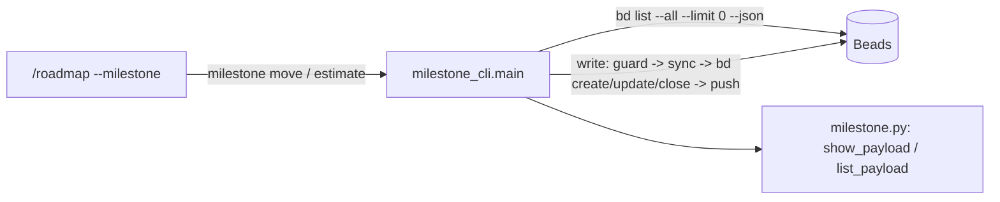

# Plan: milestones (model, scheduler, CLI, roadmap adoption)

Epic: gin-workflow-6cji
Spec: `.planning/specs/2026-10-30-milestones-design.md`
Input contract: `gin-harness/docs/changes/gin-harness-6s4-milestones/spec-delta.md` and `design.md` (commit b4ce341)

## Objective

`gin-workflow milestone create|update|kickstart|move|estimate|close|list|show` manages dated milestones in Beads. `list` and `show` print the `schema: 1` JSON of the input contract with a working-day schedule and warnings. In team mode, writes are role-gated and synced without ever resetting local Beads. `task ready` never lists a milestone. `/roadmap --milestone <id>` proposes estimates and adopts existing roadmap epics.

## Goal

Copied from the spec: a PM creates a dated milestone, attaches roadmap epics with estimates, and reads the computed schedule and warnings from `gin-workflow milestone list|show --json`, which gin-console consumes.

## Architecture

- `workflow_core/milestone.py` holds pure functions over `bd list --json` rows: status, estimate rounding, working-day arithmetic, the schedule, and the `list`/`show` payloads. It never calls `bd` or reads the clock.
- `workflow_core/milestone_cli.py` holds argparse, the config load and backend gate, Beads reads (one `bd list --all --limit 0 --json`) and writes, and, in team mode, the role check plus pull/push around each write.
- `cli.py` dispatches `milestone` to `milestone_cli.main`.
- `team_beads.push` pushes without resetting. `team.py` and `schemas.py` carry `team.permissions.milestone`.
- `tasks.py` and `team_beads.ready` add `--exclude-type milestone` to `bd ready`.
- The roadmap skill calls only `gin-workflow milestone ...` and `gin-workflow task ...`.



## Tech Stack

Python 3 stdlib (`argparse`, `datetime`, `json`, `math`, `subprocess`), jsonschema (already used by `schemas.py`), unittest, bd 1.0.5, Markdown skills and templates.

## Global Constraints

Copied from the spec:
- In scope: REQ-MILESTONE-001..017.
- Out of scope: gin-console pages and REQ-MILESTONE-UI-*; migrating existing projects; moving `team claim` and `team reassign` onto the push helper without reset (team hardening does that); a `setup doctor` check for the milestone type.
- `milestone` is a built-in bd 1.0.5 type; no `types.custom` registration.
- Milestones never carry labels.
- The JSON contract is additive-only under `schema: 1`.
- Exit codes: 0 success, including schedules with warnings; 1 every domain error, every `bd` error, the non-Beads backend, and sync failures; 2 the team role check and argparse usage errors.
- Skills never name `bd` directly (`tests/test_no_direct_bd.py`).

Plan-level rules:
- No commits on `master`. Each track commits on its own branch in its own worktree. The coordinator merges into `feat/6cji-milestones` in dependency order.
- Before editing, each track runs `gin-workflow rules --files <its files>` and follows the output.
- Every track runs, in its worktree, the tests it names and then the full suite. Expected result: `OK`.
  - Full suite: `PYTHONPATH=plugins/gin-workflow/src/scripts python3 -m unittest tests/test_all.py`
  - One file: `PYTHONPATH=plugins/gin-workflow/src/scripts python3 -m unittest tests/workflow_core/<file>.py`
- Steps are test first: write the failing test, run it and see it fail, write the code, run it and see it pass.
- Every new test method's docstring or name carries its REQ-ID (for example `test_req_007_chain_and_parallel`).

Decisions this plan takes inside the spec:
- `milestone_cli` loads the config like `team_cli._run` (`resolve_effective_config(root, write=False)`) and gates with `tasks.backend_name(config)`. This is one config load, it works in team test repositories without a generated effective config, and it reads the same `providers.task_tracking` value as `tasks.backend`.
- The "golden JSON" of the spec is an exact expected `dict` in the test (`assertEqual` on the whole payload) rather than a separate file. Created beads get fixed ids through `bd create --id`.
- `milestone_cli` has its own `_bd` helper rather than `team_beads._bd`, because `team_beads._bd` raises `TeamError` for a missing `bd`, which would map to exit 2 instead of 1.

## Route Rubric
- Choose the weakest model that can do the work.
- Raise the model for broad context or design judgement.
- Raise the effort for intrinsic difficulty: intricate logic, many edge cases, or long chains of steps.

| Kind of work | Model | Effort |
|---|---|---|
| Mechanical edits, documentation, boilerplate | weakest | `low` |
| Bounded implementation with a clear spec | middle | `medium` |
| Cross-module change, security, migration, concurrency | strongest | `high` |

Unclear requirements never raise the model or effort.

## Requirement Analysis
- **Problem statement:** Beads has no dated grouping of roadmap epics, so there is no schedule, overrun warning, or carry-over between rounds of work.
- **Success criteria:**
  - every scenario of REQ-MILESTONE-001..012 and 014..016 passes as an automated test;
  - REQ-MILESTONE-013 and 017 pass the hand check in Track 4;
  - the full suite is `OK`.
- **Constraints:** see Global Constraints.
- **Non-goals:** see Global Constraints, Out of scope.

## Approach Options
### Option 1: four sequential tracks
- **Summary:**
  1. Scheduler and reads.
  2. Writes and `task ready`.
  3. Permissions and sync.
  4. Roadmap skill and docs.
- **Pros:**
  - Each track has its own test cycle and can be rejected on its own.
  - Tracks 2 and 3 split the plain CLI from the security/sync path, as review note (5) asked.
- **Cons:** Tracks 1–3 all edit `milestone_cli.py`, so they cannot run in parallel.

### Option 2: tracks per file with parallel workers
- **Summary:** scheduler, CLI, team, and docs as parallel tracks against fixed interfaces.
- **Pros:** shorter wall-clock time.
- **Cons:**
  - The CLI track would depend on unmerged scheduler and team code.
  - Merge conflicts in `milestone_cli.py`.
  - The tracks are not independently testable.

### Recommended Approach
- **Selected option:** Option 1.
- **Rationale:** the work is about 600 lines of code and tests, mostly in one new module pair. Ordering by dependency keeps every track green on its own.

## Scope
- **In scope:** spec R2–R10, that is REQ-MILESTONE-001..017.
- **Out of scope:** see Global Constraints.

## Execution Strategy

```yaml
execution_strategy:
  mode: direct
  workers:
    mode: sequential
  rationale: Tracks 1-3 each extend milestone_cli.py and Track 4 documents the finished commands, so every track depends on the previous one.
```

## Shared interfaces

`plugins/gin-workflow/src/scripts/workflow_core/milestone.py`, created in Track 1 and used unchanged by Tracks 2–4:

```python
SCHEMA = 1
WORKDAY_MINUTES = 480

class CycleError(ValueError): ...                       # message "dependency cycle: a -> b -> a"

def parse_date(text: str) -> date                       # ValueError "not an ISO date (YYYY-MM-DD): <text>"
def period(milestone: Mapping[str, Any]) -> tuple[date, date]   # (start, end); ValueError "<id> has no start/end metadata"
def status(milestone: Mapping[str, Any], today: date) -> str    # closed | planned | scheduled | active
def estimate_days(minutes: Any) -> int | None           # ceil(minutes / 480); None unless minutes > 0
def workdays_after(end: date, finish: date) -> int      # Mon-Fri days d with end < d <= finish
def epics_of(milestone_id: str, beads: Mapping[str, Mapping[str, Any]]) -> list[Mapping[str, Any]]
def schedule(milestone, beads, start: date, today: date) -> dict   # {"finish", "overflow_days", "epics": [row, ...]}
def show_payload(milestone, beads, start: date | None, today: date) -> dict
def list_payload(beads, today: date, include_closed: bool) -> dict
```

`beads` is `{bead["id"]: bead}` built from `bd list --all --limit 0 --json`. The bd 1.0.5 row keys used are:
- `id`, `title`, `description`, `status`, `issue_type`, `parent`, `labels`, `estimated_minutes`;
- `metadata`, a dict;
- `dependencies`, a list of `{"issue_id", "depends_on_id", "type"}` where `type` is `blocks` or `parent-child`.

`plugins/gin-workflow/src/scripts/workflow_core/milestone_cli.py`:

```python
class MilestoneError(Exception): ...   # exit 1
class Denied(Exception): ...           # exit 2 (Track 3)

def _today() -> date                   # date.today(); tests patch it
def main(arguments: Sequence[str]) -> int
```

## Tasks

### Track 1: scheduler, JSON payloads, and read commands
- **Dependencies**: none
- **Files**:
  - Create `plugins/gin-workflow/src/scripts/workflow_core/milestone.py`
  - Create `plugins/gin-workflow/src/scripts/workflow_core/milestone_cli.py` (parser for all eight commands; `list`, `show`, the backend gate)
  - Modify `plugins/gin-workflow/src/scripts/workflow_core/cli.py:20-21,88-106` (`"milestone"` in `TOP_COMMANDS` and a dispatch branch)
  - Test `tests/workflow_core/test_milestone.py` (create)
  - Test `tests/workflow_core/test_milestone_cli.py` (create)
- **Provider role**: `backend`
- **Model:** `sonnet`
- **Effort:** `high`
- **Why:** a bounded new module with a precise spec, but the scheduler has intricate date logic and many edge cases (weekends, unestimated dependencies, overflow counting, cycles), which raises the effort.
- **Acceptance criteria**:
  - REQ-MILESTONE-004, 007, 008, 009, 011, 014 pass, along with the `list` part of spec US-4.
  - `gin-workflow milestone show --json` and `list --json` match the input contract's field set exactly.
  - Named tests and the full suite are `OK`.
- **Estimated complexity**: medium

Steps:
1. In `tests/workflow_core/test_milestone.py`, import `milestone` with `SCRIPTS` on `sys.path`, as `test_tasks.py` does. Build beads with a helper:
   ```python
   def bead(id, *, type="epic", status="open", parent=None, minutes=None, blocks=(), labels=(), meta=None, title=""):
       return {"id": id, "title": title or id, "description": "", "status": status, "issue_type": type,
               "parent": parent, "labels": list(labels), "estimated_minutes": minutes, "metadata": meta or {},
               "dependencies": [{"issue_id": id, "depends_on_id": d, "type": "blocks"} for d in blocks]}
   ```
   `M = bead("m1", type="milestone", meta={"start": "2026-11-02", "end": "2026-12-18"})`. Write these tests; the dates are those of the input contract scenarios:
   - REQ-007 chain and parallel: from `2026-11-02`, A 3 days, B 2 days blocked by A, C 4 days. Expected: A `2026-11-02..2026-11-04`, B `2026-11-05..2026-11-06`, C `2026-11-02..2026-11-05`.
   - REQ-007 weekend: from Thursday `2026-11-05`, A 3 days. Expected: `2026-11-05..2026-11-09`.
   - REQ-007 schedule start on Saturday `2026-11-07`: A starts `2026-11-09`.
   - REQ-007 unestimated dependency: U unestimated, A 2 days, B 1 day blocked by U and A. Expected: U `11-02..11-02`, A `11-02..11-03`, B `11-04..11-04`.
   - REQ-007 a dependency on a bead outside the milestone does not move `planned_start`.
   - REQ-008 overflow: milestone `end=2026-11-04`, epic ending `2026-11-06`. Expected: `{"code": "overflow", "days": 2}`, and `schedule(...)["overflow_days"] == 2`.
   - REQ-008 overflow with `end` on Saturday `2026-11-07` and finish Monday `2026-11-09`: 1 day. With finish on or before `end`: no warning and `overflow_days == 0`.
   - REQ-008 `late`:
     - present when `kickoff` is on or before today, the epic is open, and `planned_end < today`;
     - absent for a closed epic;
     - absent without `kickoff` (input scenario "no late before kick-start": `start=2026-10-01`, today `2026-10-29`).
   - REQ-008 `unestimated`, for `minutes=None` and for `minutes=0`.
   - REQ-008 `external_blocker`:
     - E1 in m1 blocked by open E9 whose parent is milestone m2. Expected: warning `{"code": "external_blocker"}` and `external_depends_on == [{"id": "E9", "milestone": "m2"}]`.
     - With E9 closed: listed, no warning.
     - With E9 parentless: `"milestone": None`.
     - A dependency `external:proj:cap`: not listed.
   - Cycle: A blocked by B, B blocked by A. Expected: `CycleError` whose message contains `A -> B -> A` or `B -> A -> B`.
   - REQ-004 `status`: `planned`, `scheduled` (kickoff after today), `active` (kickoff == today), and `closed` (closed bead with kickoff).
   - REQ-006 `estimate_days`: `2400 → 5`, `2401 → 6`, `None`/`0`/`-5 → None`.
   - REQ-009 `show_payload(M, beads, date(2026, 11, 16), today)` has `schedule_start "2026-11-16"` and `preview True`. Without `start`: `schedule_start` is `kickoff` when set, else `start`, and `preview False`.
   - REQ-011 `show_payload` full shape: `assertEqual` against a complete dict with keys `schema, id, title, description, status, start, end, kickoff, schedule_start, preview, today, finish, overflow_days, epics`. Each epic row has `id, title, status, estimate_days, planned_start, planned_end, depends_on, external_depends_on, warnings`. With no epics, `finish` is `None` and `overflow_days` is `0`.
   - REQ-011 `list_payload`:
     - m1 with 6 open epics; 3 open `roadmap` epics without parent; 1 closed `roadmap` epic; 1 `task` labelled `roadmap` with parent `e1` (an inherited label). Expected: `epics == {"total": 6, "closed": 0}` and `unassigned_epics == 3`.
     - A closed milestone is omitted unless `include_closed`.
     - A milestone whose epics cycle has `error` containing `dependency cycle`, and `finish`/`warnings` `None`; the other milestone is normal.
     - A milestone without `end` metadata has an `error`.

   Run `PYTHONPATH=plugins/gin-workflow/src/scripts python3 -m unittest tests/workflow_core/test_milestone.py`. Expected: `ModuleNotFoundError`.
2. Create `milestone.py`:
   ```python
   """Milestone status and working-day schedule: pure functions over `bd list --json` rows."""

   from __future__ import annotations

   from datetime import date, timedelta
   import math
   from typing import Any, Mapping

   SCHEMA = 1
   WORKDAY_MINUTES = 480
   Beads = Mapping[str, Mapping[str, Any]]


   class CycleError(ValueError):
       """The milestone's epics block each other in a loop."""


   def parse_date(text: str) -> date:
       try:
           return date.fromisoformat(str(text))
       except ValueError:
           raise ValueError(f"not an ISO date (YYYY-MM-DD): {text}") from None


   def _meta(bead: Mapping[str, Any]) -> Mapping[str, Any]:
       meta = bead.get("metadata")
       return meta if isinstance(meta, Mapping) else {}


   def period(milestone: Mapping[str, Any]) -> tuple[date, date]:
       meta = _meta(milestone)
       if not meta.get("start") or not meta.get("end"):
           raise ValueError(f"{milestone['id']} has no start/end metadata")
       return parse_date(meta["start"]), parse_date(meta["end"])


   def status(milestone: Mapping[str, Any], today: date) -> str:
       if milestone.get("status") == "closed":
           return "closed"
       kickoff = _meta(milestone).get("kickoff")
       if not kickoff:
           return "planned"
       return "scheduled" if parse_date(kickoff) > today else "active"


   def estimate_days(minutes: Any) -> int | None:
       if isinstance(minutes, (int, float)) and not isinstance(minutes, bool) and minutes > 0:
           return math.ceil(minutes / WORKDAY_MINUTES)
       return None


   def _workday(day: date) -> date:
       """The first working day (Monday to Friday) on or after `day`."""
       while day.weekday() >= 5:
           day += timedelta(days=1)
       return day


   def _last_of(start: date, days: int) -> date:
       """The last of `days` consecutive working days beginning on the working day `start`."""
       for _ in range(days - 1):
           start = _workday(start + timedelta(days=1))
       return start


   def workdays_after(end: date, finish: date) -> int:
       count, day = 0, end + timedelta(days=1)
       while day <= finish:
           count += day.weekday() < 5
           day += timedelta(days=1)
       return count


   def _blocks(bead: Mapping[str, Any]) -> list[str]:
       return [str(dep["depends_on_id"]) for dep in bead.get("dependencies") or []
               if dep.get("type") == "blocks" and not str(dep.get("depends_on_id", "")).startswith("external:")]


   def epics_of(milestone_id: str, beads: Beads) -> list[Mapping[str, Any]]:
       return [bead for bead in beads.values() if bead.get("parent") == milestone_id and bead.get("issue_type") == "epic"]


   def _milestone_of(bead: Mapping[str, Any], beads: Beads) -> str | None:
       parent = bead.get("parent")
       return parent if parent and (beads.get(parent) or {}).get("issue_type") == "milestone" else None


   def schedule(milestone: Mapping[str, Any], beads: Beads, start: date, today: date) -> dict[str, Any]:
       _, end = period(milestone)
       epics = {epic["id"]: epic for epic in epics_of(milestone["id"], beads)}
       first = _workday(start)
       planned: dict[str, tuple[date, date]] = {}

       def visit(epic_id: str, path: list[str]) -> tuple[date, date]:
           if epic_id in planned:
               return planned[epic_id]
           if epic_id in path:
               loop = path[path.index(epic_id):] + [epic_id]
               raise CycleError("dependency cycle: " + " -> ".join(loop))
           begin = first
           for dep in _blocks(epics[epic_id]):
               if dep in epics:
                   dep_start, dep_end = visit(dep, path + [epic_id])
                   estimated = estimate_days(epics[dep].get("estimated_minutes")) is not None
                   begin = max(begin, _workday(dep_end + timedelta(days=1)) if estimated else dep_start)
           days = estimate_days(epics[epic_id].get("estimated_minutes"))
           planned[epic_id] = (begin, _last_of(begin, days) if days else begin)
           return planned[epic_id]

       for epic_id in sorted(epics):
           visit(epic_id, [])
       active = status(milestone, today) == "active"
       rows = []
       for epic_id in sorted(epics, key=lambda item: (planned[item][0], item)):
           epic = epics[epic_id]
           begin, finish = planned[epic_id]
           days = estimate_days(epic.get("estimated_minutes"))
           outside = [beads[dep] for dep in _blocks(epic) if dep not in epics and dep in beads]
           warnings: list[dict[str, Any]] = []
           if overflow := workdays_after(end, finish):
               warnings.append({"code": "overflow", "days": overflow})
           if active and epic.get("status") != "closed" and finish < today:
               warnings.append({"code": "late"})
           if days is None:
               warnings.append({"code": "unestimated"})
           if any(bead.get("status") != "closed" for bead in outside):
               warnings.append({"code": "external_blocker"})
           rows.append({
               "id": epic_id, "title": epic.get("title", ""), "status": epic.get("status"), "estimate_days": days,
               "planned_start": begin.isoformat(), "planned_end": finish.isoformat(),
               "depends_on": sorted(dep for dep in _blocks(epic) if dep in epics),
               "external_depends_on": [{"id": bead["id"], "milestone": _milestone_of(bead, beads)}
                                       for bead in sorted(outside, key=lambda bead: bead["id"])],
               "warnings": warnings,
           })
       last = max((dates[1] for dates in planned.values()), default=None)
       return {"finish": last.isoformat() if last else None,
               "overflow_days": workdays_after(end, last) if last else 0, "epics": rows}


   def show_payload(milestone: Mapping[str, Any], beads: Beads, start: date | None, today: date) -> dict[str, Any]:
       meta = _meta(milestone)
       begin, _ = period(milestone)
       schedule_start = start or (parse_date(meta["kickoff"]) if meta.get("kickoff") else begin)
       return {"schema": SCHEMA, "id": milestone["id"], "title": milestone.get("title", ""),
               "description": milestone.get("description") or "", "status": status(milestone, today),
               "start": meta["start"], "end": meta["end"], "kickoff": meta.get("kickoff"),
               "schedule_start": schedule_start.isoformat(), "preview": start is not None, "today": today.isoformat(),
               **schedule(milestone, beads, schedule_start, today)}


   def list_payload(beads: Beads, today: date, include_closed: bool) -> dict[str, Any]:
       entries = []
       milestones = [bead for bead in beads.values() if bead.get("issue_type") == "milestone"]
       for milestone in sorted(milestones, key=lambda bead: (str(_meta(bead).get("start", "")), bead["id"])):
           if milestone.get("status") == "closed" and not include_closed:
               continue
           meta = _meta(milestone)
           epics = epics_of(milestone["id"], beads)
           entry = {"id": milestone["id"], "title": milestone.get("title", ""), "status": status(milestone, today),
                    "start": meta.get("start"), "end": meta.get("end"), "kickoff": meta.get("kickoff"),
                    "finish": None, "epics": {"total": len(epics),
                                              "closed": sum(epic.get("status") == "closed" for epic in epics)},
                    "warnings": None, "error": None}
           try:
               begin, _ = period(milestone)
               start = parse_date(meta["kickoff"]) if meta.get("kickoff") else begin
               plan = schedule(milestone, beads, start, today)
               entry["finish"] = plan["finish"]
               entry["warnings"] = sum(len(row["warnings"]) for row in plan["epics"])
           except ValueError as error:  # CycleError included
               entry["error"] = str(error)
           entries.append(entry)
       unassigned = sum(1 for bead in beads.values()
                        if bead.get("issue_type") == "epic" and "roadmap" in (bead.get("labels") or [])
                        and bead.get("status") != "closed" and not bead.get("parent"))
       return {"schema": SCHEMA, "milestones": entries, "unassigned_epics": unassigned, "today": today.isoformat()}
   ```
   Run step 1's command. Expected: `OK`.
3. In `tests/workflow_core/test_milestone_cli.py`, create the class `MilestoneCliTests`, decorated `@unittest.skipUnless(shutil.which("bd"), "bd is not installed")`, with these fixtures:
   - **`setUpClass`:** builds one template repository with `.claude/`, `git init -q`, an empty commit, and `gin-workflow setup init --harness claude --non-interactive --approve --set providers.task_tracking=beads`. Use the `gw` helper and `ENV` from `test_tasks.py` (copy them; they are module-private there).
   - **`setUp`:** `shutil.copytree(template, root)` and then `bd init --prefix t -q`, with `stdin=subprocess.DEVNULL` and `timeout=60`.
   - **Helpers:**
     - `bd(*args)`, which returns stdout;
     - `run(*argv)`, which calls `milestone_cli.main([*argv, "--repository", str(self.root)])` inside `contextlib.redirect_stdout`/`redirect_stderr`, with `mock.patch.object(milestone_cli, "_today", return_value=self.today)`, and returns `(code, stdout, stderr)`;
     - `today = date(2026, 10, 29)`.

   Tests:
   - REQ-011 `show` exact payload: create milestone `t-m1` with `bd create M1 --id t-m1 --type milestone --metadata '{"start":"2026-11-02","end":"2026-11-04"}'`, then epics `t-a` (`--estimate 1440`) and `t-b` (`--estimate 960`, `bd dep add t-b t-a`), both `--parent t-m1`. `json.loads` of `show t-m1 --json` equals the complete expected dict:
     - `t-a` `2026-11-02..2026-11-04`;
     - `t-b` `2026-11-05..2026-11-06` with overflow 2;
     - `finish 2026-11-06`, `overflow_days 2`, `status planned`, `preview False`, `today 2026-10-29`.
   - REQ-011 `list` exact payload for the same database: one entry with `epics {"total": 2, "closed": 0}`, `warnings 1`, `unassigned_epics 0`.
   - REQ-009: `show t-m1 --start 2026-11-16 --json` gives `preview true` and `schedule_start 2026-11-16`; the `bd show t-m1 --json` metadata is unchanged.
   - REQ-011 cycle: add epics with `bd dep add` both ways under `t-m2`. `show t-m2 --json` exits 1 and stderr contains `dependency cycle`; `list --json` exits 0 with `error` on `t-m2` only.
   - `show` of an unknown id or of an epic id exits 1 naming the id.
   - REQ-014: in a repository copied from a second template built without `--set providers.task_tracking=beads`, `list --json` exits 1 and stderr contains `providers.task_tracking: beads`.

   Run `PYTHONPATH=plugins/gin-workflow/src/scripts python3 -m unittest tests/workflow_core/test_milestone_cli.py`. Expected: import error.
4. Create `milestone_cli.py` with the full parser and the read commands:
   ```python
   """`gin-workflow milestone`: dated milestones over roadmap epics. Exit 0 ok, 1 refused or failed, 2 usage or role."""

   from __future__ import annotations

   import argparse
   from datetime import date
   import json
   import os
   from pathlib import Path
   import shutil
   import subprocess
   import sys
   from typing import Any, Sequence

   from . import milestone as core


   class MilestoneError(Exception):
       """Refused or failed request: exit 1."""


   def _today() -> date:
       return date.today()


   def _parser() -> argparse.ArgumentParser:
       common = argparse.ArgumentParser(add_help=False)
       common.add_argument("--repository", type=Path, default=Path.cwd())
       parser = argparse.ArgumentParser(prog="gin-workflow milestone")
       sub = parser.add_subparsers(dest="command", required=True)
       item = sub.add_parser("create", parents=[common])
       item.add_argument("title")
       item.add_argument("--start", required=True)
       item.add_argument("--end", required=True)
       item = sub.add_parser("update", parents=[common])
       item.add_argument("id")
       item.add_argument("--title")
       item.add_argument("--start")
       item.add_argument("--end")
       item = sub.add_parser("kickstart", parents=[common])
       item.add_argument("id")
       item.add_argument("--date")
       item = sub.add_parser("move", parents=[common])
       item.add_argument("epics", nargs="+")
       item.add_argument("--to", required=True)
       item = sub.add_parser("estimate", parents=[common])
       item.add_argument("epic")
       item.add_argument("days")
       sub.add_parser("close", parents=[common]).add_argument("id")
       item = sub.add_parser("list", parents=[common])
       item.add_argument("--all", action="store_true")
       item.add_argument("--json", action="store_true")
       item = sub.add_parser("show", parents=[common])
       item.add_argument("id")
       item.add_argument("--start")
       item.add_argument("--json", action="store_true")
       return parser


   def _config(root: Path) -> dict[str, Any]:
       from .configuration import resolve_effective_config
       from .tasks import backend_name

       if not (root / ".agent-workflow/config.yaml").is_file():
           raise MilestoneError("gin-workflow setup is required; run /setup once")
       config = resolve_effective_config(root, write=False).config.to_dict()
       if backend_name(config) != "beads":
           raise MilestoneError("milestones need providers.task_tracking: beads")
       return config


   def _bd(root: Path, argv: list[str], actor: str = "") -> str:
       executable = shutil.which("bd")
       if executable is None:
           raise MilestoneError("bd is not installed")
       env = {**os.environ, "BD_ACTOR": actor} if actor else None
       done = subprocess.run([executable, *argv], cwd=root, text=True, capture_output=True, check=False,
                             env=env, stdin=subprocess.DEVNULL, timeout=120)
       if done.returncode != 0:
           raise MilestoneError(f"bd {argv[0]} failed: {(done.stderr or done.stdout).strip()}")
       return done.stdout


   def _beads(root: Path) -> dict[str, dict[str, Any]]:
       rows = json.JSONDecoder().raw_decode(_bd(root, ["list", "--all", "--limit", "0", "--json"]).lstrip())[0]
       return {row["id"]: row for row in rows}


   def _milestone(beads: dict[str, dict[str, Any]], bead_id: str) -> dict[str, Any]:
       bead = beads.get(bead_id)
       if bead is None:
           raise MilestoneError(f"{bead_id} not found")
       if bead.get("issue_type") != "milestone":
           raise MilestoneError(f"{bead_id} is not a milestone")
       return bead


   def _date(text: str) -> date:
       try:
           return core.parse_date(text)
       except ValueError as error:
           raise MilestoneError(str(error)) from None


   def _list_text(payload: dict[str, Any]) -> str:
       lines = []
       for entry in payload["milestones"]:
           detail = (f"error: {entry['error']}" if entry["error"] else
                     f"epics {entry['epics']['closed']}/{entry['epics']['total']}  warnings {entry['warnings']}")
           lines.append(f"{entry['id']}  {entry['status']:<9} {entry['start']}..{entry['end']}  {detail}")
       lines.append(f"unassigned roadmap epics: {payload['unassigned_epics']}")
       return "\n".join(lines)


   def _show_text(payload: dict[str, Any]) -> str:
       lines = [f"{payload['id']} {payload['title']} [{payload['status']}] {payload['start']}..{payload['end']}, "
                f"schedule from {payload['schedule_start']}{' (preview)' if payload['preview'] else ''}"]
       for row in payload["epics"]:
           codes = ",".join(warning["code"] for warning in row["warnings"])
           days = row["estimate_days"] if row["estimate_days"] is not None else "-"
           lines.append(f"  {row['id']} {row['planned_start']}..{row['planned_end']} {days}d {codes}".rstrip())
       lines.append(f"finish {payload['finish'] or '-'}, overflow {payload['overflow_days']} working days")
       return "\n".join(lines)


   def _run(args: argparse.Namespace) -> int:
       root = args.repository.resolve()
       _config(root)
       if args.command == "list":
           payload = core.list_payload(_beads(root), _today(), args.all)
           print(json.dumps(payload, indent=2) if args.json else _list_text(payload))
           return 0
       if args.command == "show":
           beads = _beads(root)
           start = _date(args.start) if args.start else None
           payload = core.show_payload(_milestone(beads, args.id), beads, start, _today())
           print(json.dumps(payload, indent=2) if args.json else _show_text(payload))
           return 0
       raise MilestoneError(f"{args.command} is not implemented")  # Track 2 replaces this line


   def main(arguments: Sequence[str]) -> int:
       from .configuration import ConfigValidationError

       try:
           args = _parser().parse_args(list(arguments))
       except SystemExit as error:
           return error.code if isinstance(error.code, int) else 2
       try:
           return _run(args)
       except (MilestoneError, ConfigValidationError, ValueError) as error:  # ValueError: CycleError, bad metadata
           print(f"milestone error: {error}", file=sys.stderr)
           return 1
   ```
   In `cli.py`, append `"milestone"` to `TOP_COMMANDS` and add, next to the `team` branch:
   ```python
       if argv[0] == "milestone":
           from .milestone_cli import main as milestone_main
           return milestone_main(argv[1:])
   ```
   Run step 3's command and step 1's command. Expected: `OK`.
5. Run the full suite. Commit `feat(milestone): working-day scheduler and milestone list/show JSON`.

### Track 2: write commands and ready work without milestones
- **Dependencies**: Track 1
- **Files**:
  - Modify `plugins/gin-workflow/src/scripts/workflow_core/milestone_cli.py` (`_create`, `_update`, `_kickstart`, `_move`, `_estimate`, `_close`, `WRITES`, `_write`, and `_run` dispatch)
  - Modify `plugins/gin-workflow/src/scripts/workflow_core/tasks.py:135-156,170-186` (`query` and `main` add `--exclude-type milestone` for `ready`)
  - Modify `plugins/gin-workflow/src/scripts/workflow_core/team_beads.py:44-58` (`ready` adds `--exclude-type milestone`)
  - Test `tests/workflow_core/test_milestone_cli.py`
  - Test `tests/workflow_core/test_tasks.py`
- **Provider role**: `backend`
- **Model:** `sonnet`
- **Effort:** `medium`
- **Why:** bounded CLI work with every refusal case listed in the input contract's error table, and a two-line change in `tasks.py`/`team_beads.py`. No new design judgement is needed.
- **Acceptance criteria**:
  - Every scenario of REQ-MILESTONE-001, 002, 003, 005, 006, 010, and 015 passes, along with spec R5 (validate everything before writing; partial `move` reporting; a source in a closed milestone refused even for `--to none`).
  - Named tests and the full suite are `OK`.
- **Estimated complexity**: medium

Steps:
1. Add tests to `MilestoneCliTests`; after each write, read state back with `bd show <id> --json`:
   - REQ-001:
     - `create "M1" --start 2026-11-02 --end 2026-12-18` exits 0, prints the new id, and the bead has `issue_type milestone`, metadata `{"start": "2026-11-02", "end": "2026-12-18"}`, no labels, and `show --json` `status planned`.
     - With `--start 2026-12-18 --end 2026-11-02`: exits 1, stderr names both dates, and `bd list --all --json` is unchanged.
     - With `--start 2026-13-01`: exits 1.
   - REQ-002:
     - `update t-m1 --end 2027-01-15` changes only `end`.
     - `update t-m1 --start 2027-02-01` (after `end`) exits 1 unchanged.
     - `update` on a closed milestone exits 1 unchanged.
     - `update t-a --title X` (an epic) exits 1.
   - REQ-003:
     - `kickstart t-m1 --date 2026-11-16` gives `kickoff 2026-11-16` and `status scheduled`.
     - A second `kickstart t-m1 --date 2026-10-26` gives `active`.
     - `kickstart t-m1` without `--date` sets `kickoff` to the patched today.
     - `start` and `end` are unchanged.
     - `kickstart` on a closed milestone exits 1.
   - REQ-005:
     - `move t-a --to t-m2` re-parents it; `move t-a --to none` leaves `parent` `None`.
     - `move t-a t-x --to t-m1`, where `t-x` is a task, exits 1 and `t-a` is unchanged (nothing moved).
     - `move t-a --to t-task` exits 1.
     - An epic under epic `t-e0` exits 1 and stderr names `t-e0`.
     - A source under closed milestone `t-mc` exits 1 for `--to t-m2` and for `--to none`.
     - A closed target exits 1.
     - A closed epic in an open milestone moves.
   - REQ-006:
     - `estimate t-a 5` gives `estimated_minutes 2400`.
     - `estimate t-a 0`, `-1`, `1.5`, and `x` each exit 1 and keep 2400.
     - `estimate t-m1 3` (not an epic) exits 1.
   - REQ-010:
     - `close t-m1` with open `t-b` exits 1 naming `t-b` and stays open.
     - After `bd close t-b`, it closes.
   - Partial `move`:
     - Patch `milestone_cli._bd` to raise `MilestoneError` on the second `update` call and delegate the rest to the real `_bd`.
     - Expected: exit 1, stderr names the first epic as moved and the second as failed.

   In `tests/workflow_core/test_tasks.py`:
   - In `ExternalDependencyTests` (real bd), add REQ-015: an open milestone and an open epic under it. `gw(consumer, "task", "ready", "--json")` lists the epic and not the milestone, and `tasks.query(consumer, ["ready"])` agrees.
   - Add a mocked test that `tasks.main(["ready"])` with `backend` patched to `markdown` calls `task_markdown.main(root, ["ready"])` unchanged.

   Run both files. Expected: failures.
2. In `milestone_cli.py`, add the write functions. Each takes `(root, args, beads, actor)` and returns `(text, change)`, where `change` is a noun phrase for Track 3's "written locally but not pushed" message:
   ```python
   def _open(beads, bead_id):
       bead = _milestone(beads, bead_id)
       if bead.get("status") == "closed":
           raise MilestoneError(f"{bead_id} is closed")
       return bead

   def _check_period(start: date, end: date) -> None:
       if start > end:
           raise MilestoneError(f"start {start.isoformat()} is after end {end.isoformat()}")

   def _create(root, args, beads, actor):
       start, end = _date(args.start), _date(args.end)
       _check_period(start, end)
       meta = json.dumps({"start": start.isoformat(), "end": end.isoformat()})
       created = json.JSONDecoder().raw_decode(_bd(root, ["create", args.title, "--type", "milestone",
                                                          "--metadata", meta, "--json"], actor).lstrip())[0]
       return created["id"], "milestone"

   def _update(root, args, beads, actor):
       bead = _open(beads, args.id)
       start, end = core.period(bead)
       start, end = (_date(args.start) if args.start else start), (_date(args.end) if args.end else end)
       _check_period(start, end)
       argv = ["update", args.id, "--set-metadata", f"start={start.isoformat()}",
               "--set-metadata", f"end={end.isoformat()}"] + (["--title", args.title] if args.title else [])
       _bd(root, argv, actor)
       return f"updated {args.id}", "update"

   def _kickstart(root, args, beads, actor):
       _open(beads, args.id)
       day = _date(args.date) if args.date else _today()
       _bd(root, ["update", args.id, "--set-metadata", f"kickoff={day.isoformat()}"], actor)
       return f"kickoff of {args.id} set to {day.isoformat()}", "kickoff"
   ```
   `_move`:
   - Validate the target: `none`, or `_open(beads, args.to)`.
   - Validate every source before any write:
     - missing → `"<id> not found"`;
     - `issue_type != "epic"` → `"<id> is not an epic"`;
     - a parent that is not a milestone → `"<id> is under <parent>, which is not a milestone"`;
     - a parent milestone that is closed → `"<id> is in closed milestone <parent>"`.
   - Then for each epic run `bd update <epic> --parent <target or "">`. On a `MilestoneError`, raise `MilestoneError(f"moved {', '.join(done) or 'none'}; {epic} failed: {error}")`.
   - Return `(f"moved {', '.join(args.epics)} to {args.to}", "membership")`.

   `_estimate`:
   - `re.fullmatch(r"[1-9][0-9]*", args.days)`, else `MilestoneError("estimate must be a positive whole number of working days")`.
   - The bead must exist with `issue_type == "epic"`.
   - Run `bd update <epic> --estimate <days * core.WORKDAY_MINUTES>` and return `("estimate of <epic> set to <days> working days", "estimate")`.

   `_close`:
   - `_open`; `open_epics = sorted(e["id"] for e in core.epics_of(id, beads) if e.get("status") != "closed")`.
   - If any remain, raise `MilestoneError("open epics: " + ", ".join(open_epics))`.
   - Run `bd close <id>` and return `(f"closed {id}", "close")`.

   Then:
   ```python
   WRITES = {"create": _create, "update": _update, "kickstart": _kickstart, "move": _move,
             "estimate": _estimate, "close": _close}

   def _write(root: Path, config: dict[str, Any], args: argparse.Namespace) -> int:
       text, _change = WRITES[args.command](root, args, _beads(root), "")
       print(text)
       return 0
   ```
   In `_run`, keep the result of `_config(root)` as `config` and replace the final `raise` with `return _write(root, config, args)`. Add `import re`.
3. In `tasks.py`:
   - `main`: `return _ready(executable, [*argv, "--exclude-type", "milestone"])`.
   - `query`: before the `subprocess.run`, `argv = [*argv, "--exclude-type", "milestone"] if argv[:1] == ["ready"] else argv`. The Markdown branch returns earlier and stays unchanged.

   In `team_beads.ready`: `_bd_json(root, ["ready", "--exclude-type", "milestone"])`. Update any existing test asserting the exact `ready` argv.
4. Run both test files. Expected: `OK`. Run the full suite. Commit `feat(milestone): create, update, kickstart, move, estimate, close; ready work skips milestones`.

### Track 3: team permissions and shared-Beads sync for milestone writes
- **Dependencies**: Track 2
- **Files**:
  - Modify `plugins/gin-workflow/src/scripts/workflow_core/schemas.py:15-61` (`permissions` in `_TEAM`)
  - Modify `plugins/gin-workflow/src/scripts/workflow_core/team.py:40-47,73-98,108-129,159-165` (`TeamConfig.permissions`, `validate_team`, `load_team`, `summary`)
  - Modify `plugins/gin-workflow/src/scripts/workflow_core/team_beads.py:108-115` (new public `push` next to `_push`)
  - Modify `plugins/gin-workflow/src/scripts/workflow_core/milestone_cli.py` (`Denied`, the guard and push in `_write`, exit 2 in `main`)
  - Test `tests/workflow_core/test_schema_2_7.py`
  - Test `tests/workflow_core/test_team_beads.py`
  - Test `tests/workflow_core/test_milestone_cli.py`
- **Provider role**: `backend`
- **Model:** `opus`
- **Effort:** `medium`
- **Why:**
  - The change crosses four modules (schema, team config, Beads sync, CLI) and carries the permission check and the data-loss path of a rejected push, which calls for the strongest model.
  - The code itself is short and fully specified, so the effort stays `medium`.
- **Acceptance criteria**:
  - REQ-MILESTONE-012 and 016 pass.
  - `team.summary` has `permissions` when team mode is on.
  - A rejected push never calls `reset_to_remote`.
  - `claim` and `reassign` are unchanged.
  - Named tests and the full suite are `OK`.
- **Estimated complexity**: medium

Steps:
1. Tests:
   - `test_schema_2_7.py`:
     - REQ-012: `validate_portable_config` accepts `team.permissions: {milestone: [ba]}` for the existing members.
     - `validate_team` with `permissions: {milestone: [pm]}` and no `pm` member returns `team.permissions.milestone: role pm is held by no member`.
     - `permissions: {other: [ba]}` fails schema validation.
     - `load_team(...).permissions == {"milestone": ("ba",)}`, and `summary(...)["permissions"]` equals `{"milestone": ["ba"]}`.
   - `test_team_beads.py`, push:
     - Patch `team_beads._bd` to return `CompletedProcess([], 1, "", "rejected")` and `team_beads.reset_to_remote` to a mock.
     - `team_beads.push(root, team_with_remote)` raises `SyncConflict` containing `rejected`, and the reset mock is not called.
     - With `beads_remote` empty, `push` calls nothing.
   - `test_milestone_cli.py`, in a new class `MilestoneTeamTests` (real bd). Build the repository with `make_team_repo(root, email=..., team=TEAM_TEXT)`, where `TEAM_TEXT` is `team_fixtures.TEAM.format(host="github")` plus `  permissions:\n    milestone: [ba]\n`. Then run `bd init --prefix t -q`. Tests:
     - REQ-012:
       - As `em@corp.com` (`be_dev`), `kickstart t-m1` exits 2, stderr names `ba`, and `kickoff` is unchanged.
       - As `an@corp.com` (`ba`), it exits 0.
       - Without the `permissions` key, `em@corp.com` exits 0.
     - REQ-016:
       - With `beads_sync: {remote: x}` appended to the team text, patch `team_beads.sync` to return `{"status": "synced"}` and `team_beads.push` to raise `SyncConflict("rejected")`.
       - `kickstart t-m1 --date 2026-11-16` exits 1, and stderr contains `kickoff written locally but not pushed`.
       - `bd show` has `kickoff 2026-11-16`.
     - Pull failure: `team_beads.sync` raising `SyncConflict("conflict")` makes `create` exit 1 with `nothing written`, and no milestone exists.

   Run the three files. Expected: failures.
2. `schemas.py` `_TEAM["properties"]`: add `"permissions": {"type": "object", "properties": {"milestone": _ROLES}, "additionalProperties": False}`.
3. `team.py`:
   - `TeamConfig` gains `permissions: Mapping[str, tuple[str, ...]] = field(default_factory=dict)`.
   - `validate_team` gains, after the approvals loop: `for key, roles in (raw.get("permissions") or {}).items(): needed += [(role, f"team.permissions.{key}") for role in roles]`.
   - `load_team` passes `permissions={key: tuple(roles) for key, roles in (raw.get("permissions") or {}).items()}`.
   - `summary` returns `{"enabled": True, "host": team.host, "me": me, "permissions": {key: list(roles) for key, roles in team.permissions.items()}}`. The disabled branch is unchanged.
4. `team_beads.py`, next to `_push`:
   ```python
   def push(root: Path, team: TeamConfig) -> None:
       """Push local Beads without ever resetting them: a rejected push leaves the local write in place."""
       if team.beads_remote:
           pushed = _bd(root, ["dolt", "push"])
           if pushed.returncode != 0:
               raise SyncConflict(f"bd dolt push: {(pushed.stderr or pushed.stdout).strip()}")
   ```
5. `milestone_cli.py`:
   ```python
   class Denied(Exception):
       """The git user may not write milestones: exit 2."""

   def _guard(root: Path, config: dict[str, Any]):
       """Role check and pull before a write; returns (team, actor)."""
       from . import team as team_core
       from . import team_beads

       team = team_core.load_team(config)
       if team is None:
           return None, ""
       member = team_core.current_member(root, team)
       roles = team.permissions.get("milestone", ())
       if roles and (member is None or not set(roles) & set(member.roles)):
           raise Denied(f"milestone writes need one of the roles: {', '.join(roles)}")
       if team.beads_remote:
           try:
               team_beads.sync(root)
           except (team_beads.SyncConflict, team_core.TeamError) as error:
               raise MilestoneError(f"pull failed, nothing written: {error}") from None
       return team, member.email if member else ""

   def _write(root, config, args):
       from . import team_beads

       team, actor = _guard(root, config)
       text, change = WRITES[args.command](root, args, _beads(root), actor)
       if team is not None and team.beads_remote:
           try:
               team_beads.push(root, team)
           except team_beads.SyncConflict as error:
               raise MilestoneError(f"{change} written locally but not pushed: {error}") from None
       print(text)
       return 0
   ```
   In `main`, add before the existing `except`: `except Denied as error: print(f"milestone error: {error}", file=sys.stderr); return 2`.
6. Run the three files. Expected: `OK`. Run the full suite. Commit `feat(milestone): team.permissions.milestone and push without reset for milestone writes`.

### Track 4: roadmap skill, template, and documentation
- **Dependencies**: Track 3
- **Files**:
  - Modify `plugins/gin-workflow/src/skills/roadmap/SKILL.md:12-30` (`--milestone`, estimates, adoption, `--type epic` in queries)
  - Modify `plugins/gin-workflow/src/templates/roadmap.md` (milestone and `Unassigned` headings, `Milestone:`/`Estimate:` lines)
  - Modify `plugins/gin-workflow/src/skills/team-setup/SKILL.md:11` (ask for `permissions.milestone`)
  - Modify `docs/reference/cli.md:142-166,254-262` (new `gin-workflow milestone` section; `task ready` sentence)
  - Modify `docs/reference/config.md:164-166` (`team.permissions.milestone`)
  - Modify `docs/guides/team.md` (one paragraph: milestone permissions and sync)
  - Modify `docs/roles.md:9` (PM row: `gin-workflow milestone`)
- **Provider role**: `docs`
- **Model:** `sonnet`
- **Effort:** `medium`
- **Why:** documentation and skill text. The roadmap skill wording defines agent behavior for REQ-013/017, so it needs more than the weakest model, but the work is bounded and fully specified.
- **Human gate**: the REQ-MILESTONE-013/017 hand check (step 4) needs a person to play the PM in a `/roadmap --milestone` session on a fixture project.
- **Acceptance criteria**:
  - Spec R9 and R10 are met.
  - `tests/test_no_direct_bd.py` passes.
  - The hand check of step 4 passes for every listed item.
  - The full suite is `OK`.
- **Estimated complexity**: medium

Steps:
1. `skills/roadmap/SKILL.md`:
   - Step 1 query: `gin-workflow task list --label roadmap --type epic --all --json`. Add the sentence "bd copies a parent's labels to children, so tracks also carry `roadmap`; `--type epic` keeps them out."
   - Add a section `## With --milestone <id>` after "Before you start", with these rules:
     1. Before anything else, run `gin-workflow milestone show <id> --json`. A non-zero exit or `status: closed` stops the skill and reports the message. In team mode, stop when `team.permissions.milestone` in `gin-workflow state --format json` lists roles and none is in `team.me.roles`; name the roles.
     2. In step 4, every epic of the milestone gets `Estimate: <working days>` proposed from the analysis. Never ask the PM for estimates; this does not count against `project.max_questions`. Revise on request.
     3. Adoption: list `gin-workflow task list --label roadmap --type epic --json` beads with status `open` or `in_progress` and no `parent`. Propose which join the milestone, each with an estimate (remaining working days for `in_progress`). The PM may add or drop epics and change estimates. Never propose a closed epic. Never change an adopted epic's title, description, or dependencies.
     4. In step 5, the file groups epics under `## Milestone: <title>` with `Milestone: <id>` and `Estimate: <days>` per epic. Epics without a milestone go under `## Unassigned`. A file without these lines is still valid input.
     5. In step 6, after the existing sync (and after the roadmap PR merges when `team.approvals.roadmap` lists roles), set membership with `gin-workflow milestone move <epic>... --to <id>` and estimates with `gin-workflow milestone estimate <epic> <days>`. Never set them another way.
     6. On a re-run, Beads wins for membership and estimates. Compare `gin-workflow milestone show <id> --json` with the file and report each difference (for example "E1 estimate: file 5, Beads 8") without writing Beads.
   - Step 6, adopted epics: the existing rule "an epic that is `in_progress` or closed: leave its title, description, and dependencies unchanged" also covers adopted `open` epics.
2. `templates/roadmap.md`:
   - Replace the `## Epics` example with `## Milestone: {{milestone_title}}`, one epic block that adds `Milestone: {{milestone_id}}` and `Estimate: {{estimate_days}}` after `Epic:`, and an `## Unassigned` heading.
   - Extend the comment: milestone headings and the two lines are written only with `/roadmap --milestone`, and older files without them stay valid.
3. Docs:
   - **`docs/reference/cli.md`:** add `## gin-workflow milestone` after the `team` section, containing:
     - the usage line and a command table for the eight commands and their flags;
     - status derivation, schedule rules (working days Monday to Friday, 480 minutes per day, start precedence `--start` > `kickoff` > `start`), and warning codes;
     - "JSON: `schema: 1`, fields as in `gin-harness/docs/changes/gin-harness-6s4-milestones/design.md`, additive only";
     - "Needs `providers.task_tracking: beads`";
     - the team-mode role check and pull/push, including "a rejected push keeps the local write and exits 1";
     - exit codes 0/1/2.

     In the `task` section, add: "`ready` also leaves out beads of type `milestone`."
   - **`docs/reference/config.md` `team`:** add `permissions` (`milestone`: role list allowed to run milestone writes; unset means any member). Note that every member must update gin-workflow before the key is added, because an older gin-workflow rejects it.
   - **`docs/guides/team.md`:** one paragraph with the same facts.
   - **`docs/roles.md` PM row:** add `gin-workflow milestone`.
   - **`skills/team-setup/SKILL.md` step 1:** add "`permissions.milestone` roles (who may write milestones; empty or unset for any member)".
4. Hand check of REQ-MILESTONE-013 and 017 (Human gate):
   1. Build a scratch repository with `gin-workflow setup init --set providers.task_tracking=beads` and `bd init`.
   2. Add a roadmap file without milestones and four `roadmap` epics: E1 open, E2 open, E3 `in_progress` (each with one dependency), and E0 closed.
   3. Run `gin-workflow milestone create "M1" --start 2026-11-02 --end 2026-12-18`.
   4. Run `/roadmap --milestone <M1>`. Keep E1 and E3, drop E2, and confirm.

   Check against Beads (`gin-workflow task show <id> --json`) and the file:
   - E1 and E3 have parent M1 and an estimate;
   - E2 and E0 have no parent;
   - all titles, descriptions, and dependencies are unchanged;
   - the file lists E1 and E3 under M1 with `Milestone:`/`Estimate:`, and E2 and E0 under `Unassigned`.

   Then run `gin-workflow milestone estimate E1 8` and re-run `/roadmap --milestone <M1>`: it reports the E1 difference (file vs 8) and E1 keeps 8 days. Record the results in the track bead's notes.
5. Run `PYTHONPATH=plugins/gin-workflow/src/scripts python3 -m unittest tests/test_no_direct_bd.py` and the full suite. Commit `docs(milestone): roadmap --milestone, template, CLI and config reference`.

## Integration
- **Branch**: `feat/6cji-milestones` (from `master` plus the spec branch `spec/milestones-6cji`)
- **Merge strategy**: sequential

## Validation
- [ ] `PYTHONPATH=plugins/gin-workflow/src/scripts python3 -m unittest tests/test_all.py` gives `OK`.
- [ ] `gin-workflow milestone show <id> --json` on this repository's own Beads, after `./install.sh`, matches the input contract field set.
- [ ] `gin-workflow task ready` in this repository lists no milestone.
- [ ] The REQ-MILESTONE-013/017 hand check (Track 4 step 4) is recorded.
- [ ] Shipping: `bd -C gin-workflow ship milestones` after the epic closes, so `gin-harness-6s4` sees `provides:milestones`. gin-console reaches the new JSON only after `gin-workflow/install.sh` runs again.

## Notes
- `Model:` and `Effort:` are chosen from the main harness catalog (`haiku`, `sonnet`, `opus`; `low`..`max`) using the route rubric.
- The user may override `Model:` and `Effort:` before plan approval.
- Track beads close when their tests and review pass. Only the Parent Bead `gin-workflow-6cji` stays open until the human-confirmed merge.
- Requirement map:
  - REQ-001, 002, 003, 005, 006, 010, 015: Track 2;
  - REQ-004, 007, 008, 009, 011, 014: Track 1;
  - REQ-012, 016: Track 3;
  - REQ-013, 017: Track 4;
  - spec R1 needs no code;
  - spec R10: Track 4.
