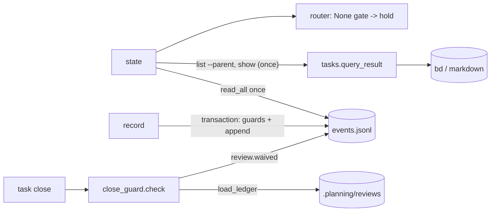

# Plan: reliability core (state that never lies)

Epic: gin-workflow-rm-reliability-core
Spec: `.planning/specs/2026-10-30-reliability-core-design.md`

## Objective

`gin-workflow state` reports a gate it cannot determine as `unknown`, holds, and names the cause; it reads the event log once and lists the epic's children once. `record` checks and appends under one lock that times out on every platform. Events carry `schema_version`. `/execute` resumes a track left `in_progress`. With `project.review_ledger` on, `task close` refuses an unreviewed track unless the waiver is recorded. `gin-workflow hooks status` tells `ship` whether the git hooks and verify commands are in place.

## Goal

Copied from the spec: `state` and `record` distinguish "not done" from "unknown", never hang on a lock, never lose a waiver silently, and a fresh session resumes the track it left in progress.

## Architecture

- `locking.file_lock` polls a non-blocking lock on POSIX and Windows alike, up to `LOCK_TIMEOUT` (60 s).
- `WorkflowEventStore.transaction()` holds the exclusive lock and exposes the events read under it plus an `append` that does not lock again. `append()` becomes a one-event transaction.
- `tasks.query_result()` returns `(data, cause)`; `query()` wraps it.
- `lifecycle_cli._state_command` reads the events once, derives every gate from that list and one tracker pass, and turns failures into `None` (shown as `unknown`) plus warnings. The router holds on a `None` gate.
- `workflow_core/close_guard.py` checks `task close` against the review ledger before `tasks.main` forwards it.
- `hooks.status_report` backs `gin-workflow hooks status`.



## Tech Stack

Python 3 stdlib (`argparse`, `fcntl`/`msvcrt`, `json`, `subprocess`, `threading` in tests), jsonschema (already used by `schemas.py`), unittest, bd 1.0.5, Markdown skills and docs.

## Global Constraints

Copied from the spec:
- Out of scope: event-log rotation or compaction; claim lease or TTL; the `.beads.gate.lock` doc line; guarding a direct `bd close` call; the SessionStart hook (dropped).
- Gate values are `satisfied`, `waived(<reason>)`, `unmet`, and `unknown`. gin-console reads them as plain strings and needs no change.
- `schema_version` is not part of the `event_id` hash; existing event ids are unchanged.
- An installed gin-workflow older than this change rejects events with `schema_version`; one install serves the machine and gin-console, so both upgrade together.

Plan-level rules:
- No commits on `master`. Each track commits on its own branch in its own worktree; the coordinator merges into `feat/reliability-core` in track order.
- Before editing, each track runs `gin-workflow rules --files <its files>` and follows the output.
- Steps are test first: write the failing test, run it and see it fail, write the code, run it and see it pass.
- Every track runs the tests it names, then the full suite. Expected: `OK`.
  - Full suite: `PYTHONPATH=plugins/gin-workflow/src/scripts python3 -m unittest tests/test_all.py`
  - One file: `PYTHONPATH=plugins/gin-workflow/src/scripts python3 -m unittest tests/workflow_core/<file>.py`
- Test names carry the story id (for example `test_us1_tracker_failure_is_unknown`).

Decisions this plan takes inside the spec:
- `file_lock` keeps its signature and reads the module constant `LOCK_TIMEOUT` at call time, so tests patch the constant; no caller needs a per-call timeout. `WINDOWS_LOCK_TIMEOUT` is renamed `LOCK_TIMEOUT`.
- `record shipped` for a workflow that already has a `delivery.shipped` event returns `already_recorded` (exit 0) instead of appending a second event. This is what makes two concurrent `record shipped` calls with different evidence leave one event (US-3).
- `_beads_json` in `lifecycle_cli` returns `(data, cause)`; tests that patch it return tuples.
- A markdown-backend query failure has the cause `markdown task query failed` (`task_markdown.query` already swallows the message).
- The close guard reads the ledger with `review_ledger.cli.load_ledger(bead, <cwd>)` and accepts it when `projection.active_approval` is set. `get_review_identity_record` needs an approval event id the guard does not have.
- `review.waived` is written to the workflow whose `orchestration.ready` event names the track's parent epic, or to the parent id when none does. `state` lists them as `review_waivers`; `ship` reads them there and skips ledger validation for those tracks.
- `hooks status` reports `verify_commands` as the sorted list of configured check names, including `<package path>:<name>` for monorepo packages.
- `state` keeps its exit rule (0 for `route`, 1 otherwise). US-2 says "exits 0" for a corrupt log, but the decision there is `hold`, so the test checks exit 1, the warning, and the absence of a traceback.
- `record` keeps exit 1 for a lock timeout, as for any `EventPersistenceError` today; exit 2 stays reserved for usage and guard refusals. The spec's "error with exit 2" for a lock timeout is not applied.

## Route Rubric
- Choose the weakest model that can do the work.
- Raise the model for broad context or design judgement.
- Raise the effort for intrinsic difficulty: intricate logic, many edge cases, or long chains of steps.

| Kind of work | Model | Effort |
|---|---|---|
| Mechanical edits, documentation, boilerplate | weakest | `low` |
| Bounded implementation with a clear spec | middle | `medium` |
| Cross-module change, security, migration, concurrency | strongest | `high` |

Unclear requirements never raise the model or effort.

## Requirement Analysis
- Problem statement: a tracker failure reads as "not done", a corrupt log hides every waiver, a held lock blocks forever on POSIX, `record` checks outside its lock, events cannot grow fields, `state` re-reads the log 6 to 8 times, nothing resumes in-progress work, a track can close without review, and `ship` cannot tell whether checks ran.
- Success criteria: the acceptance criteria of US-1 to US-8 in the spec, each covered by a named test.
- Constraints: the Global Constraints above; existing gate values and decisions stay identical while `bd` and the log work.
- Non-goals: the out-of-scope list above.

## Approach Options
### Option 1: one snapshot per command
- Summary: `state` reads events and the tracker once; every helper takes the list; failures become `None` plus a cause.
- Pros: one place decides "unknown"; the single read falls out of the same change.
- Cons: helper signatures change, so `specs_migrate.py` and `goal.py` callers move too.

### Option 2: cache reads and patch each `None` site
- Summary: memoize `read_all` and check `None` at each of the five tracker call sites.
- Pros: smaller diff.
- Cons: the unknown logic is spread over five sites; the cache hides rather than removes repeated reads.

### Recommended Approach
- Selected option: Option 1, confirmed in `/discuss`.
- Rationale: fewer places to get the unknown/unmet distinction wrong.

## Scope
- In scope: US-1 to US-8 of the spec.
- Out of scope: see Global Constraints.

## Execution Strategy

```yaml
execution_strategy:
  mode: direct
  workers:
    mode: sequential
  rationale: Tracks 2 to 5 edit the same files (lifecycle_cli.py, tasks.py, docs/reference/cli.md, docs/concepts/lifecycle.md), so they run one at a time in dependency order.
```

## Tasks

### Track 1: lock timeout, event-store transaction, schema_version
- **Dependencies**: none
- **Files**:
  - Modify `plugins/gin-workflow/src/scripts/workflow_core/locking.py:11-61` (one polling loop for both platforms, `LOCK_TIMEOUT`)
  - Modify `plugins/gin-workflow/src/scripts/workflow_core/events.py:81-227` (`schema_version`, `_Transaction`, `transaction()`, `append` via transaction)
  - Modify `plugins/gin-workflow/src/scripts/workflow_core/schemas.py:268-283` (event schema)
  - Modify `docs/concepts/state-model.md:32` (schema version and lock timeout)
  - Test `tests/workflow_core/test_locking.py`
  - Test `tests/workflow_core/test_events.py`
- **Provider role**: `backend`
- **Model:** `opus`
- **Effort:** `high`
- **Why:** locking and atomic append are concurrency code every gate depends on; a mistake loses or duplicates events.
- **Acceptance criteria**: US-3 first bullet (lock timeout) and US-4; existing locking and events tests pass with `WINDOWS_LOCK_TIMEOUT` renamed.
- **Estimated complexity**: medium

Interfaces produced:
- `locking.LOCK_TIMEOUT: float = 60.0`
- `events.EVENT_SCHEMA_VERSION: int = 1`; `WorkflowEvent.schema_version: int`
- `WorkflowEventStore.transaction() -> ContextManager[_Transaction]`; `_Transaction.events: list[WorkflowEvent]`; `_Transaction.append(event: WorkflowEvent) -> bool`

Steps:

1. Before editing, compute the id of a fixed event with the current code and keep the printed value for step 4:
   ```bash
   PYTHONPATH=plugins/gin-workflow/src/scripts python3 -c "from workflow_core.events import WorkflowEvent; print(WorkflowEvent.create(event_type='requirement.confirmed', workflow_id='wf', payload={'evidence': 's.md'}, idempotency_key='k', timestamp='2026-01-01T00:00:00Z').event_id)"
   ```
2. In `test_locking.py`, rename every `WINDOWS_LOCK_TIMEOUT` to `LOCK_TIMEOUT` and add to `PosixLockTests`:
   ```python
   @unittest.skipIf(sys.platform == "win32", "POSIX flock")
   def test_us3_waiter_times_out_while_the_lock_is_held(self):
       with tempfile.TemporaryDirectory() as tmp:
           path = Path(tmp) / "x.lock"
           held, release = threading.Event(), threading.Event()

           def holder():
               with file_lock(path):
                   held.set()
                   release.wait(5)

           thread = threading.Thread(target=holder)
           thread.start()
           held.wait(5)
           try:
               started = time.monotonic()
               with mock.patch.object(locking, "LOCK_TIMEOUT", 0.2), self.assertRaises(TimeoutError):
                   with file_lock(path):
                       pass
               self.assertLess(time.monotonic() - started, 2)
           finally:
               release.set()
               thread.join()
   ```
3. Run `test_locking.py`: the new test fails (it blocks until the holder releases, then no `TimeoutError`), and the renamed Windows test fails on the missing attribute.
4. In `test_events.py`, add (with `import json` if missing; `EXPECTED_ID` is the value printed in step 1):
   ```python
   EXPECTED_ID = "evt-<value printed in step 1>"

   def fixed_event(**overrides):
       values = dict(event_type="requirement.confirmed", workflow_id="wf", payload={"evidence": "s.md"},
                     idempotency_key="k", timestamp="2026-01-01T00:00:00Z")
       return WorkflowEvent.create(**{**values, **overrides})


   class EventSchemaVersionTests(unittest.TestCase):
       def test_us4_new_events_carry_schema_version_and_keep_their_id(self):
           event = fixed_event()
           self.assertEqual(1, event.to_dict()["schema_version"])
           self.assertEqual(EXPECTED_ID, event.event_id)

       def test_us4_reader_accepts_old_events_and_unknown_fields(self):
           old = fixed_event().to_dict()
           del old["schema_version"]
           newer = {**fixed_event(idempotency_key="k2").to_dict(), "schema_version": 2, "origin": "future"}
           with tempfile.TemporaryDirectory() as tmp:
               path = Path(tmp) / "events.jsonl"
               path.write_text(json.dumps(old) + "\n" + json.dumps(newer) + "\n", encoding="utf-8")
               self.assertEqual([1, 2], [event.schema_version for event in WorkflowEventStore(path).read_all()])


   class TransactionTests(unittest.TestCase):
       def test_us3_transaction_appends_under_one_lock(self):
           with tempfile.TemporaryDirectory() as tmp:
               store = WorkflowEventStore(Path(tmp) / "events.jsonl")
               first = fixed_event()
               with store.transaction() as tx:
                   self.assertEqual([], tx.events)
                   self.assertTrue(tx.append(first))
                   self.assertFalse(tx.append(first))
                   self.assertEqual([first.event_id], [event.event_id for event in tx.events])
               self.assertEqual([first.event_id], [event.event_id for event in store.read_all()])
   ```
   Run `test_events.py`: the three tests fail (`schema_version` and `transaction` do not exist; the reader rejects `origin`).
5. Replace `locking.py` from line 11 to the end with:
   ```python
   LOCK_TIMEOUT = 60.0
   _CONTENTION = {errno.EACCES, errno.EAGAIN, getattr(errno, "EWOULDBLOCK", errno.EAGAIN),
                  getattr(errno, "EDEADLOCK", errno.EDEADLK)}


   @contextmanager
   def file_lock(path: Path, *, exclusive: bool = True) -> Iterator[None]:
       """Hold a lock on `path` (created if missing) for the body of the `with`.

       Waits at most `LOCK_TIMEOUT` seconds, then raises `TimeoutError`."""
       try:
           import fcntl
       except ImportError:
           fcntl = None
       msvcrt = None
       if fcntl is None:
           try:
               import msvcrt
           except ImportError as error:
               raise OSError("file locking requires POSIX or Windows advisory file locking") from error
       path = Path(path)
       path.parent.mkdir(parents=True, exist_ok=True)
       with path.open("a+b") as stream:
           if fcntl is not None:
               mode = (fcntl.LOCK_EX if exclusive else fcntl.LOCK_SH) | fcntl.LOCK_NB

               def acquire() -> None:
                   fcntl.flock(stream.fileno(), mode)

               def release() -> None:
                   fcntl.flock(stream.fileno(), fcntl.LOCK_UN)
           else:
               # simplified: Windows has no shared lock, so readers take the exclusive one; use LockFileEx for shared locks if reader contention matters.
               stream.seek(0)
               if not stream.read(1):
                   stream.write(b"\0")
                   stream.flush()

               def acquire() -> None:
                   stream.seek(0)
                   msvcrt.locking(stream.fileno(), msvcrt.LK_NBLCK, 1)

               def release() -> None:
                   stream.seek(0)
                   msvcrt.locking(stream.fileno(), msvcrt.LK_UNLCK, 1)
           timeout = LOCK_TIMEOUT
           deadline = time.monotonic() + timeout
           while True:
               try:
                   acquire()
                   break
               except OSError as error:
                   if error.errno not in _CONTENTION:
                       raise
                   if time.monotonic() >= deadline:
                       raise TimeoutError(f"timed out after {timeout:g}s waiting for lock {path}") from error
                   time.sleep(0.05)
           try:
               yield
           finally:
               release()
   ```
   Run `test_locking.py`: `OK`.
6. In `schemas.py`, `WORKFLOW_EVENT_SCHEMA`: add `"schema_version": {"type": "integer", "minimum": 1},` to `properties` and delete its `"additionalProperties": False,` line (line 282 only; other schemas keep theirs).
7. In `events.py`:
   - After `_TERMINAL_WORKER_EVENTS`, add `EVENT_SCHEMA_VERSION = 1`.
   - In `WorkflowEvent`, add the field `schema_version: int = EVENT_SCHEMA_VERSION` after `idempotency_key`.
   - In `to_dict`, add `"schema_version": self.schema_version,` to `result` after `"payload"`.
   - In `from_mapping`, pass `schema_version=value.get("schema_version", 1),`.
   - `_deterministic_event_id` is unchanged.
   - Replace `WorkflowEventStore.append` and add the transaction:
   ```python
   class _Transaction:
       """The events read under the store's exclusive lock, and appends made while it is held."""

       def __init__(self, store: "WorkflowEventStore", content: bytes):
           self._store = store
           self._content = content
           self.events = _decode_events(content, store.path)

       def append(self, event: WorkflowEvent) -> bool:
           if not isinstance(event, WorkflowEvent):
               raise TypeError("event must be a WorkflowEvent")
           _validate_event_mapping(event.to_dict())
           if any(item.event_id == event.event_id for item in self.events):
               return False
           prefix = self._content
           if prefix and not prefix.endswith(b"\n"):
               prefix += b"\n"
           content = prefix + (_canonical_json(event.to_dict()) + "\n").encode("utf-8")
           atomic_write_bytes(self._store.path, content)
           self._content = content
           self.events.append(event)
           return True
   ```
   and in `WorkflowEventStore`:
   ```python
   @contextmanager
   def transaction(self) -> Iterator[_Transaction]:
       """Hold the exclusive lock: read the events once, then check and append without a gap.
       `flock` locks through two descriptors conflict even in one process, so never lock again inside."""
       with _file_lock(self.lock_path, exclusive=True):
           yield _Transaction(self, self.path.read_bytes() if self.path.exists() else b"")

   def append(self, event: WorkflowEvent) -> bool:
       if not isinstance(event, WorkflowEvent):
           raise TypeError("event must be a WorkflowEvent")
       with self.transaction() as tx:
           return tx.append(event)
   ```
   Run `test_events.py`, `test_waivers.py`, `test_router.py`, `test_lifecycle_cli.py`: `OK`. A test that compares a whole `to_dict()` to a literal gains `"schema_version": 1`.
8. `docs/concepts/state-model.md:32`, after the sentence ending "adds nothing.": add "Each event carries `schema_version` (now 1); readers accept events without it and ignore fields they do not know. A read or write waits at most 60 seconds for the store's lock, then fails."
9. Full suite: `OK`. Commit.

### Track 2: state snapshot, `unknown` gates, guards inside the lock
- **Dependencies**: Track 1
- **Files**:
  - Modify `plugins/gin-workflow/src/scripts/workflow_core/tasks.py:135-158` (`query_result`, `query` wraps it)
  - Modify `plugins/gin-workflow/src/scripts/workflow_core/lifecycle_cli.py:55-269` (snapshot helpers, `_record_command`, `_state_command`)
  - Modify `plugins/gin-workflow/src/scripts/workflow_core/router.py:379-459` (`None` gate, `state["waivers"]`)
  - Modify `plugins/gin-workflow/src/scripts/workflow_core/waivers.py:129-160` (`waivers_from_events`)
  - Modify `plugins/gin-workflow/src/scripts/workflow_core/specs_migrate.py:59-70` (new helper signatures)
  - Modify `plugins/gin-workflow/src/scripts/workflow_core/goal.py:55` (`_recorded_epic` takes events)
  - Modify `docs/reference/cli.md:44-75` (`unknown`, `record shipped` cause), `docs/concepts/lifecycle.md:19`, `docs/concepts/state-model.md:32`
  - Test `tests/workflow_core/test_tasks.py`
  - Test `tests/workflow_core/test_lifecycle_cli.py`
  - Test `tests/workflow_core/test_router.py`
  - Test `tests/workflow_core/test_specs_migrate.py`
- **Provider role**: `backend`
- **Model:** `opus`
- **Effort:** `high`
- **Why:** cross-module change of how every gate is derived, plus a check-then-append made atomic under a lock.
- **Acceptance criteria**: US-1, US-2, US-3 (second and third bullets), US-5.
- **Estimated complexity**: high

Interfaces produced:
- `tasks.query_result(root: Path, argv: Sequence[str]) -> tuple[Any, str | None]`
- `waivers.waivers_from_events(events: Sequence[WorkflowEvent], *, workflow_id: str, scope_hash: str) -> dict[str, GateWaiver]`
- `lifecycle_cli._beads_json(repo_path, argv) -> tuple[Any, str | None]`
- `lifecycle_cli._recorded_epic(events: Sequence[WorkflowEvent], workflow_id: str) -> str`
- `lifecycle_cli._process_gate_state(events, workflow_id) -> dict[str, bool | None]`
- `lifecycle_cli._delivery_state(repo_path, events, workflow_id) -> tuple[dict[str, bool | None], bool | None, str | None]` (gates, standalone, tracker cause)
- State JSON: gate value `unknown`; `warnings` may hold `tracker unavailable: <cause>` and `event log unreadable: <error>; waivers not applied`.

Steps:

1. In `test_tasks.py`, add:
   ```python
   class QueryResultTests(unittest.TestCase):
       def run_query(self, completed=None, error=None, which="/usr/bin/bd"):
           with mock.patch.object(tasks, "backend", return_value="beads"), \
                   mock.patch.object(tasks.shutil, "which", return_value=which), \
                   mock.patch.object(tasks.subprocess, "run", return_value=completed, side_effect=error):
               return tasks.query_result(Path("."), ["list"])

       def test_us1_query_result_names_the_cause(self):
           self.assertEqual((None, "bd not found"), self.run_query(which=None))
           self.assertEqual((None, "bd timed out after 30s"),
                            self.run_query(error=subprocess.TimeoutExpired("bd", 30)))
           self.assertEqual((None, "bd exited 3: boom"),
                            self.run_query(subprocess.CompletedProcess([], 3, "", "boom\nmore")))
           self.assertEqual((None, "invalid JSON from bd"), self.run_query(subprocess.CompletedProcess([], 0, "nope", "")))
           self.assertEqual(([{"id": "a"}], None), self.run_query(subprocess.CompletedProcess([], 0, '[{"id": "a"}]', "")))
   ```
   Run: fails (`query_result` missing).
2. In `tasks.py`, replace `query` with:
   ```python
   def query_result(root: Path, argv: Sequence[str]) -> tuple[Any, str | None]:
       """Run one read-only query: (JSON, None), or (None, cause) when the backend is unavailable or fails."""
       try:
           name = backend(root)
       except ConfigValidationError:
           return None, "invalid backend config"
       if name == "markdown":
           result = task_markdown.query(root, argv)
           return (None, "markdown task query failed") if result is None else (result, None)
       executable = shutil.which("bd")
       if executable is None:
           return None, "bd not found"
       if argv[:1] == ["ready"]:
           argv = [*argv, "--exclude-type", "milestone"]
       try:
           completed = subprocess.run(
               [executable, *argv, "--json"], cwd=root, text=True, capture_output=True, check=False, timeout=30
           )
       except subprocess.TimeoutExpired:
           return None, "bd timed out after 30s"
       except (OSError, subprocess.SubprocessError) as error:
           return None, f"bd failed: {error}"
       if completed.returncode != 0:
           first = next((line.strip() for line in (completed.stderr or "").splitlines() if line.strip()), "")
           return None, f"bd exited {completed.returncode}" + (f": {first}" if first else "")
       try:
           result = json.loads(completed.stdout)
       except json.JSONDecodeError:
           return None, "invalid JSON from bd"
       if argv[:1] == ["ready"]:
           held = held_by_external(root, executable)
           if held is None:
               return None, "bd ready --explain failed"
           result = without_held(result, held)
       return result, None


   def query(root: Path, argv: Sequence[str]) -> Any:
       """Run one read-only query and return its JSON; None when the backend is unavailable or fails."""
       return query_result(root, argv)[0]
   ```
   Run `test_tasks.py`: `OK`.
3. In `test_lifecycle_cli.py`:
   - Change `_fake_beads` so `run` returns `(data, None)`: `return [...], None` and `return [{"id": "epic", "status": epic_status}], None`.
   - Change line 463-464 to expect `unknown`: `with patch("workflow_core.lifecycle_cli._beads_json", lambda repo, argv: (None, "bd not found")): self.assertEqual("unknown", self._state_gates()["implementation_complete"])`.
   - In `test_record_reports_an_unwritten_gate` (line 377), patch `workflow_core.lifecycle_cli.WorkflowEventStore.transaction` instead of `.append`: `record` no longer calls `append`.
   - Add `import threading` and `import time` at the top, then add:
   ```python
   def _state_payload(self, workflow_id="default-workflow"):
       with mock.patch("sys.stdout", new=io.StringIO()) as out:
           code = lifecycle_main(["state", "--repository", str(self.repo_path), "--format", "json",
                                  "--workflow-id", workflow_id])
       return json.loads(out.getvalue()), code

   def test_us1_tracker_failure_is_unknown_and_holds(self):
       self._record_orchestration()
       with mock.patch("workflow_core.lifecycle_cli._beads_json", lambda repo, argv: (None, "bd not found")):
           payload, code = self._state_payload()
       self.assertEqual(1, code)
       self.assertEqual(("unknown", "unknown"),
                        (payload["gates"]["implementation_complete"], payload["gates"]["shipped"]))
       self.assertEqual(("progress", "hold"), (payload["stage"], payload["decision"]))
       self.assertIn("tracker unavailable: bd not found", payload["warnings"])
       self.assertIn("tracker unavailable: bd not found", payload["remedies"])

   def test_us1_unrecorded_process_gates_are_unknown_when_standalone_cannot_be_checked(self):
       self._record_orchestration()
       with mock.patch("workflow_core.lifecycle_cli._beads_json", lambda repo, argv: (None, "bd not found")):
           gates = self._state_gates()
       self.assertEqual(("unknown", "unknown", "satisfied"),
                        (gates["requirement_confirmed"], gates["plan_approved"], gates["orchestration_ready"]))

   def test_us1_record_shipped_names_the_tracker_failure(self):
       self._record_orchestration()
       with mock.patch("workflow_core.lifecycle_cli._beads_json", lambda repo, argv: (None, "bd not found")), \
               contextlib.redirect_stderr(io.StringIO()) as err:
           self.assertEqual(2, cli_main(["record", "shipped", "--repository", str(self.repo_path),
                                         "--evidence", "merge", "--actor", "user"]))
       self.assertIn("tracker unavailable: bd not found", err.getvalue())
       self.assertNotIn("standalone", err.getvalue())

   def test_us2_corrupt_event_log_is_reported(self):
       path = self.workflow_dir / "runtime/events.jsonl"
       path.parent.mkdir(parents=True, exist_ok=True)
       path.write_text("{not json\n", encoding="utf-8")
       payload, code = self._state_payload()
       self.assertEqual(1, code)
       self.assertEqual({"unknown"}, set(payload["gates"].values()))
       self.assertEqual("hold", payload["decision"])
       self.assertTrue(any(warning.startswith("event log unreadable: ") and warning.endswith("; waivers not applied")
                           for warning in payload["warnings"]), payload["warnings"])

   def test_us3_concurrent_record_shipped_writes_one_event(self):
       self._record_orchestration()
       fake = self._fake_beads([], epic_status="closed")

       def slow(repo, argv):
           time.sleep(0.2)
           return fake(repo, argv)

       codes = []

       def record(evidence):
           codes.append(cli_main(["record", "shipped", "--repository", str(self.repo_path),
                                  "--evidence", evidence, "--actor", "user"]))

       with mock.patch("workflow_core.lifecycle_cli._beads_json", slow), contextlib.redirect_stdout(io.StringIO()):
           threads = [threading.Thread(target=record, args=(evidence,)) for evidence in ("merge-a", "merge-b")]
           for thread in threads:
               thread.start()
           for thread in threads:
               thread.join()
       self.assertEqual([0, 0], codes)
       events = WorkflowEventStore(self.workflow_dir / "runtime/events.jsonl").read_all()
       self.assertEqual(1, sum(event.event_type == "delivery.shipped" for event in events))

   def test_us5_state_reads_the_log_once_and_lists_children_once(self):
       self._record_orchestration()
       calls = []
       fake = self._fake_beads(["closed", "open"])

       def counting(repo, argv):
           calls.append(argv[0])
           return fake(repo, argv)

       original = WorkflowEventStore.read_all
       with mock.patch("workflow_core.lifecycle_cli._beads_json", counting), \
               mock.patch.object(WorkflowEventStore, "read_all", autospec=True, side_effect=original) as reads:
           self._state_payload()
       self.assertEqual(1, reads.call_count)
       self.assertEqual(1, calls.count("list"))
   ```
   In `test_router.py`, add to the router test class:
   ```python
   def test_us1_unknown_gate_holds_with_the_cause(self):
       state = {"requirement_confirmed": True, "plan_approved": True, "orchestration_ready": True,
                "implementation_complete": None, "shipped": None, "waivers": {},
                "unknown_causes": ["tracker unavailable: bd not found"]}
       decision = self.route(state)
       self.assertEqual(("progress", "hold"), (decision.stage, decision.decision))
       self.assertIn("implementation_complete=unknown", decision.evidence)
       self.assertEqual(("tracker unavailable: bd not found",), decision.remedies)
   ```
   In `test_specs_migrate.py:94`, change `return_value=None` to `return_value=(None, "bd not found")`.
   Run the three files: the new tests fail.
4. `waivers.py`: split the loop of `collect_waivers` into
   ```python
   def waivers_from_events(
       events: Sequence[WorkflowEvent], *, workflow_id: str, scope_hash: str
   ) -> dict[str, GateWaiver]:
       """Return the newest valid waiver per gate for one workflow and scope; a malformed payload is skipped."""
       if not workflow_id or not scope_hash:
           return {}
       waivers: dict[str, GateWaiver] = {}
       for event in events:
           ...  # the existing loop body of collect_waivers, unchanged
       return waivers
   ```
   and make `collect_waivers` read the store as today (keeping its `{}` on a read error) and `return waivers_from_events(events, workflow_id=workflow_id, scope_hash=scope_hash)`. Add `Sequence` to the `typing` import.
5. `router.py`:
   - `_gate_status`: replace the body with
   ```python
   """Return 'satisfied', 'waived', 'unknown', or 'unmet' for a lifecycle gate; None marks an unknown value."""
   value = state.get(gate, False)
   if value is not None and type(value) is not bool:
       raise TypeError(f"{gate} must be a boolean or None")
   if value:
       return "satisfied"
   if gate not in NON_WAIVABLE_GATES and gate in waivers:
       return "waived"
   return "unknown" if value is None and gate in state else "unmet"
   ```
   - In `route_next_stage`, before `if (isinstance(store, ...`: `if isinstance(state.get("waivers"), Mapping): waivers = state["waivers"]` and turn the existing `if`/`else` into `elif`/`else`.
   - In the gate loop, after the `waived` branch:
   ```python
   if status == "unknown":
       causes = tuple(str(cause) for cause in state.get("unknown_causes") or ())
       return RouteDecision(
           "progress",
           "hold",
           (*evidence_prefix, f"{completed_gate}=unknown"),
           remedies=causes or ("restore the task tracker and the event log, then rerun gin-workflow state",),
       )
   ```
6. `lifecycle_cli.py`: replace lines 55-141 (`_process_gate_state` to `_bead_closed`) with:
   ```python
   def _read_events(store: WorkflowEventStore) -> tuple[list[WorkflowEvent] | None, str | None]:
       try:
           return store.read_all(), None
       except (EventPersistenceError, OSError, ValueError) as error:
           return None, f"event log unreadable: {error}; waivers not applied"


   def _process_gate_state(events: Sequence[WorkflowEvent], workflow_id: str) -> dict[str, bool | None]:
       """Reconstruct process gates from durable events for one workflow only."""
       # the existing body, iterating `events` instead of `event_store.read_all()`


   def _beads_json(repo_path: Path, argv: list[str]) -> tuple[Any, str | None]:
       """Run one read-only task query on the configured backend: (data, None), or (None, cause) when it fails."""
       from .tasks import query_result

       return query_result(repo_path, argv)


   def _recorded_epic(events: Sequence[WorkflowEvent], workflow_id: str) -> str:
       # the existing body, iterating `events`


   def _bead_closed(repo_path: Path, bead_id: str) -> tuple[bool, str | None]:
       shown, cause = _beads_json(repo_path, ["show", bead_id])
       record = shown[0] if isinstance(shown, list) and len(shown) == 1 else shown
       return isinstance(record, Mapping) and record.get("status") == "closed", cause


   def _delivery_state(
       repo_path: Path, events: Sequence[WorkflowEvent], workflow_id: str
   ) -> tuple[dict[str, bool | None], bool | None, str | None]:
       """Derive delivery gates: implementation from closed epic children, shipped from the closed epic
       (closed only after a confirmed merge). A standalone bead recorded as its own epic has no children:
       implementation is the bead itself closed, and shipped comes from an explicit `record shipped`.

       Returns the gates, whether the epic is standalone, and the tracker failure; None marks a value
       that failure left unknown."""
       unknown = {"implementation_complete": None, "shipped": None}
       epic = _recorded_epic(events, workflow_id)
       if not epic:
           return {"implementation_complete": False, "shipped": False}, False, None
       children, cause = _beads_json(repo_path, ["list", "--parent", epic, "--all", "--limit", "0"])
       if cause:
           return unknown, None, cause
       if children == []:
           closed, cause = _bead_closed(repo_path, epic)
           if cause:
               return unknown, True, cause
           shipped = closed and any(
               event.workflow_id == workflow_id and event.event_type == "delivery.shipped" for event in events
           )
           return {"implementation_complete": closed, "shipped": shipped}, True, None
       if isinstance(children, list) and all(
           isinstance(child, Mapping) and child.get("status") == "closed" for child in children
       ):
           closed, cause = _bead_closed(repo_path, epic)
           return {"implementation_complete": True, "shipped": None if cause else closed}, False, cause
       return {"implementation_complete": False, "shipped": False}, False, None
   ```
   Delete `_delivery_gate_state`, `_implementation_and_shipped`, and `_standalone_requirement`.
7. `_record_command`: delete the two guard blocks (lines 161-170) and the early `store = ...` stays. Wrap the append so the guards run under the lock:
   ```python
   def _record_refusal(repo_path: Path, events: Sequence[WorkflowEvent], args: argparse.Namespace):
       """The refusal for a record that the current events and tracker forbid, else None."""
       if args.gate in _PROCESS_GATES and _delivery_state(repo_path, events, args.workflow_id)[0]["shipped"]:
           return {"status": "error", "message": f"workflow {args.workflow_id} is already shipped; "
                   "pass --workflow-id <new-id> for new work"}, 2
       if args.gate != "shipped":
           return None
       if any(event.workflow_id == args.workflow_id and event.event_type == "delivery.shipped" for event in events):
           return {"status": "already_recorded", "gate": args.gate, "event_type": "delivery.shipped",
                   "workflow_id": args.workflow_id, "message": f"{args.workflow_id} is already shipped"}, 0
       epic = _recorded_epic(events, args.workflow_id)
       children, cause = (None, None) if not epic else _beads_json(
           repo_path, ["list", "--parent", epic, "--all", "--limit", "0"])
       if cause:
           return {"status": "error", "message": f"shipped not recorded: tracker unavailable: {cause}"}, 2
       if children != []:
           return {"status": "error", "message": "shipped is recordable only for a standalone bead recorded as its own "
                   "epic (orchestration-ready --epic <bead>); an epic with children ships by closing it"}, 2
       return None
   ```
   and replace the `try: appended = store.append(event)` block with:
   ```python
   try:
       with store.transaction() as tx:
           refusal = _record_refusal(Path(args.repository).resolve(), tx.events, args)
           if refusal is not None:
               return refusal
           appended = tx.append(event)
   except (EventPersistenceError, RuntimeError, OSError) as error:
       return {"status": "error", "message": f"{args.gate} not recorded for {args.workflow_id}: {error}"}, 1
   ```
   The `--actor`/team checks now run before the guards; their messages are unchanged.
8. `_state_command`: replace lines 219-241 and the `warnings`/`recent_quick` entries with:
   ```python
   events, log_error = _read_events(event_store)
   if events is None:
       gates_state: dict[str, bool | None] = {gate: None for _, gate in _STAGE_GATES}
       causes, waivers = [log_error], {}
   else:
       gates_state = _process_gate_state(events, workflow_id)
       delivery, standalone, tracker_error = _delivery_state(repo_path, events, workflow_id)
       gates_state.update(delivery)
       for gate in ("requirement_confirmed", "plan_approved"):
           if standalone:
               gates_state[gate] = True
           elif standalone is None and not gates_state[gate]:
               gates_state[gate] = None
       causes = [f"tracker unavailable: {tracker_error}"] if tracker_error else []
       waivers = waivers_from_events(events, workflow_id=workflow_id, scope_hash=scope_hash)

   state: dict[str, Any] = {
       "workflow_id": workflow_id,
       "audit_event_store": event_store,
       "scope_hash": scope_hash,
       "waivers": waivers,
       "unknown_causes": causes,
       **gates_state,
   }
   decision = route_next_stage(state, config)

   gates_status: dict[str, str] = {}
   for stage, gate in _STAGE_GATES:
       status = _gate_status(state, gate, waivers)
       gates_status[gate] = f"waived({waivers[gate].reason})" if status == "waived" else status
   ```
   and in `payload`:
   ```python
   "warnings": [w for w in (orchestrator_client.warning(config.to_dict()), *causes) if w],
   "recent_quick": [
       {"timestamp": event.timestamp, "evidence": event.payload.get("evidence", "")}
       for event in events or ()
       if event.workflow_id == workflow_id and event.event_type == "quick.completed"
   ][-5:],
   ```
   Import `waivers_from_events` from `.waivers` (drop `collect_waivers` only if no other use remains; `_quick_check_command` still uses it) and `Sequence` is already imported.
9. `specs_migrate.py` `in_flight_workflows`: read `events = store.read_all()` once and filter with `_process_gate_state(events, workflow)["plan_approved"] and not _delivery_state(Path(root), events, workflow)[0]["shipped"]` (import `_delivery_state` instead of `_delivery_gate_state`). An unknown `shipped` (`None`) keeps the workflow in flight.
10. `goal.py:55`: `epic = _recorded_epic(_get_event_store(args.repository).read_all(), args.workflow_id)`.
11. Run the four test files, then the full suite: `OK`.
12. Docs:
    - `docs/reference/cli.md` `state`: "every gate (`satisfied`, `unmet`, `waived(<reason>)`, or `unknown`)". Add after the first paragraph: "A gate is `unknown` when the task tracker or the event log cannot be read; the decision is then `hold`, and `warnings` and `remedies` name the cause (`tracker unavailable: <cause>`, `event log unreadable: <error>; waivers not applied`)."
    - `cli.md` `record` exit codes: add "`shipped` while the task tracker is unavailable (the message names the cause)" to the usage errors, and after the actor sentence: "Recording `shipped` again for a workflow that already shipped reports `already_recorded`. The guards and the append run under one lock."
    - `docs/concepts/lifecycle.md:19`: append "or a gate is `unknown` because the task tracker or the event log cannot be read".
    - `docs/concepts/state-model.md:32`: after "to derive the gates.": "When the tracker or the store cannot be read, the gates it decides are `unknown` and `state` holds with the cause."
13. Commit.

### Track 3: close guard and `review.waived`
- **Dependencies**: Track 2
- **Files**:
  - Create `plugins/gin-workflow/src/scripts/workflow_core/close_guard.py`
  - Modify `plugins/gin-workflow/src/scripts/workflow_core/tasks.py:172-188` (`main` runs the guard for `close`)
  - Modify `plugins/gin-workflow/src/scripts/workflow_core/lifecycle_cli.py` (`_state_command` payload adds `review_waivers`)
  - Modify `docs/reference/cli.md:284-292` (task close), `docs/reference/cli.md:44-54` (`review_waivers`), `docs/concepts/lifecycle.md:35`, `docs/concepts/state-model.md:32` (event list)
  - Test `tests/workflow_core/test_close_guard.py`
- **Provider role**: `backend`
- **Model:** `sonnet`
- **Effort:** `medium`
- **Why:** one new module with a clear contract and three branches; it reuses the ledger reader and the event store.
- **Acceptance criteria**: US-7.
- **Estimated complexity**: medium

Interfaces produced:
- `close_guard.check(root: Path, argv: Sequence[str]) -> tuple[list[str], str | None]` (argv to forward, or the refusal)
- Event `review.waived`: `task_id` = track, `payload = {"reason": str}`, `actor`, `idempotency_key = "<track>:review.waived:<reason>"`
- State JSON `review_waivers: [{"task_id": str, "reason": str, "actor": str | None}]`

Steps:

1. Create `tests/workflow_core/test_close_guard.py`. It runs on the markdown backend, so no `bd` is needed; repository setup copies `TaskDispatchTests` in `test_tasks.py`:
   ```python
   import json
   from pathlib import Path
   import subprocess
   import sys
   import tempfile
   import unittest
   from unittest import mock

   SCRIPTS = Path(__file__).resolve().parents[2] / "plugins/gin-workflow/src/scripts"
   sys.path.insert(0, str(SCRIPTS))

   from workflow_core import close_guard  # noqa: E402
   from workflow_core.events import WorkflowEventStore  # noqa: E402
   from tests.workflow_core.test_tasks import ENV, gw  # noqa: E402


   class CloseGuardTests(unittest.TestCase):
       def setUp(self):
           self._directory = tempfile.TemporaryDirectory()
           self.addCleanup(self._directory.cleanup)
           self.root = Path(self._directory.name) / "repo"
           (self.root / ".claude").mkdir(parents=True)
           subprocess.run(["git", "init", "-q"], cwd=self.root, check=True)
           subprocess.run(["git", "commit", "-q", "--allow-empty", "-m", "init"], cwd=self.root, env=ENV, check=True)

       def init(self, ledger):
           done = gw(self.root, "setup", "init", "--harness", "claude", "--non-interactive", "--approve",
                     "--set", "providers.task_tracking=markdown",
                     "--set", f"project.review_ledger={'true' if ledger else 'false'}")
           self.assertEqual(0, done.returncode, done.stdout + done.stderr)
           for argv in (("--id", "ep-1", "--type", "epic", "Epic"), ("--id", "ep-1.1", "--parent", "ep-1", "Track"),
                        ("--id", "loose", "Loose")):
               created = gw(self.root, "task", "create", *argv, "--json")
               self.assertEqual(0, created.returncode, created.stderr)

       def status(self, bead):
           return json.loads(gw(self.root, "task", "show", bead, "--json").stdout)[0]["status"]

       def test_us7_unreviewed_track_is_refused(self):
           self.init(ledger=True)
           closed = gw(self.root, "task", "close", "ep-1.1", "--reason", "done")
           self.assertEqual(2, closed.returncode, closed.stderr)
           self.assertIn("ep-1.1: review ledger not approved (no review ledger)", closed.stderr)
           self.assertEqual("open", self.status("ep-1.1"))

       def test_us7_waiver_is_recorded_and_the_track_closes(self):
           self.init(ledger=True)
           closed = gw(self.root, "task", "close", "ep-1.1", "--waive-review", "spike, no code", "--actor", "u")
           self.assertEqual(0, closed.returncode, closed.stderr)
           self.assertEqual("closed", self.status("ep-1.1"))
           events = WorkflowEventStore(self.root / ".agent-workflow/runtime/events.jsonl").read_all()
           self.assertEqual([("ep-1.1", "ep-1", "spike, no code", "u")],
                            [(e.task_id, e.workflow_id, e.payload["reason"], e.actor)
                             for e in events if e.event_type == "review.waived"])

       def test_us7_waiver_needs_a_reason_and_an_actor(self):
           self.init(ledger=True)
           self.assertIn("--waive-review needs", close_guard.check(self.root, ["close", "ep-1.1", "--waive-review", " "])[1])

       def test_us7_standalone_bead_closes_as_today(self):
           self.init(ledger=True)
           self.assertEqual((["close", "loose"], None), close_guard.check(self.root, ["close", "loose"]))

       def test_us7_ledger_off_closes_as_today(self):
           self.init(ledger=False)
           self.assertEqual((["close", "ep-1.1", "--reason", "done"], None),
                            close_guard.check(self.root, ["close", "ep-1.1", "--reason", "done"]))

       def test_us7_approved_ledger_closes(self):
           self.init(ledger=True)
           with mock.patch.object(close_guard, "_review_state", return_value=None):
               self.assertEqual((["close", "ep-1.1"], None), close_guard.check(self.root, ["close", "ep-1.1"]))
   ```
   Run: fails (`close_guard` missing).
2. Create `close_guard.py`:
   ```python
   """`task close` guard: with `project.review_ledger` on, a track closes only after its review ledger holds a
   live approval, or with `--waive-review <reason> --actor <id>`, which records a `review.waived` event."""

   from __future__ import annotations

   import argparse
   from pathlib import Path
   from typing import Mapping, Sequence

   REVIEW_WAIVED = "review.waived"


   def _review_state(root: Path, bead: str) -> str | None:
       """None when the bead's ledger holds a live approval, else why it does not."""
       from review_ledger.cli import load_ledger
       from review_ledger.events import WorkflowIntegrityError

       try:
           _, projection = load_ledger(bead, str(root))
       except FileNotFoundError:
           return "no review ledger"
       except (WorkflowIntegrityError, OSError, ValueError) as error:
           return f"invalid review ledger: {error}"
       return None if projection.active_approval is not None else projection.review_state


   def _record_waiver(root: Path, bead: str, epic: str, reason: str, actor: str) -> None:
       from .events import WorkflowEvent
       from .lifecycle_cli import _get_event_store

       store = _get_event_store(root)
       with store.transaction() as tx:
           workflow = next((event.workflow_id for event in reversed(tx.events)
                            if event.event_type == "orchestration.ready"
                            and isinstance(event.payload, Mapping) and event.payload.get("epic") == epic), epic)
           tx.append(WorkflowEvent.create(event_type=REVIEW_WAIVED, workflow_id=workflow, task_id=bead,
                                          actor=actor, payload={"reason": reason},
                                          idempotency_key=f"{bead}:{REVIEW_WAIVED}:{reason}"))


   def check(root: Path, argv: Sequence[str]) -> tuple[list[str], str | None]:
       """Return the `close` argv to forward to the backend, or the error that refuses the whole close."""
       from .configuration import resolve_effective_config
       from .events import EventPersistenceError
       from .project import project_settings
       from .tasks import query_result

       parser = argparse.ArgumentParser(prog="gin-workflow task close", add_help=False, exit_on_error=False)
       parser.add_argument("ids", nargs="*")
       parser.add_argument("--reason", "-r")
       parser.add_argument("--waive-review")
       parser.add_argument("--actor")
       try:
           args, rest = parser.parse_known_args(list(argv[1:]))
       except argparse.ArgumentError as error:
           return list(argv), str(error)
       forward = ["close", *args.ids, *(["--reason", args.reason] if args.reason is not None else []), *rest]
       if args.waive_review is not None and not (args.waive_review.strip() and args.actor):
           return forward, "--waive-review needs a non-empty reason and --actor"
       if not project_settings(resolve_effective_config(root, write=False).config.to_dict()).review_ledger:
           return forward, None
       unreviewed = []
       for bead in args.ids:
           shown, cause = query_result(root, ["show", bead])
           if cause:
               return forward, f"{bead}: tracker unavailable: {cause}"
           record = shown[0] if isinstance(shown, list) and len(shown) == 1 else shown
           if isinstance(record, Mapping) and record.get("parent"):
               state = _review_state(root, bead)
               if state:
                   unreviewed.append((bead, str(record["parent"]), state))
       if unreviewed and args.waive_review is None:
           return forward, "\n".join(f'{bead}: review ledger not approved ({state}); '
                                     f'pass --waive-review "<reason>" --actor <id>' for bead, _, state in unreviewed)
       try:
           for bead, epic, _ in unreviewed:
               _record_waiver(root, bead, epic, args.waive_review, args.actor)
       except (EventPersistenceError, OSError) as error:
           return forward, f"review waiver not recorded: {error}"
       return forward, None
   ```
   The waiver is recorded before the backend closes the bead; if the close then fails, the waiver stays and a retry with the same reason adds nothing.
3. `tasks.main`: after the `ConfigValidationError` block, before the markdown dispatch:
   ```python
   if argv[:1] == ["close"]:
       from .close_guard import check

       argv, error = check(root, argv)
       if error:
           print(f"error: {error}", file=sys.stderr)
           return 2
   ```
4. `lifecycle_cli._state_command` payload: add
   ```python
   "review_waivers": [
       {"task_id": event.task_id, "reason": event.payload.get("reason", ""), "actor": event.actor}
       for event in events or ()
       if event.workflow_id == workflow_id and event.event_type == "review.waived"
   ],
   ```
5. Run `test_close_guard.py`, `test_tasks.py`, `test_lifecycle_cli.py`, then the full suite: `OK`.
6. Docs:
   - `docs/reference/cli.md` `task`: after the markdown sentence add: "`close` has one guard of its own: with `project.review_ledger: true`, closing a bead that has a parent epic (a track) needs a review ledger with a live approval. Otherwise it exits 2, names the ledger state, and closes nothing. `--waive-review <reason> --actor <id>` records a `review.waived` event and closes anyway; `ship` lists those tracks. A bead without a parent, or `review_ledger: false`, closes as before. Calling `bd close` directly skips the guard." Add exit code 2 to the exit-code line.
   - `cli.md` `state`: add `review_waivers` (track, reason, actor) to the JSON list.
   - `docs/concepts/lifecycle.md:35`: append "With `project.review_ledger` on, `task close` refuses a track whose ledger is not approved unless `--waive-review` records why."
   - `docs/concepts/state-model.md:32`: add `review.waived` to the list of events.
7. Commit.

### Track 4: execute resumes in-progress work
- **Dependencies**: Track 3
- **Files**:
  - Modify `plugins/gin-workflow/src/scripts/workflow_core/task_markdown.py:209-235,319-332` (`update --claim`, `list --assignee`)
  - Modify `plugins/gin-workflow/src/skills/execute/SKILL.md:16-17`
  - Modify `docs/concepts/lifecycle.md:29`, `docs/reference/cli.md:288` (markdown subset)
  - Test `tests/workflow_core/test_task_markdown.py`
- **Provider role**: `backend`
- **Model:** `sonnet`
- **Effort:** `medium`
- **Why:** small, bounded backend change plus skill text, with one edge case (a bead claimed by someone else).
- **Acceptance criteria**: US-6.
- **Estimated complexity**: low

Steps:

1. In `test_task_markdown.py` (add `import os` and `from unittest import mock`), add to `TaskMarkdownTests`:
   ```python
   def test_us6_claim_sets_in_progress_and_assignee_and_list_filters_by_it(self):
       task = self.q("create", "T")["id"]
       with mock.patch.dict(os.environ, {"BD_ACTOR": "me@x"}):
           self.q("update", task, "--claim")
       shown = self.q("show", task)[0]
       self.assertEqual(("in_progress", "me@x"), (shown["status"], shown["assignee"]))
       self.assertEqual([task], [r["id"] for r in self.q("list", "--status", "in_progress", "--assignee", "me@x")])
       self.assertEqual([], self.q("list", "--status", "in_progress", "--assignee", "other@x"))
       with mock.patch.dict(os.environ, {"BD_ACTOR": "other@x"}):
           code, _, err = self.run_task("update", task, "--claim")
       self.assertEqual(1, code)
       self.assertIn("already claimed by me@x", err)

   def test_us6_claim_falls_back_to_git_user_email(self):
       subprocess.run(["git", "config", "user.email", "git@x"], cwd=self.root, check=True)
       task = self.q("create", "T")["id"]
       with mock.patch.dict(os.environ, {}, clear=False):
           os.environ.pop("BD_ACTOR", None)
           self.q("update", task, "--claim")
       self.assertEqual("git@x", self.q("show", task)[0]["assignee"])
   ```
   `run_task` returns exit 1 for a `TaskFileError`, as `test_explicit_id_labels_and_label_filters` shows. Run: fails (`--claim` is not an option).
2. `task_markdown.py`:
   - `update.add_argument("--claim", action="store_true")` and `listing.add_argument("--assignee", "-a")`.
   - `list` filter: add `and (not args.assignee or task.get("assignee") == args.assignee)`.
   - Add (with `import os` and `import subprocess`):
   ```python
   def _actor(root: Path) -> str:
       """Who claims: BD_ACTOR as bd uses it, else git user.email."""
       actor = os.environ.get("BD_ACTOR") or subprocess.run(
           ["git", "config", "user.email"], cwd=root, text=True, capture_output=True, check=False).stdout.strip()
       if not actor:
           raise TaskFileError("--claim needs BD_ACTOR or git config user.email")
       return actor
   ```
   - In `update`, after the field loop:
   ```python
   if args.claim:
       actor = _actor(root)
       if task["status"] == "in_progress" and task.get("assignee") not in (None, "", actor):
           raise TaskFileError(f"{task['id']} is already claimed by {task['assignee']}")
       task["status"], task["assignee"] = "in_progress", actor
   ```
   Run the test: `OK`.
3. `execute/SKILL.md`, replace lines 16-17 with:
   ```markdown
   2. Resume before picking new work: `gin-workflow task list --parent <epic> --status in_progress --json` lists the epic's tracks left in progress; with `project.team.enabled`, add `--assignee <git user.email>` so only your own claims show. Resume one: read it with `gin-workflow task show <id> --json`, read its notes, and continue. Only when none is listed, pick one unit from `gin-workflow task ready`, read it with `gin-workflow task show <id> --json`, and claim it with `gin-workflow task update <id> --claim`.
      With `project.team.enabled`, pick with `gin-workflow team ready` and claim with `gin-workflow team claim <id>` (the `gin-team` skill).
   ```
4. Docs:
   - `docs/concepts/lifecycle.md:29`: replace "The main session picks a ready task (`gin-workflow task ready`), claims it," with "The main session first resumes a track of the epic left `in_progress` (`gin-workflow task list --parent <epic> --status in_progress`); otherwise it picks a ready task (`gin-workflow task ready`), claims it (`task update <id> --claim`),".
   - `docs/reference/cli.md` `task`, markdown subset: after "`create`, `show`, `update`," note "`update --claim` sets `in_progress` and the assignee (`BD_ACTOR`, else `git config user.email`), `list --assignee` filters by it,".
5. Full suite: `OK`. Commit.

### Track 5: `hooks status` and the ship warnings
- **Dependencies**: Track 4
- **Files**:
  - Modify `plugins/gin-workflow/src/scripts/workflow_core/hooks.py:63-72,122-146` (`status_report`, `status` action)
  - Modify `plugins/gin-workflow/src/skills/ship/SKILL.md:16-17`
  - Modify `docs/reference/cli.md:196-207`
  - Test `tests/workflow_core/test_hooks.py`
- **Provider role**: `backend`
- **Model:** `sonnet`
- **Effort:** `low`
- **Why:** reuses `status()` and `project_settings`; a thin subcommand plus skill and doc text.
- **Acceptance criteria**: US-8.
- **Estimated complexity**: low

Interfaces produced:
- `hooks.status_report(root: Path) -> dict[str, Any]` = `{"hooks": {hook: "ok"|"missing"|"occupied"}, "verify_commands": [name, ...], "ok": bool}`
- `gin-workflow hooks status`: prints that JSON; exit 0 when `ok`, else 1.

Steps:

1. In `test_hooks.py` (add `import contextlib`, `import io`, `import json`), add:
   ```python
   class TestHooksStatus(unittest.TestCase):
       def setUp(self):
           self.tmp = tempfile.TemporaryDirectory()
           self.addCleanup(self.tmp.cleanup)

       def status(self, root):
           with contextlib.redirect_stdout(io.StringIO()) as out:
               code = hooks.main(["status", "--repository", str(root)])
           return code, json.loads(out.getvalue())

       def test_us8_missing_hook_is_not_ok(self):
           code, report = self.status(make_repo(self.tmp.name))
           self.assertEqual(1, code)
           self.assertEqual((False, "missing"), (report["ok"], report["hooks"]["pre-commit"]))
           self.assertEqual(["lint", "test"], report["verify_commands"])

       def test_us8_hooks_and_commands_in_place_are_ok(self):
           root = make_repo(self.tmp.name)
           hooks.install(root)
           self.assertEqual((0, True), (self.status(root)[0], self.status(root)[1]["ok"]))

       def test_us8_no_verify_commands_is_not_ok(self):
           root = make_repo(self.tmp.name, lint="", test="")
           hooks.install(root)
           code, report = self.status(root)
           self.assertEqual((1, False, []), (code, report["ok"], report["verify_commands"]))
   ```
   Run: fails (`status` is not a valid action).
2. `hooks.py` (add `import json` and `Any` to the `typing` import):
   ```python
   def status_report(root: Path) -> dict[str, Any]:
       """What `ship` checks: every hook installed and at least one verify command to run."""
       settings = project_settings(resolve_effective_config(Path(root), write=False).config.to_dict())
       hooks = status(root)
       names = [name for name, command in settings.verify_commands.items() if command]
       for package in settings.packages:
           checks = (package.get("verify") or {}).get("checks") or {}
           names += [f"{package['path']}:{name}" for name, command in checks.items() if command]
       return {"hooks": hooks, "verify_commands": sorted(names),
               "ok": all(state == "ok" for state in hooks.values()) and bool(names)}
   ```
   In `main`: `choices=("install", "run", "status")`, and before the `install` branch:
   ```python
   if args.action == "status":
       report = status_report(root)
       print(json.dumps(report, indent=2, sort_keys=True))
       return 0 if report["ok"] else 1
   ```
   Run `test_hooks.py`: `OK`.
3. `ship/SKILL.md` step 1: replace the first two sentences ("Require ... reports a hook missing).") with:
   "Require `implementation_complete` and a terminal review state. Run `gin-workflow hooks status`; on exit 1, warn the user which hook is not `ok`, or that `verify_commands` is empty, so checks did not run before integration (`gin-workflow hooks install` fixes a missing hook), and continue: it never stops ship. List each entry of `review_waivers` from `gin-workflow state --format json --workflow-id <id>` to the user as a track closed without review, with its reason and actor. Do not run tests: the `pre-commit`/`pre-push` git hooks and CI own that."
   In the ledger bullet, change "for each closed track bead of the epic:" to "for each closed track bead of the epic not listed in `review_waivers`:".
4. `docs/reference/cli.md` `hooks`: add `gin-workflow hooks status` to the usage block and after the `install` paragraph: "`status` prints `{"hooks": {...}, "verify_commands": [...], "ok": ...}`: each hook's state (`ok`, `missing`, `occupied`) and the configured check names, including `<package>:<name>` for packages. It exits 1 when a hook is not `ok` or no verify command is configured; `ship` warns on that and continues."
5. Full suite: `OK`. Commit.

## Integration
- **Branch**: `feat/reliability-core`, created from `spec/reliability-core` at orchestration.
- **Merge strategy**: sequential (Track 1 → 5).

## Validation
- [ ] Full suite passes: `PYTHONPATH=plugins/gin-workflow/src/scripts python3 -m unittest tests/test_all.py`
- [ ] `tests/install_smoke_test.sh` passes
- [ ] Manual: with `PATH` lacking `bd`, `gin-workflow state --format json --workflow-id gin-workflow-rm-reliability-core` prints `unknown` gates, `decision: hold`, and `tracker unavailable: bd not found`
- [ ] Manual: `gin-workflow hooks status` in this repo prints the hook states and exits 0 or 1 accordingly

## Notes
- `Model:` and `Effort:` are chosen from the main harness catalog using the route rubric. The user may override them before plan approval.
- The Parent Bead (`gin-workflow-rm-reliability-core`) stays open until the human-confirmed merge; track beads close after tests and review pass so dependents unblock.
- gin-console sees `unknown` only after `install.sh` runs again; it renders it like `unmet` with its own label.
