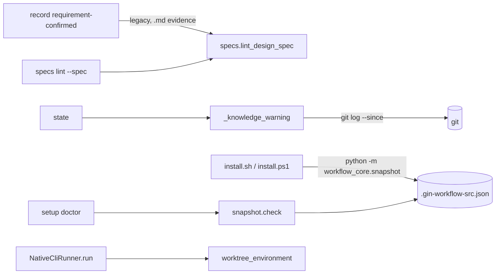

# Plan: process hygiene (consistent skills, rules that bind where it matters)

Epic: gin-workflow-rm-process-hygiene
Spec: `.planning/specs/2026-10-31-process-hygiene-design.md`

## Objective

Every stage skill states the commit, approval, and review-ledger rules once and the same way, in English. `safety-check.sh` blocks `git commit -n` and `core.hooksPath` overrides. `post-edit.sh` is gone. Orchestrator workers in a worktree get `WORKTREE_PATH`. `record requirement-confirmed` refuses a legacy spec whose stories lack acceptance criteria. `state` warns at ship time when no knowledge record changed since orchestration. `setup doctor` reports an installed snapshot that differs from `src`.

## Goal

Copied from the spec: Stage skills agree with each other and with the CLI, carry no hard-coded locale, and the safety rules block what they claim to block.

## Architecture

- Skill text: `references/stage-contract.md` owns the Git rule and a new Approvals table; skills reference them.
- `safety-check.sh` builds, per simple command, a copy with quoted text replaced by `Q`, and matches the git rules against it.
- `gin_orchestrator.native_cli.worktree_environment(cwd)` adds `WORKTREE_PATH` to the worker environment at spawn.
- `workflow_core.specs.lint_design_spec(path)` is the legacy lint; `specs lint --spec` and `record requirement-confirmed` call it.
- `lifecycle_cli._knowledge_warning(...)` adds one entry to `state` `warnings`.
- `workflow_core/snapshot.py` hashes the `src` tree; the installers write the stamp into the CLI install directory; `setup doctor` recomputes.



## Tech Stack

Python 3 stdlib (`argparse`, `hashlib`, `json`, `re`, `subprocess`), bash, PowerShell, unittest, Markdown skills and docs.

## Global Constraints

Copied from the spec:
- Out of scope: changing the default layout to `sdd`; shrinking skill size; the roadmap skill's tech-doc rule; `WORKTREE_PATH` for Claude Code native subagents.
- The `requirement-confirmed` lint is new enforcement; specs already recorded are unaffected.
- The state warning is additive; gin-console ignores unknown warnings.
- `.gin-workflow-src.json` appears only after the next install; until then doctor skips the check.
- Removing `post-edit.sh` changes `hooks.json`; installed snapshots keep the old entry until reinstall.

Plan-level rules:
- No commits on `master`. Each track commits on its own branch in its own worktree, created from `feat/process-hygiene`; the coordinator merges tracks into `feat/process-hygiene` in track order.
- Before editing, each track runs `gin-workflow rules --files <its files>` and follows the output.
- Steps are test first: write the failing test, run it and see it fail, write the code, run it and see it pass.
- Every track runs the tests it names, then the full suite. Expected: `OK`.
  - Full suite: `PYTHONPATH=plugins/gin-workflow/src/scripts python3 -m unittest tests/test_all.py`
  - One file: `PYTHONPATH=plugins/gin-workflow/src/scripts python3 -m unittest tests/workflow_core/<file>.py`
  - Safety hook: `python3 -m unittest tests/test_safety_check.py`
- Test names carry the story id (for example `test_us2_blocks_commit_n`).

Decisions this plan takes inside the spec:
- `AGENTS.md:32` keeps its Git sentence. AGENTS.md is this repository's policy, read by sessions that never load `stage-contract.md`; the spec's "reference instead of restate" applies to the skills.
- `architecture.md:97` already draws `A` as "Main agent (execute)" running `init, checkpoint, transition-requested`, which matches the review skill's implementer role; it needs no change.
- `.beads.gate.lock` writer: `bd` 1.0.5. `~/gin-beads/gin-workflow/embeddeddolt.gate.lock` and `gin-workflow/.beads.gate.lock` carry the same creation time to the nanosecond (2026-10-13 07:37:33.698006545), so one `bd` call created both as `<path>.gate.lock` locks.
- The snapshot stamp is written into the CLI install directory (`~/.local/lib/gin-workflow/<version>/`), not into each harness target. The hash covers the whole `plugins/gin-workflow/src` tree, so a stale skill and a stale CLI both show; doctor finds the stamp next to its own `workflow_core` package, which it can locate without knowing harness paths.
- The `ship` skill text that shows `state` warnings lives in Track 1, so only Track 1 edits skill files.

## Execution Strategy

```yaml
execution_strategy:
  mode: worker
  workers:
    mode: parallel
  rationale: Tracks 1-4 touch disjoint files; Track 5 shares lifecycle_cli.py with Track 4 and Track 6 shares the installers with Track 2, so those two wait for their blocker.
```

## Tasks

### Track 1: Skill and doc text
- **Dependencies**: none
- **Files**:
  - Modify `plugins/gin-workflow/src/references/stage-contract.md:19-29` (Approvals table, Git rule)
  - Modify `plugins/gin-workflow/src/skills/execute/SKILL.md:29,43-47`
  - Modify `plugins/gin-workflow/src/skills/quick/SKILL.md:24-28`
  - Modify `plugins/gin-workflow/src/skills/discuss/SKILL.md:25-26`
  - Modify `plugins/gin-workflow/src/skills/plan/SKILL.md:17,19,27`
  - Modify `plugins/gin-workflow/src/skills/orchestrate/SKILL.md:24-25`
  - Modify `plugins/gin-workflow/src/skills/gin-worktrees/SKILL.md:16,22,25`
  - Modify `plugins/gin-workflow/src/skills/gin-parallel-agents/SKILL.md:15`
  - Modify `plugins/gin-workflow/src/skills/ship/SKILL.md:30,36`
  - Modify `plugins/gin-workflow/src/skills/gin-sdd/SKILL.md:16`
  - Modify `plugins/gin-workflow/src/skills/gin-team/SKILL.md:16,36`
  - Modify `plugins/gin-workflow/src/skills/migrate-specs/SKILL.md:12,18`
  - Modify `plugins/gin-workflow/src/skills/gin-knowledge/SKILL.md:13`
  - Modify `docs/concepts/state-model.md:17`
- **Provider role**: `docs`
- **Model:** `sonnet`
- **Effort:** `low`
- **Why:** text-only edits, but across 14 files that must end up consistent; broad context needs the middle model, the edits themselves are not intricate.
- **Acceptance criteria**: US-1 criteria; `grep -n "[ăâđêôơư]" plugins/gin-workflow/src/skills/execute/SKILL.md` prints nothing; `grep -rn "Never commit or push" plugins/gin-workflow/src/skills` prints nothing; every skill line that asked for approval of an action in the table now cites "stage-contract Approvals".
- **Estimated complexity**: medium

Line numbers come from research at `c5d1e2c`; locate each with `grep -n "approv\|commit\|push" <file>` before editing.

Steps:
1. `stage-contract.md`: replace the `## Approval` paragraph with:
   ```markdown
   ## Approvals
   Get explicit user confirmation in the harness before each action below, and record it where the table says before acting. A notification is never approval.

   | Action | Recorded as |
   |---|---|
   | Approve a plan | `gin-workflow record plan-approved` |
   | Production-impacting parallel work | bead notes (`gin-workflow task update <id> --notes`) |
   | Disable worktree isolation, work in place, or run on the current branch | bead notes |
   | Change the execution strategy or scope | bead notes, and the plan when it changes |
   | Create a pull request | the PR link in the handoff |
   | Merge into the base branch | the merge commit in the handoff |
   | Force-push (only when the user asks) | the handoff |
   | Discard work (the user types `discard`) | the handoff |
   ```
   Replace the `## Git` paragraph with:
   ```markdown
   ## Git
   Commit only on a feature or worktree branch, never on `main`/`master`. `discuss` and `plan` commit on `feat/<topic>` (`<topic>` from `.planning/specs/<date>-<topic>-design.md`); SDD and team modes use their own `spec/...` branch. `execute` commits and pushes its track branch. `quick` commits on the current feature branch, or on a new `quick/<slug>` when started on `main`/`master`, and does not push. Pull requests, merges, and force-pushes follow Approvals.
   ```
2. `execute/SKILL.md`:
   - Lines 46-47 become:
     ```markdown
        1. Ask for the command to create a PR from the pushed feature branch.
        2. Keep the pushed feature branch and continue with the next track, using the artifact just produced.
     ```
   - Step 4.1 becomes: "Request review through the `review` skill and wait for a terminal review state. This session is the implementer there: it runs `init`, `checkpoint`, and `transition-requested --to review-requested --actor-role worker`."
   - Step 4.3 starts "Commit and push the track branch (stage-contract Git), then ...".
   - Line 29: replace the restated approval list with "needs approval (stage-contract Approvals)".
3. `quick/SKILL.md`: insert a step before `record quick-completed`: "Commit per stage-contract Git: on `main`/`master`, first `git switch -c quick/<slug>`; do not push." Renumber the following steps. Line 28 becomes "Never create plans, beads, or gates."
4. `discuss/SKILL.md` step 5: "Commit it on `feat/<topic>` (create it from the base branch if needed), never on `main`/`master`." Step 6 adds: "In the legacy layout, `gin-workflow specs lint --spec <path>` must print `ok`; `record requirement-confirmed` refuses the spec otherwise."
5. `plan/SKILL.md`: step 2 adds "Commit the plan on the spec's `feat/<topic>` branch." Step 4 ends "→ commit (stage-contract Git)" instead of "commit only if authorized". Step 11 adds "(stage-contract Approvals)".
6. `orchestrate/SKILL.md` step 6: "Isolate by default: from the spec and plan branch `feat/<topic>`, create a worktree per the `gin-worktrees` skill under `.planning/worktrees/`, so each track branch contains the spec and plan. Disabling isolation or running on the current branch needs approval (stage-contract Approvals)." Step 7 ends with "(stage-contract Approvals)" instead of restating.
7. `gin-worktrees/SKILL.md`: line 22 adds "`base-ref` defaults to the current branch." Lines 16 and 25 cite stage-contract Approvals instead of restating.
8. `gin-parallel-agents:15`, `gin-sdd:16`, `gin-team:16,36`, `migrate-specs:12,18`: replace the restated approval rule with a citation of stage-contract Approvals; keep stage-specific detail (for example gin-team's host approval policy, migrate-specs' merge step).
9. `ship/SKILL.md`: step 5 starts "Before creating a PR, merging, force-pushing, or cleanup: get approval (stage-contract Approvals), and confirm ...". Step 7 replaces "Reconcile knowledge per `gin-knowledge`." with "Show each entry of `warnings` from `gin-workflow state --format json --workflow-id <id>` to the user, then reconcile knowledge per `gin-knowledge`."
10. `gin-knowledge/SKILL.md` step 3: "Write `.planning/knowledge/<topic>.md` with **Context**, **Decision/Solution**, **Consequences**, **References** (paths, beads), and **Scope**. For an architectural decision, start from `gin-workflow specs template adr.md` and add **References** and **Scope**."
11. `docs/concepts/state-model.md`, after line 17: "`bd` also creates `.beads.gate.lock` in the repository root (and `embeddeddolt.gate.lock` in the Beads directory) as a lock around its writes; `.gitignore` excludes it."
12. Run `bash tests/install_smoke_test.sh` (skills are copied verbatim, so only the smoke test exercises them) and the full suite.

### Track 2: Safety hook and post-edit removal
- **Dependencies**: none
- **Files**:
  - Modify `plugins/gin-workflow/src/scripts/safety-check.sh:38-84`
  - Delete `plugins/gin-workflow/src/scripts/post-edit.sh`
  - Modify `plugins/gin-workflow/src/hooks/hooks.json` (drop PostToolUse; description "Gin workflow safety hooks.")
  - Modify `install.sh:200-295` (post-edit entries in the Claude, Codex, Antigravity, Copilot hook templates)
  - Modify `install.ps1:125-182` (same entries)
  - Test `tests/test_safety_check.py`
  - Test `tests/gin_orchestrator/test_harness_packaging.py:160-170`
  - Modify `README.md:64`, `docs/concepts/architecture.md:20`, `docs/contributing.md:43`, `docs/reference/troubleshooting.md:32` (mention only the safety hook)
  - Modify `.planning/roadmap.md:58` (windows-parity ports only `safety-check.sh`)
- **Provider role**: `backend`
- **Model:** `sonnet`
- **Effort:** `high`
- **Why:** security rule in bash regex with quoting edge cases and must-not-break allow cases; one file plus mechanical removals, so the middle model at high effort.
- **Acceptance criteria**: US-2 and US-3 criteria; `git grep -n post-edit -- ':!.planning'` prints nothing; `bash tests/install_smoke_test.sh` passes.
- **Estimated complexity**: medium

Steps:
1. In `tests/test_safety_check.py` add, in a class `TestHookBypassBlocked`:
   ```python
   def test_us2_blocks_hook_bypasses(self):
       for command in ("git commit -n -m x", "git commit -anm x", "git commit -m x -n",
                       "git -c core.hooksPath=/dev/null commit -m x", "git -c core.hookspath=/tmp push",
                       "git config core.hooksPath /tmp/h", 'git config --local core.hooksPath "/tmp/h"',
                       "git config set core.hooksPath /tmp/h", "git config --unset core.hooksPath",
                       "cd /tmp && git commit -n -m x"):
           self.assertEqual(2, exit_code(command), command)

   def test_us2_allows_reads_and_quoted_text(self):
       for command in ("git commit -m 'fix -n flag'", 'git commit -m "skip -n"', "git push -n",
                       "git config core.hooksPath", "git config --get core.hooksPath",
                       "git commit --amend --no-edit", "git log -n 3",
                       'bd create --description "git commit -n"'):
           self.assertEqual(0, exit_code(command), command)
   ```
   Delete `POST_EDIT_SCRIPT` and `test_post_edit_runs_on_path_from_copilot_payload`. Update the module docstring to "safety-check.sh blocks commands that skip the gin-workflow git hooks or remove broad paths." Run: fails on the new block cases.
2. In `safety-check.sh`, extend the existing segment loop (lines 42-58) to build a parallel `bares` array: the same segment with every quoted run replaced by one `Q` (append `Q` when a quote opens, append nothing while inside quotes). Then replace section 1b (lines 79-84) with:
   ```bash
   # 1b. The git hooks are the quality gate: never skip them.
   block_hooks() { echo "Blocked: $1 skips the gin-workflow git hooks; fix the failing check instead." >&2; exit 2; }
   if [[ "$COMMAND" =~ git[[:space:]].*(commit|push|merge)[[:space:]].*--no-verify ]] || \
      [[ "$COMMAND" =~ git[[:space:]].*--no-verify.*(commit|push|merge) ]]; then
     block_hooks "--no-verify"
   fi
   for bare in "${bares[@]}"; do
     lower=${bare,,}
     [[ "$lower" =~ (^|[[:space:]])git([[:space:]]|$) ]] || continue
     [[ "$lower" =~ [[:space:]]commit([[:space:]].*)?[[:space:]]-[a-z]*n[a-z]*([[:space:]]|$) ]] && block_hooks "git commit -n"
     [[ "$lower" =~ [[:space:]]-c[[:space:]]*core\.hookspath= ]] && block_hooks "-c core.hooksPath"
     if [[ "$lower" =~ [[:space:]]config[[:space:]](.*[[:space:]])?core\.hookspath([[:space:]]+(.*))?$ ]]; then
       rest=${BASH_REMATCH[3]}
       [[ "$lower" =~ (--unset|[[:space:]]unset[[:space:]]) ]] && block_hooks "unsetting core.hooksPath"
       [[ "$lower" =~ [[:space:]]--get ]] && continue
       [ -n "${rest// /}" ] && block_hooks "setting core.hooksPath"
     fi
   done
   ```
   The `-n` pattern requires a single dash followed only by letters, so `--amend`, `--no-edit`, and `-m Q` do not match; `git log -n 3` passes because it has no `commit` word. Run the test file: `OK`.
3. Delete `post-edit.sh`; remove the PostToolUse block from `hooks.json` and set its description to "Gin workflow safety hooks."; remove every post-edit entry from the hook templates in `install.sh` and `install.ps1` (and "and post-edit" from their hook descriptions). Update `test_harness_packaging.py:166` to assert that no PostToolUse entry references `post-edit.sh`.
4. Edit the four docs lines and `roadmap.md:58` to name only `safety-check.sh`.
5. Run `bash tests/install_smoke_test.sh`, the harness packaging test, and the full suite.

### Track 3: WORKTREE_PATH for orchestrator workers
- **Dependencies**: none
- **Files**:
  - Modify `plugins/gin-orchestrator/src/scripts/gin_orchestrator/native_cli.py:85-102,331-334`
  - Test `tests/gin_orchestrator/test_native_cli.py`
- **Provider role**: `backend`
- **Model:** `sonnet`
- **Effort:** `low`
- **Why:** one helper and one call site with a clear spec.
- **Acceptance criteria**: US-4 criteria; `sanitized_environment` is unchanged.
- **Estimated complexity**: low

Steps:
1. Add to `test_native_cli.py`, next to `test_runner_bounds_stdin_sanitizes_environment_and_parses_jsonl`:
   ```python
   def test_us4_worker_in_worktree_gets_worktree_path(self):
       with tempfile.TemporaryDirectory() as directory:
           worktree = Path(directory, ".planning", "worktrees", "t-1")
           worktree.mkdir(parents=True)
           for cwd, expected in ((worktree, str(worktree.resolve())), (Path(directory), None)):
               script = cwd / "worker.py"
               script.write_text("import json, os\nprint(json.dumps({'wt': os.getenv('WORKTREE_PATH')}))\n",
                                 encoding="utf-8")
               output = NativeCliRunner().run(NativeCliInvocation((sys.executable, str(script)), cwd, b"", 2.0))
               self.assertEqual(expected, output.records[0]["wt"], cwd)
   ```
   Run: fails (`None` for the worktree).
2. In `native_cli.py`, after `sanitized_environment`:
   ```python
   def worktree_environment(cwd: Path) -> dict[str, str]:
       """`WORKTREE_PATH` for a worker inside `.planning/worktrees/<id>`, so safety-check keeps it there."""
       for path in (cwd, *cwd.parents):
           if path.parent.name == "worktrees" and path.parent.parent.name == ".planning":
               return {"WORKTREE_PATH": str(path)}
       return {}
   ```
   In `NativeCliRunner.run`, pass `env={**sanitized_environment(), **worktree_environment(invocation.cwd)}` to `Popen`. Leave the probe and `git status` calls unchanged.
3. Run the file, then the full suite.

### Track 4: Legacy spec lint enforced at requirement-confirmed
- **Dependencies**: none
- **Files**:
  - Modify `plugins/gin-workflow/src/scripts/workflow_core/specs.py` (add `lint_design_spec`)
  - Modify `plugins/gin-workflow/src/scripts/workflow_core/specs_cli.py:25-27,55-100` (`lint --spec`)
  - Modify `plugins/gin-workflow/src/scripts/workflow_core/lifecycle_cli.py:178-205` (`_record_command`)
  - Test `tests/workflow_core/test_specs_design_lint.py` (new)
  - Test `tests/workflow_core/test_lifecycle_cli.py`
  - Modify `docs/reference/cli.md` (the `specs lint --spec` option and the `record requirement-confirmed` refusal)
- **Provider role**: `backend`
- **Model:** `sonnet`
- **Effort:** `medium`
- **Why:** bounded parser and one guard with a clear spec; several edge cases (fences, inline code, empty bullets).
- **Acceptance criteria**: US-5 criteria; `gin-workflow specs lint --spec .planning/specs/2026-10-31-process-hygiene-design.md` prints `ok`.
- **Estimated complexity**: medium

Steps:
1. Create `tests/workflow_core/test_specs_design_lint.py` with cases for `specs.lint_design_spec(path)`:
   - a spec with two stories each with `Acceptance criteria:` and a `- ` bullet → `[]`;
   - a story with no `Acceptance criteria:` line → one error naming `US-2`;
   - `Acceptance criteria:` followed only by `-` (empty bullet, as in the template) → one error;
   - no `### US-` block → one error "no user stories";
   - `{{title}}`, `TBD`, `TODO` in prose → one error each with its line number;
   - the same tokens inside backticks or a ``` fence → `[]`.
   Error format: `<path>:<line>: <message>`. Run: fails (`AttributeError`).
2. In `specs.py`:
   ```python
   _STORY_HEADING = re.compile(r"^### (US-\d+):")
   _PLACEHOLDER = re.compile(r"\{\{|\bTBD\b|\bTODO\b")


   def lint_design_spec(path: Path) -> list[str]:
       """Legacy design spec: user stories with acceptance criteria and no placeholder left outside code."""
       errors, story, state, fenced = [], None, "", False
       stories = 0

       def close() -> None:
           if story and state != "bullet":
               errors.append(f"{path}:{story[1]}: {story[0]} has no acceptance criteria")

       for number, line in enumerate(path.read_text(encoding="utf-8").splitlines(), 1):
           if line.lstrip().startswith("```"):
               fenced = not fenced
               continue
           if fenced:
               continue
           if _PLACEHOLDER.search(re.sub(r"`[^`]*`", "", line)):
               errors.append(f"{path}:{number}: placeholder left: {line.strip()}")
           if line.startswith("#"):
               close()
               match = _STORY_HEADING.match(line)
               story, state = ((match.group(1), number), "") if match else (None, "")
               stories += bool(match)
           elif story and line.strip() == "Acceptance criteria:":
               state = "criteria"
           elif story and state == "criteria" and re.match(r"^- \S", line):
               state = "bullet"
       close()
       if not stories:
           errors.append(f"{path}:1: no user stories (### US-<n>:)")
       return errors
   ```
   Run the new test file: `OK`.
3. `specs_cli.py`: add `item.add_argument("--spec", type=Path)` to `lint`; at the top of `_run`, after `cfg` is built and before `specs.require_layout(cfg, "sdd")`:
   ```python
   if args.command == "lint" and args.spec:
       specs.require_layout(cfg, "legacy")
       return _findings(specs.lint_design_spec(args.spec), args.format, "ok")
   ```
   Add a test in `test_specs_design_lint.py` that runs `specs_cli.main(["lint", "--spec", <file>, "--repository", <tmp repo>])` and gets 1 for a bad spec, 0 for a good one (reuse `specs_fixtures.py` to build a legacy-layout repo).
4. In `test_lifecycle_cli.py`, add `test_us5_requirement_confirmed_refuses_spec_without_criteria` (legacy repo, bad `.md` spec → exit 1, stderr names the story, no `requirement.confirmed` event), `test_us5_requirement_confirmed_records_linted_spec` (good spec → recorded), and `test_us5_non_markdown_evidence_is_not_linted` (`--evidence "chat 2026-10-31"` → recorded). Run: the first fails.
5. In `lifecycle_cli._record_command`, before the team block:
   ```python
   if args.gate == "requirement-confirmed":
       errors = _spec_lint_errors(Path(args.repository).resolve(), args.evidence)
       if errors:
           return {"status": "rejected", "message": "requirement-confirmed refused: spec lint failed\n"
                   + "\n".join(errors)}, 1
   ```
   with
   ```python
   def _spec_lint_errors(repo_path: Path, evidence: str) -> list[str]:
       """Legacy-layout spec lint for a Markdown evidence file; other evidence is not checked."""
       from .specs import lint_design_spec

       path = repo_path / evidence
       if not evidence.endswith(".md") or not path.is_file():
           return []
       config = resolve_effective_config(repo_path, write=False).config.to_dict()
       if project_settings(config).layout != "legacy":
           return []
       return lint_design_spec(path)
   ```
6. Document `specs lint --spec` and the refusal in `docs/reference/cli.md`. Run both test files, then the full suite.

### Track 5: Knowledge warning in state
- **Dependencies**: Track 4 (both edit `lifecycle_cli.py`)
- **Files**:
  - Modify `plugins/gin-workflow/src/scripts/workflow_core/lifecycle_cli.py:225-300` (`_state_command`)
  - Test `tests/workflow_core/test_lifecycle_cli.py`
  - Modify `docs/concepts/lifecycle.md` (one line under ship: the warning and what clears it)
- **Provider role**: `backend`
- **Model:** `sonnet`
- **Effort:** `medium`
- **Why:** bounded change in one function plus git-dated test fixtures.
- **Acceptance criteria**: US-6 criteria for `state`.
- **Estimated complexity**: low

Steps:
1. In `test_lifecycle_cli.py` add `test_us6_state_warns_when_knowledge_unchanged_since_orchestration`, `test_us6_no_warning_after_knowledge_commit`, and `test_us6_no_warning_before_implementation_complete`. Each builds a git repo with `.planning/knowledge/`, appends an `orchestration.ready` event with `WorkflowEvent.create(..., timestamp="2026-10-01T00:00:00Z")`, patches `_delivery_state` to return `implementation_complete` True (or False for the third), and for the second commits a file under `.planning/knowledge/` with `GIT_COMMITTER_DATE=2026-10-02T00:00:00Z`. Assert on `payload["warnings"]`. Run: the first fails.
2. In `lifecycle_cli.py`:
   ```python
   def _knowledge_warning(repo_path: Path, config: Any, events: Sequence[WorkflowEvent] | None,
                          workflow_id: str, gates: Mapping[str, bool | None]) -> str | None:
       """Ship-time reminder: no commit touched the knowledge directory since orchestration-ready."""
       ready = [e for e in events or () if e.workflow_id == workflow_id and e.event_type == "orchestration.ready"]
       if not ready or not gates.get("implementation_complete"):
           return None
       try:
           knowledge = resolve_artifact(config, "knowledge")
       except ArtifactResolutionError:
           return None
       since = ready[-1].timestamp
       done = subprocess.run(["git", "log", f"--since={since}", "--format=%H", "--", str(knowledge)],
                             cwd=repo_path, capture_output=True, text=True, timeout=10, check=False)
       if done.returncode or done.stdout.strip():
           return None
       return (f"no commit changed {knowledge.relative_to(repo_path) if knowledge.is_relative_to(repo_path) else knowledge} "
               f"since orchestration-ready ({since}); reconcile knowledge (gin-knowledge) before ship")
   ```
   Import `subprocess` and `from .artifacts import ArtifactResolutionError, resolve_artifact`. In `_state_command`, compute `knowledge = _knowledge_warning(repo_path, config, events, workflow_id, gates_state)` after `gates_state` is final and add it to `warnings`: `[w for w in (orchestrator_client.warning(...), *causes, knowledge) if w]`. Do not add it to `causes` (they feed `unknown_causes` and the router).
3. Add the line to `docs/concepts/lifecycle.md`. Run the file, then the full suite.

### Track 6: Installed snapshot stamp and doctor check
- **Dependencies**: Track 2 (both edit `install.sh` and `install.ps1`)
- **Files**:
  - Create `plugins/gin-workflow/src/scripts/workflow_core/snapshot.py`
  - Modify `plugins/gin-workflow/src/scripts/workflow_core/setup_service.py:405-560` (`doctor`)
  - Modify `install.sh:530-545` (`install_launcher`)
  - Modify `install.ps1:405-420` (`Install-Launcher`)
  - Test `tests/workflow_core/test_snapshot.py` (new)
  - Test `tests/install_smoke_test.sh:297-312`, `tests/install_smoke_test.ps1` (stamp exists)
  - Modify `docs/contributing.md:74` (doctor reports a stale snapshot)
- **Provider role**: `backend`
- **Model:** `sonnet`
- **Effort:** `medium`
- **Why:** small new module plus two installer hooks in two shells; clear spec.
- **Acceptance criteria**: US-7 criteria; `bash tests/install_smoke_test.sh` passes.
- **Estimated complexity**: medium

Steps:
1. Create `tests/workflow_core/test_snapshot.py`:
   - `test_us7_matching_tree_has_no_warning`: write files in a temp `src`, `write_stamp(src, install)`, `check(install)` is `None`;
   - `test_us7_edited_tree_warns`: edit one file after the stamp → the warning contains "installed snapshot differs from src";
   - `test_us7_missing_stamp_or_src_is_silent`: no stamp → `None`; stamp whose `src` was deleted → `None`;
   - `test_us7_pycache_is_ignored`: adding `__pycache__/x.pyc` keeps `check` `None`;
   - `test_us7_doctor_reports_the_warning`: patch `workflow_core.snapshot.check` to return a warning and assert `setup_service.doctor(<initialized tmp repo>)["actions"]` contains `install: <warning>` (build the repo the way `test_setup_cli.py` does for its doctor tests).
   Run: fails (`ModuleNotFoundError`).
2. Create `snapshot.py`:
   ```python
   """Installed-snapshot stamp: the plugin src tree hash taken at install time, checked by setup doctor."""

   from __future__ import annotations

   import hashlib
   import json
   from pathlib import Path
   import sys

   STAMP = ".gin-workflow-src.json"


   def tree_hash(src: Path) -> str:
       digest = hashlib.sha256()
       files = [p for p in src.rglob("*") if p.is_file() and "__pycache__" not in p.parts and p.suffix != ".pyc"]
       for path in sorted(files, key=lambda p: p.relative_to(src).as_posix()):
           digest.update(path.relative_to(src).as_posix().encode() + b"\0")
           digest.update(hashlib.sha256(path.read_bytes()).digest())
       return digest.hexdigest()


   def write_stamp(src: Path, install_dir: Path) -> None:
       src = src.resolve()
       (install_dir / STAMP).write_text(json.dumps({"src": str(src), "sha256": tree_hash(src)}) + "\n", encoding="utf-8")


   def check(install_dir: Path) -> str | None:
       """A warning when the stamped src tree changed since install; None when it matches or cannot be checked."""
       try:
           data = json.loads((install_dir / STAMP).read_text(encoding="utf-8"))
           src = Path(data["src"])
       except (OSError, ValueError, KeyError, TypeError):
           return None
       if not src.is_dir() or tree_hash(src) == data.get("sha256"):
           return None
       return f"installed snapshot differs from src ({src}); run ./install.sh"


   if __name__ == "__main__":
       write_stamp(Path(sys.argv[1]), Path(sys.argv[2]))
   ```
3. In `doctor`, before the result is returned, add:
   ```python
   from .snapshot import check as snapshot_check

   stale = snapshot_check(Path(__file__).absolute().parents[1])
   checks_details["snapshot"] = {"warning": stale}
   if stale:
       actions.append(f"install: {stale}")
   ```
   `Path(__file__).absolute().parents[1]` is `~/.local/lib/gin-workflow/<version>/` in an installed CLI and `plugins/gin-workflow/src/scripts/` in a checkout, where no stamp exists. Run `test_snapshot.py`: `OK`.
4. `install.sh` `install_launcher`, after the package copy loop, for `gin-workflow` only:
   ```bash
   if [ "$name" = gin-workflow ]; then
     PYTHONPATH="$source_dir" python3 -B -m workflow_core.snapshot "$SCRIPT_DIR/plugins/gin-workflow/src" "$install_dir"
   fi
   ```
   `install.ps1` `Install-Launcher`, same place:
   ```powershell
   if ($Name -eq 'gin-workflow') {
       $previous = $env:PYTHONPATH
       $env:PYTHONPATH = $sourceDirectory
       try { & python -B -m workflow_core.snapshot (Join-Path $ScriptRoot 'plugins/gin-workflow/src') $installDirectory }
       finally { $env:PYTHONPATH = $previous }
       if ($LASTEXITCODE) { throw 'Error: could not write the installed snapshot stamp' }
   }
   ```
   Add `assert_exists "$MOCK_HOME/.local/lib/gin-workflow/2.9/.gin-workflow-src.json"` to `install_smoke_test.sh` and the equivalent to `install_smoke_test.ps1`.
5. Update `docs/contributing.md:74`. Run `bash tests/install_smoke_test.sh`, `test_snapshot.py`, then the full suite.

## Integration
- **Branch**: `feat/process-hygiene`
- **Merge strategy**: parallel-then-merge (Tracks 1-4 in parallel; Track 5 after 4; Track 6 after 2; merge in track order)

## Validation
- [ ] Full suite `OK`: `PYTHONPATH=plugins/gin-workflow/src/scripts python3 -m unittest tests/test_all.py`
- [ ] `bash tests/install_smoke_test.sh` passes
- [ ] `gin-workflow specs lint --spec .planning/specs/2026-10-31-process-hygiene-design.md` prints `ok` (after reinstall)
- [ ] Manual: after `./install.sh --platform all`, `gin-workflow setup doctor` shows no `install:` action; touch a file under `plugins/gin-workflow/src` and it shows one
- [ ] Manual: in a Claude Code session with the reinstalled plugin, `git commit -n -m x` is blocked by the hook

## Notes
- `Model:` and `Effort:` are chosen from the main harness catalog (claude: haiku, sonnet, opus; efforts low to max) using the route rubric.
- The user may override `Model:` and `Effort:` before plan approval.
- The Parent Bead (`gin-workflow-rm-process-hygiene`) stays open until a human-confirmed merge; track beads close after tests and review pass.
