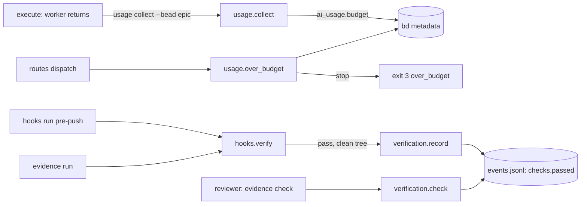

# Plan: cost control (enforced budgets, no wasted test reruns)

Epic: gin-workflow-rm-cost-control
Spec: `.planning/specs/2026-11-01-cost-control-design.md`

## Objective

`usage.budget_usd` gives each epic a USD ceiling. `usage collect --bead <epic>` stores and prints a budget status. `routes dispatch` exits 3 once the epic's stored cost reaches 120% of the budget. `execute` collects the epic's usage after every worker. A passing `pre-push` run, or `gin-workflow evidence run`, is recorded against the tree it tested, and the reviewer reruns tests only when `gin-workflow evidence check` finds no record. `routes resolve` warns when every track routes to the strongest model.

## Goal

Copied from the spec: AI spend per epic has an enforced ceiling when prices are known, usage is fresh after every dispatch, reviewers reuse passing hook runs instead of rerunning tests, and `routes resolve` flags a plan that routes every track to the strongest model.

## Architecture

- `workflow_core/usage.py` owns the budget: `WARN_RATIO`, `STOP_RATIO`, `budget_usd(repo)`, `budget_status(cost, unpriced, budget)`, `over_budget(repo, workflow_id)`. `collect` adds the `budget` block for an epic.
- `workflow_core/routes.py` `dispatch` calls `usage.over_budget` before it touches the manifest; `resolve` calls `_top_model_warning` at both success returns.
- New `workflow_core/verification.py` owns the `checks.passed` event: `clean_tree`, `record`, `check`, `run`, and the `gin-workflow evidence` CLI. `hooks.run` splits into the pre-push filter and `hooks.verify`, which records a passing pre-push run.
- Skills: `execute/SKILL.md` §3 collects the epic after each worker and handles exit 3; `review/SKILL.md` runs `evidence run` before requesting review and `evidence check` before rerunning tests.



## Tech Stack

Python 3 stdlib (`argparse`, `json`, `subprocess`), unittest, Markdown skills and docs.

## Global Constraints

Copied from the spec:
- Out of scope: model prices (no prices ship in code; the user writes `.agent-workflow/usage-prices.yaml`); retry by failure kind, passing the prior attempt's `changed_files`, opening the circuit breaker on the first QUOTA or AUTH failure, and one constant for the timeout and retry defaults (moved to `gin-workflow-dura`); process-group kill on timeout; multi-track parallel dispatch inside `execute`.
- `usage.budget_usd` is optional and additive; existing configs validate unchanged.
- The `budget` block in `ai_usage` is additive; gin-console reads `ai_usage` fields it knows and ignores the rest.
- Exit 3 from `routes dispatch` is new. Before the skill change installs, a harness running the old `execute` text treats it as an unknown failure and stops, which is safe.
- The budget stop depends on time-span attribution, so it can be off; the 20% margin and the `warn` status come first. The user can always raise the budget.
- The execute and review stage chains stay within 12,000 characters (`tests/workflow_core/test_token_budget.py`).

Plan-level rules:
- No commits on `master`. Each track commits on its own branch in its own worktree, created from `feat/cost-control`; the coordinator merges tracks into `feat/cost-control` in track order.
- Before editing, each track runs `gin-workflow rules --files <its files>` and follows the output.
- Steps are test first: write the failing test, run it and see it fail, write the code, run it and see it pass.
- Every track runs the tests it names, then the full suite. Expected: `OK`.
  - Full suite: `PYTHONPATH=plugins/gin-workflow/src/scripts python3 -m unittest tests/test_all.py`
  - One file: `PYTHONPATH=plugins/gin-workflow/src/scripts python3 -m unittest tests/workflow_core/<file>.py`
- Test names carry the story id (for example `test_us2_child_collect_writes_no_budget`).

Decisions this plan takes inside the spec (the spec is amended to match):
- **Event name `checks.passed`, workflow id `checks`.** `verification.passed` is already a legacy gate event: `usage_attribution._GATE_STAGES` maps it to stage `verify`, and `test_lifecycle_cli` checks that old verification events are ignored. Reusing it would move usage between stages. `checks` is never a real workflow: `specs_migrate` lists only plan-approved workflows, and `close_guard` looks up `orchestration.ready` only.
- **Only `pre-push` records.** `pre-commit` runs `lint` and `typecheck` (`hooks.py:20`), never `test`, so its record could never satisfy `evidence check`.
- **`gin-workflow evidence run`.** `execute` pushes after review (§4.3), so a pre-push record does not exist when the reviewer looks. The implementer runs `evidence run` after `checkpoint` and before requesting review; it runs the pre-push commands on the committed tree and records the pass.
- **`evidence check` without `--commit` checks the working tree.** The review checkpoint commit lives on `refs/gin/review/<bead>` and may hold only the scoped files, so its tree hash can differ from the branch tree. The reviewer runs `evidence check` in the track worktree: it needs no tracked change against `HEAD` and uses `HEAD^{tree}`. `approve` already refuses a working tree that differs from the checkpoint.
- **Execute keeps the track-close collect.** It adds the per-worker epic collect; the track-close collect keeps per-track `ai_usage` for `usage report --bead`.
- **Top-model warning needs a catalog with two or more models,** and skips `provider_default` routes and unknown providers. `codex`, `antigravity`, and `opencode` ship one-model catalogs, where every route is trivially the strongest.
- **Dispatch fails open on bd.** When `bd` cannot be read (`usage.UsageError`), dispatch prints a warning and proceeds; the budget is advisory until usage can be read.
- **The budget comes from the live config of the main checkout**, through `resolve_effective_config(main_checkout(repo), write=False)`. `load_effective_config` reads the generated file, which is stale until `setup refresh`; raising the budget must take effect on the next dispatch.
- **No config version bump.** The top-level schema has `additionalProperties: True` and the new `usage` object is optional; `exclusiveMinimum` is already used (`schemas.py:158`).

## Execution Strategy

```yaml
execution_strategy:
  mode: worker
  workers:
    mode: parallel
  rationale: Tracks 1, 3 and 4 touch disjoint code and separate sections of docs/reference/cli.md; Track 2 extends usage.py after Track 1 and edits routes.py and the routes section of cli.md after Track 4.
```

## Tasks

### Track 1: Budget in config and `usage collect`
- **Dependencies**: none
- **Files**:
  - Modify `plugins/gin-workflow/src/scripts/workflow_core/schemas.py:229-233` (add `usage` next to `notifications`)
  - Modify `plugins/gin-workflow/src/scripts/workflow_core/usage.py:17-28,281-284` (imports, ratios, `budget_usd`, `budget_status`, budget block in `collect`)
  - Modify `plugins/gin-workflow/src/scripts/workflow_core/usage_cli.py:72-73` (budget in the collect line)
  - Modify `docs/reference/config.md:88-96` (new `### usage` after `### notifications`)
  - Modify `docs/guides/usage-report.md:36-46` (new `## Budget` after `## Prices`)
  - Modify `docs/reference/cli.md:333` (`collect` sentence)
  - Test `tests/workflow_core/test_usage.py`
  - Test `tests/workflow_core/test_usage_cli.py`
- **Provider role**: `backend`
- **Model:** `sonnet`
- **Effort:** `medium`
- **Why:** bounded change to one module and its CLI with exact thresholds from the spec.
- **Acceptance criteria**: US-2. Statuses at 50%, 80%, 120% are `ok`, `warn`, `stop`; a used model without a price gives `unenforceable`; a child bead's collect writes no `budget`; `budget_usd: 0` is a configuration error; the collect line prints the status.
- **Estimated complexity**: low

Interfaces produced (Track 2 consumes them):
- `usage.WARN_RATIO = 0.8`, `usage.STOP_RATIO = 1.2`
- `usage.budget_usd(repo: Path) -> float | None` (raises `usage.UsageError` on an invalid configuration)
- `usage.budget_status(cost: float | None, unpriced: Sequence[str], budget: float) -> str`

Steps:

1. Add the tests to `tests/workflow_core/test_usage.py`, at the end of the file:

```python
class BudgetTests(Fixture):
    def budget(self, value):
        write(self.repo, ".agent-workflow/config.yaml",
              f"schema_version: '2.8'\nproviders:\n  task_tracking: beads\nusage:\n  budget_usd: {value}\n")

    def test_us2_status_thresholds(self):
        self.assertEqual(usage.budget_status(5.0, [], 10.0), "ok")
        self.assertEqual(usage.budget_status(8.0, [], 10.0), "warn")
        self.assertEqual(usage.budget_status(11.99, [], 10.0), "warn")
        self.assertEqual(usage.budget_status(12.0, [], 10.0), "stop")
        self.assertEqual(usage.budget_status(None, [], 10.0), "ok")

    def test_us2_unpriced_model_makes_the_budget_unenforceable(self):
        self.assertEqual(usage.budget_status(None, ["m9"], 10.0), "unenforceable")
        self.assertEqual(usage.budget_status(50.0, ["m9"], 10.0), "unenforceable")

    def test_us2_epic_collect_stores_the_budget_block(self):
        self.budget(1)
        doc = self.collect("ep1")
        self.assertEqual(doc["budget"], {"budget_usd": 1.0, "cost": doc["cost"], "status": "ok"})
        stored = json.loads(self.written()[-1][1])
        self.assertEqual(stored["budget"], doc["budget"])

    def test_us2_child_collect_writes_no_budget(self):
        self.budget(1)
        self.assertNotIn("budget", self.collect("ep1.1"))

    def test_us2_no_budget_means_no_budget_block(self):
        self.assertNotIn("budget", self.collect("ep1"))
        self.assertIsNone(usage.budget_usd(self.repo))

    def test_us2_budget_must_be_positive(self):
        self.budget(0)
        with self.assertRaises(usage.UsageError):
            usage.budget_usd(self.repo)
```

   Add to `UsageCliTests` in `tests/workflow_core/test_usage_cli.py`:

```python
    def test_us2_collect_prints_the_epic_budget_status(self):
        write(self.repo, ".agent-workflow/config.yaml",
              "schema_version: '2.8'\nproviders:\n  task_tracking: beads\nusage:\n  budget_usd: 10\n")
        fake_cli(self.bin, "bd", [
            {"argv": ["show", "e1"], "stdout": [{"id": "e1", "issue_type": "epic", "title": "E1",
                                                "started_at": "2026-10-04T09:00:00Z", "closed_at": None}]},
            {"argv": ["history", "e1"], "stdout": []},
            {"argv": ["dep", "list", "e1"], "stdout": []},
            {"argv": ["update"], "stdout": ""},
        ])
        done = run_cli(self.repo, "usage", "collect", "--bead", "e1", env=self.env)
        self.assertEqual(done.returncode, 0, done.stderr)
        self.assertIn("budget ok (0/10)", done.stdout)
```

   Run both files; expect failures (`AttributeError: budget_status`, missing `budget`).

2. In `schemas.py`, after the `"notifications"` entry (line 233), add:

```python
        "usage": {
            "type": "object",
            "properties": {"budget_usd": {"type": "number", "exclusiveMinimum": 0}},
            "additionalProperties": False,
        },
```

3. In `usage.py`, change the import at line 19 to `from .configuration import ConfigValidationError, require_yaml, resolve_effective_config`, and after `_SEVERITIES` (line 28) add:

```python
# Budget statuses: `warn` from WARN_RATIO of the budget, `stop` from STOP_RATIO; the margin
# above 1.0 covers the error of time-span attribution.
WARN_RATIO = 0.8
STOP_RATIO = 1.2
```

   After `cost()` (line 66) add:

```python
def budget_usd(repo: Path) -> float | None:
    """`usage.budget_usd` from the main checkout's live config; None when unset."""
    try:
        config = resolve_effective_config(main_checkout(Path(repo).resolve()), write=False).config.to_dict()
    except ConfigValidationError as error:
        raise UsageError(f"invalid configuration: {error}") from error
    value = (config.get("usage") or {}).get("budget_usd")
    return None if value is None else float(value)


def budget_status(cost: float | None, unpriced: Sequence[str], budget: float) -> str:
    if unpriced:
        return "unenforceable"
    ratio = (cost or 0.0) / budget
    if ratio >= STOP_RATIO:
        return "stop"
    return "warn" if ratio >= WARN_RATIO else "ok"
```

   In `collect`, replace

```python
    if is_epic:
        document["children"] = children
```

   with

```python
    if is_epic:
        document["children"] = children
        budget = budget_usd(repo)
        if budget is not None:
            document["budget"] = {"budget_usd": budget, "cost": document["cost"],
                                  "status": budget_status(document["cost"], document["unpriced"], budget)}
```

4. In `usage_cli.py` `main`, after the `text = f"{args.bead}: cost ..."` statement (lines 72-73) add:

```python
            budget = out.get("budget")
            if budget:
                text += f"; budget {budget['status']} ({_money(budget['cost'])}/{_money(budget['budget_usd'])})"
                if budget["status"] == "unenforceable":
                    text += f"; no price for {', '.join(out['unpriced'])} in {usage.PRICES_FILE}"
```

   Run both test files; expect `OK`.

5. Docs.
   - `docs/reference/config.md`, after the `### notifications` section:

```markdown
### `usage`

`budget_usd` (number above 0, optional): the AI spend ceiling of each epic, in USD. `gin-workflow usage collect --bead <epic>` compares the epic's cost with it and reports `ok`, `warn` (from 80%), `stop` (from 120%), or `unenforceable` (a used model has no price in `.agent-workflow/usage-prices.yaml`). See [AI usage report](../guides/usage-report.md#budget).
```

   - `docs/guides/usage-report.md`, a new section after `## Prices`:

```markdown
## Budget

Set `usage.budget_usd` in `.agent-workflow/config.yaml` to give each epic a spend ceiling in USD:

```yaml
usage:
  budget_usd: 25
```

`usage collect --bead <epic>` then stores `budget: {budget_usd, cost, status}` in the epic's summary and prints the status:

| Status | When |
|---|---|
| `ok` | cost below 80% of the budget |
| `warn` | cost from 80% up to 120% |
| `stop` | cost at or above 120%; the margin covers the error of time-span attribution |
| `unenforceable` | a used model has no price; the output names the models and `.agent-workflow/usage-prices.yaml` |

A track's summary has no budget block; the budget belongs to the epic.
```

   - `docs/reference/cli.md` `## gin-workflow usage`, after the sentence ending "unpriced models show `-`.": add "With `usage.budget_usd` set, collecting an epic adds `budget: {budget_usd, cost, status}` to its summary and the status to the printed line."
   Run the full suite; expect `OK`.

### Track 2: Dispatch stop and per-worker collect
- **Dependencies**: Track 1, Track 4
- **Files**:
  - Modify `plugins/gin-workflow/src/scripts/workflow_core/usage.py` (add `over_budget` after `budget_status`)
  - Modify `plugins/gin-workflow/src/scripts/workflow_core/routes.py:22-31,170-176` (import `usage`; budget check in `dispatch`)
  - Modify `plugins/gin-workflow/src/skills/execute/SKILL.md:32-40` (new §3 step 3)
  - Modify `docs/concepts/lifecycle.md:35`
  - Modify `docs/guides/usage-report.md:23` (When it runs) and the `## Budget` section from Track 1
  - Modify `docs/reference/config.md` (`### usage` from Track 1)
  - Modify `docs/reference/cli.md:262-264` (`dispatch` paragraph and exit codes)
  - Create `tests/workflow_core/test_routes_budget.py`
- **Provider role**: `backend`
- **Model:** `sonnet`
- **Effort:** `medium`
- **Why:** bounded change across two modules and one skill, with the exit code and payload fixed by the spec.
- **Acceptance criteria**: US-1 and US-3. Budget 10 with stored cost 12 exits 3 with `over_budget` and leaves the manifest and event log unchanged; budget 20 dispatches; no budget, null cost, or an unpriced model dispatches; an unreadable `bd` warns and dispatches; a workflow id maps to the epic recorded by `orchestration-ready`; `execute/SKILL.md` collects the epic after each worker and handles exit 3; `test_token_budget.py` passes.
- **Estimated complexity**: medium

Interfaces consumed: `usage.budget_usd`, `usage.budget_status` (Track 1); `usage._events`, `usage._show`, `usage._usage_of`, `usage_attribution.gates_from_events` (existing).
Interface produced: `usage.over_budget(repo: Path, workflow_id: str) -> dict | None`.

Steps:

1. Create `tests/workflow_core/test_routes_budget.py`:

```python
"""`routes dispatch` refuses a track once the epic's stored cost reaches 120% of `usage.budget_usd`."""

from __future__ import annotations

import contextlib
import io
import json
import os
from pathlib import Path
import sys
import tempfile
import unittest
from unittest import mock

sys.path.insert(0, str(Path(__file__).resolve().parent))
sys.path.insert(0, str(Path(__file__).resolve().parents[2] / "plugins/gin-workflow/src/scripts"))

from team_fixtures import fake_cli, path_with, write  # noqa: E402
from workflow_core import routes, usage  # noqa: E402
from workflow_core.events import WorkflowEvent, WorkflowEventStore  # noqa: E402
from workflow_core.setup_service import refresh  # noqa: E402

CONFIG = "schema_version: '2.8'\nproviders:\n  task_tracking: beads\n"
ROUTE = {"provider": "claude", "selection_mode": "explicit", "model": "sonnet", "effort": "medium"}
MANIFEST = json.dumps({"workflow_id": "ep1", "tracks": {"t1": {"resolved": ROUTE}}})


class DispatchBudgetTests(unittest.TestCase):
    def setUp(self):
        self.tmp = tempfile.TemporaryDirectory()
        self.addCleanup(self.tmp.cleanup)
        base = Path(os.path.realpath(self.tmp.name))
        self.root = base / "repo"
        self.manifest = write(self.root, ".agent-workflow/runtime/assignments/ep1.yaml", MANIFEST)
        self.events = self.root / ".agent-workflow/runtime/events.jsonl"
        self.bin = base / "bin"
        patcher = mock.patch.dict(os.environ, path_with(self.bin))
        patcher.start()
        self.addCleanup(patcher.stop)

    def config(self, extra=""):
        write(self.root, ".agent-workflow/config.yaml", CONFIG + extra)
        refresh(self.root)  # `bd` is used only when the generated config names Beads

    def stored(self, ai_usage):
        fake_cli(self.bin, "bd", [{"argv": ["show", "ep1"], "stdout": [
            {"id": "ep1", "issue_type": "epic", "metadata": {"ai_usage": json.dumps(ai_usage)}}]}])

    def dispatch(self, workflow_id="ep1"):
        out, err = io.StringIO(), io.StringIO()
        with contextlib.redirect_stdout(out), contextlib.redirect_stderr(err):
            code = routes.main(["dispatch", "--workflow-id", workflow_id, "--task-id", "t1",
                                "--repository", str(self.root), "--json"])
        return code, json.loads(out.getvalue()), err.getvalue()

    def test_us1_over_budget_exits_3_and_changes_nothing(self):
        self.config("usage:\n  budget_usd: 10\n")
        self.stored({"cost": 12, "unpriced": []})
        code, payload, _ = self.dispatch()
        self.assertEqual(code, 3)
        self.assertEqual(payload, {"status": "over_budget", "epic": "ep1", "cost": 12, "budget_usd": 10.0})
        self.assertEqual(self.manifest.read_text(encoding="utf-8"), MANIFEST)
        self.assertFalse(self.events.exists())

    def test_us1_raising_the_budget_lets_dispatch_proceed(self):
        self.config("usage:\n  budget_usd: 20\n")
        self.stored({"cost": 12, "unpriced": []})
        code, payload, _ = self.dispatch()
        self.assertEqual((code, payload["model"]), (0, "sonnet"))

    def test_us1_no_budget_dispatches_without_reading_bd(self):
        self.config()
        code, _, _ = self.dispatch()
        self.assertEqual(code, 0)
        self.assertFalse((self.bin / "calls.log").exists())

    def test_us2_null_cost_or_unpriced_model_never_stops(self):
        self.config("usage:\n  budget_usd: 10\n")
        for stored in ({"cost": None, "unpriced": ["m9"]}, {"cost": 50, "unpriced": ["m9"]}, {}):
            self.stored(stored)
            self.assertEqual(self.dispatch()[0], 0, stored)

    def test_unreadable_bd_warns_and_dispatches(self):
        self.config("usage:\n  budget_usd: 10\n")
        with mock.patch.object(usage, "_bd", side_effect=usage.UsageError("bd is not installed")):
            code, _, err = self.dispatch()
        self.assertEqual(code, 0)
        self.assertIn("budget not checked: bd is not installed", err)

    def test_us1_workflow_id_maps_to_its_recorded_epic(self):
        self.config("usage:\n  budget_usd: 10\n")
        self.stored({"cost": 12, "unpriced": []})
        write(self.root, ".agent-workflow/runtime/assignments/wf.yaml", MANIFEST)
        WorkflowEventStore(self.events).append(
            WorkflowEvent.create(event_type="orchestration.ready", workflow_id="wf", payload={"epic": "ep1"}))
        code, payload, _ = self.dispatch("wf")
        self.assertEqual((code, payload["epic"]), (3, "ep1"))
```

   Run it; expect failures (exit 0 where 3 is expected).

2. In `usage.py`, after `budget_status`, add:

```python
def over_budget(repo: Path, workflow_id: str) -> dict[str, Any] | None:
    """The stop payload once the epic's stored cost reaches STOP_RATIO of the budget; None otherwise."""
    budget = budget_usd(repo)
    if budget is None:
        return None
    root = main_checkout(Path(repo).resolve())
    epic = gates_from_events(_events(root))[1].get(workflow_id, workflow_id)
    stored = _usage_of(_show(root, epic)) or {}
    if budget_status(stored.get("cost"), stored.get("unpriced") or [], budget) != "stop":
        return None
    return {"status": "over_budget", "epic": epic, "cost": stored["cost"], "budget_usd": budget}
```

3. In `routes.py`, add `from . import usage` after `from . import orchestrator_client` (line 29). In `dispatch`, after the `if not manifest_path.is_file(): ...` return and before `yaml = require_yaml()`, add:

```python
    try:
        stop = usage.over_budget(root, workflow_id)
    except usage.UsageError as error:
        print(f"warning: budget not checked: {error}", file=sys.stderr)
        stop = None
    if stop is not None:
        return stop, 3
```

   Run `test_routes_budget.py` and `test_routes_cli.py`; expect `OK`.

4. `execute/SKILL.md` §3: insert a new step after step 2 and renumber the steps after it (3→4, 4→5, 5→6, 6→7):

```markdown
3. After each worker result, run `gin-workflow usage collect --bead <epic> --best-effort`. If `routes dispatch` exits 3 (`over_budget`), `gin-workflow notify --event needs_input "<epic>: over budget"`, leave the bead `in_progress` with a note, and ask the user to raise `usage.budget_usd` or stop.
```

   Run `PYTHONPATH=plugins/gin-workflow/src/scripts python3 -m unittest tests/workflow_core/test_token_budget.py`; expect `OK` (execute chain 11,903 of 12,000 characters).

5. Docs.
   - `docs/concepts/lifecycle.md:35`, before "When tests pass and review approves": add the bullet "- After each worker returns, the agent runs `gin-workflow usage collect --bead <epic> --best-effort`. With `usage.budget_usd` set, `routes dispatch` exits 3 once the epic's stored cost reaches 120% of the budget, and the agent asks you to raise the budget or stop."
   - `docs/guides/usage-report.md` "When it runs": "`execute` runs `gin-workflow usage collect --bead <epic> --best-effort` after each worker returns and `--bead <track>` before closing each track, and `ship` runs it for the epic before closing it." At the end of `## Budget`, add: "At `stop`, `gin-workflow routes dispatch` for the epic prints `{\"status\": \"over_budget\", ...}`, dispatches nothing, and exits 3. Raising `usage.budget_usd` lets the next dispatch proceed without another collect. `unenforceable` never stops a dispatch."
   - `docs/reference/config.md` `### usage`: append "At `stop`, `routes dispatch` refuses the next track (exit 3) until you raise the budget."
   - `docs/reference/cli.md` `dispatch` paragraph: append "With `usage.budget_usd` set, it first reads the stored `ai_usage` of the epic (the one `orchestration-ready` recorded for the workflow, else the workflow id). At or above 120% of the budget it prints `{\"status\": \"over_budget\", \"epic\", \"cost\", \"budget_usd\"}`, changes nothing, and exits 3. When `bd` cannot be read it prints a warning and dispatches." In the exit codes line, add "3 the epic is over budget (`dispatch`)".
   Run the full suite; expect `OK`.

### Track 3: Recorded check runs and `gin-workflow evidence`
- **Dependencies**: none
- **Files**:
  - Create `plugins/gin-workflow/src/scripts/workflow_core/verification.py`
  - Modify `plugins/gin-workflow/src/scripts/workflow_core/hooks.py:13-16,109-131` (import; split `run` into the filter and `verify`; record a pass)
  - Modify `plugins/gin-workflow/src/scripts/workflow_core/cli.py:20-21,109` (`evidence` top command)
  - Modify `plugins/gin-workflow/src/skills/review/SKILL.md:15,23`
  - Modify `docs/reference/cli.md:230-234` (hooks note; new `## gin-workflow evidence` section after the hooks section)
  - Test `tests/workflow_core/test_hooks.py`
- **Provider role**: `backend`
- **Model:** `sonnet`
- **Effort:** `medium`
- **Why:** a new small module plus a split of one function; git edge cases (dirty tree, linked worktree) are listed with tests.
- **Acceptance criteria**: US-4. A passing `pre-push` on a clean tree records `HEAD^{tree}`; a failing run, a run with tracked changes, and `pre-commit` record nothing; a failed record warns and keeps exit 0; `evidence check` exits 0 for a tree whose record includes `test` and 1 otherwise; `evidence run` refuses a dirty tree with exit 2; a record made in a linked worktree is found from the main checkout; `state` is unaffected by `checks.passed` (full suite); `review/SKILL.md` runs `evidence run` before requesting review and `evidence check` before rerunning tests; `test_token_budget.py` passes.
- **Estimated complexity**: medium

Interfaces produced:
- `verification.EVENT_TYPE = "checks.passed"`, `verification.WORKFLOW_ID = "checks"`
- `verification.clean_tree(root: Path) -> str | None`
- `verification.record(root: Path, hook: str, tree: str, commands: Sequence[str]) -> None`
- `verification.check(root: Path, commit: str | None = None) -> tuple[dict | None, str]`; the record is `{"tree", "hook", "commands", "recorded_at"}`
- `verification.run(root: Path) -> int`, `verification.main(argv) -> int`
- `hooks.verify(root: Path, hook: str) -> int`

Steps:

1. Add to `tests/workflow_core/test_hooks.py`: imports `from workflow_core import hooks, setup_service, verification` (extend line 19) and `from workflow_core.events import WorkflowEventStore`; then, at the end of the file:

```python
class TestPassingRunRecords(unittest.TestCase):
    def setUp(self):
        self.tmp = tempfile.TemporaryDirectory()
        self.addCleanup(self.tmp.cleanup)
        self.base = Path(os.path.realpath(self.tmp.name))
        self.root = make_repo(self.base)

    def other(self, name, **kwargs):
        path = self.base / name
        path.mkdir()
        return make_repo(path, **kwargs)

    def records(self, root):
        path = root / ".agent-workflow/runtime/events.jsonl"
        events = WorkflowEventStore(path).read_all() if path.is_file() else []
        return [event for event in events if event.event_type == verification.EVENT_TYPE]

    def test_us4_passing_pre_push_records_the_tested_tree(self):
        self.assertEqual(0, hooks.run(self.root, "pre-push", [push_ref(self.root)]))
        found, _ = verification.check(self.root, "HEAD")
        self.assertEqual(found["tree"], git(self.root, "rev-parse", "HEAD^{tree}"))
        self.assertEqual((found["hook"], found["commands"]), ("pre-push", ["test"]))

    def test_us4_failing_run_records_nothing(self):
        root = self.other("b", test="false")
        self.assertNotEqual(0, hooks.run(root, "pre-push", [push_ref(root)]))
        self.assertEqual([], self.records(root))

    def test_us4_tracked_changes_record_nothing(self):
        (self.root / "f.txt").write_text("y")
        self.assertEqual(0, hooks.run(self.root, "pre-push", [push_ref(self.root)]))
        self.assertEqual([], self.records(self.root))

    def test_us4_pre_commit_records_nothing(self):
        self.assertEqual(0, hooks.run(self.root, "pre-commit"))
        self.assertEqual([], self.records(self.root))

    def test_us4_failed_record_warns_and_keeps_the_exit_code(self):
        err = io.StringIO()
        with mock.patch.object(verification, "record", side_effect=OSError("disk full")), \
                contextlib.redirect_stderr(err):
            self.assertEqual(0, hooks.run(self.root, "pre-push", [push_ref(self.root)]))
        self.assertIn("passing run not recorded: disk full", err.getvalue())

    def test_us4_check_needs_a_test_command(self):
        tree = git(self.root, "rev-parse", "HEAD^{tree}")
        self.assertEqual((None, f"no passing check recorded for tree {tree}"), verification.check(self.root, "HEAD"))
        verification.record(self.root, "pre-push", tree, ["lint"])
        found, reason = verification.check(self.root, "HEAD")
        self.assertIsNone(found)
        self.assertIn("ran no test command", reason)
        verification.record(self.root, "pre-push", tree, ["pkg:test"])
        self.assertIsNotNone(verification.check(self.root, "HEAD")[0])

    def test_us4_check_without_commit_needs_a_clean_tree(self):
        verification.record(self.root, "pre-push", git(self.root, "rev-parse", "HEAD^{tree}"), ["test"])
        self.assertIsNotNone(verification.check(self.root)[0])
        (self.root / "f.txt").write_text("y")
        found, reason = verification.check(self.root)
        self.assertIsNone(found)
        self.assertIn("commit them first", reason)

    def test_us4_evidence_cli_run_and_check(self):
        quiet = contextlib.redirect_stdout(io.StringIO())
        with quiet, contextlib.redirect_stderr(io.StringIO()):
            self.assertEqual(1, verification.main(["check", "--repository", str(self.root)]))
            self.assertEqual(0, verification.main(["run", "--repository", str(self.root)]))
            self.assertEqual(0, verification.main(["check", "--commit", "HEAD", "--repository", str(self.root)]))
            (self.root / "f.txt").write_text("y")
            self.assertEqual(2, verification.main(["run", "--repository", str(self.root)]))

    def test_us4_record_from_a_linked_worktree_lands_in_the_main_checkout(self):
        tree = self.base / "wt"
        git(self.root, "worktree", "add", "-q", "-b", "track", str(tree))
        with contextlib.redirect_stderr(io.StringIO()):
            self.assertEqual(0, verification.run(tree))
        self.assertEqual(1, len(self.records(self.root)))
        self.assertIsNotNone(verification.check(self.root, "HEAD")[0])
```

   Run `test_hooks.py`; expect failures (`ImportError: verification`).

2. Create `plugins/gin-workflow/src/scripts/workflow_core/verification.py`:

```python
"""Passing verify runs recorded against the tree they tested, so a reviewer can skip a rerun."""

from __future__ import annotations

import argparse
import json
from pathlib import Path
import subprocess
import sys
from typing import Any, Sequence

from .checkout import main_checkout
from .events import WorkflowEvent, WorkflowEventStore

# Not `verification.passed`: that name is a legacy gate event mapped to the `verify` usage stage.
EVENT_TYPE = "checks.passed"
WORKFLOW_ID = "checks"


def _git(root: Path, *args: str) -> subprocess.CompletedProcess:
    return subprocess.run(["git", *args], cwd=root, text=True, capture_output=True, check=False)


def _events_path(root: Path) -> Path:
    return main_checkout(Path(root).resolve()) / ".agent-workflow/runtime/events.jsonl"


def clean_tree(root: Path) -> str | None:
    """HEAD's tree hash when no tracked file differs from HEAD; None otherwise."""
    status = _git(root, "status", "--porcelain", "--untracked-files=no")
    if status.returncode or status.stdout.strip():
        return None
    tree = _git(root, "rev-parse", "HEAD^{tree}")
    return tree.stdout.strip() if tree.returncode == 0 else None


def record(root: Path, hook: str, tree: str, commands: Sequence[str]) -> None:
    path = _events_path(root)
    path.parent.mkdir(parents=True, exist_ok=True)
    WorkflowEventStore(path).append(WorkflowEvent.create(
        event_type=EVENT_TYPE, workflow_id=WORKFLOW_ID,
        payload={"tree": tree, "hook": hook, "commands": sorted(commands)}))


def check(root: Path, commit: str | None = None) -> tuple[dict[str, Any] | None, str]:
    """The newest record that ran `test` on the commit's tree, or on HEAD's tree when nothing tracked changed."""
    if commit is None:
        tree = clean_tree(root)
        if tree is None:
            return None, "tracked files differ from HEAD; commit them first"
    else:
        done = _git(root, "rev-parse", "--verify", "--quiet", f"{commit}^{{tree}}")
        if done.returncode:
            return None, f"unknown commit: {commit}"
        tree = done.stdout.strip()
    path = _events_path(root)
    events = WorkflowEventStore(path).read_all() if path.is_file() else []
    matches = [event for event in events
               if event.event_type == EVENT_TYPE and (event.payload or {}).get("tree") == tree]
    if not matches:
        return None, f"no passing check recorded for tree {tree}"
    tested = [event for event in matches
              if any(name == "test" or name.endswith(":test") for name in event.payload["commands"])]
    if not tested:
        return None, f"the checks recorded for tree {tree} ran no test command"
    newest = max(tested, key=lambda event: event.timestamp)
    return {"tree": tree, "hook": newest.payload["hook"], "commands": list(newest.payload["commands"]),
            "recorded_at": newest.timestamp}, ""


def run(root: Path) -> int:
    """Run the pre-push verify commands on the committed tree; a pass is recorded."""
    if clean_tree(root) is None:
        print("error: tracked files differ from HEAD; commit them so the record names the tree it tested",
              file=sys.stderr)
        return 2
    from .hooks import verify  # hooks imports this module

    return verify(Path(root), "pre-push")


def main(argv: Sequence[str]) -> int:
    parser = argparse.ArgumentParser(prog="gin-workflow evidence")
    common = argparse.ArgumentParser(add_help=False)
    common.add_argument("--repository", type=Path, default=Path.cwd())
    sub = parser.add_subparsers(dest="command", required=True)
    sub.add_parser("run", parents=[common])
    checker = sub.add_parser("check", parents=[common])
    checker.add_argument("--commit")
    checker.add_argument("--json", action="store_true")
    args = parser.parse_args(list(argv))
    root = args.repository.resolve()
    if args.command == "run":
        return run(root)
    found, reason = check(root, args.commit)
    if args.json:
        print(json.dumps({"record": found, "reason": reason}))
    elif found:
        print(f"passed {', '.join(found['commands'])} on tree {found['tree']} ({found['hook']}, {found['recorded_at']})")
    else:
        print(reason)
    return 0 if found else 1
```

3. In `hooks.py`, add `from . import verification` after the existing imports (line 16), and replace `run` (lines 109-131) with:

```python
def run(root: Path, hook: str, refs: Sequence[str] = ()) -> int:
    root = Path(root)
    if hook == "pre-push" and not _pushes_head(root, refs):
        print("gin-workflow: pre-push tested nothing (no pushed branch at the checked-out HEAD)", file=sys.stderr)
        return 0
    return verify(root, hook)


def verify(root: Path, hook: str) -> int:
    """Run the hook's verify commands; a passing pre-push on a clean tree is recorded."""
    root = Path(root)
    settings = project_settings(resolve_effective_config(root, write=False).config.to_dict())
    names = _PRE_PUSH.get(settings.rigor, _PRE_PUSH["standard"]) if hook == "pre-push" else _PRE_COMMIT
    scoped = [(root, [(name, settings.verify_commands[name]) for name in names if settings.verify_commands.get(name)])]
    for package in settings.packages:
        checks = (package.get("verify") or {}).get("checks") or {}
        scoped.append((root / package["path"],
                       [(f"{package['path']}:{name}", checks[name]) for name in names if checks.get(name)]))
    if not any(commands for _, commands in scoped):
        print(f"gin-workflow: no verify commands configured for {hook}; nothing to run", file=sys.stderr)
        return 0
    # Taken before the commands run, so the record names the tree they tested.
    tree = verification.clean_tree(root) if hook == "pre-push" else None
    env = {key: value for key, value in os.environ.items() if key not in _GIT_ENV}
    for cwd, commands in scoped:
        code = _run_commands(hook, commands, cwd, env)
        if code:
            return code
    if tree:
        try:
            verification.record(root, hook, tree, [name for _, commands in scoped for name, _ in commands])
        except Exception as error:  # a failed record never changes the hook's result
            print(f"gin-workflow {hook}: passing run not recorded: {error}", file=sys.stderr)
    return 0
```

4. In `cli.py`, add `"evidence"` to `TOP_COMMANDS` (after `"hooks"`), and before the `if argv[0] == "usage":` branch add:

```python
    if argv[0] == "evidence":
        from .verification import main as evidence_main
        return evidence_main(argv[1:])
```

   Run `test_hooks.py`, then the full suite.

5. `review/SKILL.md`:
   - Requesting step 1: after "`checkpoint --repo-id <id> --commit-msg "<msg>" --actor-id <id>` to snapshot the reviewed tree," insert "then `gin-workflow evidence run` in the worktree (fix any failure first),".
   - Reviewing step 3: replace "run the tests in isolation." with "run the tests in isolation unless `gin-workflow evidence check` in the worktree exits 0; then cite its record instead."
   Run `test_token_budget.py`; expect `OK` (review chain 11,615 of 12,000 characters).

6. `docs/reference/cli.md`:
   - `## gin-workflow hooks`, end of the `run` paragraph: "A passing `pre-push` on a tree with no tracked changes is recorded for [`evidence check`](#gin-workflow-evidence)."
   - New section after the hooks section:

```markdown
## `gin-workflow evidence`

```
gin-workflow evidence run [--repository DIR]
gin-workflow evidence check [--commit SHA] [--repository DIR] [--json]
```

When every `pre-push` verify command passes on a tree with no tracked changes, `hooks run pre-push` and `evidence run` append a `checks.passed` event (workflow id `checks`; payload `tree`, `hook`, `commands`) to `.agent-workflow/runtime/events.jsonl` in the main checkout. A record that cannot be written prints a warning and never changes the exit code. `pre-commit` records nothing, because it runs no `test`.

`run` runs the `pre-push` verify commands on the checked-out commit. The `review` skill runs it after `checkpoint`, because the branch is pushed only after review. It refuses with exit 2 when a tracked file differs from `HEAD`.

`check` finds the newest record for the tree of `--commit`, or of `HEAD` when no tracked file differs from it, whose commands include `test` or `<package>:test`. It prints the record, or why none matches; `--json` prints `{"record": {"tree", "hook", "commands", "recorded_at"} | null, "reason"}`. The reviewer reruns the tests only when it exits 1.

Exit codes: `run` 0 pass, 2 tracked changes, otherwise the failing command's exit code; `check` 0 a record matches, 1 none does.
```

   Run the full suite; expect `OK` (`test_docs_coverage` requires this heading).

### Track 4: Top-model warning in `routes resolve`
- **Dependencies**: none
- **Files**:
  - Modify `plugins/gin-workflow/src/scripts/workflow_core/routes.py:88-102,145-158` (warning at both success returns; new `_top_model_warning`)
  - Modify `docs/reference/cli.md:256` (`resolve` paragraph)
  - Test `tests/workflow_core/test_routes_cli.py`
- **Provider role**: `backend`
- **Model:** `sonnet`
- **Effort:** `low`
- **Why:** one small function with exact code and three tests; no design judgement left.
- **Acceptance criteria**: US-5. Two tracks both on `opus` produce the warning; one track, or `opus` plus `sonnet`, produce none; the exit code stays 0.
- **Estimated complexity**: low

Interface produced: `routes._top_model_warning(config_dict: Mapping, entries: Sequence[Mapping]) -> str | None`.

Steps:

1. Add to `TestRoutesCLI` in `tests/workflow_core/test_routes_cli.py`:

```python
    def _track(self, task_id, model):
        return {"task_id": task_id, "provider_role": "backend", "model": model, "effort": "high"}

    def test_us5_every_track_on_the_strongest_model_warns(self):
        code, payload = self._resolve("wf-top", [self._track("t1", "opus"), self._track("t2", "opus")])
        self.assertEqual(code, 0)
        self.assertIn("every track routes to opus, the strongest claude model; check the plan's tiers",
                      payload["warnings"])

    def test_us5_one_track_or_mixed_models_do_not_warn(self):
        for tracks in ([self._track("t1", "opus")], [self._track("t1", "opus"), self._track("t2", "sonnet")]):
            code, payload = self._resolve("wf-top", tracks)
            self.assertEqual(code, 0)
            self.assertFalse([w for w in payload["warnings"] if "strongest" in w], tracks)
```

   Run `test_routes_cli.py`; expect the first test to fail.

2. In `routes.py`, add before `resolve`:

```python
def _top_model_warning(config_dict: Mapping[str, Any], entries: Sequence[Mapping[str, Any]]) -> str | None:
    """A warning when two or more tracks all route to the strongest model of a multi-model catalog."""
    if len(entries) < 2:
        return None
    strongest: set[tuple[str, str]] = set()
    for entry in entries:
        resolved = entry.get("resolved") or {}
        provider = str(resolved.get("provider", ""))
        try:
            models = catalog_for(config_dict, provider).models
        except KeyError:
            return None
        if resolved.get("selection_mode") == "provider_default" or len(models) < 2 \
                or resolved.get("model") != models[-1]:
            return None
        strongest.add((provider, models[-1]))
    named = ", ".join(f"{model}, the strongest {provider} model" for provider, model in sorted(strongest))
    return f"every track routes to {named}; check the plan's tiers"
```

   In `resolve`, add the same line right before each of the two success `return {...}` statements that carry `"manifest": manifest` (the orchestrator path after `write_assignments`, and the final return):

```python
    if manifest and (warning := _top_model_warning(config_dict, entries)):
        warnings.append(warning)
```

   (indented to match the surrounding block). Run `test_routes_cli.py`; expect `OK`.

3. `docs/reference/cli.md` `resolve` paragraph, after the sentence that lists the printed keys: "`warnings` names the strongest model when two or more tracks all route to the last model of a catalog with two or more models; the exit code does not change." Run the full suite; expect `OK`.

## Integration
- **Branch**: `feat/cost-control`
- **Merge strategy**: parallel-then-merge (Tracks 1, 3, 4 in parallel; Track 2 after 1 and 4; merge in track order)

## Validation
- [ ] Full suite `OK`: `PYTHONPATH=plugins/gin-workflow/src/scripts python3 -m unittest tests/test_all.py`
- [ ] `gin-workflow specs lint --spec .planning/specs/2026-11-01-cost-control-design.md` prints `ok`
- [ ] Manual, after `./install.sh --platform all`: with `usage: {budget_usd: 0.01}` in a scratch repo's config and a priced epic, `gin-workflow usage collect --bead <epic>` prints `budget stop`, and `gin-workflow routes dispatch --workflow-id <epic> --task-id <t>` exits 3
- [ ] Manual: in a track worktree, `gin-workflow evidence run` then `gin-workflow evidence check` exits 0, and `gin-workflow state --workflow-id gin-workflow-rm-cost-control` still prints the gates

## Notes
- `Model:` and `Effort:` are chosen from the main harness catalog (claude: haiku, sonnet, opus; efforts low to max) using the route rubric. No track is on `opus`, so Track 4's warning does not fire on this plan.
- The user may override `Model:` and `Effort:` before plan approval.
- The Parent Bead (`gin-workflow-rm-cost-control`) stays open until a human-confirmed merge; track beads close after tests and review pass.
- This repository has no `.agent-workflow/usage-prices.yaml`, so its own epics stay `unenforceable` until one is written; that is the designed behavior.
