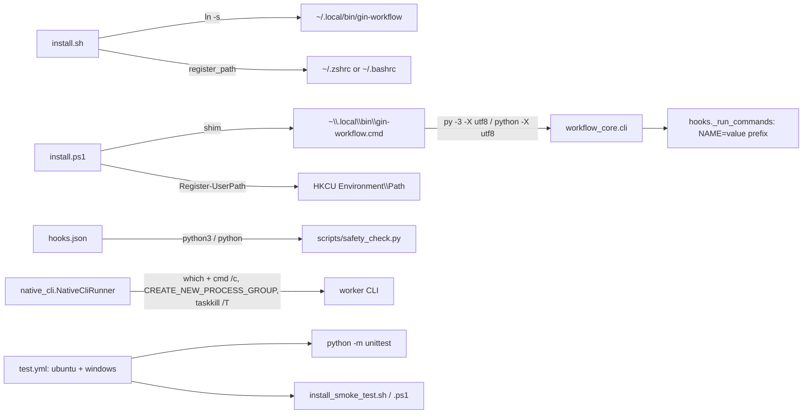

# Plan: Windows parity phase 2 (native launcher, hooks, workers, CI)

Epic: gin-workflow-rm-windows-parity
Spec: `.planning/specs/2026-11-02-windows-parity-design.md`

## Objective

After `install.sh` (macOS, Linux) or `install.ps1` (Windows), `gin-workflow` runs from a new terminal with no manual `PATH` edit; the safety hook runs with Python alone; gin-orchestrator workers start, see their environment, and stop on cancel on Windows; `.github/workflows/test.yml` is green on `ubuntu-latest` and `windows-latest` for every push and pull request.

## Goal

Copied from the spec: every gin-workflow command, hook, and orchestrator worker runs on Windows 10/11 and macOS from a plain terminal after `install.ps1` or `install.sh`, with no Git Bash, WSL, or manual `PATH` edit, and CI proves it on every push and pull request.

## Architecture

- `install.sh` and `install.ps1` own `PATH` registration (`register_path` / `Register-UserPath`, with `--no-modify-path` / `-NoModifyPath`) and the launcher shim. The shim content is the only place that decides the interpreter (`py -3 -X utf8`, else `python -X utf8`).
- `plugins/gin-workflow/src/scripts/safety_check.py` is the single safety hook. The installers and `src/hooks/hooks.json` reference it with a per-platform interpreter.
- `gin_orchestrator/native_cli.py` owns worker spawn and cancel; the `nt` branches live next to the `posix` ones in `NativeCliRunner.run`.
- `workflow_core/executable_resolver.py` resolves executables with `shutil.which` on every path; `workflow_core/hooks.py` `_run_commands` owns the `NAME=value` prefix.
- `.github/workflows/test.yml` runs both platforms; `release.yml` is unchanged.



## Tech Stack

Bash 4 (`install.sh`), PowerShell 7 (`install.ps1`), Python 3.11 stdlib (`re`, `json`, `os`, `shutil`, `subprocess`), unittest, GitHub Actions.

## Global Constraints

Copied from the spec:
- Out of scope: the `.beads` symlink on Windows (document a junction or copy fallback only); `merge-integration.sh`; the `{env, argv}` form of `verify_commands` and a config schema bump; adding `encoding="utf-8"` to each `subprocess(text=True)` call; the `.beads.gate.lock` writer, Beads on Windows, and the Windows build of `bd`.
- `PATH` registration never edits a file or registry value that already contains the entry; a startup file that cannot be written produces a warning with the `export` line and a zero exit.
- `install.ps1` refuses to replace a shim it does not recognize; the recognizer accepts the previous and the new content only.
- `safety_check.py` exits 2 with `Error: failed to parse PreToolUse hook payload as JSON.` on malformed input.
- The env-prefix parser recognizes only the strict `NAME=value` token shape; anything else passes to the shell unchanged.
- Config schema version stays `2.9`; no migration; `state --format json` shape unchanged.
- Every `skipIf(os.name == "nt")` has a reason string.

Plan-level rules:
- No commits on `master`. Each track commits on its own branch in its own worktree, created from `feat/windows-parity`; the coordinator merges tracks into `feat/windows-parity` in track order.
- Before editing, each track runs `gin-workflow rules --files <its files>` and follows the output.
- Steps are test first: write the failing test, run it and see it fail, write the code, run it and see it pass.
- Every track runs the tests it names, then the full suite. Expected: `OK`.
  - Full suite: `PYTHONPATH=plugins/gin-workflow/src/scripts python3 -m unittest tests/test_all.py`
  - One file: `PYTHONPATH=plugins/gin-workflow/src/scripts python3 -m unittest tests/workflow_core/<file>.py`
  - Smoke: `bash tests/install_smoke_test.sh`; `pwsh -NoProfile -File tests/install_smoke_test.ps1` (on Linux it runs the parts outside `if ($IsWindows)`).
- Test names carry the story id (for example `test_us6_env_prefix_reaches_child`).

Decisions this plan takes inside the spec (the spec is amended to match):
- **No launcher version bump in this epic.** `is_managed_launcher_link` and `Test-ManagedLauncherShim` accept any managed version, so a 2.9 install upgrades in place; the bump is the release step in `docs/contributing.md:102`. The spec's "Launcher versions bump" line becomes "No version bump; the release procedure bumps it".
- **Byte semantics in the port.** `safety_check.py` maps the command to one character per byte (`.encode("utf-8", "surrogateescape").decode("latin-1")`) before parsing, so `\cʀ` takes the first byte (0xca) like bash under `LC_ALL=C`, and messages are printed back through the inverse mapping.
- **Nested payloads recurse in-process.** Instead of re-executing itself with `SAFETY_CHECK_DEPTH`, the port calls `check(payload, cwd, depth + 1)`; the depth limit and message are unchanged, and `SAFETY_CHECK_DEPTH` is still read as the starting depth.

## Route Rubric

- Choose the weakest model that can do the work.
- Raise the model for broad context or design judgement.
- Raise the effort for intrinsic difficulty: intricate logic, many edge cases, or long chains of steps.

| Kind of work | Model | Effort |
|---|---|---|
| Mechanical edits, documentation, boilerplate | `haiku` | `low` |
| Bounded implementation with a clear spec | `sonnet` | `medium` |
| Cross-module change, security, migration, concurrency | `opus` | `high` |

Unclear requirements never raise the model or effort.

## Requirement Analysis

- Problem statement: the launcher is installed but not on `PATH`; the hook needs bash and `jq`; workers use POSIX-only process handling; nothing runs on Windows in CI.
- Success criteria: spec US-1 to US-7; `test.yml` green on both platforms.
- Constraints: the Global Constraints above; the smoke test never writes the developer's registry.
- Non-goals: the Out of scope list.

## Approach Options

### Option 1: Installer-owned PATH and shim, Python hook, per-site Windows branches
- Summary: the installers register `PATH` and write the shim; one Python hook; `nt` branches inside `native_cli.py` and `executable_resolver.py`.
- Pros: no new modules, no config change, follows the existing structure of both installers.
- Cons: `install.sh` and `install.ps1` each grow one function and one flag.

### Option 2: A `gin-workflow setup path` CLI subcommand that edits `PATH`
- Summary: the installers call the CLI to register `PATH`.
- Pros: one implementation in Python.
- Cons: the CLI is not on `PATH` yet at that moment, so the installer must locate it; adds a CLI command and docs for a one-time step.

### Recommended Approach
- Selected option: Option 1.
- Rationale: the installers already own the launcher location and the `PATH` warning; the change lands where the warning is.

## Scope

- In scope: spec R1 to R13.
- Out of scope: the spec's Out of scope list.

## Execution Strategy

```yaml
execution_strategy:
  mode: worker
  workers:
    mode: parallel
  rationale: Tracks 1, 2, 3, and 4 touch disjoint files; Track 5 depends on all of them because CI must see the final tree.
```

## Tasks

### Track 1: Installers register PATH, new shim, -Link fallback
- **Dependencies**: none
- **Files**:
  - Modify `install.sh:6-14` (flag `MODIFY_PATH=true`, `PATH_MARKER`), `install.sh:16-57` (`--no-modify-path`), `install.sh:95-107` (uninstall calls `unregister_path`), `install.sh:472-530` (`install_launcher` calls `register_path` instead of the warning)
  - Modify `install.ps1:1-12` (`[switch]$NoModifyPath`), `install.ps1:64-76` (`-Link` fallback), `install.ps1:317-352` (`Test-ManagedLauncherShim` accepts old and new content), `install.ps1:355-452` (shim content, `Register-UserPath`), `install.ps1:626-650` (uninstall calls `Unregister-UserPath`)
  - Test `tests/install_smoke_test.sh`
  - Test `tests/install_smoke_test.ps1`
  - Modify `docs/guides/windows.md:1-75` (PATH section, shim, Developer Mode note), `docs/contributing.md:70`, `docs/reference/troubleshooting.md:13`, `README.md:38`
- **Provider role**: `backend`
- **Model:** `sonnet`
- **Effort:** `medium`
- **Why:** bounded shell and PowerShell edits with the exact content and the recognizer regex given below; the edge cases (idempotency, upgrade from the old shim, dry-run) are enumerated.
- **Acceptance criteria**: spec US-1, US-2, US-3 (shim content and upgrade cases); `bash tests/install_smoke_test.sh` passes; `pwsh -NoProfile -File tests/install_smoke_test.ps1` passes on Linux (and on Windows in Track 5).
- **Estimated complexity**: medium

Steps:

1. `tests/install_smoke_test.sh`, after the mock-HOME install block (`:304`), add the failing assertions:
   ```bash
   # PATH registration: once per rc file, chosen by $SHELL, removed on --uninstall, skipped with --no-modify-path.
   path_home="$(mktemp -d)"
   HOME="$path_home" SHELL=/bin/zsh PATH="/usr/bin:/bin" ./install.sh --platform opencode >/dev/null
   HOME="$path_home" SHELL=/bin/zsh PATH="/usr/bin:/bin" ./install.sh --platform opencode >/dev/null
   assert_contains "$path_home/.zshrc" '# gin-workflow PATH'
   if [ "$(grep -c '# gin-workflow PATH' "$path_home/.zshrc")" != "1" ]; then echo "PATH block written more than once" >&2; exit 1; fi
   assert_contains "$path_home/.zshrc" 'export PATH="$HOME/.local/bin:$PATH"'
   HOME="$path_home" SHELL=/bin/zsh PATH="/usr/bin:/bin" ./install.sh --uninstall >/dev/null
   assert_not_contains "$path_home/.zshrc" '# gin-workflow PATH'
   HOME="$path_home" SHELL=/bin/bash PATH="/usr/bin:/bin" ./install.sh --platform opencode --no-modify-path >"$output_file" 2>&1
   assert_not_exists "$path_home/.bashrc"
   assert_contains "$output_file" 'export PATH="$HOME/.local/bin:$PATH"'
   HOME="$path_home" SHELL=/bin/bash PATH="/usr/bin:/bin" ./install.sh --platform opencode --dry-run >"$output_file"
   assert_contains "$output_file" "(dry-run) would add $path_home/.local/bin to PATH in $path_home/.bashrc"
   rm -rf "$path_home"
   ```
   Run `bash tests/install_smoke_test.sh`: fails at `Unknown parameter passed: --no-modify-path` or the first `assert_contains`.
2. `install.sh`: after `ORCH_LAUNCHER_VERSION="0.1"` add `MODIFY_PATH=true` and `PATH_MARKER='# gin-workflow PATH'`; in the `case $1` add
   ```bash
       --no-modify-path)
         MODIFY_PATH=false
         shift
         ;;
   ```
   Add two functions before `install_launcher`:
   ```bash
   path_rc_file() {
     case "$(basename "${SHELL:-}")" in
       zsh) echo "${HOME}/.zshrc" ;;
       bash) echo "${HOME}/.bashrc" ;;
       *) echo "" ;;
     esac
   }

   register_path() {
     local bin="${HOME}/.local/bin" rc
     case ":${PATH}:" in *":${bin}:"*) return ;; esac
     rc="$(path_rc_file)"
     if [ "$MODIFY_PATH" != true ] || [ -z "$rc" ]; then
       echo "Add ${bin} to PATH: put 'export PATH=\"\$HOME/.local/bin:\$PATH\"' in ${rc:-your shell startup file}." >&2
       return
     fi
     if [ -f "$rc" ] && grep -qF "$PATH_MARKER" "$rc"; then return; fi
     if [ "$DRY_RUN" = true ]; then
       echo "(dry-run) would add ${bin} to PATH in $rc"
       return
     fi
     if ! printf '\n%s\nexport PATH="$HOME/.local/bin:$PATH"\n' "$PATH_MARKER" >> "$rc" 2>/dev/null; then
       echo "Warning: could not write $rc; add 'export PATH=\"\$HOME/.local/bin:\$PATH\"' to it." >&2
       return
     fi
     echo "Added ${bin} to PATH in $rc; open a new terminal or run: source $rc"
   }

   unregister_path() {
     local rc
     for rc in "${HOME}/.zshrc" "${HOME}/.bashrc"; do
       { [ -f "$rc" ] && grep -qF "$PATH_MARKER" "$rc"; } || continue
       python3 - "$rc" "$PATH_MARKER" <<'PYEOF'
   import sys
   path, marker = sys.argv[1], sys.argv[2]
   lines = open(path, encoding="utf-8").read().split("\n")
   out, drop_next = [], False
   for line in lines:
       if line == marker:
           drop_next = True
           continue
       if drop_next:
           drop_next = False
           if line == 'export PATH="$HOME/.local/bin:$PATH"':
               continue
       out.append(line)
   open(path, "w", encoding="utf-8").write("\n".join(out))
   PYEOF
       echo "Removed the gin-workflow PATH block from $rc"
     done
   }
   ```
   In the uninstall block (`:95`) add `unregister_path` before `echo "Removed generated dist output..."`. In `install_launcher`, replace the `case ":${PATH}:"` warning (`:524-527`) with `register_path`, and in the dry-run branch (`:495-499`) add `if [ "$name" = gin-workflow ]; then register_path; fi` before `return`. Run the smoke test: passes.
3. `tests/install_smoke_test.ps1`: in `Invoke-Installer` (`:29`), before splatting, add
   ```powershell
   if (-not $Parameters.ContainsKey('NoModifyPath') -and -not $env:GITHUB_ACTIONS) { $Parameters['NoModifyPath'] = $true }
   ```
   After the shim upgrade loop (`:174-200`) add failing assertions:
   ```powershell
   $shimText = [IO.File]::ReadAllText((Join-Path $TestHome '.local/bin/gin-workflow.cmd'))
   Assert-Contains $shimText 'py -3 -X utf8 "'
   Assert-Contains $shimText 'else (python -X utf8 "'
   Assert-True (-not $shimText.Contains('||')) 'shim must not chain the CLI with ||'
   if ($IsWindows) {
       $pathDryRun = Invoke-Installer @{ Platform = 'codex'; Project = $project; DryRun = $true; NoModifyPath = $false }
       Assert-Contains ($pathDryRun | Out-String) 'would add'
       $noPathOutput = Invoke-Installer @{ Platform = 'codex'; Project = $project; NoModifyPath = $true }
       Assert-Contains ($noPathOutput | Out-String) 'Add '
   }
   if ($IsWindows -and $env:GITHUB_ACTIONS) {
       $binDir = [IO.Path]::GetFullPath((Join-Path $TestHome '.local/bin')).TrimEnd('\', '/')
       Invoke-Installer @{ Platform = 'codex'; Project = $project; NoModifyPath = $false } | Out-Null
       Assert-True (([Environment]::GetEnvironmentVariable('Path', 'User') -split ';') -contains $binDir) 'user PATH entry missing after install'
       Invoke-Installer @{ Uninstall = $true; NoModifyPath = $false } | Out-Null
       Assert-True (-not (([Environment]::GetEnvironmentVariable('Path', 'User') -split ';') -contains $binDir)) 'user PATH entry still present after -Uninstall'
   }
   ```
   Also add a `-Link` fallback case next to the existing `Link = $true` install (`:144`): on Windows without Developer Mode the output must contain `Unable to create symbolic link` as a warning and the install must still produce `Join-Path $linkProject '.claude/skills/gin-workflow/skills/setup/SKILL.md'`; wrap it in `if ($IsWindows)` and assert only `Assert-Exists` plus that no exception was thrown (`Invoke-Installer` returning normally is the assertion). Run `pwsh -NoProfile -File tests/install_smoke_test.ps1`: fails on the shim content.
4. `install.ps1`: add `[switch]$NoModifyPath` after `[switch]$DryRun`. Replace the `-Link` `catch` (`:73-75`) with
   ```powershell
   catch {
       if (-not $script:LinkFallbackWarned) {
           Write-Warning "Unable to create symbolic link '$target'; copying instead. Enable Windows Developer Mode or run PowerShell with suitable privileges for -Link. $($_.Exception.Message)"
           $script:LinkFallbackWarned = $true
       }
       Copy-Item -LiteralPath $item.FullName -Destination $target -Recurse -Force
   }
   ```
   and `$script:LinkFallbackWarned = $false` after `$UserHome = [IO.Path]::GetFullPath($UserHome)`.
   Replace the single regex in `Test-ManagedLauncherShim` (`:327-329`) with two accepted shapes:
   ```powershell
   $oldShape = '\A@echo off\npython "([^"\n]+)" %\*\n?\z'
   $newShape = '\A@echo off\nwhere py >nul 2>nul\nif %errorlevel%==0 \(py -3 -X utf8 "([^"\n]+)" %\*\) else \(python -X utf8 "\1" %\*\)\n?\z'
   if ($content -notmatch $oldShape -and $content -notmatch $newShape) {
       return $false
   }
   ```
   (`$Matches[1]` is the launcher path in both shapes; the rest of the function is unchanged.)
   Replace `$shimContent` (`:418`) with
   ```powershell
   $shimContent = "@echo off`r`nwhere py >nul 2>nul`r`nif %errorlevel%==0 (py -3 -X utf8 `"$launcherTarget`" %*) else (python -X utf8 `"$launcherTarget`" %*)`r`n"
   ```
   Add before `Install-Launcher`:
   ```powershell
   function Get-LauncherBin {
       return [IO.Path]::GetFullPath((Join-Path $UserHome '.local/bin')).TrimEnd('\', '/')
   }

   function Test-PathContains {
       param([Parameter(Mandatory)][AllowEmptyString()][string]$PathValue, [Parameter(Mandatory)][string]$Directory)
       foreach ($entry in ($PathValue -split [Regex]::Escape([IO.Path]::PathSeparator))) {
           if ([string]::IsNullOrWhiteSpace($entry)) { continue }
           try {
               if ([IO.Path]::GetFullPath($entry).TrimEnd('\', '/').Equals($Directory, [StringComparison]::OrdinalIgnoreCase)) { return $true }
           }
           catch { continue }
       }
       return $false
   }

   function Register-UserPath {
       $launcherBin = Get-LauncherBin
       if (-not (Test-PathContains -PathValue $env:PATH -Directory $launcherBin)) {
           $env:PATH = "$launcherBin$([IO.Path]::PathSeparator)$env:PATH"
       }
       if (-not $IsWindows) {
           Write-Warning "$launcherBin is not on PATH."
           return
       }
       $userPath = [string][Environment]::GetEnvironmentVariable('Path', 'User')
       if (Test-PathContains -PathValue $userPath -Directory $launcherBin) { return }
       if ($NoModifyPath) {
           Write-Output "Add $launcherBin to your user PATH (install.ps1 -NoModifyPath leaves it unchanged)."
           return
       }
       if ($DryRun) {
           Write-Output "(dry-run) would add $launcherBin to the user PATH"
           return
       }
       $entries = @($userPath -split ';' | Where-Object { -not [string]::IsNullOrWhiteSpace($_) }) + $launcherBin
       [Environment]::SetEnvironmentVariable('Path', ($entries -join ';'), 'User')
       Write-Output "Added $launcherBin to the user PATH; open a new terminal for other sessions to see it."
   }

   function Unregister-UserPath {
       if (-not $IsWindows -or $NoModifyPath) { return }
       $launcherBin = Get-LauncherBin
       $userPath = [string][Environment]::GetEnvironmentVariable('Path', 'User')
       $entries = @($userPath -split ';' | Where-Object { -not [string]::IsNullOrWhiteSpace($_) })
       $kept = @($entries | Where-Object { -not (Test-PathContains -PathValue $_ -Directory $launcherBin) })
       if ($kept.Count -eq $entries.Count) { return }
       [Environment]::SetEnvironmentVariable('Path', ($kept -join ';'), 'User')
       Write-Output "Removed $launcherBin from the user PATH."
   }
   ```
   In `Install-Launcher`, replace the `PATH` check block (`:432-451`) with `if ($Name -eq 'gin-workflow') { Register-UserPath }`, and in the `$DryRun` branch (`:384-388`) add `if ($Name -eq 'gin-workflow') { Register-UserPath }` before `return`. In the `$Uninstall` block add `Unregister-UserPath` before the final `Write-Output`. Run the smoke test on Linux: passes.
5. Docs: `docs/guides/windows.md` Installation section gains a `PATH` paragraph (the installer adds `%USERPROFILE%\.local\bin` to the user `PATH`; `-NoModifyPath` to opt out; open a new terminal) and the Python prerequisite paragraph (`:15`) says the shim runs `py -3` when the `py` launcher exists, else `python`; the Developer Mode section says `-Link` falls back to copying with a warning. `docs/contributing.md:70`: replace "the installer warns when that folder is not on `PATH` and does not change your environment" with "the installer adds that folder to the user `PATH` unless `-NoModifyPath` is passed; `install.sh` does the same in `~/.zshrc` or `~/.bashrc` unless `--no-modify-path` is passed". `docs/reference/troubleshooting.md:13`: "If you installed with `--no-modify-path`, add `~/.local/bin` to `PATH`." `README.md:38`: "The installer links it and adds `~/.local/bin` to your shell startup file (`--no-modify-path` to opt out); a marketplace install alone does not". Run `PYTHONPATH=plugins/gin-workflow/src/scripts python3 -m unittest tests/workflow_core/test_docs_coverage.py`: `OK`.
6. Run the full suite and both smoke tests; commit `feat(install): register ~/.local/bin on PATH, py -3 utf8 shim, -Link copy fallback`.

### Track 2: Safety hook in Python
- **Dependencies**: none
- **Files**:
  - Create `plugins/gin-workflow/src/scripts/safety_check.py`
  - Delete `plugins/gin-workflow/src/scripts/safety-check.sh`
  - Modify `plugins/gin-workflow/src/hooks/hooks.json:10`
  - Modify `install.sh:191-265` (four hook templates), `install.ps1:116-169` (`New-HooksFile`, `New-CopilotHooksFile`)
  - Test `tests/test_safety_check.py:11-14,179-200`
  - Test `tests/install_smoke_test.sh` (hook command assertions), `tests/install_smoke_test.ps1` (hook command assertions)
  - Modify `README.md:23-29,64`, `docs/reference/troubleshooting.md:30-35`, `docs/concepts/architecture.md:20`
- **Provider role**: `backend`
- **Model:** `opus`
- **Effort:** `high`
- **Why:** a security hook with a byte-level quote parser, ANSI-C decoding, nested-shell recursion, and 40 regex cases; the existing test file is the oracle and any drift is a bypass.
- **Acceptance criteria**: spec US-4; `tests/test_safety_check.py` passes with only its invocation changed; `grep -rn safety-check.sh install.sh install.ps1 plugins/gin-workflow/src docs README.md` prints nothing except the troubleshooting heading anchor history noted in step 6.
- **Estimated complexity**: high

Steps:

1. `tests/test_safety_check.py`: change `SCRIPT` to `.../scripts/safety_check.py`, `exit_code` to `subprocess.run([sys.executable, str(SCRIPT), command], stdin=subprocess.DEVNULL, capture_output=True).returncode` (add `import sys`), the `TestPayloadWithoutJq` run (`:186`) to `[sys.executable, str(SCRIPT)]` with `env={"PATH": directory}` kept (it proves no `jq` or `bash` is needed; rename the class `TestPayloadFromStdin`), and the two Copilot runs (`:194,199`) to `[sys.executable, str(SCRIPT)]`. Run `python3 -m unittest tests/test_safety_check.py`: every test errors with `No such file`.
2. Create `safety_check.py` with this structure (module docstring: "PreToolUse safety hook: blocks hook bypasses, broad recursive removals, and work outside the assigned worktree."):
   ```python
   import json, os, re, sys
   from dataclasses import dataclass

   BLOCK = 2

   def to_bytes_str(text: str) -> str:
       return text.encode("utf-8", "surrogateescape").decode("latin-1")

   def from_bytes_str(text: str) -> str:
       return text.encode("latin-1").decode("utf-8", "replace")

   def read_input(argv: list[str]) -> tuple[str, str]:
       """(command, cwd): hook JSON on stdin when stdin is not a TTY and not empty, else argv."""
       if not sys.stdin.isatty():
           raw = sys.stdin.buffer.read()
           if raw.strip():
               try:
                   payload = json.loads(raw.decode("utf-8", "surrogateescape"))
                   command = (payload.get("tool_input") or {}).get("command") or ""
                   cwd = payload.get("cwd") or ""
               except (ValueError, AttributeError):
                   print("Error: failed to parse PreToolUse hook payload as JSON.", file=sys.stderr)
                   raise SystemExit(BLOCK)
               return str(command), str(cwd)
       return (argv[1] if len(argv) > 1 else ""), (argv[2] if len(argv) > 2 else "")

   @dataclass
   class Segment:
       raw: str   # the segment text as typed
       bare: str  # one quoting layer removed; quoted text with spaces or an empty whole-word quote becomes "Q"
       unq: str   # one quoting layer removed, text kept

   def decode_ansi_c(text: str) -> str:
       """bash $'...' decoding on a byte string: \\' \\" \\? , octal \\nnn, \\xHH, \\a\\b\\e\\E\\f\\n\\r\\t\\v\\\\, \\cX (X & 31; \\c\\\\ is one backslash)."""

   def split_segments(command: str) -> list[Segment]:
       """Port of safety-check.sh:45-100: split on ; & | and newline outside quotes; handle \\, "...", '...', $'...', $"..."."""

   def block(message: str) -> None:
       print(f"Blocked: {message} skips the gin-workflow git hooks; fix the failing check instead.", file=sys.stderr)
       raise SystemExit(BLOCK)

   def check_removal(segments: list[Segment]) -> None:
       """Port of :101-119; message 'Blocked: Dangerous recursive file removal target or option detected.'"""

   def check_hooks(command: str, segments: list[Segment], cwd: str, depth: int) -> None:
       """Port of :121-194; nested sh -c / eval payloads call check(payload, cwd, depth + 1)."""

   def check_worktree(cwd: str) -> None:
       """Port of :196-209 with os.path.realpath; prints the same Blocked line."""

   def check(command: str, cwd: str, depth: int) -> None:
       segments = split_segments(command)
       check_removal(segments)
       check_hooks(command, segments, cwd, depth)

   def main(argv: list[str]) -> int:
       command, cwd = read_input(argv)
       check(to_bytes_str(command), cwd, int(os.environ.get("SAFETY_CHECK_DEPTH", "0") or 0))
       check_worktree(cwd)
       return 0

   if __name__ == "__main__":
       raise SystemExit(main(sys.argv))
   ```
   Regexes translate one to one; bash `[[:space:]]` becomes `\s`. Case: `check_removal` (`:101-119`) and the `--no-veri` loop (`:123-129`) run before `shopt -s nocasematch` (`:147`) and stay case-sensitive; everything from `:149` to `:193` (`config_env_re`, `shell_re`, `git_re`, `git_word_re`, `git_value_opt_re`, `commit_n_word_re`, `commit_value_opt_re`, `hooks_c_re`, `hooks_config_re`, `--unset`, `--get`) compiles with `re.IGNORECASE`. `${BASH_REMATCH[7]}` becomes `match.group(7)`. The `read -ra words <<< "$bare"` split is `bare.split()` (whitespace, empty words dropped). `realpath -q` failing becomes `None` and blocks as the shell does. Implement in the order: `read_input` and `main` (the `TestPayloadFromStdin` and `TestCopilotPayloads` tests pass), `split_segments` and `decode_ansi_c` (US-2 ANSI-C tests pass), `check_removal` (`TestRecursiveRemoval`), `check_hooks` (`TestNoVerifyBlocked`, `TestHookBypassBlocked`), `check_worktree`. Run the test file after each; all green at the end.
3. `plugins/gin-workflow/src/hooks/hooks.json:10` command becomes
   ```
   s=\"${PLUGIN_ROOT}/scripts/safety_check.py\"; if command -v python3 >/dev/null 2>&1; then exec python3 \"$s\"; fi; exec python \"$s\"
   ```
   `install.sh` templates: `template_hooks_for_claude` and `template_hooks_for_codex` command `python3 \"${root_var}/scripts/safety_check.py\"`; `template_hooks_for_antigravity` command `python3 \"\${PLUGIN_ROOT:-${default_root}}/scripts/safety_check.py\"`; `template_hooks_for_copilot` `bash` value `s=\"${PLUGIN_ROOT:-...}/scripts/safety_check.py\"; if [ -f \"$s\" ]; then exec python3 \"$s\"; fi; echo \"gin-workflow: $s not found, hook skipped\" >&2`. `install.ps1` `New-HooksFile`: `command = "python `"$root/scripts/safety_check.py`""` (antigravity) and `"python `"$HooksRoot/scripts/safety_check.py`""`; `New-CopilotHooksFile` mirrors the bash change with `python3`. Delete `safety-check.sh` (`git rm`). Smoke tests: `tests/install_smoke_test.sh` has `assert_codex_hooks_schema` (`:58`) and dist assertions; update the expected command strings there and in `install_smoke_test.ps1` to the new ones, and add `assert_not_exists "$MOCK_HOME/.claude/skills/gin-workflow/scripts/safety-check.sh"` plus `assert_exists ".../scripts/safety_check.py"`. Run both smoke tests: pass.
4. Docs: `README.md` remove the `jq` and `Git Bash (Windows only)` rows (`:27-28`); `README.md:64` "The hook needs `bash`" becomes "The hook runs through Copilot's `bash` hook type"; `docs/reference/troubleshooting.md:30` heading becomes `` `gin-workflow: <path>/scripts/safety_check.py not found, hook skipped` `` and the README link anchor updates to `#gin-workflow-pathscriptssafety_checkpy-not-found-hook-skipped`; `docs/concepts/architecture.md:20` node label `hooks/hooks.json: scripts/safety_check.py`. Run `test_docs_coverage.py`: `OK`.
5. Full suite and both smoke tests; commit `feat(hooks): port safety-check to Python and drop jq`.

### Track 3: Resolver, worker environment, hook runner env prefix
- **Dependencies**: none
- **Files**:
  - Modify `plugins/gin-workflow/src/scripts/workflow_core/executable_resolver.py:14-21,34-68`
  - Modify `plugins/gin-orchestrator/src/scripts/gin_orchestrator/native_cli.py:85-101`
  - Modify `plugins/gin-workflow/src/scripts/workflow_core/hooks.py:100-107`
  - Test `tests/workflow_core/test_executable_resolver.py`
  - Test `tests/gin_orchestrator/test_native_cli.py`
  - Test `tests/workflow_core/test_hooks.py`
- **Provider role**: `backend`
- **Model:** `sonnet`
- **Effort:** `medium`
- **Why:** three small, independent functions with exact behavior given; tests are patch-based and run on Linux.
- **Acceptance criteria**: spec R7, R9, R10; US-5 third bullet; US-6.
- **Estimated complexity**: low

Steps:

1. `tests/workflow_core/test_executable_resolver.py`: add
   ```python
   def test_us5_finds_cmd_shim_in_common_dir_with_pathext(self):
       from workflow_core import executable_resolver as module
       with tempfile.TemporaryDirectory() as directory:
           shim = Path(directory) / "claude.cmd"
           shim.write_text("@echo off\r\n", encoding="utf-8")
           shim.chmod(0o755)
           with mock.patch.object(module, "COMMON_INSTALL_DIRS", (Path(directory),)), \
                   mock.patch.dict(os.environ, {"PATH": "", "PATHEXT": ".COM;.EXE;.BAT;.CMD"}), \
                   mock.patch.object(module.os, "name", "nt"):
               self.assertEqual(str(shim), module.resolve_harness_executable("claude", provider="claude"))

   def test_us5_appdata_npm_is_probed_on_windows(self):
       from workflow_core import executable_resolver as module
       with mock.patch.dict(os.environ, {"APPDATA": r"C:\Users\x\AppData\Roaming"}):
           self.assertIn(Path(r"C:\Users\x\AppData\Roaming") / "npm", module.common_install_dirs("nt"))
           self.assertFalse(any(path.name == "npm" for path in module.common_install_dirs("posix")))
   ```
   `shutil.which` honors `PATHEXT` only when `sys.platform == "win32"`, so on Linux the first test is satisfied by the explicit `PATHEXT` fallback in step 2 (the `os.name == "nt"` branch), and on Windows by `shutil.which` itself. Run the file: fails (`common_install_dirs` missing).
2. `executable_resolver.py`: replace the `COMMON_INSTALL_DIRS` constant with
   ```python
   def common_install_dirs(os_name: str = os.name) -> tuple[Path, ...]:
       dirs = [Path.home() / ".npm-global/bin", Path.home() / ".local/bin", Path.home() / ".opencode/bin",
               Path.home() / ".local/share/pnpm", Path("/usr/local/bin"), Path("/home/linuxbrew/.linuxbrew/bin")]
       if os_name == "nt" and os.environ.get("APPDATA"):
           dirs.append(Path(os.environ["APPDATA"]) / "npm")
       return tuple(dirs)

   COMMON_INSTALL_DIRS: tuple[Path, ...] = common_install_dirs()
   ```
   and replace the probe loop (`:60-66`) with
   ```python
   for directory in COMMON_INSTALL_DIRS:
       for name in candidates_to_probe:
           found_here = shutil.which(name, path=str(directory))
           if found_here is None and os.name == "nt":
               for ext in os.environ.get("PATHEXT", "").split(os.pathsep):
                   if ext and (directory / f"{name}{ext}").is_file():
                       found_here = str(directory / f"{name}{ext}")
                       break
           if found_here:
               return os.path.abspath(found_here)
   ```
   Keep `test_finds_opencode_in_its_default_install_dir` green (it patches `COMMON_INSTALL_DIRS`, which the loop still reads). Run the file: `OK`.
3. `tests/gin_orchestrator/test_native_cli.py`: add
   ```python
   def test_us5_sanitized_environment_keeps_windows_variables_on_nt(self):
       source = {"PATH": "p", "SYSTEMROOT": "C:\\Windows", "USERPROFILE": "C:\\Users\\x", "APPDATA": "a",
                 "LOCALAPPDATA": "l", "TEMP": "t", "TMP": "t", "PATHEXT": ".EXE", "SECRET": "no"}
       with mock.patch.object(native_cli.os, "name", "nt"):
           kept = native_cli.sanitized_environment(source)
       self.assertEqual({"PATH", "SYSTEMROOT", "USERPROFILE", "APPDATA", "LOCALAPPDATA", "TEMP", "TMP", "PATHEXT"}, set(kept))
       with mock.patch.object(native_cli.os, "name", "posix"):
           self.assertEqual({"PATH"}, set(native_cli.sanitized_environment(source)))
   ```
   (import `native_cli` as a module and `mock` as the file already does for other tests; add them if missing). Run: fails. In `sanitized_environment` add after the `allowed` set:
   ```python
   if os.name == "nt":
       allowed |= {"SYSTEMROOT", "USERPROFILE", "APPDATA", "LOCALAPPDATA", "TEMP", "TMP", "PATHEXT"}
   ```
   Run: `OK`.
4. `tests/workflow_core/test_hooks.py`, in the class holding `test_git_env_is_stripped`. A real `sh` already accepts `NAME=value cmd`, so the tests prove the parser by patching `subprocess.run` and asserting the call:
   ```python
   def test_us6_env_prefix_is_split_off_the_command(self):
       calls = []
       def fake_run(command, **kwargs):
           calls.append((command, kwargs["env"]))
           return subprocess.CompletedProcess(command, 0)
       with mock.patch.object(hooks.subprocess, "run", fake_run):
           hooks._run_commands("pre-commit", [("test", "PYTHONPATH=src A_B=x=y python -m unittest")], Path("."), {"PATH": "p"})
       self.assertEqual([("python -m unittest", {"PATH": "p", "PYTHONPATH": "src", "A_B": "x=y"})], calls)

   def test_us6_command_without_prefix_is_unchanged(self):
       calls = []
       with mock.patch.object(hooks.subprocess, "run", lambda command, **kwargs: calls.append(command) or subprocess.CompletedProcess(command, 0)):
           hooks._run_commands("pre-commit", [("test", "echo A=1; ls -l=x")], Path("."), {})
       self.assertEqual(["echo A=1; ls -l=x"], calls)
   ```
   Run: fails. In `hooks.py` add
   ```python
   _ENV_PREFIX = re.compile(r"^([A-Za-z_][A-Za-z0-9_]*)=(\S*)\s+")

   def _split_env_prefix(command: str) -> tuple[str, dict[str, str]]:
       """Leading NAME=value words become environment variables, as a POSIX shell would do."""
       prefix: dict[str, str] = {}
       while (match := _ENV_PREFIX.match(command)):
           prefix[match.group(1)] = match.group(2)
           command = command[match.end():]
       return command, prefix
   ```
   (`import re`), and in `_run_commands` replace the `subprocess.run` line with
   ```python
   shell_command, prefix = _split_env_prefix(command)
   code = subprocess.run(shell_command, shell=True, cwd=cwd, env={**env, **prefix}).returncode
   ```
   The `print` line above it still shows `command`. Run the file: `OK`.
5. Full suite; commit `feat(windows): resolver honors PATHEXT and %APPDATA%\npm, worker env allowlist on nt, env prefix in hook runner`.

### Track 4: Worker spawn and cancel on Windows
- **Dependencies**: none
- **Files**:
  - Modify `plugins/gin-orchestrator/src/scripts/gin_orchestrator/native_cli.py:329-353,409-445`
  - Test `tests/gin_orchestrator/test_native_cli.py`
- **Provider role**: `backend`
- **Model:** `opus`
- **Effort:** `high`
- **Why:** process-group lifecycle and kill escalation on two platforms, verified on Linux only through patching; a mistake leaves orphaned workers or breaks the POSIX path that 20 tests cover.
- **Acceptance criteria**: spec R8; US-5 first two bullets; every existing `test_native_cli.py` test still passes.
- **Estimated complexity**: medium

Steps:

1. Add to `test_native_cli.py`:
   ```python
   def test_us5_windows_spawn_resolves_cmd_shim_through_cmd_and_new_process_group(self):
       seen = {}
       class FakeProcess:
           pid = 4242
           returncode = 0
           def __init__(self):
               self.stdin, self.stdout, self.stderr = io.BytesIO(), io.BytesIO(b'{"status": "ok"}\n'), io.BytesIO()
           def poll(self): return 0
           def wait(self, timeout=None): return 0
       def fake_popen(argv, **kwargs):
           seen["argv"], seen["kwargs"] = list(argv), kwargs
           return FakeProcess()
       with mock.patch.object(native_cli.os, "name", "nt"), \
               mock.patch.object(native_cli.subprocess, "Popen", fake_popen), \
               mock.patch.object(native_cli.subprocess, "CREATE_NEW_PROCESS_GROUP", 0x200, create=True), \
               mock.patch.object(native_cli.shutil, "which", lambda name: r"C:\Users\x\AppData\Roaming\npm\claude.cmd" if name == "claude" else None), \
               tempfile.TemporaryDirectory() as directory:
           NativeCliRunner().run(NativeCliInvocation(("claude", "-p"), Path(directory), b"", 2.0))
       self.assertEqual(["cmd", "/c", r"C:\Users\x\AppData\Roaming\npm\claude.cmd", "-p"], seen["argv"])
       self.assertEqual(0x200, seen["kwargs"]["creationflags"])
       self.assertFalse(seen["kwargs"]["start_new_session"])
       self.assertIsNone(seen["kwargs"]["preexec_fn"])

   def test_us5_windows_cancel_uses_taskkill_tree(self):
       cancel = threading.Event()
       runs: list[list[str]] = []
       class FakeProcess:
           pid = 4242
           returncode = None
           killed = False
           def __init__(self):
               self.stdin, self.stdout, self.stderr = io.BytesIO(), io.BytesIO(), io.BytesIO()
           def poll(self):
               cancel.set()                      # first poll: the worker is running, then cancellation arrives
               return 1 if runs else None        # dead once taskkill ran
           def wait(self, timeout=None):
               if not runs:
                   raise subprocess.TimeoutExpired("fake", timeout)
               self.returncode = 1
               return 1
           def kill(self):
               self.killed = True
       fake = FakeProcess()
       def fake_run(argv, **kwargs):
           runs.append(list(argv))
           return subprocess.CompletedProcess(argv, 0)
       with mock.patch.object(native_cli.os, "name", "nt"), \
               mock.patch.object(native_cli.subprocess, "Popen", lambda argv, **kwargs: fake), \
               mock.patch.object(native_cli.subprocess, "CREATE_NEW_PROCESS_GROUP", 0x200, create=True), \
               mock.patch.object(native_cli.subprocess, "run", fake_run), \
               mock.patch.object(native_cli.shutil, "which", lambda name: name), \
               tempfile.TemporaryDirectory() as directory:
           with self.assertRaises(NativeCliError) as raised:
               NativeCliRunner().run(NativeCliInvocation(("worker.exe",), Path(directory), b"", 5.0), cancel_event=cancel)
       self.assertIs(FailureKind.CANCELLED, raised.exception.kind)
       self.assertIn(["taskkill", "/T", "/F", "/PID", "4242"], runs)
       self.assertFalse(fake.killed)
   ```
   (`import io, threading` at the top of the test file if missing; `_workspace_changed_files` also goes through the patched `subprocess.run`, which is why the assertion is `assertIn`.) Run: both fail (`cmd` not in argv; `creationflags` missing).
2. In `NativeCliRunner.run`, before `subprocess.Popen`, add
   ```python
   argv = list(invocation.argv)
   popen_kwargs: dict[str, object] = {}
   if os.name == "nt":
       resolved = shutil.which(argv[0]) or argv[0]
       if resolved.lower().endswith((".cmd", ".bat")):
           argv = ["cmd", "/c", resolved, *argv[1:]]
       else:
           argv[0] = resolved
       popen_kwargs["creationflags"] = subprocess.CREATE_NEW_PROCESS_GROUP
   ```
   and pass `argv` and `**popen_kwargs` to `Popen` (keep `start_new_session=os.name == "posix"` and the `preexec_fn` expression). In `terminate_tree`, replace each `else: process.terminate()` branch with `_taskkill_tree(process)` for the first two escalation steps and keep `process.kill()` as the last resort, where
   ```python
   def _taskkill_tree(process: subprocess.Popen) -> None:
       """Windows: end the whole tree; taskkill missing or failing falls through to process.kill()."""
       try:
           subprocess.run(["taskkill", "/T", "/F", "/PID", str(process.pid)], stdout=subprocess.DEVNULL,
                          stderr=subprocess.DEVNULL, check=False, timeout=5)
       except (OSError, subprocess.SubprocessError):
           process.kill()
   ```
   is a module-level function. Run the file: `OK`, including the 20 existing tests.
3. Full suite; commit `feat(orchestrator): spawn .cmd workers through cmd /c and cancel with taskkill on Windows`.

### Track 5: CI on both platforms, POSIX skips, remaining docs
- **Dependencies**: Track 1, Track 2, Track 3, Track 4
- **Files**:
  - Create `.github/workflows/test.yml`
  - Modify `tests/**/test_*.py` (only `@unittest.skipIf(os.name == "nt", "<reason>")` decorators where the Windows job fails for a POSIX reason) and `tests/install_smoke_test.ps1` (Windows-only failures)
  - Modify `docs/contributing.md:76-85` (Tests section: CI workflow, `PYTHONUTF8=1`), `docs/guides/windows.md` (Task tracking: `.beads` junction or copy; Verifying: CI runs the same smoke test)
- **Provider role**: `backend`
- **Model:** `opus`
- **Effort:** `high`
- **Why:** the Windows job cannot run locally; the implementer diagnoses failures from CI logs across every test module and must tell a POSIX-only test from a real Windows bug (which is fixed, not skipped).
- **Acceptance criteria**: spec US-7 (the implementer pushes the integration branch and reads `gh run view --log-failed`; no human action is needed); `gh run list --branch feat/windows-parity --workflow test.yml` shows both jobs `success`; `grep -rn 'skipIf(os.name == "nt"' tests | grep -v '"nt", "' ` prints nothing.
- **Estimated complexity**: high

Steps:

1. Create `.github/workflows/test.yml`:
   ```yaml
   name: test
   on:
     push:
     pull_request:
   permissions:
     contents: read
   jobs:
     linux:
       runs-on: ubuntu-latest
       timeout-minutes: 20
       steps:
         - uses: actions/checkout@v4
         - uses: actions/setup-python@v5
           with:
             python-version: "3.12"
         - run: python3 -m pip install PyYAML jsonschema
         - run: |
             git config --global user.name "ci"
             git config --global user.email "ci@example.com"
         - run: python3 -m unittest discover -s tests -v
         - run: bash tests/install_smoke_test.sh
     windows:
       runs-on: windows-latest
       timeout-minutes: 30
       env:
         PYTHONUTF8: "1"
       steps:
         - uses: actions/checkout@v4
         - uses: actions/setup-python@v5
           with:
             python-version: "3.12"
         - run: python -m pip install PyYAML jsonschema
         - run: |
             git config --global user.name "ci"
             git config --global user.email "ci@example.com"
         - run: python -m unittest discover -s tests -v
         - run: pwsh -NoProfile -File tests/install_smoke_test.ps1
   ```
   Commit on the track branch, merge into `feat/windows-parity`, push, and read the run: `gh run list --branch feat/windows-parity --workflow test.yml --limit 1`, then `gh run view <id> --log-failed`.
2. For each Windows failure: a POSIX dependency (`bash`, `os.killpg`, `chmod` bits, `symlink_to` without Developer Mode, `/bin/sh` scripts as verify commands, `realpath` of `/tmp`) gets `@unittest.skipIf(os.name == "nt", "<what POSIX feature the test needs>")` on the test method or class; anything else is a product bug and is fixed in the owning module with a regression test that runs on Linux too. Repeat push and read until both jobs are `success`. Each iteration is one commit `test(windows): <what>`.
3. `docs/contributing.md` Tests section: add "CI runs `tests/test_all.py` and both smoke tests on `ubuntu-latest` and `windows-latest` for every push and pull request (`.github/workflows/test.yml`); the Windows job sets `PYTHONUTF8=1`, which the installed shim also sets with `-X utf8`." `docs/guides/windows.md` Task tracking item 2: add "This repository keeps `.beads` as a symlink to `~/gin-beads/<repo>`; on Windows use a junction (`cmd /c mklink /J .beads %USERPROFILE%\gin-beads\<repo>`) or a plain copy of the directory." Run `test_docs_coverage.py`: `OK`.
4. Commit `ci: run tests and install smoke tests on ubuntu and windows`.

## Integration
- **Branch**: `feat/windows-parity`
- **Merge strategy**: parallel-then-merge (Tracks 1–4 in parallel, each merged in track order; Track 5 after all four)

## Validation
- [ ] `PYTHONPATH=plugins/gin-workflow/src/scripts python3 -m unittest tests/test_all.py` prints `OK`
- [ ] `bash tests/install_smoke_test.sh` exits 0
- [ ] `pwsh -NoProfile -File tests/install_smoke_test.ps1` exits 0 on Linux and in the Windows job
- [ ] `test.yml` linux and windows jobs `success` on `feat/windows-parity`
- [ ] Manual: on a Windows machine, `pwsh -File .\install.ps1 -Platform claude`, open a new terminal, `gin-workflow --version` prints `gin-workflow 2.9`; `pwsh -File .\install.ps1 -Uninstall` removes the user `PATH` entry
- [ ] Manual: on macOS with zsh, `./install.sh --platform claude`, open a new terminal, `gin-workflow --version` prints `gin-workflow 2.9`

## Notes
- `Model:` and `Effort:` come from the `claude` catalog (`haiku`, `sonnet`, `opus`; `low` … `max`).
- Track 2 is the only track where the implementer must read the whole `safety-check.sh` before writing; the test file is the oracle.
- Parent bead `gin-workflow-rm-windows-parity` stays open until the human-confirmed merge; track beads close when their tests and review pass.
