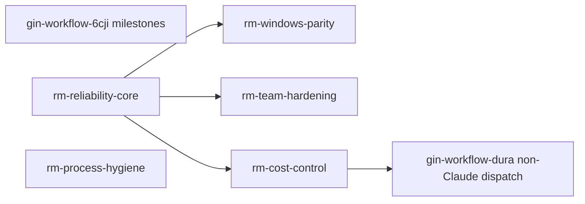

# Roadmap: Workflow audit — reliable, cross-platform, team-safe gin-workflow

Date: 2026-10-30
Source: Solution-architect audit of this repository on 2026-10-30 (five researcher passes over the gate engine, Windows portability, team mode, orchestrator dispatch, and ADLC practice; high-severity claims verified at the cited lines), plus the two epics already open in Beads.

<!-- Written by /roadmap after the PM confirms it. One "### " block per epic; an epic id never changes once written.
     Depends on: epic ids from this file. Evidence: the tech-doc file and section (for example
     03-ARCHITECTURE.md#Request flow) or the product brief. The dependency graph stays acyclic. -->

## Goals

- `state` never reports work as done or undone when the task tracker is unreachable; locks time out; waivers are never silently lost; a new session resumes a half-done track.
- Every command, hook, and worker runs natively on Windows and Linux, proven by CI on both.
- Several members in different roles work in parallel without conflicting claims, lost Beads commits, or unproven gates.
- AI spend per epic has an enforced ceiling; retries and reviews do not multiply cost without cause.
- Skills agree with each other and with the CLI; no hard-coded locale or shell.
- PMs plan dated milestones over roadmap epics and gin-console shows them.

## Constraints

- Keep the JSON read by gin-console backward compatible (`gin-workflow state --format json`, `task ... --json`): add fields, never remove or change meaning.
- `workflow_core.ext` additions do not change `EXT_VERSION` unless a signature changes.
- Windows CI runs on `windows-latest`; no WSL or Git Bash assumption in the tested path.
- No `/tech-doc` pass precedes this roadmap; evidence points at verified `file:line` sites instead.
- Beads dependencies record technical blocking only; the wave order below is scheduling, expressed later through milestones.

## Strategy

Risk first, then fan out. The milestone epic goes first because `/roadmap --milestone` is what later attaches every epic here to a dated milestone. Reliability core is the foundation the three platform/team/cost epics build on (tracker-unavailable state, lock timeout, event schema version, resume protocol). Windows parity, team hardening, and cost control are independent of each other and run in parallel once the core ships. Process hygiene touches only skills and docs, so it ships early to reduce rebases. Non-Claude dispatch follows cost control because both edit the orchestrator dispatch path and new workers should inherit the budget and retry rules once.

## Order

| Wave | Epics |
|---|---|
| 0 | `gin-workflow-6cji` |
| 1 | `gin-workflow-rm-reliability-core`, `gin-workflow-rm-process-hygiene` |
| 2 | `gin-workflow-rm-windows-parity`, `gin-workflow-rm-team-hardening`, `gin-workflow-rm-cost-control` |
| 3 | `gin-workflow-dura` |

After `gin-workflow-6cji` ships: `gin-workflow milestone create`, then `/roadmap --milestone <id>` adopts the epics of this file with estimates.

## Milestone: Workflow audit phase 2

### Windows parity phase 2: native hooks, workers, and CI
Epic: gin-workflow-rm-windows-parity
Milestone: gin-workflow-8w27
Estimate: 2
Goal: Every gin-workflow command, hook, and orchestrator worker runs on Windows without Git Bash or WSL, and CI proves it on every push.
Scope: port `safety-check.sh` to Python and point `hooks.json` at `python` (drops the `jq` dependency); `sanitized_environment` keeps `SYSTEMROOT`, `USERPROFILE`, `APPDATA`, `LOCALAPPDATA`, `TEMP`, `TMP`, `PATHEXT` on `nt`; worker spawn resolves the executable with `shutil.which` and runs `.cmd`/`.bat` through `cmd /c`; `verify_commands` accept an `{env, argv}` form run without a shell, defaults use `sys.executable`, with a config migration; cancel uses `CREATE_NEW_PROCESS_GROUP` and `taskkill /T`; the five `subprocess(text=True)` sites pass `encoding="utf-8", errors="replace"`; the `.cmd` launcher tries `py -3` before `python`; `install.ps1` falls back to copy when a symlink fails; `executable_resolver` adds `%APPDATA%\npm`; a `windows-latest` CI job runs `python -m unittest` and `tests/install_smoke_test.ps1`.
Out of scope: the `.beads` symlink on Windows (document a junction or copy fallback only); `merge-integration.sh` and `find-polluter.sh`.
Depends on: gin-workflow-rm-reliability-core
Evidence: `plugins/gin-workflow/src/hooks/hooks.json:10,22`; `plugins/gin-orchestrator/src/scripts/gin_orchestrator/native_cli.py:86-102,333-341,339,404-425`; `workflow_core/hooks.py:89`; `install.ps1:70,343,427`; `.github/workflows/release.yml:10`; `gin_orchestrator/{workspace.py:22,171,review.py:81,task_tracking_cli.py:34,cli.py:192}`; `.planning/specs/2026-10-28-windows-support-design.md` (out-of-scope list of the shipped epic `gin-workflow-eq77`).
Risks: the new `verify_commands` shape needs a config version bump and migration; Windows CI minutes cost more and run slower.

### Team hardening: no conflicting claims, no lost Beads, proven gates
Epic: gin-workflow-rm-team-hardening
Milestone: gin-workflow-8w27
Estimate: 2
Goal: Several members in different roles work in parallel while gates, claims, reviews, and Beads stay consistent and nothing is lost on a rejected push.
Scope: `_push` syncs before pushing and never runs `reset --hard`; the Dolt branch comes from config; `claim` applies `eligible` for the bead's `area:` labels like `reassign`; without a Beads remote, `claim` reports itself as advisory; `team init` and `setup doctor` warn on gates with no role policy, with a `team.strict` switch that requires one for every gate; recorded team gates become visible to teammates (derive from the PR on `team check`, or write the proven gate into the epic bead metadata — decided in `/discuss`); `check_plan` rejects the same file listed by two tracks; `team check` passes the local head and `ship` requires approval on the PR head; in team mode the ledger reviewer must differ from the track owner and `max_cycles` is enforced by `review-ledger.py`; claims carry a lease with a TTL.
Out of scope: identity beyond the git email (documented as a known limit); parsing Dolt exit codes.
Depends on: gin-workflow-rm-reliability-core
Evidence: `workflow_core/team.py:13-15,92,220,332`; `workflow_core/team_beads.py:88,95-112`; `workflow_core/team_cli.py:88`; `workflow_core/reviewer.py:121-125`; `docs/concepts/state-model.md:32`; `plugins/gin-workflow/src/skills/gin-review-response/SKILL.md:34`.
Risks: sharing gate records changes the state model and gin-console's reading of it; `team.strict` can lock out an existing team until roles are configured, so it defaults off.

### Cost control: enforced budgets, no wasted retries
Epic: gin-workflow-rm-cost-control
Milestone: gin-workflow-8w27
Estimate: 1
Goal: AI spend per epic has an enforced ceiling, retries happen only for transient failures, and reviewers reuse existing evidence instead of repeating work.
Scope: `usage.budget_usd` per epic with a warning, then a stop, in `usage collect`; usage collected after every dispatch, not only at track close; retries only for transient failure kinds (quota, rate limit, service) and the prior attempt's `changed_files` passed to the next; the circuit breaker opens on the first QUOTA or AUTH failure; one constant owns the timeout and retry defaults; the reviewer calls `find_verification` and reruns tests only when evidence is missing or stale; a timed-out attempt kills its process group; `routes resolve` warns when every track is on the top model.
Out of scope: model prices; multi-track parallel dispatch inside the `execute` skill (separate bead).
Depends on: gin-workflow-rm-reliability-core
Evidence: `plugins/gin-orchestrator/src/scripts/gin_orchestrator/{budget.py:1-10,worker_scheduler.py:92,182-205,232-289,circuit_breaker.py:38-46,registry.py:107,251,config.py:9-11,evidence.py:309-358}`; `workflow_core/usage.py:63-307`; `plugins/gin-workflow/src/skills/review/SKILL.md:23`.
Risks: usage attribution by time span is heuristic, so the budget stop has error bars; warn first, stop only above a margin.

### Process hygiene: consistent skills, rules that bind where it matters
Epic: gin-workflow-rm-process-hygiene
Milestone: gin-workflow-8w27
Estimate: 1
Goal: Stage skills agree with each other and with the CLI, carry no hard-coded locale or shell, and the safety rules block what they claim to block.
Scope: remove the Vietnamese lines from `execute/SKILL.md:46-47`; one commit/push rule across `execute` and `quick`; name who runs `checkpoint` and `transition-requested`; state which branch holds the spec commit before a worktree exists; `safety-check` also blocks `git commit -n` and `core.hooksPath` overrides; drop `post-edit.sh` (echo only) or give it a job; dispatch sets `WORKTREE_PATH`; a lint for stories and acceptance criteria before `record requirement-confirmed` in the legacy layout; an ADR template for the legacy layout and a `ship` warning when `.planning/knowledge` did not change since orchestration; `setup doctor` compares the installed snapshot hash with `src`; one approvals table in `stage-contract.md` referenced by the skills; one doc line naming the writer of `.beads.gate.lock`.
Out of scope: changing the default layout to `sdd`; shrinking skill size; the roadmap skill's tech-doc rule (handled by a `/quick` right after this roadmap, to avoid overlapping `gin-workflow-6cji`).
Depends on:
Evidence: `plugins/gin-workflow/src/skills/execute/SKILL.md:43-47`; `skills/quick/SKILL.md:28`; `plugins/gin-workflow/src/scripts/safety-check.sh:80,88`; `scripts/post-edit.sh:19-21`; `skills/discuss/SKILL.md:28`; `skills/gin-knowledge/SKILL.md`; `docs/contributing.md` (installed snapshot section); `references/stage-contract.md` (Approval).
Risks: touches many skill files that other epics also edit, so it ships early and the others rebase.

### Non-Claude main harness dispatches tracks to workers
Epic: gin-workflow-dura
Milestone: gin-workflow-8w27
Estimate: 1
Goal: When Codex, Antigravity, OpenCode, or Copilot is the main harness, tracks, reviews, and explorations run on workers at the catalog model and effort instead of in the main session.
Scope: choose in `/discuss` between native subagent spawn per harness (agent file format, per-spawn model and effort, tool permissions) and handing tracks to the harness's own CLI worker through gin-orchestrator (reusing the `btt3` R10 workers); agent translation in `install.sh` for Codex, Antigravity, OpenCode (none today), and Copilot (dropped today).
Out of scope: changes to the model catalog; Claude Code dispatch (shipped in `gin-workflow-btt3`).
Depends on: gin-workflow-rm-cost-control
Evidence: `.planning/specs/2026-10-29-model-effort-selection-design.md`; `install.sh:448`; closed epic `gin-workflow-btt3` (merged at 5b5e0da).
Risks: agent formats differ per harness and need research; both this epic and cost control edit the orchestrator dispatch path, hence the ordering.

## Unassigned

### Milestones: dated milestones, working-day scheduler, roadmap adoption
Epic: gin-workflow-6cji
Goal: A PM creates a milestone with a period, attaches roadmap epics, sees the computed schedule and warnings, and gin-console reads it through a stable JSON contract.
Scope: REQ-MILESTONE-001..017 from the input contract: milestone beads (type `milestone`, `start`/`end`/`kickoff` metadata), `gin-workflow milestone create/update/kickstart/move/estimate/close/list/show`, working-day scheduler and warnings (`overflow`, `late`, `unestimated`, `external_blocker`), JSON `schema: 1`, `team.permissions.milestone` role check and shared-Beads sync, `task ready` excludes milestones, `/roadmap --milestone` with proposed estimates and adoption of existing roadmap epics.
Out of scope: gin-console pages (own child epic of `gin-harness-6s4`); migration of existing projects (none needed).
Depends on:
Evidence: `gin-harness/docs/changes/gin-harness-6s4-milestones/spec-delta.md` and `design.md` ("JSON contract", "Existing projects"), branch `spec/milestones`, commit b4ce341; parent cross-repo epic `gin-harness-6s4`.
Risks: REQ-MILESTONE-016 cites `team reassign` as the sync model, but `team_beads._push` runs `dolt reset --hard origin/main` on a rejected push, which contradicts the "written locally but not pushed" scenario, so this epic needs a push helper without reset that team hardening later adopts for `claim` and `reassign`; `bd ready` lists an open milestone, so both gin-workflow and gin-console must filter the type and ship together; Beads children inherit parent labels by default, so tracks under `roadmap` epics may carry that label; `/roadmap --milestone` edits `roadmap/SKILL.md` and the roadmap template, which this file already uses.

### Reliability core: state that never lies
Epic: gin-workflow-rm-reliability-core
Goal: `state` and `record` distinguish "not done" from "unknown", never hang on a lock, never lose a waiver silently, and a fresh session resumes the track it left in progress.
Scope: tracker failure (`bd` missing, timeout, error) yields an `unknown` gate value plus a "tracker unavailable" warning, and `record shipped` names that cause instead of "standalone bead"; a corrupt event log surfaces a warning instead of an empty waiver set; `file_lock` takes a timeout on POSIX (`LOCK_NB` with a deadline) matching the Windows 60 s; the `shipped` and already-shipped guards run inside the store lock; events carry `schema_version` and readers ignore unknown fields; `state` reads the log once per command; `execute` first resumes `in_progress` beads owned by the current actor, and a SessionStart hook runs `gin-workflow state` and `task list --status in_progress`; `task close` on a track refuses without a terminal ledger approval or waiver when `project.review_ledger` is on; `ship` warns when `hooks status` is not ok or `verify_commands` is empty.
Out of scope: event-log rotation or compaction; claim lease/TTL (team hardening); `.beads.gate.lock` beyond identifying its writer in one doc line.
Depends on:
Evidence: `plugins/gin-workflow/src/scripts/workflow_core/tasks.py:132-155`, `lifecycle_cli.py:117-118`, `waivers.py:143`, `router.py:175`, `locking.py:34`, `events.py:207-220`, `schemas.py:267-282`, `lifecycle_cli.py:50`; `plugins/gin-workflow/src/skills/execute/SKILL.md:16`; `workflow_core/hooks.py:95-105`; `docs/concepts/lifecycle.md:31,78`.
Risks: an `unknown` gate value is new to gin-console's parser, so it is added as a new field next to the existing booleans; the SessionStart hook must stay cheap.
