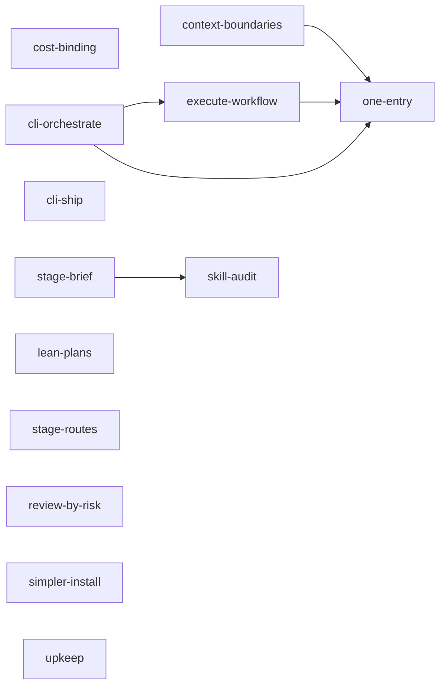

# Roadmap: Cost and friction of the common path

Date: 2026-11-26
Source: product brief "gin-workflow: product brief for the next improvements" (Claude Doc, 2026-11-25, https://claude.ai/artifact/7fQvBeHDvkXfbRp5xwxT1m), confirmed with the PM in `/roadmap` on 2026-11-26 and revised the same day (Claude Code only, an upkeep epic). The previous roadmap (process review follow-up, 2026-11-10) is fully shipped; it stays in git history.

<!-- Written by /roadmap after the PM confirms it. One "### " block per epic; an epic id never changes once written.
     Depends on: epic ids from this file. Evidence: the tech-doc file and section (for example
     03-ARCHITECTURE.md#Request flow) or the product brief. The dependency graph stays acyclic.
     The milestone headings and the Milestone:, Points: and Estimate: lines are written by /roadmap --milestone
     or by a plain /roadmap with a milestone plan; older files without them stay valid.
     A plain /roadmap without a milestone plan omits them and lists its epics under Unassigned.
     gin milestone list reads two Constraints lines: Deadline: (YYYY-MM-DD, the project deadline) and the whole
     number that starts AI capacity: (the default lanes, streams of work that each run one epic at a time);
     it also reads Days per point: (working days per story point, used until closed epics give a measured value).
     The way-of-working section is written by /roadmap from the skill's references/way-of-working.md and kept on re-runs;
     Spec ready by: and Integration point: are written by /roadmap --milestone or by a plain /roadmap with a milestone plan.
     Older files without them stay valid.
     Summary, Outcome:, Demo:, Features:, Legacy:, and Legacy coverage are written per the skill's references/manager-view.md;
     Outcome: and Demo: need a milestone; Legacy coverage needs 13-CAPABILITIES.md. Older files without them stay valid. -->

## Goals

- A shipped epic costs half the main-session tokens it costs today, and the median main-session request carries under 120K tokens (293K today).
- A feature asks the user for one command and three decisions: confirm the spec, approve the plan, choose how to ship.
- Orchestrate, the ship checks, and the stage preflight are single CLI calls. The model handles failures and the user's choices.
- Cost per epic and per stage can be read without spending agent tokens.
- A marketplace install is enough on Claude Code.
- The maintainer learns of a breaking change in Claude Code or Beads within a week and maintains only the parts that have a real user.
- Reopened beads and findings at ship stay flat while the numbers above move.

## Summary

| Milestone | Period | Outcome | Demo | Epics |
|---|---|---|---|---|
| Unassigned | | | | Session binding for the cost view; Upkeep for one maintainer; Fresh context per stage with a state card; Orchestrate as one CLI command; Ship checks and options in the CLI; One-call stage brief; Plans that record decisions; Effort and model matched to the stage; Review sized to risk; Execute as a Claude Code workflow; One entry command; Skill text audit for current models; Marketplace install without extra steps |

## Constraints

- AI capacity: 1 lane: 1 person building with AI agents, 1 Claude Max account.
- Deadline: 2026-12-11
- Claude Code only (PM decision, 2026-11-26): the epics of this file are built and verified on Claude Code. The Codex, OpenCode, Copilot, and Antigravity builds stay as they are and get no new behaviour. Every hook runs on Windows.
- gin-workflow dispatches no work to another harness (decided 2026-11-21). Work shared between harnesses belongs to gin-harness.
- Gates, evidence, and approvals do not change. A merge, a pull request, or a force-push still needs explicit approval.
- Keep the JSON read by gin-console backward compatible (`gin state`, `gin milestone list --json`, `bd ... --json`): add keys, never rename or remove them.
- The cost view lives in gin-console (PM decision, 2026-11-26). Its epic and the cross-repository parent in gin-harness are outside this file.
- Skill files keep character budgets enforced by tests. An epic that moves text into the CLI moves its budget test too.
- Two candidates of the brief are decided after phases 1 and 2 (PM decision, 2026-11-26): the Beads 1.4 upgrade and a status surface built as a Claude Code mod. A later `/gin:roadmap` run adds them.
- One skills tree for the other harnesses (`gin-workflow-harness-convergence`) is deferred until the Claude Code work is done (PM decision, 2026-11-26). Its bead stays in Beads as deferred.
- The open questions of the brief are decided in the `/gin:discuss` of the epic that owns them. The name of the ship stage next to Claude Code's built-in `/ship` belongs to `gin-workflow-cli-ship`. Starting execution right after plan approval belongs to `gin-workflow-one-entry`. A self check for `low` and docs-only tracks belongs to `gin-workflow-review-by-risk`. `gin prime` next to `bd prime` belongs to `gin-workflow-context-boundaries`.
- `gin-workflow-nox6` (native subagents on Codex, OpenCode, and Copilot) is outside this file and deferred for the same reason.

## Way of working

- Foundation: none needed; CI (pytest at pre-push), `install.sh`, and `gin docs check` exist. The cost baseline comes first instead.
- Spec cadence: one maintainer is PM, BA, and developer, so `/gin:discuss` runs for each epic right before its `/gin:plan`; no spec-ahead milestone. The open questions of the brief are decided in the `/gin:discuss` of the epic that owns them.
- Build: each epic runs discuss to ship in its own worktree; epics that edit the same stage skills run one after another in the order below; `Depends on:` lists only a need for another epic's shipped behaviour.
- Integration: each epic merges to master and pushes once, then `install.sh` refreshes the installed plugin, so the next epic is built with the shipped change; no feature flags and no integration point.
- Quality: the full pytest suite at pre-push, an independent review per track, `gin docs check` when docs change; an epic closes only when its docs match its shipped behaviour. An epic that targets a number records the measured value before and after in its ship note.
- Load: 1 lane, one epic at a time.

## Strategy

Measure first, then shrink the main session, then make agent turns cheaper, then shorten the path for the user. The main session holds 81% of prompt tokens at a 293K median context, so phase 1 carries most of the saving and makes every later epic cheaper to build. Until gin-console shows cost per epic, the transcript scan of the brief gives the baseline. In phase 1 the two CLI stages come before the stage brief, because they shrink the skills the brief then rewrites. In phase 2 the three small epics come before the workflow, so the saving they bring is measured on its own. Phase 3 changes what the user types and how the plugin is packaged, and it builds on the commands of phases 1 and 2. The upkeep epic runs second, because every later epic builds on Claude Code surfaces that change every week. Epics that edit the same stage skills run back to back in the listed order.

## Order

| Phase | Gate before the next phase | Epics |
|---|---|---|
| Measure | A baseline per epic is recorded | `gin-workflow-cost-binding`, `gin-workflow-upkeep` |
| Small sessions | The median main-session context is under 120K | `gin-workflow-context-boundaries`, `gin-workflow-cli-orchestrate`, `gin-workflow-cli-ship`, `gin-workflow-stage-brief` |
| Cheaper turns | Main-session tokens per epic are halved | `gin-workflow-lean-plans`, `gin-workflow-stage-routes`, `gin-workflow-review-by-risk`, `gin-workflow-execute-workflow` |
| Shorter path | | `gin-workflow-one-entry`, `gin-workflow-skill-audit`, `gin-workflow-simpler-install` |

With 1 lane the epics run in the listed order: cost-binding, upkeep, context-boundaries, cli-orchestrate, cli-ship, stage-brief, lean-plans, stage-routes, review-by-risk, execute-workflow, one-entry, skill-audit, simpler-install. The 13 epics total 78 points and 19 working days at the measured pace of 0.17 days per point. The deadline leaves 12 working days from 2026-11-26, which covers the order through stage-routes.

## Unassigned

### Session binding for the cost view
Epic: gin-workflow-cost-binding
Points: 2 (one event and one option on an existing command, plus docs)
Estimate: 1
Kind: technical
Complexity: low: one additive event type
Goal: Every agent session is tied to the epic it worked on, so gin-console can show cost per epic and per stage with no work at close.
Scope: `gin state` accepts the session id that Claude Code substitutes into a skill (`${CLAUDE_SESSION_ID}`) and appends one `session.bound` event per session and workflow to `.agent-workflow/runtime/events.jsonl`; the stage skills pass it; a harness without a session id records nothing; docs for the event.
Out of scope: reading transcripts and showing cost (gin-console, with a cross-repository parent in gin-harness); budgets or any check that blocks work; collection at track close or at ship.
Features: Cost view (the gin-workflow part)
Legacy: none
Depends on:
Evidence: brief "Where the tokens go" and "Proposed work", epic 1; `.planning/knowledge/retire-ai-usage.md`; `plugins/gin-workflow/src/scripts/workflow_core/events.py`, `lifecycle_cli.py:518`.
Risks: an older gin must still read the event log; no number is shown until gin-console has its own epic.

### Upkeep for one maintainer
Epic: gin-workflow-upkeep
Points: 3 (one scheduled check, two docs pages, one usage report with a freeze decision)
Estimate: 1
Kind: technical
Complexity: low: scripts and docs, no change to the lifecycle
Goal: One maintainer learns of a breaking change in Claude Code or Beads within a week, releases from a written procedure, and maintains only the parts that have a real user.
Scope: a weekly scheduled check reads the Claude Code changelog and the Beads releases and files a bead for each change that touches a surface gin uses; a release runbook that covers the tag and the Pages deploy; a docs page on what keeps working in a project without gin; a usage report of skills and modes from the session transcripts, and a freeze list decided from it, where a frozen part gets fixes only; team mode is the first candidate.
Out of scope: removing a frozen part; recruiting maintainers; the other harness builds, which this file already leaves as they are.
Features: Upkeep (PM request, 2026-11-26; not in the brief)
Legacy: none
Depends on:
Evidence: PM decision in `/roadmap` on 2026-11-26; team mode is 2,849 of the 18,632 lines of `workflow_core` plus 4,931 lines of tests, and none of the four maintained projects configures `team:`; `install.sh`, `install.ps1`, and their smoke tests total 174K characters; Claude Code 2.1.330 reserved the `ship` name; `.planning/knowledge/release-versioning.md`.
Risks: a team outside the maintained projects may rely on team mode; the scheduled check needs a Claude Code cloud task or a local cron (decided in discuss).

### Fresh context per stage with a state card
Epic: gin-workflow-context-boundaries
Points: 5 (one command, two hooks, a handoff line in nine stage skills, one setup proposal; same size as gin-workflow-g2gx = 5)
Estimate: 1
Kind: capability
Complexity: medium: the card must hold what a fresh session needs in under 10,000 characters
Goal: A stage starts in a small session and loses nothing, because the workflow state is shown again after every clear and every compaction.
Scope: `gin prime` prints the state card (workflow, stage, gates, ready tracks, open questions, review cycles used, next command); a `SessionStart` hook injects it on `startup`, `clear`, and `compact`, and a `PreCompact` hook tells the summary what to keep; each stage skill ends with one handoff line (clear, then the next command); `/gin:setup` proposes `autoCompactWindow: 200000`; the hooks run on Windows.
Out of scope: the stage preflight and mode text (`gin-workflow-stage-brief`); moving to the next stage without a typed command (`gin-workflow-one-entry`); a status line or pane.
Features: Context boundaries
Legacy: none
Depends on:
Evidence: brief "Where the tokens go" (median context 293K, peak 967K) and epic 2; `plugins/gin-workflow/src/hooks/hooks.json` (one `PreToolUse` hook today); `docs/guides/claude-workflow.md` (context hygiene is a convention); Claude Code hooks and model configuration docs.
Risks: `bd prime` may inject a second card (decided in discuss); the card omits a decision made only in chat.

### Orchestrate as one CLI command
Epic: gin-workflow-cli-orchestrate
Points: 8 (every mode of the orchestrate stage moves into code: team lanes, workspace repositories, SDD labels; same size as gin-workflow-ch2v = 8)
Estimate: 2
Kind: technical
Complexity: high: the team, workspace, and SDD branches of the stage become code paths
Goal: An approved plan becomes tracked work in one step, with no typed stage and no model turns spent on bookkeeping.
Scope: `gin orchestrate --plan <path>` creates the epic and track beads, mirrors dependencies, resolves routes, creates worktrees per `project.worktree`, and records `orchestration_ready`; it is idempotent and reports every diagnostic at once; it reuses `plan_tracks` and the route resolver; plan approval can run it; `/gin:orchestrate` becomes a thin skill; the docs show four typed stages.
Out of scope: running tracks (`gin-workflow-execute-workflow`); `bd create --graph`, which needs bd 1.4; changes to the plan format (`gin-workflow-lean-plans`).
Features: Orchestrate in the CLI
Legacy: none
Depends on:
Evidence: brief "Where the tokens go" (22% of main-session prompt tokens) and epic 3; `plugins/gin-workflow/src/skills/orchestrate/SKILL.md` (8 steps); `workflow_core/team.py:288` (`plan_tracks`), `routes.py:53` (`resolve`).
Risks: a run that fails halfway must resume cleanly; team mode and workspace behaviour must match the skill text it replaces; tests pin phrases of the skill.

### Ship checks and options in the CLI
Epic: gin-workflow-cli-ship
Points: 8 (four options and the checks of every mode; same size as gin-workflow-ch2v = 8)
Estimate: 2
Kind: technical
Complexity: high: merge order, cleanup, and close-out for solo, team, and workspace
Goal: Shipping takes two or three model turns: the user sees the checks, picks an option, and the tool runs it.
Scope: `gin ship check` runs the checks the skill lists today; `gin ship merge`, `pr`, `keep`, and `discard` run the approved option and stop at the first failure with its cause; the skill keeps the options, the approval, and failure handling; on Claude Code the pull request option can hand over to the built-in `/ship`; the stage name is settled against that built-in.
Out of scope: approval rules, which stay as they are; review policy (`gin-workflow-review-by-risk`); the SDD archive and gin-qa checks beyond calling them.
Features: Ship in the CLI
Legacy: none
Depends on:
Evidence: brief "Where the tokens go" (15% of main-session prompt tokens), epic 4, and open question 1; `plugins/gin-workflow/src/skills/ship/SKILL.md` (8,922 characters); Claude Code `/ship` docs (a skill named `ship` is not loaded where the built-in is available).
Risks: `discard` and branch deletion need the same typed confirmation when a command runs them; a rename of the stage touches docs in two languages; behaviour on Claude Code 2.1.330 or later is not verified.

### One-call stage brief
Epic: gin-workflow-stage-brief
Points: 13 (nine stage skills, mode text for team, workspace, SDD, ledger, and harness, plus the tracker calls behind three commands)
Estimate: 3
Kind: technical
Complexity: high: every stage skill and its budget test change together
Goal: A stage learns its state and only the rules that apply to this project in one fast call.
Scope: `gin stage <name>` returns the preflight, the state the stage needs, and the rules for the project's modes; the skill inlines it on Claude Code; mode text moves from the skills into CLI templates under the budget tests; each `gin` command on the stage path makes one `bd` call (`gin state` makes three, `gin task ready` two); `gin setup doctor` no longer takes 66 seconds.
Out of scope: rewriting skill prose for current models (`gin-workflow-skill-audit`); new modes.
Features: Stage brief
Legacy: none
Depends on:
Evidence: brief "Where the time goes", "Where the friction is" (28% mode text), and epic 5; `workflow_core/lifecycle_cli.py:118,137,441` (three tracker calls in `gin state`); `tests/workflow_core/test_token_budget.py`; bead `gin-workflow-4sa5`.
Risks: text that leaves a skill must lose no rule; an organization setting can disable inline shell lines, so the fallback call stays; gin-console reads the `gin state` JSON.

### Plans that record decisions
Epic: gin-workflow-lean-plans
Points: 5 (plan schema, plan skill, developer agent, and the checks that read plans; same size as gin-workflow-05e5 = 5)
Estimate: 1
Kind: capability
Complexity: medium: `check-plan` reads the plan format and tests pin it
Goal: A plan states decisions, files, interfaces, and named tests, and the developer agent writes the code once.
Scope: the plan schema and skill drop step-by-step code; code stays only where an exact signature or migration must be fixed; a track on the weakest model keeps exact steps; the developer agent derives test-first steps; `check-plan` and the route lines keep working.
Out of scope: the metadata lines orchestrate reads; the spec format.
Features: Lean plans
Legacy: none
Depends on:
Evidence: brief epic 7 (the 14 newest plans average 46K characters, 47% of it code; plan wrote 873K of 2.76M main-session output tokens); `plugins/gin-workflow/src/skills/plan/SKILL.md`, `plan-schema.md`; the plans of 2026-11-19 to 2026-11-22 in `.planning/plans/`.
Risks: weaker models may need a second review cycle; review cycles per track are compared before and after.

### Effort and model matched to the stage
Epic: gin-workflow-stage-routes
Points: 3 (frontmatter on the stage skills, one agent default, the catalog, one comparison run)
Estimate: 1
Kind: technical
Complexity: low: declarative settings and one measured comparison
Goal: Coordination work runs at low effort and lookups run on the cheapest model, as the AI strategy guide already recommends.
Scope: stage skills declare `effort`; the researcher agent defaults to the weakest model; the Claude model catalog names tiers by its aliases; one comparison of developer routes by cost per closed track.
Out of scope: forcing a model on the user's session; budgets.
Features: Routes that match the stage
Legacy: none
Depends on:
Evidence: brief epic 9 (97% of main-session requests at `high` or `xhigh`; Haiku served 1% of subagent requests); `docs/guides/ai-strategy.md`; Claude Code skills and prompt caching docs.
Risks: the field reaches the other harness builds without a check; an effort set too low on a stage that needs judgement.

### Review sized to risk
Epic: gin-workflow-review-by-risk
Points: 5 (reviewer brief, review skill, the reviewer route command, one ship step)
Estimate: 1
Kind: capability
Complexity: medium: a policy change on the safety path
Goal: Review effort follows the risk of a track, and a second review cycle happens only for a real defect.
Scope: the reviewer brief names what blocks (wrong behaviour, unmet requirements) and treats style as notes; one review returns a spec verdict and a code verdict; `low` and docs-only tracks may get a self check with one branch review at ship; `gin reviewer` counts cycles from events.
Out of scope: the review ledger; team approval policies; who may waive a review.
Features: Review by risk
Legacy: none
Depends on:
Evidence: brief epic 8 (111 review runs for 105 developer runs, a third of subagent tokens); `.planning/knowledge/lean-lifecycle.md` (every track of two epics needed two cycles); `workflow_core/reviewer.py:29`; `.planning/specs/2026-10-07-review-tier-routing-design.md`.
Risks: a defect reaches ship; the self check for `low` tracks is decided in discuss; reopened beads are the check.

### Execute as a Claude Code workflow
Epic: gin-workflow-execute-workflow
Points: 8 (one workflow script, one closing command, the execute skill, on a harness surface gin has not used)
Estimate: 2
Kind: capability
Complexity: high: a workflow takes no input mid-run and resumes only in its session
Goal: All unattended tracks of an epic run from one command, and the main session reads one summary instead of every hand-off.
Scope: a workflow in the plugin's `workflows/` runs one pipeline per ready track: developer at the track's route, reviewer, a bounded fix loop, each with a schema-checked result; tracks with a `Human gate:` stay out; one `gin` call closes approved tracks with their evidence; tracks keep `gin worktree` paths; Codex, OpenCode, Copilot, and Antigravity keep the in-session loop; the result decides whether `gin goal` stays.
Out of scope: review policy (`gin-workflow-review-by-risk`); starting execution from plan approval (`gin-workflow-one-entry`); workflows on other harnesses.
Features: Execute as a workflow
Legacy: none
Depends on: gin-workflow-cli-orchestrate
Evidence: brief epic 6 and "Where the tokens go" (105 developer and 111 reviewer runs driven from the main session); `plugins/gin-workflow/src/skills/execute/SKILL.md` (worker dispatch loop), `skills/execute/references/result-contract.md`; Claude Code workflows docs.
Risks: a run cannot ask a question, so a `needs_clarification` result must stop its track cleanly; subagent worktrees branch from the remote default branch by default; a stopped run resumes only in its session.

### One entry command
Epic: gin-workflow-one-entry
Points: 5 (one router skill, two automatic hand-overs, visibility settings on 18 skills, docs)
Estimate: 1
Kind: capability
Complexity: medium: it changes what the user types at every step
Goal: A feature starts with one command and asks three decisions: confirm the spec, approve the plan, choose how to ship.
Scope: `/gin <request>` sizes the work with the `quick-check` rule and routes to quick or discuss; a confirmed spec hands over to plan in a fresh context; an approved plan runs orchestrate and execute and stops at the ship options; `/gin` alone continues the current workflow; seven helper skills leave the menu, and eleven setup and one-off skills stop loading by themselves; getting started and use cases are rewritten.
Out of scope: removing the stage commands, which stay; team mode approvals through pull requests.
Features: One entry
Legacy: none
Depends on: gin-workflow-context-boundaries, gin-workflow-cli-orchestrate, gin-workflow-execute-workflow
Evidence: brief epic 10 and open question 3; `docs/getting-started.md` (five typed stages); `plugins/gin-workflow/src/skills/workflow/SKILL.md`, `skills/quick/SKILL.md`; Claude Code skills docs (`user-invocable`, `disable-model-invocation`).
Risks: starting execution without a prompt is a new default (decided in discuss); the router cannot load a stage skill that is hidden from the model.

### Skill text audit for current models
Epic: gin-workflow-skill-audit
Points: 8 (36 skills and 6 agents across three plugins)
Estimate: 2
Kind: technical
Complexity: medium: many files, each change small
Goal: Every skill and agent states the outcome it wants in the fewest words that still hold the rules, measured before and after.
Scope: run the bundled prompt audit over `plugins/*/src` and apply it skill by skill; outcomes and constraints for judgement steps, exact commands for fragile steps; arithmetic and lookup tables move to the CLI; incident history leaves the text; `claude plugin details` figures before and after; tests that pin phrases move to CLI behaviour.
Out of scope: mode text (`gin-workflow-stage-brief`); new behaviour.
Features: Skill audit
Legacy: none
Depends on: gin-workflow-stage-brief
Evidence: brief epic 11 and "Where the friction is"; `.planning/knowledge/skill-authoring-limits.md` (three files within 25 characters of their cap); Claude Code plugin measurement docs; Anthropic's prompt audit guide.
Risks: a removed sentence held a rule that no test covered; the Vietnamese docs quote skill text.

### Marketplace install without extra steps
Epic: gin-workflow-simpler-install
Points: 5 (plugin layout, the YAML dependency, git hook paths, two installers)
Estimate: 1
Kind: technical
Complexity: medium: two installers and Windows
Goal: Installing the plugin from the marketplace is the whole install on Claude Code.
Scope: the `gin` CLI ships in the plugin's `bin/`; the PyYAML requirement goes; `gin hooks install` writes the CLI's absolute path into the git hooks; `install.sh` and `install.ps1` stay for the other harnesses; getting started and troubleshooting are updated.
Out of scope: the bundle layout for the other harnesses, which is deferred; gin-qa's Node requirement.
Features: Simpler install
Legacy: none
Depends on:
Evidence: brief epic 12; `README.md` (a marketplace install leaves `gin` off `PATH`); `workflow_core/hooks.py:34-36` (git hooks call `gin` from `PATH`); Claude Code plugin components docs (`bin/`).
Risks: configs written by hand must still load; one machine may hold two copies of `gin` (launcher and plugin).
