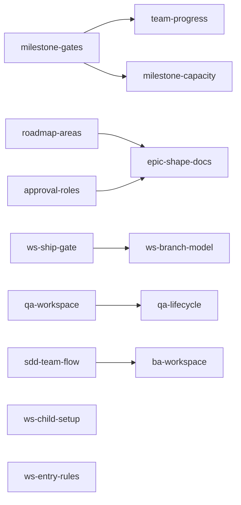

# Roadmap: Process review follow-up, workspace and team gaps

Date: 2026-11-10
Source: `.planning/reviews/2026-11-07-process-review/synthesis.md` (26 clusters, 106 findings from five role personas, epic `gin-workflow-process-review`), confirmed with the PM in `/roadmap` on 2026-11-10. The previous roadmap (BA enhancement, 2026-11-05) is fully shipped; it stays in git history.

<!-- Written by /roadmap after the PM confirms it. One "### " block per epic; an epic id never changes once written.
     Depends on: epic ids from this file. Evidence: the tech-doc file and section (for example
     03-ARCHITECTURE.md#Request flow) or the product brief. The dependency graph stays acyclic.
     The milestone headings and the Milestone: and Estimate: lines are written only by /roadmap --milestone;
     older files without them stay valid.
     A plain /roadmap omits them and lists its epics under Unassigned.
     gin milestone list reads two Constraints lines: Deadline: (YYYY-MM-DD, the project deadline) and the whole
     number that starts AI capacity: (the default lanes, streams of work that each run one epic at a time).
     The way-of-working section is written by /roadmap from the skill's references/way-of-working.md and kept on re-runs;
     Spec ready by: and Integration point: are written by /roadmap --milestone. Older files without them stay valid. -->

## Goals

- A team runs gin-workflow on a multi-repository workspace without a blocked gate: child pull requests pass `ship`, gin-qa runs from the `qa` child, and no approval needs a role held by one person.
- `/gin:roadmap` and `gin milestone` give the same answer on every member's machine and plan by area, contract, and integration.
- Docs and the brownfield starter state one rule: one epic per capability, one track per repository, the area on the track.
- Every finding of the process review is handled by exactly one epic below.

## Constraints

- AI capacity: 1 lane: 1 person building with AI agents, 1 Claude Max account.
- Deadline: 2026-11-13
- Epic shape (PM decision, 2026-11-10): one epic per capability with one track per repository; `area:<name>` belongs to the track, not the epic. This replaces the "one area per epic" model in `.planning/knowledge/workspace.md`.
- Keep the JSON read by gin-console backward compatible (`gin state`, `gin milestone list --json`, `bd ... --json`): add keys, never rename or remove them.
- Skill files keep their character budgets (`gin-*` 6,000; stage skills 12,000).
- The other role conflicts of the synthesis are decided in the `/discuss` of the epic that owns them: contract epic (`gin-workflow-roadmap-areas`), tech lead load and contract spec approval (`gin-workflow-approval-roles`, `gin-workflow-epic-shape-docs`), mockups for a 1-1 copy (`gin-workflow-ba-workspace`).

## Way of working

- Foundation: none needed; CI (pytest at pre-push), `install.sh`, and `gin docs check` exist.
- Spec cadence: one maintainer is PM, BA, and developer, so `/gin:discuss` runs for each epic right before its `/gin:plan`; no spec-ahead milestone.
- Build: each epic runs discuss to ship in its own worktree; epics that edit the same files run one after another in the order below; `Depends on:` lists only a need for another epic's shipped behaviour.
- Integration: each epic merges to master and pushes once, then `install.sh` refreshes the installed plugin; no feature flags and no integration point.
- Quality: the full pytest suite at pre-push, an independent review per track, `gin docs check` when docs change; an epic closes only when its docs match its shipped behaviour.
- Load: 1 lane, one epic at a time; a milestone holds at most 1 times its working days of estimates.

## Strategy

Fix the planning tools first, because every later epic is planned with them: shared gate state and forecast fidelity, then the capacity model and exit criteria, then roadmap areas on tracks with contract and integration epics. The three blockers follow: the ship gate for child pull requests, gin-qa in a child, and approval roles. `ws-ship-gate` and `approval-roles` both edit `team.py`, so they run back to back. Progress views build on the shared gate state. The docs epic for the epic rule comes after the roadmap and approval epics it describes. Workspace branch, setup, and rule epics follow, then the QA lifecycle on top of gin-qa in a child, then the SDD team flow and the BA epic that builds on it.

## Order

| Wave | Epics |
|---|---|
| 1 | `gin-workflow-milestone-gates`, `gin-workflow-milestone-capacity`, `gin-workflow-roadmap-areas` |
| 2 | `gin-workflow-ws-ship-gate`, `gin-workflow-qa-workspace`, `gin-workflow-approval-roles` |
| 3 | `gin-workflow-team-progress`, `gin-workflow-epic-shape-docs`, `gin-workflow-ws-branch-model` |
| 4 | `gin-workflow-ws-child-setup`, `gin-workflow-ws-entry-rules`, `gin-workflow-qa-lifecycle` |
| 5 | `gin-workflow-sdd-team-flow`, `gin-workflow-ba-workspace` |

With 1 lane the epics run in the listed order: milestone-gates, milestone-capacity, roadmap-areas, ws-ship-gate, qa-workspace, approval-roles, team-progress, epic-shape-docs, ws-branch-model, ws-child-setup, ws-entry-rules, qa-lifecycle, sdd-team-flow, ba-workspace. Estimates total 21 working days; only the first two fit before the deadline.

## Unassigned

### Shared gate state and forecast fidelity
Epic: gin-workflow-milestone-gates
Estimate: 2
Complexity: high: gate readiness moves from the local event log to the epic bead
Goal: `gin milestone` readiness and `orchestration_ready` read gate state from the epic bead, so every member's machine shows the same answer, and the forecast counts the remaining work of in-progress epics.
Scope: `spec_confirmed`/`spec_not_ready` read the epic's shared `gates` metadata, with `.agent-workflow/runtime/events.jsonl` as the fallback; a `spec_due` warning for epics of `planned` milestones; `orchestration_ready` shared through the epic bead; in-progress epics scheduled by remaining work; unestimated epics placed with a flagged default; the deadline shown by `gin milestone show`; `late` defined in the docs.
Out of scope: the capacity model, member availability, exit criteria, and split warnings (`gin-workflow-milestone-capacity`); progress views (`gin-workflow-team-progress`); gin-console changes beyond added JSON keys.
Depends on:
Evidence: synthesis "Shared gate state for milestone and lifecycle routing" (PM-5, BA-5, BE-LEAD-5) and part of "Milestone capacity, forecast, and exit criteria" (PM-6); `milestone_cli.py:128-138`, `milestone.py:171-177,231-246`, `lifecycle_cli.py:87-88,184-185,426-428`.
Risks: the JSON read by gin-console must only gain keys; gate values in `gin state` stay `satisfied`/`unmet` strings.

### Milestone capacity model, exit criteria, and split warnings
Epic: gin-workflow-milestone-capacity
Estimate: 2
Complexity: medium: team config gains member availability
Goal: the roadmap bound and the `gin milestone` schedule use one capacity model by role group with member availability and QA, milestones store an integration date and exit criteria and warn when they fail, and the roadmap warns about an epic larger than its milestone.
Scope: default lanes no longer count the PM and BA as builders; member days off; QA counted in the Load bound; integration date and exit criteria keys on a milestone; `show` warns after the integration date and on open `discovered-from` bug beads; a roadmap warning when an estimate exceeds the milestone's working days.
Out of scope: shared gate state and forecast fidelity (`gin-workflow-milestone-gates`); progress views (`gin-workflow-team-progress`).
Depends on: gin-workflow-milestone-gates
Evidence: synthesis "Milestone capacity, forecast, and exit criteria" (PM-4, PM-12, PM-17, PM-18, QA-15); `milestone_cli.py:141-148`, `plugins/gin-workflow/src/skills/roadmap/SKILL.md:17-25`, `references/way-of-working.md:21`.
Risks: an availability schema in the team config; the roadmap skill budget.

### Roadmap areas on tracks, contract and integration epics
Epic: gin-workflow-roadmap-areas
Estimate: 1
Complexity: medium: roadmap skill and `check-plan` change together
Goal: a roadmap plans by area and contract: tracks carry `Area:` as `area:<name>` labels that `check-plan` enforces, and the roadmap can schedule contract and integration work as tracked epics.
Scope: `Area:` per track in plans and `area:<name>` on track beads; `check-plan` refuses a track outside its declared area; `/gin:roadmap` proposes contract epics and integration epics and records the integration point as tracked work; where the API contract lives and how apps consume it, as a convention.
Out of scope: the docs rewrite of the epic rule (`gin-workflow-epic-shape-docs`); milestone forecast (`gin-workflow-milestone-gates`).
Depends on:
Evidence: synthesis "Area field on roadmap epics" (BE-LEAD-6, PM-10) and "Contract-first and integration scheduling" (BE-LEAD-7, FE-LEAD-6, PM-7, FE-LEAD-4, PM-9); `team_beads.py:96-98`.
Risks: the contract epic conflict (PM-7, FE-LEAD-4 vs BE-LEAD-7) is decided in `/discuss`; `gin team ready` must keep showing epics without an area.

### Ship gate accepts pull requests of workspace children
Epic: gin-workflow-ws-ship-gate
Estimate: 1
Complexity: medium: team gate code resolves the repository of the pull request
Goal: `gin team check --gate ship`, `record shipped`, and `team deps` work on pull requests opened in a workspace child repository.
Scope: compare a pull request with the `origin` and HEAD of the child repository it belongs to, not the parent; accept `--repository <child>` without a child config; tests for the ship gate on a child pull request.
Out of scope: the branch and pull request model (`gin-workflow-ws-branch-model`); approval policy (`gin-workflow-approval-roles`).
Depends on:
Evidence: synthesis "Ship gate accepts pull requests of workspace children" (QA-3, BE-LEAD-1, FE-LEAD-3, BE-LEAD-13, BE-LEAD-16); `team.py:424-426,432,516`, `team_cli.py:64-66,185`, `workspace.py:146,155-157`.
Risks: edits `team.py` with `gin-workflow-approval-roles`, hence back to back.

### gin-qa runs from the qa child and its track worktrees
Epic: gin-workflow-qa-workspace
Estimate: 1
Complexity: medium: gin-qa gains workspace root resolution
Goal: gin-qa resolves the workspace root, reads config from the parent, and writes its files and `git log` lookups into the `qa` child.
Scope: `gin_qa` resolves the workspace root like the core CLI; Playwright config, `package.json`, `.gitignore` entries, and case-ID history go to the child repository; docs for running gin-qa from the child.
Out of scope: QA tracks in the lifecycle (`gin-workflow-qa-lifecycle`).
Depends on:
Evidence: synthesis "gin-qa runs from the qa child and its track worktrees" (QA-1, QA-2); `gin_qa/cli.py:20`, `gin_qa/reqs.py:39-41`, `e2e.py:192-200,226-228,279-282`, `cases.py:242-243`.
Risks: gin-qa must keep working in a single repository.

### Approval roles without a single-holder deadlock
Epic: gin-workflow-approval-roles
Estimate: 1
Complexity: medium: approval policy semantics and starter config
Goal: the starter and `team.approvals` give each gate a second approver, an `fe_lead` for app areas, and an enforceable QA sign-off on `ship`.
Scope: an `fe_lead` role in `docs/roles.md` and the starter; area leads per area; a policy that requires every listed role (or names one) so `ship: [qe, be_lead]` cannot skip QA; no gate that only an author can approve; tech lead approval load.
Out of scope: the ship gate repository bug (`gin-workflow-ws-ship-gate`).
Depends on:
Evidence: synthesis "Approval roles without a single-holder deadlock" (BE-LEAD-2, FE-LEAD-1, FE-LEAD-13, BE-LEAD-11, QA-4); `docs/starters/brownfield.md:47-54`, `docs/roles.md:18-24`, `team.py:355,457-458`.
Risks: changing "one of" semantics breaks existing `team.approvals`; keep the old meaning as the default and add an explicit form.

### Progress views and usage totals for a team
Epic: gin-workflow-team-progress
Estimate: 1
Complexity: medium: progress skill and usage roll-up
Goal: `/gin:progress` shows the milestone forecast, pending approvals, spec status, QA state, and grouping by area or repository, and an epic's usage totals include every member's runs or say they are partial.
Scope: progress report sections for a milestone and a team; usage roll-up from children's stored `ai_usage`; a partial-total marker.
Out of scope: the forecast computation (`gin-workflow-milestone-gates`).
Depends on: gin-workflow-milestone-gates
Evidence: synthesis "Progress views for a team" (PM-11, PM-14, BA-16, QA-19, BE-LEAD-18, FE-LEAD-19) and "Team usage totals" (PM-15); `usage.py:292-295,386`.
Risks: the progress skill budget of 6,000 characters.

### One epic rule, owner roles, and prompts that match the starter
Epic: gin-workflow-epic-shape-docs
Estimate: 1
Complexity: low: docs and starter only
Goal: the workspace guide, roles page, and brownfield starter state one epic per capability with one track per repository, who owns technical epics and milestone writes, and prompts that match the workspace layout.
Scope: `docs/guides/workspace.md`, `docs/roles.md`, `docs/starters/brownfield.md` and their `.vi.md` pairs; owners for discuss and approval of a contract or technical epic; roadmap order and `gin milestone` writes; QA work and shared packages under the epic rule; skill reference prompts use the workspace layout and never put a track in the frozen `legacy/`.
Out of scope: behaviour changes (each owning epic documents its own).
Depends on: gin-workflow-roadmap-areas, gin-workflow-approval-roles
Evidence: synthesis "One epic rule for features that span repositories" (BA-3, BE-LEAD-8, FE-LEAD-12, QA-5, FE-LEAD-11), "Owner roles for technical epics and milestone writes" (BA-4, BE-LEAD-20, PM-8, FE-LEAD-5, PM-3, BE-LEAD-19), "Prompt templates match the workspace starter" (PM-19, BA-18, QA-16, BE-LEAD-21, FE-LEAD-21).
Risks: the contract spec approval conflict (BA-4 vs FE-LEAD-5) is decided in `/discuss`.

### Branch, pull request, and track environment model for workspace children
Epic: gin-workflow-ws-branch-model
Estimate: 2
Complexity: high: cross-module: orchestrate, worktrees, takeover, review ledger, quick
Goal: one flow for child `feat/<topic>` branches, track worktree creation on claim, track pull request bases, review ledgers, closing a multi-member epic, read-only sibling repositories for a track, and `/gin:quick` in team mode.
Scope: members create their own track worktree and child branch on claim; `team takeover` fetches from the child; review ledgers stay out of service repositories; a track declares read-only siblings and how to run the service and app it is tested against; quick in team mode ends with a pull request and ship approval.
Out of scope: the ship gate check itself (`gin-workflow-ws-ship-gate`).
Depends on: gin-workflow-ws-ship-gate
Evidence: synthesis "Branch and pull request model for workspace children" (BE-LEAD-4, BE-LEAD-14, BE-LEAD-15, FE-LEAD-14, BE-LEAD-10, FE-LEAD-16, PM-13), "Track environment with read-only siblings and running services" (BE-LEAD-26, FE-LEAD-10, QA-12), "Quick in team mode" (PM-16, QA-18, BE-LEAD-17, FE-LEAD-18); `team_beads.py:226,329`, `review_ledger/cli.py:42-44`.
Risks: largest epic; may split into two plans in `/discuss`.

### Workspace onboarding, frozen legacy access, and team init per child
Epic: gin-workflow-ws-child-setup
Estimate: 2
Complexity: medium: setup, team init, and hooks per child
Goal: each role knows what to clone, frozen legacy entries are reachable from tech-doc and discuss, setup collects the repository entries, and `gin team init` writes CODEOWNERS, the pull request template, the commit-msg hook, and the CI job into each non-frozen child.
Scope: per-role clone guidance; legacy access for BA and tech-doc; setup prompts for workspace entries; `team init` and `team hooks` per child.
Out of scope: rule packs per entry (`gin-workflow-ws-entry-rules`).
Depends on:
Evidence: synthesis "Workspace onboarding and frozen legacy access" (PM-1, PM-2, BA-2, BE-LEAD-12, BE-LEAD-25) and "Team init for every workspace child" (BE-LEAD-3, FE-LEAD-2); `team_init.py:41,125-137`, `docs/guides/workspace.md:63`.
Risks: writing into child repositories needs each child's default branch and host.

### Per-entry checks, rule packs, shape, and a Java and JSP legacy
Epic: gin-workflow-ws-entry-rules
Estimate: 2
Complexity: medium: doctor, rules, worktrees, tech-doc
Goal: doctor, worktrees, and execute use the current entry's `verify.checks`, rule packs, and shape appendix instead of the parent's, `java` and `spring` rule packs exist, and tech-doc scouts Spring, JAX-RS, Struts, and JSP routes per entry.
Scope: rule-pack detection per entry `package.json` and build files; shape appendix by entry shape in execute; `java` and `spring` packs; tech-doc route scouting for JVM web stacks.
Out of scope: team init per child (`gin-workflow-ws-child-setup`).
Depends on:
Evidence: synthesis "Per-entry checks, rule packs, and shape in a workspace" (FE-LEAD-7, FE-LEAD-8, BE-LEAD-23, FE-LEAD-17, BE-LEAD-22, FE-LEAD-9, FE-LEAD-20) and "Tech-doc and rules for a Java and JSP legacy" (BE-LEAD-9, BA-13, FE-LEAD-22); `rules_checks.py:22-28,47-58`, `rules.py:247-254`, `execute/SKILL.md:23`, `worktrees/SKILL.md:39`.
Risks: new rule packs need their own tests and budgets.

### QA tracks, acceptance cases, test evidence, and legacy parity
Epic: gin-workflow-qa-lifecycle
Estimate: 2
Complexity: medium: execute, review, ship, and gin-qa skills
Goal: execute runs QA tracks through gin-qa, review and ship check acceptance cases, run evidence is published beyond the tester's machine, automated failures file bug beads, and parity tests have an owner and a legacy reference.
Scope: a QA track path in `/gin:execute`; ship and spec checklists per pull request kind; a gin-qa coverage check in ship; evidence publishing; bug beads from e2e and API test failures; a case field for the legacy reference and the build to run against.
Out of scope: gin-qa root resolution (`gin-workflow-qa-workspace`).
Depends on: gin-workflow-qa-workspace
Evidence: synthesis "QA tracks and acceptance cases in the lifecycle" (QA-6, QA-7, QA-13, QA-14, QA-20), "Test evidence and defect tracking" (QA-8, QA-9, QA-17), "Legacy parity testing" (QA-10, BE-LEAD-24); `ship/SKILL.md:16-18`, `run/SKILL.md:16`.
Risks: stage skill budgets of 12,000 characters.

### SDD layout and change flow for a team workspace
Epic: gin-workflow-sdd-team-flow
Estimate: 2
Complexity: medium: starter, sdd skill, specs lint and trace
Goal: the brownfield starter sets the SDD layout with a capture step before discuss, and asset folders, in-flight requirement changes, `Source:` lines, spec checklists, cross-child `specs trace`, and the archive pull request follow one team flow.
Scope: `artifacts.layout: sdd` in the brownfield starter; how living specs relate to legacy behaviour; a working `MODIFIED` block for an in-flight requirement; `specs trace` across children; branch and approver for confirmed asset folders.
Out of scope: BA work during build (`gin-workflow-ba-workspace`).
Depends on:
Evidence: synthesis "SDD layout in the brownfield starter" (BA-1, QA-11, BA-17) and "SDD change flow for a team workspace" (BA-6, BA-8, BA-9, BA-11, BA-12, BA-19); `specs.py:458-460`, `specs_trace.py:12-16,38`.
Risks: REQ-ID collisions on parallel branches need a rule before the trace change.

### Capture and mockups in a workspace, and the BA during build
Epic: gin-workflow-ba-workspace
Estimate: 1
Complexity: low: gin-ba skills and execute questions
Goal: mockup reads the target app's design tokens, capture records who confirmed it, the area lead reviews mockups before confirm, business questions raised in execute reach the BA as epic comments, and each epic gets one BA acceptance point.
Scope: gin-ba mockup and capture in a workspace; a BA question path from execute; a BA acceptance step per epic.
Out of scope: the SDD change flow (`gin-workflow-sdd-team-flow`).
Depends on: gin-workflow-sdd-team-flow
Evidence: synthesis "Capture and mockups in a workspace" (BA-14, BA-15, FE-LEAD-15) and "BA during build" (BA-7, BA-10); `mockup/SKILL.md:18-19,34`.
Risks: the mockup conflict for a 1-1 copy (BA-14 vs FE-LEAD-15) is decided in `/discuss`.
