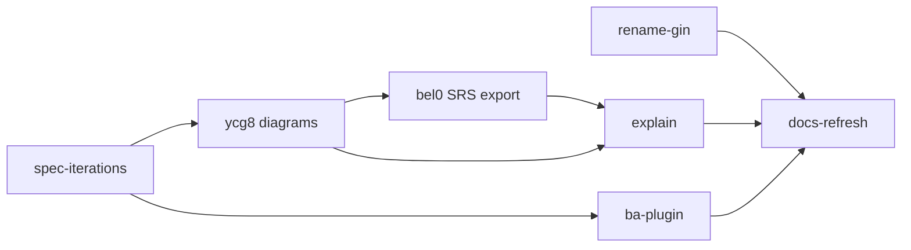

# Roadmap: BA enhancement — iteration assets, mockups, diagrams, SRS, explain, then the `gin` rename

Date: 2026-11-05
Source: Product brief given with `/roadmap gin-workflow-96sx` on 2026-11-05 (CLI rename, BA skill set, asset folder structure), plus the two epics opened from the BA process discussion of `gin-workflow-7xy4` (`gin-workflow-ycg8`, `gin-workflow-bel0`) and `.planning/knowledge/ba-capability-placement.md`. The previous roadmap (Workflow audit, 2026-10-30) is fully shipped; it stays in git history.

<!-- Written by /roadmap after the PM confirms it. One "### " block per epic; an epic id never changes once written.
     Depends on: epic ids from this file. Evidence: the tech-doc file and section (for example
     03-ARCHITECTURE.md#Request flow) or the product brief. The dependency graph stays acyclic.
     The milestone headings and the Milestone: and Estimate: lines are written only by /roadmap --milestone;
     older files without them stay valid.
     A plain /roadmap omits them and lists its epics under Unassigned. -->

## Goals

- A BA records each customer iteration and each legacy feature under `docs/specs/<capability>/assets/<date>/`, and every stage knows that layout.
- A BA gets an interactive HTML mockup and a description of a legacy feature confirmed before `/discuss` writes requirements.
- Specs carry an activity diagram per feature and a state diagram for complex features.
- A capability or change exports to a printable SRS and to an interactive explainer page from the same living specs.
- `gin` becomes the CLI and `gin:` the skill namespace, with `gin-workflow` kept as an alias.
- Once everything above has shipped, the documentation describes the whole BA flow and the new names in one pass, with no page left on the old ones.

## Constraints

- AI capacity: 1 person building with AI agents, 1 Claude Max account.
- SDD layout only for the asset layout, diagrams, SRS, and explain; the legacy layout does not change.
- Keep the JSON read by gin-console backward compatible; gin-console keeps calling `gin-workflow state --format json` until a cross-repo epic in gin-harness moves it to `gin`.
- Iteration folders are named by ISO date (`assets/2026-05-11/`) so they sort chronologically; a flat `assets/<file>` stays valid.
- `gin-ba` is a separate plugin like `gin-qa`; `explain` and the SRS export live in the core plugin because developers and PMs use them too.
- Skill files keep their character budgets (`gin-*` 6,000; stage skills 12,000).

## Strategy

Follow the BA flow: the asset layout first, because the mockup, legacy capture, diagrams, and SRS all write into it. Diagrams next, because the SRS and the explainer embed them. The `gin-ba` plugin and the SRS export then run in parallel on different files; the explainer reuses the SRS renderer, so it comes last in the milestone. The rename sweeps 158 files and every skill name, so it runs after the BA epics, in one mechanical pass, and opens the next milestone. A final docs epic closes it: each feature epic documents its own change, and the last epic rewrites the guides and reference pages as one coherent whole once names and flow are final.

## Order

| Wave | Epics |
|---|---|
| 1 | `gin-workflow-spec-iterations` |
| 2 | `gin-workflow-ycg8`, `gin-workflow-ba-plugin` |
| 3 | `gin-workflow-bel0` |
| 4 | `gin-workflow-explain` |
| next milestone | `gin-workflow-rename-gin`, then `gin-workflow-docs-refresh` |

`gin-workflow-ycg8` runs after `gin-workflow-spec-iterations` because both edit `gin-sdd/SKILL.md`; the Beads dependency of this adopted epic stays unchanged.

## Milestone: gin-workflow enhancement

### Spec assets: dated iteration folders and legacy capture
Epic: gin-workflow-spec-iterations
Milestone: gin-workflow-96sx
Estimate: 1
Goal: A BA records each customer iteration and each legacy feature under `docs/specs/<capability>/assets/<YYYY-MM-DD>/`, and the stages know the layout.
Scope: the convention in `docs/guides/sdd.md` (and `.vi.md`) and `gin-sdd`: `assets/<date>/description.md` (required), `legacy/*`, `mockup/`, `changes.md`; `gin-workflow specs assets new <cap> [--date] [--legacy]` creates the folder and `description.md` from a template; `specs lint` warns on an iteration folder without `description.md`; the *Capabilities affected* table and `01-proposal.md` cite `assets/<date>/...` paths; a flat `assets/<file>` stays valid.
Out of scope: moving existing flat assets; generating the HTML mockup (`gin-workflow-ba-plugin`); the legacy layout.
Depends on:
Evidence: brief §3 (Asset Folder Structure & Traceability); `docs/guides/sdd.md` "Images and mockups"; `plugins/gin-workflow/src/skills/gin-sdd/SKILL.md` steps 1 and 3; `.planning/knowledge/ba-capability-placement.md`.
Risks: a strict lint breaks existing projects, so a missing `description.md` is a warning; the date format is written into the guide, so it is fixed in `/discuss` first.

### Diagrams in specs: activity diagram per feature, state diagram for complex features
Epic: gin-workflow-ycg8
Milestone: gin-workflow-96sx
Estimate: 1
Goal: Specs carry an activity diagram per feature and a state diagram for a complex feature, in Mermaid, carried by archive into `docs/specs/<capability>/`.
Scope: as the epic bead: where the diagram lives (`03-design.md` Data Flow, or the living spec per capability), when a state diagram is required, and how `specs archive` carries diagrams into `docs/specs/<capability>/`; decided in `/discuss`.
Out of scope: the SRS export (`gin-workflow-bel0`).
Depends on:
Evidence: epic bead `gin-workflow-ycg8` (from the BA process discussion of `gin-workflow-7xy4`, 2026-11-05); the docs site already renders Mermaid.
Risks: edits `gin-sdd/SKILL.md` together with `gin-workflow-spec-iterations`, hence the wave order; the skill budget of 6,000 characters.

### gin-ba plugin: mockup and legacy capture skills
Epic: gin-workflow-ba-plugin
Milestone: gin-workflow-96sx
Estimate: 2
Goal: A BA runs `gin-ba:mockup` to get an interactive HTML mockup in the iteration folder and `gin-ba:capture` to describe a legacy feature from screenshots; both are confirmed before `/discuss` writes requirements.
Scope: new plugin `plugins/gin-ba/src` registered in `.claude-plugin/marketplace.json` and `install.sh` after the `gin-qa` pattern; `gin-ba:mockup <cap>` invokes `frontend-design` and writes a self-contained `assets/<date>/mockup/index.html`, iterating until the BA confirms; `gin-ba:capture <cap>` reads `assets/<date>/legacy/*` (and optional code paths) and writes `description.md` describing the as-is behaviour (screens, fields, rules); `gin-sdd` discuss reads `description.md` and the mockup when present and cites them per requirement; `docs/guides/ba.md` (and `.vi.md`): capture → mockup → discuss → diagrams → SRS; character-budget tests for the new skills.
Out of scope: a BA CLI beyond `specs assets`; a `gin-ba:change` skill (`specs assets new` plus discuss covers it); Figma import.
Depends on: gin-workflow-spec-iterations
Evidence: brief §2 (BA Workflow & Specialized Skills); `plugins/gin-qa` as the plugin pattern; `.claude-plugin/marketplace.json`; `install.sh:636,836`.
Risks: `frontend-design` exists only on Claude Code, so other harnesses fall back to plain HTML guidance; mockup HTML can be large.

### SRS export: printable HTML from living specs with a customizable template
Epic: gin-workflow-bel0
Milestone: gin-workflow-96sx
Estimate: 1
Goal: A capability's or a change's requirements export to an SRS as HTML that prints to PDF with the browser, with a per-project template (logo, customer, product brief, cover, section order).
Scope: as the epic bead: command shape (`gin-workflow specs export`), scope selection (capability, change, whole project), template location and variables, and how diagrams and assets are embedded; decided in `/discuss`. The spec-to-HTML renderer is reused by `gin-workflow-explain`.
Out of scope: the interactive explainer (`gin-workflow-explain`).
Depends on:
Evidence: epic bead `gin-workflow-bel0` (from the BA process discussion of `gin-workflow-7xy4`, 2026-11-05).
Risks: runs after `gin-workflow-ycg8` so diagrams appear in the export; the Beads dependency of this adopted epic stays unchanged.

### Interactive capability explainer: gin:explain
Epic: gin-workflow-explain
Milestone: gin-workflow-96sx
Estimate: 1
Goal: A developer, PM, or BA runs `/gin:explain <capability|change>` and gets an interactive HTML page that explains the capability: stories, requirements by group, diagrams, mockups and images, with navigation.
Scope: reuse the renderer of `gin-workflow-bel0` with an interactive template (tabs or filters per requirement group, embedded Mermaid, image viewer); input is a capability or a change folder; the skill adds a narrative summary written by the model; where the output is written and whether it is committed is decided in `/discuss`.
Out of scope: publishing to the docs site; the legacy layout.
Depends on: gin-workflow-bel0, gin-workflow-ycg8
Evidence: brief §2 (Interactive Feature Explanation); epic bead `gin-workflow-bel0`.
Risks: a generated HTML committed to the repository churns on every run, so it may be gitignored or built on demand.

## Unassigned

### Rename: gin CLI, gin: skill namespace, gin:learn
Epic: gin-workflow-rename-gin
Goal: `gin` is the CLI and `gin:` the skill namespace; `gin-workflow` keeps working as an alias.
Scope: a `gin` launcher installed next to `gin-workflow` (symlink to the same target), in `install.sh`, `install.ps1`, and the `.cmd` launcher; the plugin renamed `gin-workflow` → `gin` in the marketplace and manifest, with `install.sh` removing the old `~/.claude/skills/gin-workflow`; `gin-knowledge` → `learn` (whether `gin-sdd`, `gin-team`, `gin-worktrees`, and the other `gin-` prefixed skills also drop the prefix is decided in `/discuss`); one sweep of the 158 files that reference `gin-workflow:`; `setup refresh` updates the links in `AGENTS.md`; gin-console moves to `gin` through a cross-repo epic in gin-harness.
Out of scope: renaming the repository, the `plugins/gin-workflow/` directory, `gin-qa`, or `gin-orchestrator`.
Depends on:
Evidence: brief §1 (Core CLI & Command Renaming); `.claude-plugin/marketplace.json`; `install.sh:636,829,836`; `gin-harness/AGENTS.md` (gin-console runs `gin-workflow state --format json`).
Risks: `setup doctor` compares the installed snapshot hash with `src`; `CLAUDE.md` files of other repositories point at `gin-workflow:*` skills; `install.sh:636` detects `gin-workflow` for gin-qa; scheduled after the BA epics so the sweep runs once without rebases.

### Docs refresh: one coherent documentation pass after the BA flow and the rename ship
Epic: gin-workflow-docs-refresh
Goal: After every epic above has shipped, `README.md`, `docs/guides/`, `docs/reference/`, and the `.vi.md` translations describe the full BA flow (iteration assets → capture → mockup → discuss → diagrams → SRS → explain) and use the `gin` CLI and `gin:` skill names everywhere, with no page left on the old names or the old flow.
Scope: audit every docs page and `README.md` against the shipped behaviour with `/tech-doc`-grade evidence; rewrite `docs/guides/sdd.md`, `docs/guides/ba.md`, `docs/reference/cli.md`, `docs/reference/skills.md`, `docs/reference/config.md` and their `.vi.md` pairs as one whole instead of per-epic patches; update `docs/concepts/architecture.md` and `lifecycle.md` where the BA stages and `gin-ba` plugin appear; `gin-workflow docs check` and `mkdocs build --strict` pass; `AGENTS.md` links refreshed by `setup refresh`.
Out of scope: new behaviour; changes to skills or CLI (a mismatch found here is a bug bead on the owning epic, not a fix in this one).
Depends on: gin-workflow-spec-iterations, gin-workflow-ycg8, gin-workflow-ba-plugin, gin-workflow-bel0, gin-workflow-explain, gin-workflow-rename-gin
Evidence: PM request on 2026-11-05 during `/roadmap`; `AGENTS.md` (docs ownership: `README.md`, `docs/concepts/`, `docs/reference/`, `docs/contributing.md`); `docs/guides/sdd.md`.
Risks: the docs pages are already edited by every epic before it, so this epic rebases last and must not undo per-epic docs; the character budgets of skill files do not apply, but `docs check` house-style rules do.
