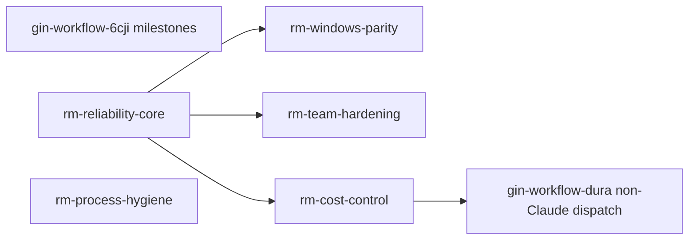
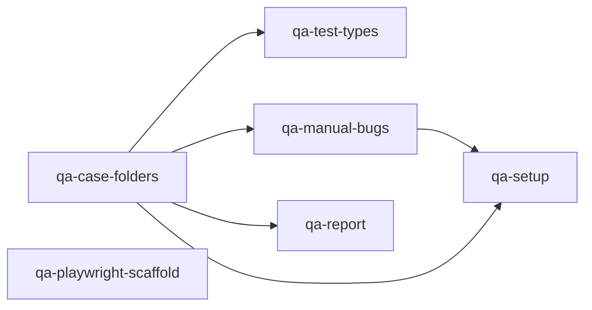

# Roadmap: Workflow audit — reliable, cross-platform, team-safe gin-workflow

Date: 2026-10-30
Source: Solution-architect audit of this repository on 2026-10-30 (five researcher passes over the gate engine, Windows portability, team mode, orchestrator dispatch, and ADLC practice; high-severity claims verified at the cited lines), plus the two epics already open in Beads. QA process epics added on 2026-11-03 from the /discuss session with the testers' questions (templates, per-type files, results, bugs, Excel report) verified against `plugins/gin-qa` and gin-console's `qa/`.

<!-- Written by /roadmap after the PM confirms it. One "### " block per epic; an epic id never changes once written.
     Depends on: epic ids from this file. Evidence: the tech-doc file and section (for example
     03-ARCHITECTURE.md#Request flow) or the product brief. The dependency graph stays acyclic. -->

## Goals

- `state` never reports work as done or undone when the task tracker is unreachable; locks time out; waivers are never silently lost; a new session resumes a half-done track.
- Every command, hook, and worker runs natively on Windows and Linux, proven by CI on both.
- Several members in different roles work in parallel without conflicting claims, lost Beads commits, or unproven gates.
- AI spend per epic has an enforced ceiling; retries and reviews do not multiply cost without cause.
- Skills agree with each other and with the CLI; no hard-coded locale or shell.
- PMs plan dated milestones over roadmap epics and gin-console shows them.
- Testers write cases per capability and type, record manual and automated results in the case files, file bugs linked to the work, and get one consolidated report.

## Constraints

- Keep the JSON read by gin-console backward compatible (`gin-workflow state --format json`, `task ... --json`): add fields, never remove or change meaning.
- `workflow_core.ext` additions do not change `EXT_VERSION` unless a signature changes.
- Windows CI runs on `windows-latest`; no WSL or Git Bash assumption in the tested path.
- No `/tech-doc` pass precedes this roadmap; evidence points at verified `file:line` sites instead.
- Beads dependencies record technical blocking only; the wave order below is scheduling, expressed later through milestones.
- AI capacity: one person building with AI agents, one Claude Max account.

## Strategy

Risk first, then fan out. The milestone epic goes first because `/roadmap --milestone` is what later attaches every epic here to a dated milestone. Reliability core is the foundation the three platform/team/cost epics build on (tracker-unavailable state, lock timeout, event schema version, resume protocol). Windows parity, team hardening, and cost control are independent of each other and run in parallel once the core ships. Process hygiene touches only skills and docs, so it ships early to reduce rebases. Non-Claude dispatch follows cost control because both edit the orchestrator dispatch path and new workers should inherit the budget and retry rules once.

QA process: the case-folder epic defines the file layout and the single `cases result` write path, so it goes first; test types, manual runs, and the report only read or write through it and run in parallel after it; the setup prompt comes last because it generates the process the manual-runs epic defines; the Playwright scaffold touches only `e2e init` and runs alongside the first epic.

## Order

| Wave | Epics |
|---|---|
| 0 | `gin-workflow-6cji` |
| 1 | `gin-workflow-rm-reliability-core`, `gin-workflow-rm-process-hygiene` |
| 2 | `gin-workflow-rm-windows-parity`, `gin-workflow-rm-team-hardening`, `gin-workflow-rm-cost-control` |
| 3 | `gin-workflow-dura` |

After `gin-workflow-6cji` ships: `gin-workflow milestone create`, then `/roadmap --milestone <id>` adopts the epics of this file with estimates.

QA process milestone `gin-workflow-o2nc`:

| Wave | Epics |
|---|---|
| 1 | `gin-workflow-qa-case-folders`, `gin-workflow-qa-playwright-scaffold` |
| 2 | `gin-workflow-qa-test-types`, `gin-workflow-qa-manual-bugs`, `gin-workflow-qa-report` |
| 3 | `gin-workflow-qa-setup` |

## Milestone: Workflow audit phase 2

### Windows parity phase 2: native hooks, workers, and CI
Epic: gin-workflow-rm-windows-parity
Milestone: gin-workflow-8w27
Estimate: 2
Goal: Every gin-workflow command, hook, and orchestrator worker runs on Windows without Git Bash or WSL, and CI proves it on every push.
Scope: port `safety-check.sh` to Python and point `hooks.json` at `python` (drops the `jq` dependency); `sanitized_environment` keeps `SYSTEMROOT`, `USERPROFILE`, `APPDATA`, `LOCALAPPDATA`, `TEMP`, `TMP`, `PATHEXT` on `nt`; worker spawn resolves the executable with `shutil.which` and runs `.cmd`/`.bat` through `cmd /c`; `verify_commands` accept an `{env, argv}` form run without a shell, defaults use `sys.executable`, with a config migration; cancel uses `CREATE_NEW_PROCESS_GROUP` and `taskkill /T`; the five `subprocess(text=True)` sites pass `encoding="utf-8", errors="replace"`; the `.cmd` launcher tries `py -3` before `python`; `install.ps1` falls back to copy when a symlink fails; `executable_resolver` adds `%APPDATA%\npm`; a `windows-latest` CI job runs `python -m unittest` and `tests/install_smoke_test.ps1`.
Out of scope: the `.beads` symlink on Windows (document a junction or copy fallback only); `merge-integration.sh` and `find-polluter.sh`.
Depends on: gin-workflow-rm-reliability-core
Evidence: `plugins/gin-workflow/src/hooks/hooks.json:10,22`; `plugins/gin-orchestrator/src/scripts/gin_orchestrator/native_cli.py:86-102,333-341,339,404-425`; `workflow_core/hooks.py:89`; `install.ps1:70,343,427`; `.github/workflows/release.yml:10`; `gin_orchestrator/{workspace.py:22,171,review.py:81,task_tracking_cli.py:34,cli.py:192}`; `.planning/specs/2026-10-28-windows-support-design.md` (out-of-scope list of the shipped epic `gin-workflow-eq77`).
Risks: the new `verify_commands` shape needs a config version bump and migration; Windows CI minutes cost more and run slower.

### Team hardening: no conflicting claims, no lost Beads, proven gates
Epic: gin-workflow-rm-team-hardening
Milestone: gin-workflow-8w27
Estimate: 2
Goal: Several members in different roles work in parallel while gates, claims, reviews, and Beads stay consistent and nothing is lost on a rejected push.
Scope: `_push` syncs before pushing and never runs `reset --hard`; the Dolt branch comes from config; `claim` applies `eligible` for the bead's `area:` labels like `reassign`; without a Beads remote, `claim` reports itself as advisory; `team init` and `setup doctor` warn on gates with no role policy, with a `team.strict` switch that requires one for every gate; recorded team gates become visible to teammates (derive from the PR on `team check`, or write the proven gate into the epic bead metadata — decided in `/discuss`); `check_plan` rejects the same file listed by two tracks; `team check` passes the local head and `ship` requires approval on the PR head; in team mode the ledger reviewer must differ from the track owner and `max_cycles` is enforced by `review-ledger.py`; claims carry a lease with a TTL.
Out of scope: identity beyond the git email (documented as a known limit); parsing Dolt exit codes.
Depends on: gin-workflow-rm-reliability-core
Evidence: `workflow_core/team.py:13-15,92,220,332`; `workflow_core/team_beads.py:88,95-112`; `workflow_core/team_cli.py:88`; `workflow_core/reviewer.py:121-125`; `docs/concepts/state-model.md:32`; `plugins/gin-workflow/src/skills/gin-review-response/SKILL.md:34`.
Risks: sharing gate records changes the state model and gin-console's reading of it; `team.strict` can lock out an existing team until roles are configured, so it defaults off.

### Cost control: enforced budgets, no wasted retries
Epic: gin-workflow-rm-cost-control
Milestone: gin-workflow-8w27
Estimate: 1
Goal: AI spend per epic has an enforced ceiling, retries happen only for transient failures, and reviewers reuse existing evidence instead of repeating work.
Scope: `usage.budget_usd` per epic with a warning, then a stop enforced by `routes dispatch`; usage collected after every dispatch, not only at track close; git hooks record passing verify runs by tree hash and the reviewer reruns tests only when no matching record exists; `routes resolve` warns when every track is on the top model.
Out of scope: model prices; multi-track parallel dispatch inside the `execute` skill (separate bead); retry and circuit-breaker rules and the timeout/retry defaults constant (moved to `gin-workflow-dura`, since `WorkerScheduler` is not wired into any production path yet); process-group kill on timeout (done on POSIX; Windows in `gin-workflow-rm-windows-parity`).
Spec: .planning/specs/2026-11-01-cost-control-design.md
Depends on: gin-workflow-rm-reliability-core
Evidence: `plugins/gin-orchestrator/src/scripts/gin_orchestrator/{budget.py:1-10,worker_scheduler.py:92,182-205,232-289,circuit_breaker.py:38-46,registry.py:107,251,config.py:9-11,evidence.py:309-358}`; `workflow_core/usage.py:63-307`; `plugins/gin-workflow/src/skills/review/SKILL.md:23`.
Risks: usage attribution by time span is heuristic, so the budget stop has error bars; warn first, stop only above a margin.

### Process hygiene: consistent skills, rules that bind where it matters
Epic: gin-workflow-rm-process-hygiene
Milestone: gin-workflow-8w27
Estimate: 1
Goal: Stage skills agree with each other and with the CLI, carry no hard-coded locale or shell, and the safety rules block what they claim to block.
Scope: remove the Vietnamese lines from `execute/SKILL.md:46-47`; one commit/push rule across `execute` and `quick`; name who runs `checkpoint` and `transition-requested`; state which branch holds the spec commit before a worktree exists; `safety-check` also blocks `git commit -n` and `core.hooksPath` overrides; drop `post-edit.sh` (echo only) or give it a job; dispatch sets `WORKTREE_PATH`; a lint for stories and acceptance criteria before `record requirement-confirmed` in the legacy layout; an ADR template for the legacy layout and a `ship` warning when `.planning/knowledge` did not change since orchestration; `setup doctor` compares the installed snapshot hash with `src`; one approvals table in `stage-contract.md` referenced by the skills; one doc line naming the writer of `.beads.gate.lock`.
Out of scope: changing the default layout to `sdd`; shrinking skill size; the roadmap skill's tech-doc rule (handled by a `/quick` right after this roadmap, to avoid overlapping `gin-workflow-6cji`).
Depends on:
Evidence: `plugins/gin-workflow/src/skills/execute/SKILL.md:43-47`; `skills/quick/SKILL.md:28`; `plugins/gin-workflow/src/scripts/safety-check.sh:80,88`; `scripts/post-edit.sh:19-21`; `skills/discuss/SKILL.md:28`; `skills/gin-knowledge/SKILL.md`; `docs/contributing.md` (installed snapshot section); `references/stage-contract.md` (Approval).
Risks: touches many skill files that other epics also edit, so it ships early and the others rebase.

### Non-Claude main harness dispatches tracks to workers
Epic: gin-workflow-dura
Milestone: gin-workflow-8w27
Estimate: 1
Goal: When Codex, Antigravity, OpenCode, or Copilot is the main harness, tracks, reviews, and explorations run on workers at the catalog model and effort instead of in the main session.
Scope: choose in `/discuss` between native subagent spawn per harness (agent file format, per-spawn model and effort, tool permissions) and handing tracks to the harness's own CLI worker through gin-orchestrator (reusing the `btt3` R10 workers); agent translation in `install.sh` for Codex, Antigravity, OpenCode (none today), and Copilot (dropped today); from cost control: retries only for transient failure kinds (quota, rate limit, service) with the prior attempt's `changed_files` passed to the next, the circuit breaker opening on the first QUOTA or AUTH failure, and one constant owning the timeout and retry defaults, applied to the dispatch path this epic wires.
Out of scope: changes to the model catalog; Claude Code dispatch (shipped in `gin-workflow-btt3`).
Depends on: gin-workflow-rm-cost-control
Evidence: `.planning/specs/2026-10-29-model-effort-selection-design.md`; `install.sh:448`; closed epic `gin-workflow-btt3` (merged at 5b5e0da).
Risks: agent formats differ per harness and need research; both this epic and cost control edit the orchestrator dispatch path, hence the ordering.

## Milestone: QA process

### Case folders per capability, per-type files, recorded results
Epic: gin-workflow-qa-case-folders
Milestone: gin-workflow-o2nc
Estimate: 1
Goal: Test cases live in `qa/cases/<capability>/<type>.md`, the file name sets the type, each case carries its latest `Result`, `Run`, and `Bug`, and one CLI command writes them.
Scope: `cases.py` loads the folder layout and still parses flat `<cap>.md`; `next-id` counts across a capability's files and their git history; `Result`, `Run`, `Bug` are left out of `hash8` and of `fields` in export, and `check` accepts only `passed`, `failed`, `blocked`, `not run`; `gin-qa cases result <TC-ID> <status> [--run <ref>] [--bug <bead>]` is the only write path; `e2e run` calls it per case of the run (worst result across Playwright projects); `templates/qa-readme.md` describes the `qa/` tree and is written next to `guidelines.md` on first `/gin-qa:cases`; the `cases` skill, `docs/guides/qa.md`, and `docs/guides/customizing-templates.md` follow.
Out of scope: runners for non-e2e types; a manual-run skill; the report.
Depends on:
Evidence: `plugins/gin-qa/src/scripts/gin_qa/cases.py:118-136` (one file per capability, stem must match the TC prefix); `cases.py:171-177` (`hash8` includes extra fields); `e2e.py:171-200` (end of `run`); gin-console `qa/cases/milestone-ui.md` (55 e2e and 11 api cases in one file).
Risks: a flat file and a folder for the same capability at once (`check` reports it); `e2e run` now edits committed files.

### Automated test types beyond e2e
Epic: gin-workflow-qa-test-types
Milestone: gin-workflow-o2nc
Estimate: 2
Goal: `api`, `integration`, and `unit` cases get the same path as e2e cases: planned, pinned, run, checked, and their results recorded.
Scope: `qa/guidelines.md` declares per type the test globs, the `TC-ID@hash8` marker, and the run command; `gin-qa tests plan|pin|check` generalize the marker scanning of `e2e.py` to any glob; `gin-qa tests run --type <t>` runs the declared command with JUnit XML output and maps test names containing a TC-ID to `gin-qa cases result`; skill `/gin-qa:tests <capability> --type <t>` writes the missing tests from the project's own pattern.
Out of scope: Playwright specifics (they stay in `e2e`); performance or load tests.
Depends on: gin-workflow-qa-case-folders
Evidence: `plugins/gin-qa/src/scripts/gin_qa/e2e.py:39-41` (only `Type: e2e` is selected); `e2e.py:54-90` (`plan`, `check_specs`); gin-console `qa/guidelines.md` (api cases are backend pytest with fakes, with no runner or skill).
Risks: JUnit test-name conventions differ per runner; pytest with fakes depends on the project's conftest.

### Manual runs and bug logging
Epic: gin-workflow-qa-manual-bugs
Milestone: gin-workflow-o2nc
Estimate: 1
Goal: A tester walks the manual cases of a capability, records passed, failed, or blocked, and files a bug bead linked to the work it came from.
Scope: skill `/gin-qa:run <capability>` over the `manual.md` cases, one case per step, writing through `gin-qa cases result`; on a failure it creates `gin-workflow task create -t bug` with the steps, expected, actual, and evidence, `--deps discovered-from:<epic of the REQ>`, an optional `--external-ref` for the team's tracker, and records `--bug`; the tester row of `docs/roles.md` and a process section in `docs/guides/qa.md`.
Out of scope: syncing bugs to Jira or Notion; test cycles or runs as beads.
Depends on: gin-workflow-qa-case-folders
Evidence: `bd create --type bug --deps discovered-from:<id>`; `docs/guides/usage-report.md:19` (bugs counted by `discovered-from`); `docs/roles.md` (tester row lists `/gin-qa:cases`, `/gin-qa:e2e`, `/gin-workflow:progress` only).
Risks: in the legacy layout a `Source:` path may have no bead, so the bug gets no `discovered-from`.

### Consolidated xlsx report
Epic: gin-workflow-qa-report
Milestone: gin-workflow-o2nc
Estimate: 1
Goal: One workbook for every capability with counts per capability, type, priority, and result, and charts of them.
Scope: `gin-qa report --format xlsx --out <path>` built from the `cases export` data; a `Summary` sheet with bar and pie charts, a `Cases` sheet with the extra fields as columns, one sheet per capability; `openpyxl` as an optional dependency with an exit-2 message naming the install command when missing.
Out of scope: filling a project's own Excel template (openpyxl drops existing charts on save); trend history across runs.
Depends on: gin-workflow-qa-case-folders
Evidence: `plugins/gin-qa/src/scripts/gin_qa/cli.py` (`export` is JSON only); `docs/guides/qa.md` ("feeds your own report tooling").
Risks: the first third-party dependency in gin-qa; chart styling expectations from the testers' current templates.

### Project QA setup prompt
Epic: gin-workflow-qa-setup
Milestone: gin-workflow-o2nc
Estimate: 1
Goal: A new project gets `qa/guidelines.md`, `qa/README.md`, and a thin project-local process skill from one interview, all of it passing `gin-qa cases check`.
Scope: skill `/gin-qa:setup` asking the test types, file layout, bug tracker, and report expectations; it writes the guidelines sections (`Types`, `Automated types`, `Manual runs`, `Bugs`), the README, and `.claude/skills/<project>-qa/SKILL.md` holding process only, with data always read through the gin-qa CLI; it runs `gin-qa cases check` at the end.
Out of scope: generated skill folders for harnesses other than Claude Code (documented, not generated).
Depends on: gin-workflow-qa-case-folders, gin-workflow-qa-manual-bugs
Evidence: `docs/guides/customizing-templates.md:99-160` (guidelines and extra fields); `install.sh:668,682` (skills install per user; no project-local mechanism).
Risks: generated skills drift from plugin behavior; keeping them process-only limits it.

### Playwright scaffold in e2e init
Epic: gin-workflow-qa-playwright-scaffold
Milestone: gin-workflow-o2nc
Estimate: 1
Goal: `gin-qa e2e init` leaves a runnable `playwright.config.ts` that follows Playwright practice and finds specs under `qa/e2e`.
Scope: `templates/playwright.config.ts` (testDir from `qa.e2e`, `baseURL` from `E2E_BASE_URL`, `retries` and `forbidOnly` on CI, `trace: 'on-first-retry'`, `list` and `junit` reporters, a chromium project, a commented `webServer` block, `testIdAttribute`); `init` writes it when none exists and hints the `e2e` npm script; `/gin-qa:e2e` skips the URL question when the config sets `baseURL`.
Out of scope: page objects, auth setup projects, API stub helpers.
Depends on:
Evidence: `plugins/gin-qa/src/scripts/gin_qa/e2e.py:125-142` (`init` writes only the fixture and the ignore entry); gin-console `playwright.config.ts` and `qa/e2e/support/api.ts` (written by hand).
Risks: a project with an existing config gets nothing, by design (`init` never overwrites).

## Unassigned

### Milestones: dated milestones, working-day scheduler, roadmap adoption
Epic: gin-workflow-6cji
Goal: A PM creates a milestone with a period, attaches roadmap epics, sees the computed schedule and warnings, and gin-console reads it through a stable JSON contract.
Scope: REQ-MILESTONE-001..017 from the input contract: milestone beads (type `milestone`, `start`/`end`/`kickoff` metadata), `gin-workflow milestone create/update/kickstart/move/estimate/close/list/show`, working-day scheduler and warnings (`overflow`, `late`, `unestimated`, `external_blocker`), JSON `schema: 1`, `team.permissions.milestone` role check and shared-Beads sync, `task ready` excludes milestones, `/roadmap --milestone` with proposed estimates and adoption of existing roadmap epics.
Out of scope: gin-console pages (own child epic of `gin-harness-6s4`); migration of existing projects (none needed).
Depends on:
Evidence: `gin-harness/docs/changes/gin-harness-6s4-milestones/spec-delta.md` and `design.md` ("JSON contract", "Existing projects"), branch `spec/milestones`, commit b4ce341; parent cross-repo epic `gin-harness-6s4`.
Risks: REQ-MILESTONE-016 cites `team reassign` as the sync model, but `team_beads._push` runs `dolt reset --hard origin/main` on a rejected push, which contradicts the "written locally but not pushed" scenario, so this epic needs a push helper without reset that team hardening later adopts for `claim` and `reassign`; `bd ready` lists an open milestone, so both gin-workflow and gin-console must filter the type and ship together; Beads children inherit parent labels by default, so tracks under `roadmap` epics may carry that label; `/roadmap --milestone` edits `roadmap/SKILL.md` and the roadmap template, which this file already uses.

### Reliability core: state that never lies
Epic: gin-workflow-rm-reliability-core
Goal: `state` and `record` distinguish "not done" from "unknown", never hang on a lock, never lose a waiver silently, and a fresh session resumes the track it left in progress.
Scope: tracker failure (`bd` missing, timeout, error) yields an `unknown` gate value plus a "tracker unavailable" warning, and `record shipped` names that cause instead of "standalone bead"; a corrupt event log surfaces a warning instead of an empty waiver set; `file_lock` takes a timeout on POSIX (`LOCK_NB` with a deadline) matching the Windows 60 s; the `shipped` and already-shipped guards run inside the store lock; events carry `schema_version` and readers ignore unknown fields; `state` reads the log once per command; `execute` first resumes `in_progress` beads owned by the current actor, and a SessionStart hook runs `gin-workflow state` and `task list --status in_progress`; `task close` on a track refuses without a terminal ledger approval or waiver when `project.review_ledger` is on; `ship` warns when `hooks status` is not ok or `verify_commands` is empty.
Out of scope: event-log rotation or compaction; claim lease/TTL (team hardening); `.beads.gate.lock` beyond identifying its writer in one doc line.
Depends on:
Evidence: `plugins/gin-workflow/src/scripts/workflow_core/tasks.py:132-155`, `lifecycle_cli.py:117-118`, `waivers.py:143`, `router.py:175`, `locking.py:34`, `events.py:207-220`, `schemas.py:267-282`, `lifecycle_cli.py:50`; `plugins/gin-workflow/src/skills/execute/SKILL.md:16`; `workflow_core/hooks.py:95-105`; `docs/concepts/lifecycle.md:31,78`.
Risks: an `unknown` gate value is new to gin-console's parser, so it is added as a new field next to the existing booleans; the SessionStart hook must stay cheap.
