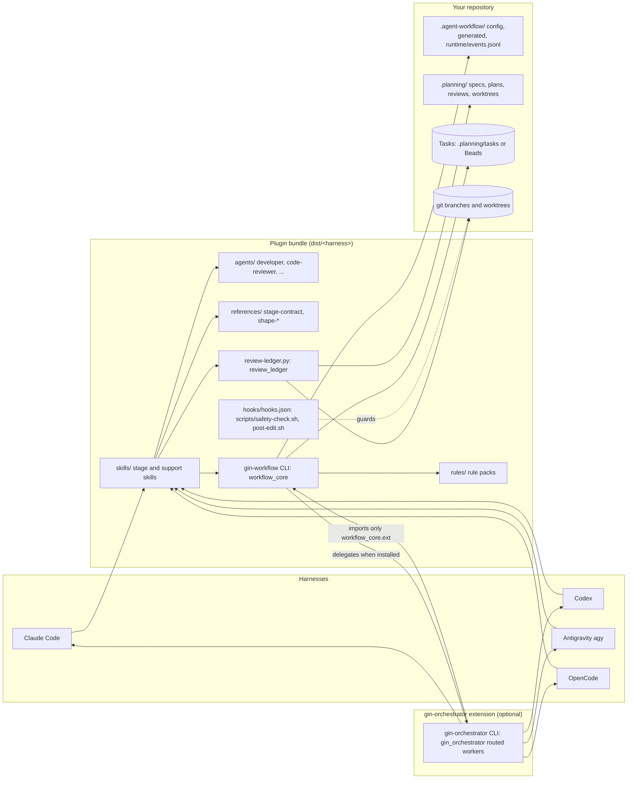
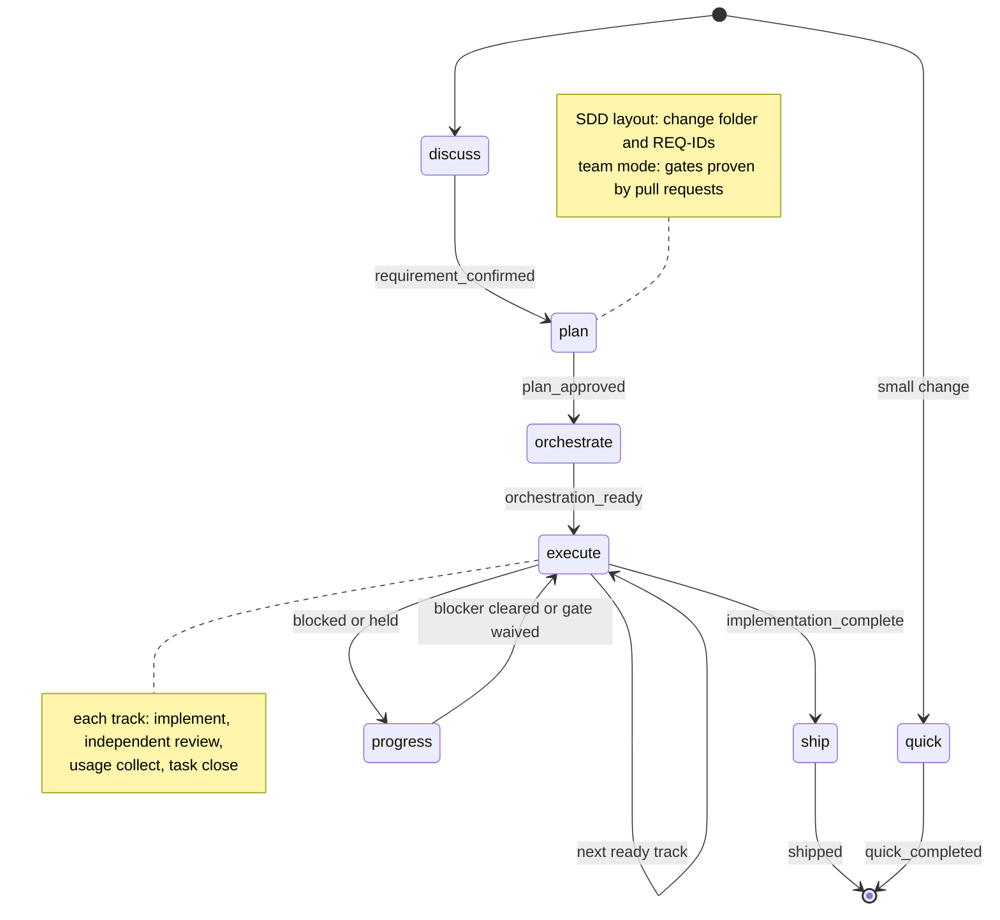
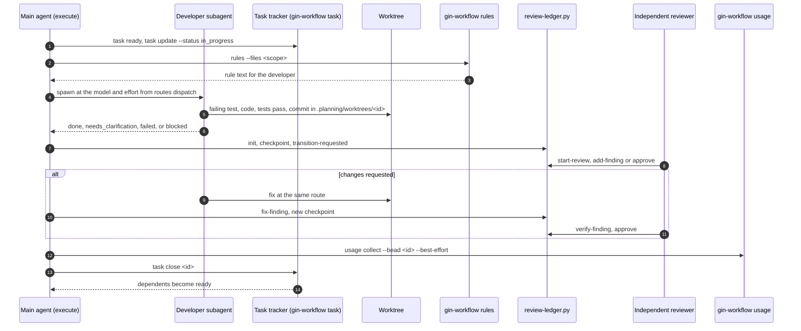
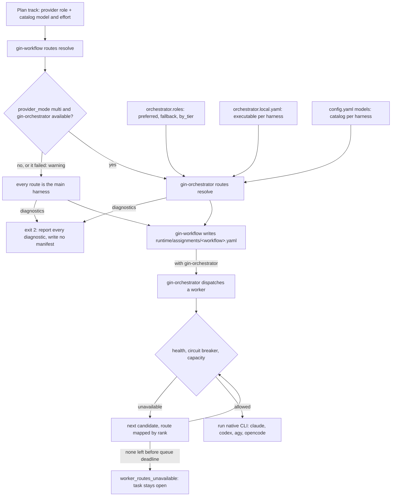
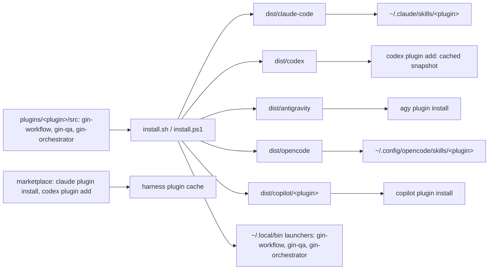
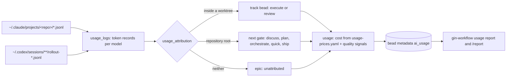

# Architecture

gin-workflow is a plugin for Claude Code, Codex, Antigravity, and OpenCode that moves a change from requirement to merge through recorded gates. GitHub Copilot CLI also loads its skills and hooks, but it cannot be the configured harness, so workers and reviews run on one of the others. Skills tell the agent what to do at each stage. The `gin-workflow` Python CLI records the gates and derives the workflow state from them. A task tracker (local Markdown files, or Beads if you choose it) tracks the work. This page shows how the pieces fit. Each diagram links to the page that covers it in detail.

## Components

The harness loads the skills. Skills call `gin-workflow` for configuration, gates, rules, specs, team mode, and usage, and `review-ledger.py` for reviews. Tasks go through `gin-workflow task`, which serves Markdown files or runs `bd`. `gin-orchestrator` is an optional extension: `gin-workflow` calls it through a versioned CLI contract ([Orchestrator contract](../reference/orchestrator-contract.md)), and it reaches back only through the facade `workflow_core.ext`; `gin-workflow` never imports it. Nothing outside the repository holds workflow state except Beads (if used) and the harness logs that `usage collect` reads. See [State model](state-model.md) for who owns what.

## Lifecycle

Each arrow is a gate recorded with `gin-workflow record` or derived from the task tracker. `gin-workflow state` evaluates the gates and names exactly one next stage, or holds at `progress` with remedies. See [Lifecycle](lifecycle.md).

## One track, from claim to close

A track closes when its tests pass and its review is approved, without waiting for a merge; that unblocks the next track. The reviewer runs in a fresh session of the main harness, or on a different provider with gin-orchestrator, within `routing.review.max_cycles`. See [Lifecycle](lifecycle.md#execute-and-review).

## Provider routing

Plans name roles and routes from the main harness's model catalog, never providers. `gin-workflow` resolves the routes and writes the manifest. It delegates the resolution, and the reviewer choice, to `gin-orchestrator` only when `provider_mode` is `multi` and that extension is installed. Without it every route is the main harness. Executables come from machine-local configuration and are rechecked at dispatch. Every candidate runs the plan's route mapped by rank into its own catalog, so a fallback keeps the rank. See [Providers](providers.md) and [Orchestrator](../orchestrator/README.md).

## Build and install

The installer rebuilds `dist/` from `src/` for each selected platform and registers it with the harness. Three plugins build the same way: `gin-workflow` (the default), `gin-qa`, and `gin-orchestrator`. `--plugin gin-orchestrator` installs gin-workflow first when the gin-workflow launcher is missing or at another version. Each harness keeps a snapshot, so a fix committed to this repository reaches a machine only after the install runs again there. A marketplace install copies the plugin but not the launchers. See [Contributing](../contributing.md) and [Troubleshooting](../reference/troubleshooting.md).

## Usage collection

`execute` and `ship` run `usage collect --best-effort` before closing a bead, so a collection error never blocks the close. It keeps only the timestamp, model, session, working directory, branch, and token counts of each log entry, never prompt text. See [Usage report](../guides/usage-report.md).
