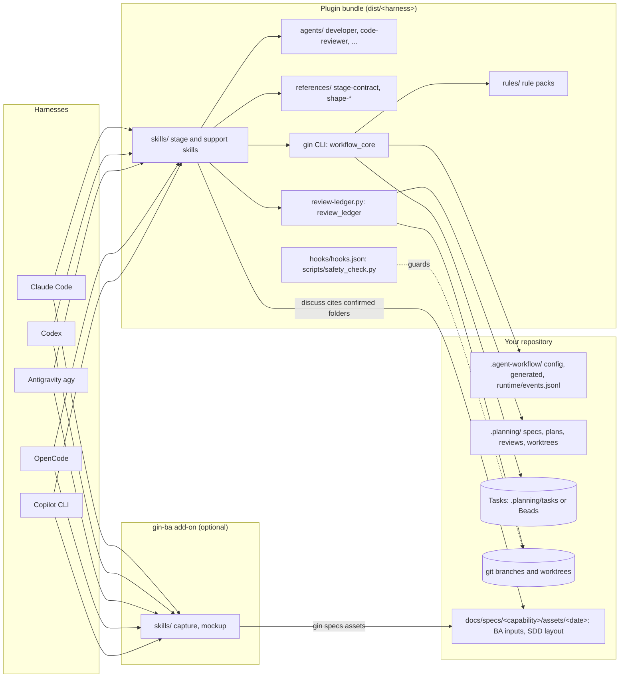
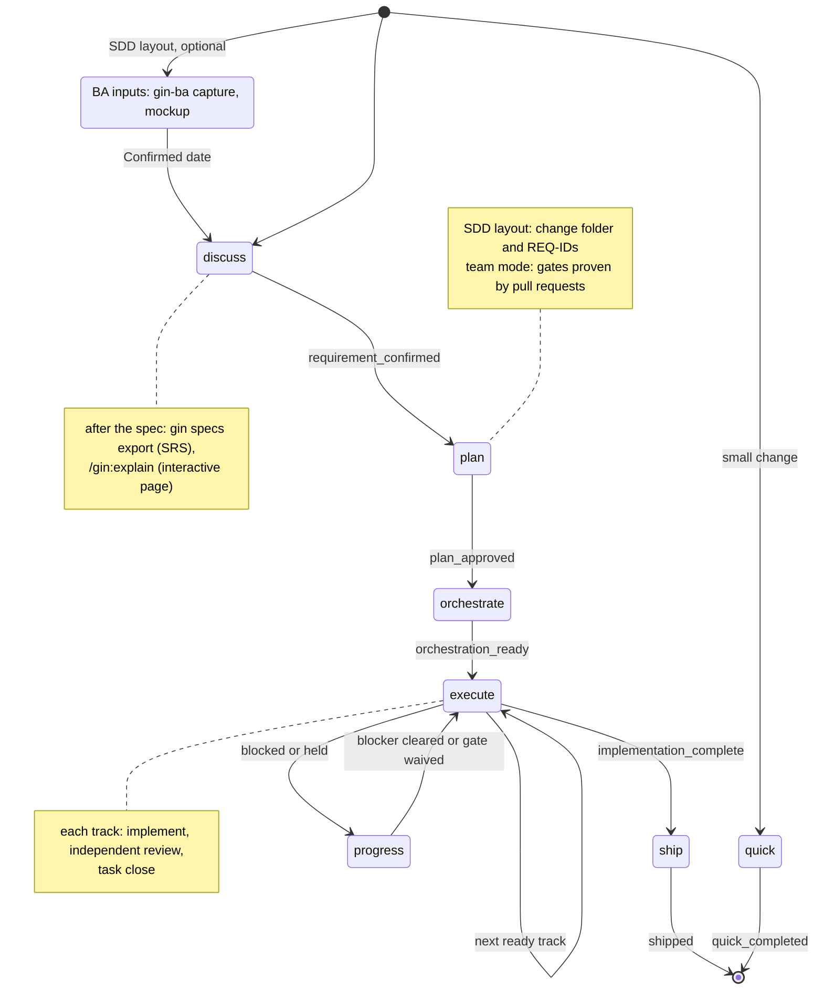
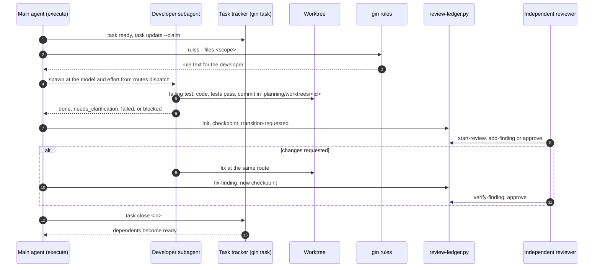
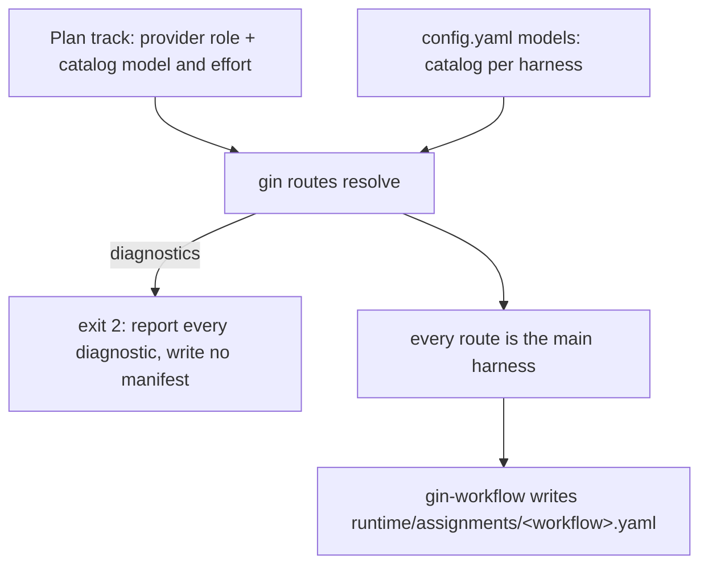
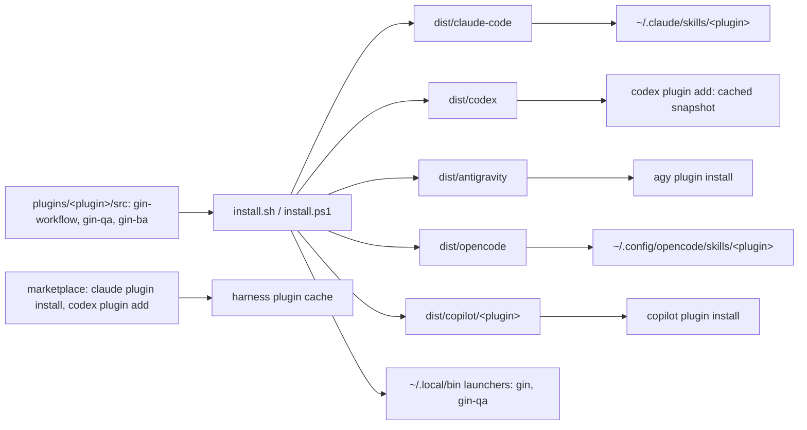

# Architecture

gin-workflow is a plugin for Claude Code, Codex, Antigravity, OpenCode, and GitHub Copilot CLI that moves a change from requirement to merge through recorded gates. Skills tell the agent what to do at each stage. The `gin` Python CLI records the gates and derives the workflow state from them. A task tracker (local Markdown files, or Beads if you choose it) tracks the work. This page shows how the pieces fit. Each diagram links to the page that covers it in detail.

## Components

The harness loads the skills. Skills call `gin` for configuration, gates, rules, specs, and team mode; they call `review-ledger.py` for reviews. Tasks go through `gin task`, which serves Markdown files or runs `bd`. Nothing outside the repository holds workflow state except Beads (if used). See [State model](state-model.md) for who owns what.

The optional `gin-ba` add-on has skills only and no CLI. With the SDD layout, `capture` and `mockup` write the business analyst's inputs into dated asset folders under `docs/specs/<capability>/assets/` through `gin specs assets`. `discuss` cites the confirmed folders. See [Business analyst](../guides/ba.md).

## Lifecycle

Each arrow between stages is a gate recorded with `gin record` or derived from the task tracker. `gin state` evaluates the gates and names exactly one next stage, or holds at `progress` with remedies. The `ba_inputs` state and the SRS export and explain page after the spec record no gate; the BA confirms inputs with `Confirmed: <date>` in the folder's `description.md`. See [Lifecycle](lifecycle.md) and [Business analyst](../guides/ba.md).

## One track, from claim to close

A track closes when its tests pass and its review is approved, without waiting for a merge; that unblocks the next track. The reviewer runs in a fresh session of the main harness within `routing.review.max_cycles`. See [Lifecycle](lifecycle.md#execute-and-review).

## Provider routing

Plans name roles and routes from the main harness's model catalog, never providers. gin-workflow resolves every route to the main harness and writes the manifest. See [Providers](providers.md).

## Build and install

The installer rebuilds `dist/` from `src/` for each selected platform and registers it with the harness. Three plugins build the same way: gin-workflow (the default, plugin id `gin`), `gin-qa`, and `gin-ba`. Each harness keeps a snapshot, so a fix committed to this repository reaches a machine only after the install runs again there. A marketplace install copies the plugin but not the launchers. See [Contributing](../contributing.md) and [Troubleshooting](../reference/troubleshooting.md).
