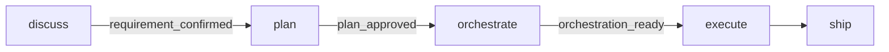

# Bắt đầu

Hướng dẫn này đưa một tính năng từ ý tưởng tới merge bằng Claude Code và `gin-workflow`.

Mỗi thay đổi đi qua các cổng chất lượng được ghi nhận:



---

## Điều kiện tiên quyết { #prerequisites }

1. Python 3.11 trở lên (kèm PyYAML) và Git.
2. Claude Code và plugin `gin-workflow`:
   ```bash
   curl -sSL https://raw.githubusercontent.com/giangdhwhtbr/gin-workflow/master/remote-install.sh | bash -s -- --platform claude
   ```
   Trên Windows PowerShell, xem [hướng dẫn Windows](guides/windows.md) để dùng `install.ps1`.
3. Tùy chọn: [Beads](https://github.com/gastownhall/beads) (`bd`) để theo dõi task (`brew install beads` hoặc `npm install -g @beads/bd`, rồi `bd init` trong repository của bạn). Nếu không có, task là các file Markdown cục bộ.
4. Tùy chọn: [các công cụ khuyến nghị](guides/recommended-tools.md) như CodeGraph, giúp agent tra cứu code nhanh hơn.

---

## Thiết lập một lần { #one-time-setup }

Chạy setup trong Claude Code để cấu hình dự án:

```text
/gin-workflow:setup
```

Trong repository của nhóm, chỉ Tech Lead chạy `/gin-workflow:setup`, một lần, rồi commit `.agent-workflow/config.yaml`. Đồng đội làm theo [tham gia nhóm](guides/team.md#join-it-member) thay vì chạy setup.

Setup hỏi từng câu một và tạo `.agent-workflow/config.yaml`:
- Loại dự án: stage và shape, được phát hiện từ repository của bạn.
- Rigor: setup gợi ý `standard` cho codebase có sẵn (Git worktree cho công việc song song và review độc lập) và `easy` cho dự án mới; `strict` luôn dùng worktree và review ledger.
- Verify commands: các lệnh lint, typecheck, test, build và e2e của bạn (dự án mới sẽ được hỏi về stack thay vào đó).
- Code index: với codebase có sẵn, setup đề nghị chạy `codegraph init` khi đã cài CodeGraph.
- Theo dõi task: `markdown` (mặc định; file cục bộ dưới `.planning/tasks/`) hoặc `beads` (cần `bd`).

Mọi thứ chạy trong harness bạn đã mở (`provider_mode: single`).

Hãy commit `.agent-workflow/config.yaml` vào git.

---

## Quy trình làm tính năng { #feature-workflow }

### Discuss { #discuss }
```text
/gin-workflow:discuss Add an export-to-csv button on the user list
```
Claude đọc code hiện có, hỏi từng câu làm rõ, đề xuất các hướng tiếp cận và viết một specification vào `.planning/specs/<date>-<topic>-design.md` (hoặc `docs/changes/` ở chế độ SDD). Xác nhận thiết kế để qua cổng `requirement_confirmed`.

### Plan { #plan }
```text
/gin-workflow:plan export-csv-button
```
Claude chia spec đã xác nhận thành các track trong `.planning/plans/`, mỗi track có file, interface và các bước test-first. Duyệt plan để qua cổng `plan_approved`.

### Orchestrate { #orchestrate }
```text
/gin-workflow:orchestrate export-csv-button
```
Claude tạo một epic và các task trong công cụ theo dõi task của bạn (Markdown hoặc Beads) cùng một Git worktree cô lập. Bước này qua cổng `orchestration_ready`.

### Execute { #execute }
```text
/gin-workflow:execute
```
Claude nhận track sẵn sàng tiếp theo, viết test thất bại trước, triển khai cho tới khi test qua, rồi chạy một review độc lập trong review ledger. Sau khi được duyệt, track được đóng. Lặp lại `/gin-workflow:execute` cho tới khi mọi track xong.

Các kiểm tra chất lượng không cần một stage riêng: `pre-commit` chạy lint và typecheck, `pre-push` chạy test (thêm build ở `standard` và `strict`, và e2e ở `strict`), còn CI là lớp bảo đảm cuối (`gin-workflow hooks install`, xem [tham chiếu CLI](reference/cli.md#gin-workflow-hooks)).

### Ship { #ship }
```text
/gin-workflow:ship
```
Claude đưa ra bốn lựa chọn: merge cục bộ, push và mở pull request, giữ branch, hoặc bỏ. Sau khi bạn đồng ý, nó tích hợp công việc, xóa worktree và đóng epic (`shipped`). Ship không chạy test; git hook và CI làm việc đó.

---

## Lối tắt { #shortcuts }

- `/gin-workflow:workflow`: phát hiện trạng thái hiện tại và chạy stage kế tiếp.
- `/gin-workflow:quick <change>`: xử lý một thay đổi nhỏ (mặc định tối đa 5 file trong một module) mà không cần spec hay task.
- `/gin-workflow:progress`: hiển thị các task đang làm, sẵn sàng và bị chặn.

---

## Starter và hướng dẫn { #starters-and-guides }

- Dự án mới: [starter greenfield](starters/greenfield.md).
- Codebase legacy: [starter brownfield](starters/brownfield.md).
- Nhóm: [vai trò trong nhóm](roles.md).
