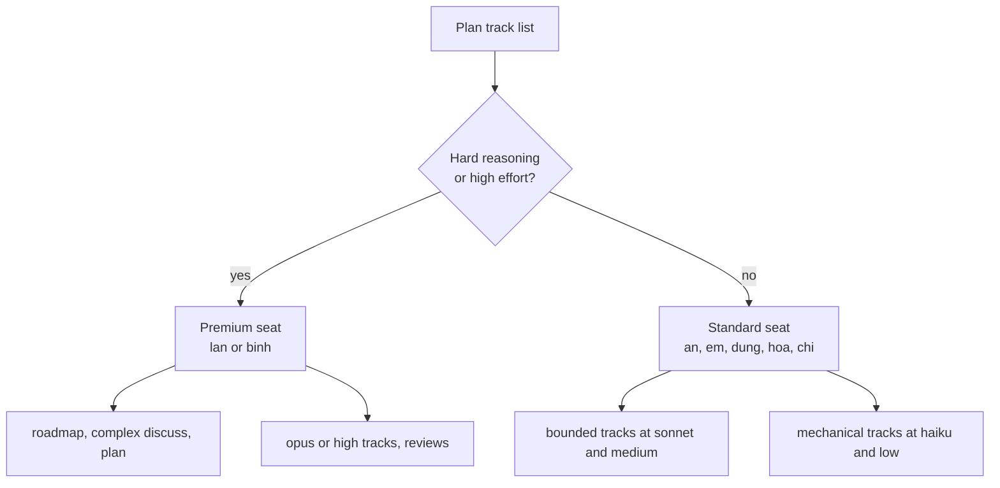
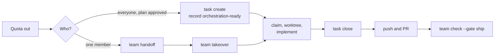

# Using AI effectively

Pick the weakest model that can do the stage, raise the effort only for hard reasoning, and give the costly stages to the people with the most AI quota. This guide shows the choice per stage, a way to split work across mixed seats, and how to keep working when quota runs out.

The model and effort advice is a convention. gin-workflow records the `Model:` and `Effort:` of each plan track and routes by them, but it does not pick them for you. The names come from the model catalog in [configuration](../reference/config.md#models): `haiku`, `sonnet`, and `opus` for models, `low`, `medium`, and `high` for efforts.

## Model and effort by stage

Stages that read and write structured text run on `sonnet`. Stages that weigh trade-offs across the whole repository run on `opus`. Mechanical work runs on `haiku` at `low` effort.

| Stage | Model | Effort | Why |
|---|---|---|---|
| `/gin:setup` | `haiku` | `low` | An interview that fills fixed questions; little reasoning |
| `/gin:team-setup` | `haiku` | `low` | Writes the `team:` block from answers you already hold |
| `/gin:tech-doc` | `sonnet` | `medium` | Reads a lot of code, but summarizes rather than designs |
| `/gin:roadmap` | `opus` | `high` | Splits goals into dependent epics; a wrong split costs a milestone |
| `/gin:roadmap --milestone` | `sonnet` | `medium` | Chooses epics against capacity and blockers from a fixed list |
| `/gin:discuss` | `sonnet` | `medium` | Turns answers into a spec; use `opus` for a risky legacy capability |
| `/gin:plan` | `opus` | `high` | Decides tracks, areas, owners, and routes; every later stage inherits it |
| `/gin:orchestrate` | `haiku` | `low` | Mirrors the plan into beads; the plan already holds the decisions |
| `/gin:execute`, track at `low` | `haiku` | `low` | Mechanical edits and boilerplate |
| `/gin:execute`, track at `medium` | `sonnet` | `medium` | A bounded change with a clear spec |
| `/gin:execute`, track at `high` | `opus` | `high` | Cross-module, migration, security, or concurrency work |
| `/gin:review` | `opus` | `high` | A reviewer weaker than the author misses defects |
| `/gin:ship` | `haiku` | `low` | Runs the chosen merge option and closes beads |
| `/gin-qa:setup` | `sonnet` | `medium` | One interview that writes the QA guidelines |
| `/gin-qa:cases` | `sonnet` | `medium` | Maps requirements to cases; needs care, not deep design |
| `/gin-qa:tests` | `sonnet` | `medium` | Writes tests in your own framework from the cases |
| `/gin-qa:run` | `haiku` | `low` | Walks a tester through steps and records results |
| `/gin-qa:e2e` | `sonnet` | `medium` | Explores the running application to write specs |
| `/gin-qa:report` | `haiku` | `low` | Runs `gin-qa report` and summarizes the output |

Set the model for a plan track in its `Model:` and `Effort:` lines. Change the model for your own session with `/model` in Claude Code, as [Working with Claude Code](claude-workflow.md#context-hygiene-and-session-habits) describes.

## Allocating team accounts

Give the Premium seats to the stages where a mistake spreads, and the Standard seats to bounded parallel tracks. The plan does this through the `Owner:` of each track.

The example is the seven-person team of the [brownfield starter](../starters/brownfield.md#the-scenario) with two Premium and five Standard seats. Seat tiers are a team convention, not a setting.



Rules that keep the split working:

- Lan and Binh run `/gin:roadmap`, the `plan`, reviews, and the `opus` or `high` tracks, such as the legacy cutover.
- An, Em, Dung, Hoa, and Chi run bounded tracks in parallel, at `sonnet` and `medium` or `haiku` and `low`.
- Write the `Owner:` of every track in the plan, so the split is visible in `gin team check-plan <plan>`.
- Set `usage.budget_usd` in `.agent-workflow/config.yaml` to cap the spend of each epic. See [AI usage report](usage-report.md#budget).

## Working manually when AI quota runs out

When quota runs out, the workflow continues from the command line: beads, claims, worktrees, rules, and gates are all commands, not model behavior.



### Hand a track to another member

The current assignee or the area lead runs one command from the main checkout. It refuses a dirty worktree, pushes the branch and the review ref, and reassigns the bead. With `--release` it returns the bead to the pool for any member:

```bash
gin team handoff <bead> <email>
```

The new owner takes it in one command from the main checkout of their clone; it fetches the branch, creates `.planning/worktrees/<bead>`, fetches the review ref, and claims:

```bash
gin team takeover <bead>
```

### Create track beads by hand

If quota ran out after the plan was approved and before `/gin:orchestrate` ran, create what that skill would have created.

```bash
gin task create --parent <epic> --labels track:<N>,area:<area> --assignee <owner> "<title>"
gin task dep add <blocked> <blocker>
gin record orchestration-ready --workflow-id <epic> --epic <epic> --evidence "<bead-ids>"
```

### Work a track

1. Find and claim a bead.
   - In team mode, run `gin team deps`, `gin team ready`, and `gin team claim <bead>`. The claim writes a lease.
   - In solo mode, run `gin task ready` and `gin task update <bead> --claim`.
2. Create the worktree for a new branch and enter it. Then check that the blocking tracks have merged.
   ```bash
   gin worktree create <bead> feat/<topic>-t<N>
   cd .planning/worktrees/<bead>
   gin team deps --bead <bead>
   ```
3. Read the track's `Files:` and `Interfaces:` in the plan, then list the rules that apply to those paths.
   ```bash
   gin rules --files <paths>
   ```
4. Write the failing test, make it pass, and commit. The `pre-commit` hook runs `lint` and `typecheck`.
5. For a QA track, work the cases by hand with the `gin-qa` CLI.
   ```bash
   gin-qa cases plan <capability>
   gin-qa cases next-id <capability>
   # create one file per case under qa/cases/<capability>/
   gin-qa cases pin <TC-ID>
   gin-qa cases check
   gin-qa tests run --type <type>
   gin-qa e2e run
   gin-qa e2e check --run <folder>
   gin-qa cases result <TC-ID> <status> --run <ref>
   gin-qa cases bug <TC-ID> --actual "<text>" --run "<ref>"
   gin-qa report <capability>
   ```
   Use `gin-qa cases bug` only for a failed manual case. It files the bug bead and records the failure.
6. Close the track. Under `easy` or `standard` rigor, which leave `project.review_ledger` off:
   ```bash
   gin task close <bead> --reason "Tests pass; implemented manually"
   ```
   Under `strict` rigor, a track needs an approved review ledger. A peer review in the pull request can stand in for it as a recorded waiver:
   ```bash
   gin task close <bead> --waive-review "AI quota exhausted; peer reviewed in PR #<num>" --actor <your-email> --reason "Tests and PR review passed"
   ```
7. Push `feat/<topic>-t<N>`. The `pre-push` hook runs `test` under `easy` rigor, `test` and `build` under `standard`, and `test`, `build`, and `e2e` under `strict`. With shared Beads, run `gin team sync`.
8. Open the pull request and fill the `Plan:` and `Tracks:` fields of the template, so teammates' `gin team deps` can resolve the track.

### Check the ship gate

Once every track pull request has merged, check the gate and close the epic.

```bash
gin team check <pr-url> --gate ship
gin task close <epic> --reason "All tracks merged"
gin worktree cleanup <bead>
```

See [team mode](team.md) for claims and gates, and the [CLI reference](../reference/cli.md) for every option.
