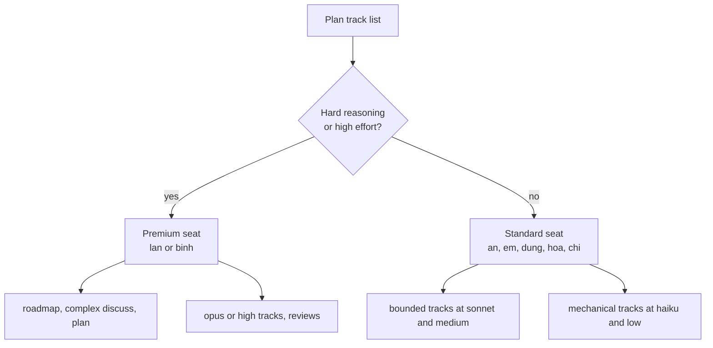
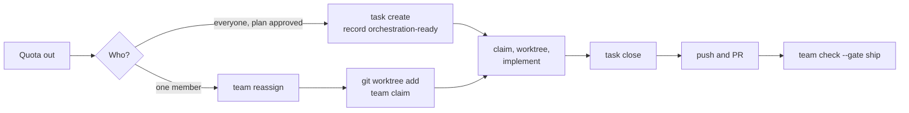

# Dùng AI hiệu quả { #using-ai-effectively }

Chọn model yếu nhất mà vẫn làm được stage, chỉ tăng effort cho phần suy luận khó, và giao các stage tốn kém cho những người có nhiều quota AI nhất. Hướng dẫn này chỉ ra lựa chọn theo từng stage, một cách chia việc cho các seat không đồng đều, và cách tiếp tục làm việc khi hết quota.

Lời khuyên về model và effort là một quy ước. `gin-workflow` ghi lại `Model:` và `Effort:` của mỗi track trong plan và định tuyến theo chúng, nhưng không chọn thay bạn. Các tên lấy từ model catalog trong [cấu hình](../reference/config.md#models): `haiku`, `sonnet`, và `opus` cho model, `low`, `medium`, và `high` cho effort.

## Model và effort theo stage { #model-and-effort-by-stage }

Các stage đọc và ghi văn bản có cấu trúc chạy trên `sonnet`. Các stage cân nhắc đánh đổi trên toàn repository chạy trên `opus`. Công việc cơ học chạy trên `haiku` ở effort `low`.

| Stage | Model | Effort | Lý do |
|---|---|---|---|
| `/gin-workflow:setup` | `haiku` | `low` | Một buổi phỏng vấn điền các câu hỏi cố định; ít suy luận |
| `/gin-workflow:team-setup` | `haiku` | `low` | Ghi khối `team:` từ các câu trả lời bạn đã có |
| `/gin-workflow:tech-doc` | `sonnet` | `medium` | Đọc nhiều code, nhưng tóm tắt chứ không thiết kế |
| `/gin-workflow:roadmap` | `opus` | `high` | Chia mục tiêu thành các epic phụ thuộc nhau; chia sai tốn cả một milestone |
| `/gin-workflow:roadmap --milestone` | `sonnet` | `medium` | Chọn epic theo năng lực và blocker từ một danh sách cố định |
| `/gin-workflow:discuss` | `sonnet` | `medium` | Biến câu trả lời thành spec; dùng `opus` cho một capability legacy có rủi ro |
| `/gin-workflow:plan` | `opus` | `high` | Quyết định track, area, owner, và route; mọi stage sau đều kế thừa nó |
| `/gin-workflow:orchestrate` | `haiku` | `low` | Phản chiếu plan vào bead; plan đã chứa các quyết định |
| `/gin-workflow:execute`, track ở `low` | `haiku` | `low` | Chỉnh sửa cơ học và boilerplate |
| `/gin-workflow:execute`, track ở `medium` | `sonnet` | `medium` | Một thay đổi có phạm vi rõ với spec rõ |
| `/gin-workflow:execute`, track ở `high` | `opus` | `high` | Công việc liên module, migration, bảo mật, hoặc đồng thời |
| `/gin-workflow:review` | `opus` | `high` | Reviewer yếu hơn tác giả sẽ bỏ sót lỗi |
| `/gin-workflow:ship` | `haiku` | `low` | Chạy lựa chọn merge đã chọn và đóng bead |
| `/gin-qa:setup` | `sonnet` | `medium` | Một buổi phỏng vấn ghi ra các QA guideline |
| `/gin-qa:cases` | `sonnet` | `medium` | Ánh xạ requirement thành case; cần cẩn thận, không cần thiết kế sâu |
| `/gin-qa:tests` | `sonnet` | `medium` | Viết test trong framework của bạn từ các case |
| `/gin-qa:run` | `haiku` | `low` | Dẫn tester đi qua các bước và ghi lại kết quả |
| `/gin-qa:e2e` | `sonnet` | `medium` | Khám phá ứng dụng đang chạy để viết spec |
| `/gin-qa:report` | `haiku` | `low` | Chạy `gin-qa report` và tóm tắt đầu ra |

Đặt model cho một track của plan trong các dòng `Model:` và `Effort:` của nó. Đổi model cho session của chính bạn bằng `/model` trong Claude Code, như [Làm việc với Claude Code](claude-workflow.md#context-hygiene-and-session-habits) mô tả.

## Phân bổ tài khoản của nhóm { #allocating-team-accounts }

Giao các seat Premium cho những stage mà một sai sót lan rộng, và các seat Standard cho những track song song có phạm vi rõ. Plan làm việc này thông qua `Owner:` của từng track.

Ví dụ là nhóm bảy người của [starter brownfield](../starters/brownfield.md#the-scenario) với hai seat Premium và năm seat Standard. Hạng seat là một quy ước của nhóm, không phải một thiết lập.



Các quy tắc giúp cách chia này vận hành tốt:

- Lan và Binh chạy `/gin-workflow:roadmap`, `plan`, các review, và các track `opus` hoặc `high`, như cutover legacy.
- An, Em, Dung, Hoa, và Chi chạy song song các track có phạm vi rõ, ở `sonnet` và `medium` hoặc `haiku` và `low`.
- Ghi `Owner:` của mọi track trong plan, để cách chia hiện rõ trong `gin-workflow team check-plan <plan>`.
- Đặt `usage.budget_usd` trong `.agent-workflow/config.yaml` để giới hạn chi tiêu của mỗi epic. Xem [Báo cáo mức sử dụng AI](usage-report.md#budget).

## Làm thủ công khi hết quota AI { #working-manually-when-ai-quota-runs-out }

Khi hết quota, workflow vẫn tiếp tục từ dòng lệnh: bead, claim, worktree, rule, và gate đều là lệnh, không phải hành vi của model.



### Bàn giao một track cho thành viên khác { #hand-a-track-to-another-member }

Assignee hiện tại hoặc area lead chuyển track. Push branch trước.

```bash
git push origin feat/<topic>-t<N>
gin-workflow team reassign <bead> <email>
```

Owner mới checkout branch đã push. `gin-workflow worktree create` chỉ tạo branch mới, nên ở đây hãy dùng `git worktree add`:

```bash
git fetch origin
git worktree add .planning/worktrees/<bead> feat/<topic>-t<N>
gin-workflow team claim <bead>
```

### Tạo track bead bằng tay { #create-track-beads-by-hand }

Nếu quota hết sau khi plan được duyệt và trước khi `/gin-workflow:orchestrate` chạy, hãy tạo những gì skill đó lẽ ra đã tạo.

```bash
gin-workflow task create --parent <epic> --labels track:<N>,area:<area> --assignee <owner> "<title>"
gin-workflow task dep add <blocked> <blocker>
gin-workflow record orchestration-ready --workflow-id <epic> --epic <epic> --evidence "<bead-ids>"
```

### Làm một track { #work-a-track }

1. Tìm và claim một bead.
   - Trong chế độ team, chạy `gin-workflow team deps`, `gin-workflow team ready`, và `gin-workflow team claim <bead>`. Claim ghi một lease.
   - Trong chế độ solo, chạy `gin-workflow task ready` và `gin-workflow task update <bead> --claim`.
2. Tạo worktree cho một branch mới và vào đó. Sau đó kiểm tra các track chặn đã merge.
   ```bash
   gin-workflow worktree create <bead> feat/<topic>-t<N>
   cd .planning/worktrees/<bead>
   gin-workflow team deps --bead <bead>
   ```
3. Đọc `Files:` và `Interfaces:` của track trong plan, rồi liệt kê các rule áp dụng cho các path đó.
   ```bash
   gin-workflow rules --files <paths>
   ```
4. Viết test fail, làm cho nó pass, và commit. Hook `pre-commit` chạy `lint` và `typecheck`.
5. Với một track QA, làm các case bằng tay với CLI `gin-qa`.
   ```bash
   gin-qa cases plan <capability>
   gin-qa cases next-id <capability>
   # create one file per case under qa/cases/<capability>/
   gin-qa cases pin <TC-ID>
   gin-qa cases check
   gin-qa tests run --type <type>
   gin-qa e2e run
   gin-qa e2e check --run <folder>
   gin-qa cases result <TC-ID> <status> --run <ref>
   gin-qa cases bug <TC-ID> --actual "<text>" --run "<ref>"
   gin-qa report <capability>
   ```
   Chỉ dùng `gin-qa cases bug` cho một case thủ công thất bại. Nó tạo bug bead và ghi lại lần thất bại.
6. Đóng track. Ở rigor `easy` hoặc `standard`, những mức để `project.review_ledger` tắt:
   ```bash
   gin-workflow task close <bead> --reason "Tests pass; implemented manually"
   ```
   Ở rigor `strict`, một track cần review ledger đã được duyệt. Một peer review trong pull request có thể thay thế nó dưới dạng một waiver được ghi lại:
   ```bash
   gin-workflow task close <bead> --waive-review "AI quota exhausted; peer reviewed in PR #<num>" --actor <your-email> --reason "Tests and PR review passed"
   ```
7. Push `feat/<topic>-t<N>`. Hook `pre-push` chạy `test` ở rigor `easy`, `test` và `build` ở `standard`, và `test`, `build`, và `e2e` ở `strict`. Với Beads dùng chung, chạy `gin-workflow team sync`.
8. Mở pull request và điền các trường `Plan:` và `Tracks:` của template, để `gin-workflow team deps` của đồng đội có thể resolve track.

### Kiểm tra gate ship { #check-the-ship-gate }

Khi mọi pull request của track đã merge, kiểm tra gate và đóng epic.

```bash
gin-workflow team check <pr-url> --gate ship
gin-workflow task close <epic> --reason "All tracks merged"
gin-workflow worktree cleanup <bead>
```

Xem [chế độ team](team.md) cho claim và gate, và [tài liệu tham chiếu CLI](../reference/cli.md) cho mọi tùy chọn.
