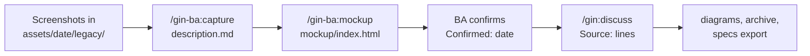

# Business analyst

A business analyst (BA) turns what the customer wants into confirmed requirements before any developer plans work. This page follows one capability from install to a merged spec pull request, using the optional `gin-ba` plugin for screenshots and mockups.



## Your role

The BA owns the specs and the `requirement_confirmed` gate. The table lists what the role uses; [roles](../roles.md) shows how it fits with the other roles.

| Item | Value |
|---|---|
| Skills | `/gin-ba:capture`, `/gin-ba:mockup`, `/gin:discuss`, `/gin:explain`, `/gin:tech-doc`, `/gin:progress` |
| Files | `docs/specs/` and `docs/changes/` with the [SDD layout](sdd.md) |
| Branch | `spec/<epic>-<slug>` |
| Gate | `requirement_confirmed` |

In [team mode](team.md) the gate takes the roles listed in `team.approvals`. A member with a listed role, who is not the pull request author, must approve the spec pull request before the gate is recorded.

## Steps

### Install gin-ba

The legacy layout has no dated asset folders, so `gin-ba` needs gin-workflow and a project on the SDD layout. Move a legacy project with `/gin:migrate-specs`; the skills stop and say so otherwise.

From a clone of this repository, or remotely:

```bash
./install.sh --plugin gin-ba          # or --plugin all for every plugin
curl -sSL https://raw.githubusercontent.com/giangdhwhtbr/gin-workflow/master/remote-install.sh | bash -s -- --plugin gin-ba
```

The installer adds the skills for each harness. `gin-ba` has no CLI and no launcher, and the installer warns when `gin` is missing. In a team repository, [join the team](team.md#join-it-member) first and do not run `/gin:setup`.

### Open a dated asset folder

Each round of inputs gets a folder `docs/specs/<capability>/assets/<YYYY-MM-DD>/` with a `description.md`. Both skills take the capability and `--date YYYY-MM-DD`, which defaults to today, and create the folder with `gin specs assets add`. The folder rules, including frozen folders, are in [images and mockups](sdd.md#images-and-mockups).

### Capture legacy behaviour

Run `/gin-ba:capture` when a feature already exists and you are rebuilding or changing it. It describes the feature from screenshots, so the requirements start from what the product does today.

1. Collect the screenshots (`.png`, `.jpg`, `.jpeg`, `.webp` or `.gif`). They can be anywhere on disk.
2. Run `/gin-ba:capture <capability> --date <date>` and name the files. The skill copies them to `assets/<date>/legacy/` with `gin specs assets add <capability> <files> --legacy`.
3. Name code paths that show the feature's checks, if any. The skill reads only the paths you name.
4. Review `description.md`. It has `Kind: legacy`, one `### <Screen>` per screen with a `Field | Type | Required | Rule` table and its actions, `## Rules` and `## Open questions`.

A value the evidence does not settle reads `?` and gets an open question. Skip this step for a feature with no existing version.

### Build the mockup

Run `/gin-ba:mockup <capability>` to build screens the customer can click through. The skill writes `assets/<date>/mockup/index.html`, one file with inline CSS and JavaScript, no network requests and fictional data.

Each screen is a `<section id>` that opens by URL hash. A requirement can then cite `mockup/index.html#<screen-id>`. A screen with empty, error or loading states can switch between them on the page.

The look comes from the product's existing UI, else the `frontend-design` skill when the harness provides it, else the skill's built-in skeleton. A missing `frontend-design` skill is not an error. Revise the mockup in the conversation until you are satisfied.

The skill sets `Kind:` to `new` for a capability's first dated folder and `change` after that. For `change`, `## Changes` lists what differs from `Previous:`.

### Confirm the inputs

Confirming freezes a folder, so `/gin:discuss` can cite it. Say so explicitly in the conversation; the skill then runs `gin specs assets confirm <capability> --date <date>`, which sets `Confirmed:` to today.

The skills never confirm on your behalf and never commit. Review the folder and commit it yourself. Discuss asks about folders you have not confirmed instead of citing them.

### Discuss the epic

Run `/gin:discuss` to turn the confirmed inputs into requirements. Discuss reads `description.md` and any `mockup/index.html` of each dated folder of the affected capabilities. It turns `## Open questions` into questions or listed assumptions.

Each requirement taken from an input gets a `Source:` line that names the file, for example `Source: assets/2026-06-02/mockup/index.html#new-order`; [the SDD guide](sdd.md#images-and-mockups) shows the full block.

Discuss also writes the [diagrams](sdd.md#diagrams) and the change folder, and `specs lint --change <epic>` must pass. In team mode a member without a technical role gets business questions only; see [what changes in each stage](team.md#what-changes-in-each-stage).

### Open the spec pull request

With `artifacts.spec_review: pr`, discuss commits the change folder and the files it cites on `spec/<epic>-<slug>` and, after you approve, opens the pull request. The gate is recorded only once `specs status --change <epic>` reports the pull request merged.

With `chat`, the gate is recorded when you confirm in the conversation. When `team.approvals` lists roles for `requirement_confirmed`, use the pull request flow. [Team mode](team.md) explains who may approve it.

### Export and explain

Two commands share the spec with people who do not read the repository. `gin specs export <capability>` writes an SRS as one HTML file, and `/gin:explain <capability>` writes an interactive page. See [exporting an SRS](sdd.md#exporting-an-srs) and [explaining a capability](sdd.md#explaining-a-capability).

## Conventions

These are team practices, not behaviour the tool enforces.

- Capture the legacy behaviour and the REST contract before writing requirements, so the edge cases are known.
- A requirement change after plan approval goes in a new change folder whose `MODIFIED` block carries the base hash; see [keeping work apart](../roles.md#keeping-work-apart).
- A feature's requirements, its UI included, live in the feature's capability. A `ui` capability holds only what spans pages.
- The BA reviews and commits asset folders, because the skills never do.

Common mistakes:

- Creating a second epic by hand. Discuss reuses the roadmap epic.
- Writing user stories without acceptance criteria.
- Leaving out the edge cases of the legacy system.

## Commands

| Command | Writes |
|---|---|
| `/gin-ba:capture <cap> [--date D] [paths]` | `assets/<D>/description.md` with `Kind: legacy` |
| `/gin-ba:mockup <cap> [--date D]` | `assets/<D>/mockup/index.html` and `assets/<D>/description.md` |
| `/gin:discuss` | the change folder, requirements and diagrams |
| `/gin:explain <cap>` | `.agent-workflow/runtime/explain/<cap>.html` |
| `gin specs export <cap>` | `srs-<cap>.html` |

## Reading list

1. [Joining a team](team.md#join-it-member)
2. [SDD living specs](sdd.md)
3. [Customizing templates](customizing-templates.md)
4. The Discuss an epic section of the [brownfield starter](../starters/brownfield.md#discuss-an-epic)
