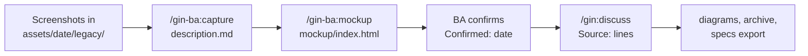

# BA add-on (`gin-ba`)

`gin-ba` is an optional plugin with two skills that prepare a capability's inputs before `/gin:discuss` writes requirements. `/gin-ba:capture` describes an existing feature from screenshots, and `/gin-ba:mockup` builds an interactive HTML mockup. Both write into the dated asset folders of the [SDD layout](sdd.md) and need gin-workflow. The plugin has no CLI and is not installed by default.



## Install

From a clone of this repository, or remotely:

```bash
./install.sh --plugin gin-ba          # or --plugin all for every plugin
curl -sSL https://raw.githubusercontent.com/giangdhwhtbr/gin-workflow/master/remote-install.sh | bash -s -- --plugin gin-ba
```

This installs the skills for each harness. `gin-ba` has no launcher; the installer warns when `gin` is missing.

## Dated folders

Each round of inputs for a capability lives in `docs/specs/<capability>/assets/<YYYY-MM-DD>/`, named by the day the inputs arrived, with a `description.md` from `gin specs template iteration.md`. Both skills take the capability and `--date YYYY-MM-DD` (default: today):

- `/gin-ba:mockup` creates a missing folder, and both skills write a missing `description.md`; `Previous:` names the latest earlier dated folder.
- A folder whose `description.md` reads `Confirmed: <date>` is frozen: the skill stops and asks for a new date.
- An unconfirmed folder is continued.

The skills set `Confirmed: <today>` only after the BA explicitly confirms, and never commit: the BA reviews and commits the folder.

## Legacy capture: `/gin-ba:capture`

1. Put the screenshots of the existing feature under `docs/specs/<capability>/assets/<date>/legacy/` (`.png`, `.jpg`, `.jpeg`, `.webp`, or `.gif`).
2. Run `/gin-ba:capture <capability> --date <date>`, optionally followed by code paths that show the feature's checks. The skill reads only the paths you name.
3. Review `description.md`: `Kind: legacy`, one `### <Screen>` per screen with a `Field | Type | Required | Rule` table and its actions, `## Rules`, and `## Open questions`. A value the evidence does not settle reads `?` and has an open question.
4. Confirm it; the skill sets `Confirmed: <today>`.

## Mockup: `/gin-ba:mockup`

`/gin-ba:mockup <capability>` writes `assets/<date>/mockup/index.html`, one file with inline CSS and JavaScript, no network requests, and fictional data. Each screen is a `<section id>` that opens by URL hash, so a requirement can cite `mockup/index.html#<screen-id>`; a screen that has empty, error, or loading states can switch between them.

The look comes from, in order: the product's existing UI in the repository; the `frontend-design` skill when the repository has no UI and the harness provides the skill; otherwise the skill's built-in skeleton. A missing `frontend-design` skill is not an error. `Kind:` is `new` for a capability's first dated folder and `change` after that, with `## Changes` listing what differs from `Previous:`. Revise the mockup in the conversation until you confirm it.

## From inputs to requirements

`/gin:discuss` reads `description.md` and any `mockup/index.html` of each dated folder of the affected capabilities. It cites only confirmed folders and asks about the others, and it turns `## Open questions` into questions or listed assumptions. Each requirement taken from an input gets a `Source:` line:

```markdown
### REQ-ORDERS-007: Reject a past delivery date
The system SHALL reject a delivery date before today.
Source: `assets/2026-05-11/description.md`, `assets/2026-06-02/mockup/index.html#new-order`
```

The rest of the SDD flow is unchanged: discuss also writes the [diagrams](sdd.md#diagrams), `specs archive` copies the `Source:` lines into the living `spec.md`, and `gin specs export <capability>` prints them in the SRS.

## Commands

| Command | Writes |
|---|---|
| `/gin-ba:capture <cap> [--date D] [paths]` | `assets/<D>/description.md` with `Kind: legacy` |
| `/gin-ba:mockup <cap> [--date D]` | `assets/<D>/mockup/index.html` and `assets/<D>/description.md` |
