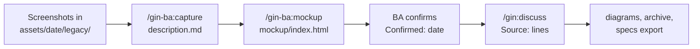

# Add-on BA (`gin-ba`) { #ba-add-on-gin-ba }

`gin-ba` là một plugin tùy chọn với hai skill chuẩn bị đầu vào của một capability trước khi `/gin:discuss` viết requirement. `/gin-ba:capture` mô tả một tính năng hiện có từ screenshot, và `/gin-ba:mockup` dựng một mockup HTML tương tác. Cả hai ghi vào các thư mục asset có tên ngày của [layout SDD](sdd.md) và cần gin-workflow. Plugin không có CLI và không được cài theo mặc định.



## Cài đặt { #install }

Từ một bản clone của repository này, hoặc từ xa:

```bash
./install.sh --plugin gin-ba          # or --plugin all for every plugin
curl -sSL https://raw.githubusercontent.com/giangdhwhtbr/gin-workflow/master/remote-install.sh | bash -s -- --plugin gin-ba
```

Lệnh này cài các skill cho từng harness. `gin-ba` không có launcher; bộ cài cảnh báo khi thiếu `gin`.

## Thư mục có tên ngày { #dated-folders }

Mỗi đợt đầu vào của một capability nằm trong `docs/specs/<capability>/assets/<YYYY-MM-DD>/`, đặt tên theo ngày đầu vào đến, kèm một `description.md` từ `gin specs template iteration.md`. Cả hai skill nhận capability và `--date YYYY-MM-DD` (mặc định: hôm nay):

- `/gin-ba:mockup` tạo thư mục chưa có, và cả hai skill ghi `description.md` khi chưa có; `Previous:` ghi thư mục có tên ngày gần nhất trước đó.
- Thư mục có `description.md` ghi `Confirmed: <date>` bị đóng băng: skill dừng lại và hỏi một ngày mới.
- Thư mục chưa xác nhận được làm tiếp.

Các skill chỉ đặt `Confirmed: <today>` sau khi BA xác nhận rõ ràng, và không bao giờ commit: BA xem lại và commit thư mục.

## Ghi lại hệ thống cũ: `/gin-ba:capture` { #legacy-capture-gin-bacapture }

1. Đặt các screenshot của tính năng hiện có vào `docs/specs/<capability>/assets/<date>/legacy/` (`.png`, `.jpg`, `.jpeg`, `.webp`, hoặc `.gif`).
2. Chạy `/gin-ba:capture <capability> --date <date>`, có thể kèm các đường dẫn code cho thấy các kiểm tra của tính năng. Skill chỉ đọc những đường dẫn bạn nêu.
3. Xem lại `description.md`: `Kind: legacy`, mỗi màn hình một `### <Screen>` với bảng `Field | Type | Required | Rule` và các hành động của nó, `## Rules`, và `## Open questions`. Một giá trị mà bằng chứng không xác định được ghi là `?` và có một câu hỏi mở.
4. Xác nhận nó; skill đặt `Confirmed: <today>`.

## Mockup: `/gin-ba:mockup` { #mockup-gin-bamockup }

`/gin-ba:mockup <capability>` ghi `assets/<date>/mockup/index.html`, một file với CSS và JavaScript nội tuyến, không có request mạng, và dữ liệu hư cấu. Mỗi màn hình là một `<section id>` mở bằng URL hash, nên một requirement có thể trích dẫn `mockup/index.html#<screen-id>`; màn hình nào có trạng thái trống, lỗi hoặc đang tải thì chuyển qua lại được giữa các trạng thái đó.

Giao diện lấy từ, theo thứ tự: UI hiện có của sản phẩm trong repository; skill `frontend-design` khi repository không có UI và harness cung cấp skill này; nếu không thì khung dựng sẵn của skill. Thiếu skill `frontend-design` không phải là lỗi. `Kind:` là `new` cho thư mục có tên ngày đầu tiên của một capability và `change` sau đó, với `## Changes` liệt kê điểm khác so với `Previous:`. Chỉnh mockup trong cuộc trò chuyện cho tới khi bạn xác nhận.

## Từ đầu vào tới requirement { #from-inputs-to-requirements }

`/gin:discuss` đọc `description.md` và mọi `mockup/index.html` của từng thư mục có tên ngày của các capability bị ảnh hưởng. Nó chỉ trích dẫn các thư mục đã xác nhận và hỏi về các thư mục còn lại, và biến `## Open questions` thành câu hỏi hoặc các giả định được liệt kê. Mỗi requirement lấy từ một đầu vào có một dòng `Source:`:

```markdown
### REQ-ORDERS-007: Reject a past delivery date
The system SHALL reject a delivery date before today.
Source: `assets/2026-05-11/description.md`, `assets/2026-06-02/mockup/index.html#new-order`
```

Phần còn lại của luồng SDD không đổi: discuss cũng viết các [sơ đồ](sdd.md#diagrams), `specs archive` sao chép các dòng `Source:` vào `spec.md` sống, và `gin specs export <capability>` in chúng trong SRS.

## Lệnh { #commands }

| Lệnh | Ghi |
|---|---|
| `/gin-ba:capture <cap> [--date D] [paths]` | `assets/<D>/description.md` với `Kind: legacy` |
| `/gin-ba:mockup <cap> [--date D]` | `assets/<D>/mockup/index.html` và `assets/<D>/description.md` |
