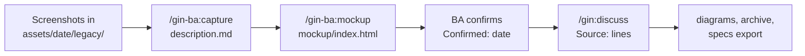

# Business analyst (BA) { #business-analyst }

Business analyst (BA) biến mong muốn của khách hàng thành requirement đã xác nhận trước khi developer lập kế hoạch. Trang này đi theo một capability từ lúc cài đặt đến khi spec pull request được merge, dùng plugin tùy chọn `gin-ba` cho screenshot và mockup.



## Vai trò của BA { #your-role }

BA sở hữu các spec và gate `requirement_confirmed`. Bảng dưới liệt kê những gì vai trò này dùng; [vai trò](../roles.md) cho thấy vai trò này khớp với các vai trò khác ra sao.

| Mục | Giá trị |
|---|---|
| Skill | `/gin-ba:capture`, `/gin-ba:mockup`, `/gin:discuss`, `/gin:explain`, `/gin:tech-doc`, `/gin:progress` |
| File | `docs/specs/` và `docs/changes/` với [layout SDD](sdd.md) |
| Branch | `spec/<epic>-<slug>` |
| Gate | `requirement_confirmed` |

Trong [chế độ nhóm](team.md), gate nhận các vai trò liệt kê trong `team.approvals`. Một thành viên có vai trò được liệt kê, không phải tác giả pull request, phải duyệt spec pull request trước khi gate được ghi. Chính sách phụ thuộc vào [loại](../concepts/lifecycle.md#epic-kinds) của epic: epic `technical` có thể không cần BA, và epic `parity` dẫn các folder `Kind: legacy` đã xác nhận của BA trên dòng `Parity with:` ([chính sách theo loại epic](team.md#policy-per-epic-kind)).

## Các bước { #steps }

### Cài đặt gin-ba { #install-gin-ba }

Layout legacy không có thư mục asset theo ngày, nên `gin-ba` cần gin-workflow và một dự án dùng layout SDD. Chuyển dự án legacy bằng `/gin:migrate-specs`; nếu chưa chuyển, các skill dừng lại và báo lỗi.

Từ một bản clone của repository này, hoặc từ xa:

```bash
./install.sh --plugin gin-ba          # or --plugin all for every plugin
curl -sSL https://raw.githubusercontent.com/giangdhwhtbr/gin-workflow/master/remote-install.sh | bash -s -- --plugin gin-ba
```

Bộ cài thêm các skill cho từng harness. `gin-ba` không có CLI và không có launcher; bộ cài cảnh báo khi thiếu `gin`. Trong repository nhóm, [tham gia nhóm](team.md#join-it-member) trước và không chạy `/gin:setup`.

### Mở thư mục asset có tên ngày { #open-a-dated-asset-folder }

Mỗi đợt đầu vào có một thư mục `docs/specs/<capability>/assets/<YYYY-MM-DD>/` với một `description.md`. Cả hai skill nhận capability và `--date YYYY-MM-DD`, mặc định là hôm nay, và tạo thư mục bằng `gin specs assets add`. Quy tắc thư mục, gồm cả thư mục bị đóng băng, nằm ở [ảnh và mockup](sdd.md#images-and-mockups).

### Ghi lại hành vi hệ thống cũ { #capture-legacy-behaviour }

Chạy `/gin-ba:capture` khi tính năng đã tồn tại và đang được dựng lại hoặc thay đổi. Skill mô tả tính năng từ screenshot, nên requirement bắt đầu từ những gì sản phẩm làm hiện nay.

1. Gom các screenshot (`.png`, `.jpg`, `.jpeg`, `.webp` hoặc `.gif`). Chúng có thể nằm ở bất kỳ đâu trên đĩa.
2. Chạy `/gin-ba:capture <capability> --date <date>` và nêu tên các file. Skill sao chép chúng vào `assets/<date>/legacy/` bằng `gin specs assets add <capability> <files> --legacy`.
3. Nêu các đường dẫn code cho thấy các kiểm tra của tính năng, nếu có. Skill chỉ đọc những đường dẫn được nêu.
4. Xem lại `description.md`. File có `Kind: legacy`, mỗi màn hình một `### <Screen>` với bảng `Field | Type | Required | Rule` và các hành động, `## Rules` và `## Open questions`.

Giá trị mà bằng chứng không xác định được ghi là `?` và có một câu hỏi mở. Bỏ qua bước này với tính năng chưa có phiên bản cũ.

### Dựng mockup { #build-the-mockup }

Chạy `/gin-ba:mockup <capability>` để dựng các màn hình mà khách hàng có thể bấm thử. Skill ghi `assets/<date>/mockup/index.html`, một file với CSS và JavaScript nội tuyến, không có request mạng và dữ liệu hư cấu.

Mỗi màn hình là một `<section id>` mở bằng URL hash. Nhờ vậy requirement có thể trích dẫn `mockup/index.html#<screen-id>`. Màn hình có trạng thái trống, lỗi hoặc đang tải chuyển qua lại được giữa các trạng thái trên trang.

Giao diện lấy từ UI hiện có của sản phẩm, nếu không thì từ skill `frontend-design` khi harness cung cấp, nếu không nữa thì từ khung dựng sẵn của skill. Thiếu skill `frontend-design` không phải là lỗi. Trong workspace, UI hiện có là repository con `shape: frontend` đã clone, nên mockup dùng lại token và component của nó. Bản sao 1-1 của các màn hình cũ không cần mockup. Chỉnh mockup trong cuộc trò chuyện cho tới khi đạt yêu cầu.

Skill đặt `Kind:` là `new` cho thư mục có tên ngày đầu tiên của capability và `change` sau đó. Với `change`, `## Changes` liệt kê điểm khác so với `Previous:`.

### Xác nhận đầu vào { #confirm-the-inputs }

Xác nhận làm thư mục bị đóng băng, nhờ đó `/gin:discuss` có thể trích dẫn nó. Nói rõ điều này trong cuộc trò chuyện; skill sau đó chạy `gin specs assets confirm <capability> --date <date>`, lệnh đặt `Confirmed:` thành hôm nay. Confirm cũng ghi `Confirmed by:` bằng git `user.email` của BA, và `Agreed with:` khi BA truyền `--agreed-with <text>` để nêu ai khác đã đồng ý. Trong chế độ nhóm, skill mockup hỏi sự đồng ý của lead khu vực frontend trước khi xác nhận; `/gin-ba:capture` hỏi ai khác đã đồng ý.

Các skill không bao giờ xác nhận thay BA và không bao giờ commit. BA xem lại thư mục; `/gin:discuss` commit nó cùng change folder trích dẫn nó ([hình ảnh và mockup](sdd.md#images-and-mockups)). Discuss hỏi về các thư mục chưa xác nhận thay vì trích dẫn chúng.

### Thảo luận epic { #discuss-the-epic }

Chạy `/gin:discuss` để biến đầu vào đã xác nhận thành requirement. Discuss đọc `description.md` và mọi `mockup/index.html` của từng thư mục có tên ngày của các capability bị ảnh hưởng. Nó biến `## Open questions` thành câu hỏi hoặc các giả định được liệt kê.

Mỗi requirement lấy từ một đầu vào có một dòng `Source:` nêu tên file, ví dụ `Source: assets/2026-06-02/mockup/index.html#new-order`; [hướng dẫn SDD](sdd.md#images-and-mockups) có khối đầy đủ.

Discuss cũng viết các [sơ đồ](sdd.md#diagrams), các [use case](sdd.md#use-cases) nếu có, và change folder, và `specs lint --change <epic>` phải qua. Trong chế độ nhóm, thành viên không có vai trò kỹ thuật chỉ nhận câu hỏi nghiệp vụ; xem [thay đổi ở từng stage](team.md#what-changes-in-each-stage).

### Mở spec pull request { #open-the-spec-pull-request }

Với `artifacts.spec_review: pr`, discuss commit change folder và các file nó trích dẫn lên `spec/<epic>-<slug>` và, sau khi BA đồng ý, mở pull request. Gate chỉ được ghi khi `specs status --change <epic>` báo pull request đã merge.

Với `chat`, gate được ghi khi BA xác nhận trong cuộc trò chuyện. Khi `team.approvals` liệt kê vai trò cho `requirement_confirmed`, dùng luồng pull request. [Chế độ nhóm](team.md) giải thích ai được duyệt.

### Xuất và giải thích { #export-and-explain }

Hai lệnh chia sẻ spec với những người không đọc repository. `gin specs export <capability>` ghi SRS thành một file HTML, và `/gin:explain <capability>` ghi một trang tương tác. Xem [xuất SRS](sdd.md#exporting-an-srs) và [giải thích một capability](sdd.md#explaining-a-capability).

### Prep task { #prep-tasks }

Tech lead có thể giao cho bạn [prep task](../concepts/lifecycle.md#prep-tasks) trước spec, như capture hoặc mockup. Ở chế độ nhóm, `gin team ready` liệt kê chúng. Nếu không, chạy `gin task list --label prep --status open,in_progress`.

Hoàn thành output mà task nêu, rồi đóng bằng `gin task close <id> --reason "<output>"`. Với task `spike` hoặc `question`, trước tiên trả lời trên epic bằng `gin task comment <epic> "[gin answer] <prep-id>: <answer>"`. Ở chế độ nhóm, chạy `gin team sync` sau khi đóng.

### Trong lúc build { #during-the-build }

Execute đăng comment `[gin question] <track>: <question>` khi spec và plan không trả lời được câu hỏi của worker. Chạy `/gin:progress` để liệt kê các câu chưa được trả lời. Trả lời từng câu bằng `gin task comment <epic> "[gin answer] <track>: <answer>"`, và execute tiếp tục track.

Khi một câu trả lời thay đổi requirement sau khi plan được duyệt, cũng làm theo [thay đổi requirement sau khi plan được duyệt](sdd.md#changing-a-requirement-after-plan-approval).

Sau khi các track của epic đóng, xem lại đầu ra của `/gin-qa:report`. Với epic nằm sau feature flag, làm việc này tại điểm tích hợp của milestone. Sau đó thêm `gin task comment <epic> "[gin accept] <epic>: <what was checked>"`.

Nghiệm thu là quy ước của nhóm. Ship chỉ kiểm tra nó bằng một cảnh báo và vẫn tiếp tục khi thiếu. Xem [comment của epic](../concepts/lifecycle.md#stages-and-gates) để biết mọi loại comment.

## Quy ước { #conventions }

Đây là thực hành của nhóm, không phải hành vi công cụ ép buộc.

- Ghi lại hành vi hệ thống cũ và REST contract trước khi viết requirement, để biết các edge case.
- Thay đổi requirement sau khi plan được duyệt đi vào một change folder mới; xem [thay đổi requirement sau khi plan được duyệt](sdd.md#changing-a-requirement-after-plan-approval).
- Requirement của một tính năng, gồm cả UI, nằm trong capability của tính năng đó. Capability `ui` chỉ chứa những gì dùng chung cho nhiều trang.
- Thư mục asset đã xác nhận vào nhánh gốc cùng pull request của spec; xem [hình ảnh và mockup](sdd.md#images-and-mockups).
- Hành vi cũ nằm trong các thư mục `Kind: legacy`; xem [living spec trong quá trình chuyển đổi](sdd.md#living-specs-during-a-migration).

Các lỗi thường gặp:

- Tạo epic thứ hai bằng tay. Discuss dùng lại epic của roadmap.
- Viết user story không có acceptance criteria.
- Bỏ sót các edge case của hệ thống cũ.

## Lệnh { #commands }

| Lệnh | Ghi |
|---|---|
| `/gin-ba:capture <cap> [--date D] [paths]` | `assets/<D>/description.md` với `Kind: legacy` |
| `/gin-ba:mockup <cap> [--date D]` | `assets/<D>/mockup/index.html` và `assets/<D>/description.md` |
| `/gin:discuss` | change folder, requirement và sơ đồ |
| `/gin:explain <cap>` | `.agent-workflow/runtime/explain/<cap>.html` |
| `gin specs export <cap>` | `srs-<cap>.html` |

## Danh sách đọc { #reading-list }

1. [Tham gia nhóm](team.md#join-it-member)
2. [Living spec SDD](sdd.md)
3. [Tùy biến template](customizing-templates.md)
4. Mục Discuss an epic của [starter brownfield](../starters/brownfield.md#discuss-an-epic)
