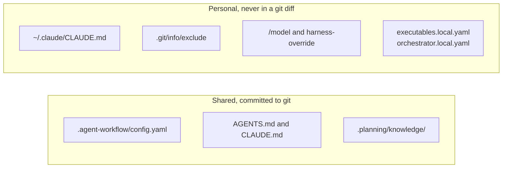

# Working with Claude Code

Keep your own settings in your home folder and the team's settings in the repository. Then switch context between stages and give each parallel session its own worktree. This guide covers the three habits.

## Personal customization without affecting the team

Anything you put in the repository is shared with the team once it is committed. Anything in your home folder or in a git-ignored file stays on your machine.



Use the personal side for these:

- `~/.claude/CLAUDE.md` holds instructions that Claude Code loads in every project, including every `.planning/worktrees/<id>` worktree, so nothing lands in the repository.
- `.git/info/exclude` ignores personal scratch files in the repository without editing the shared `.gitignore`.
- `/model` changes the model of your Claude Code session. `gin setup harness-override --harness <name>` sets a session override of the main harness, and `--clear` removes it.
- `.agent-workflow/executables.local.yaml` and `.agent-workflow/orchestrator.local.yaml` record where the CLIs live on your machine when they sit outside your `PATH`. Both files are git-ignored. See [configuration](../reference/config.md#executableslocalyaml).

A `~/.claude/CLAUDE.md` that answers in Vietnamese and keeps technical text as written:

```markdown
## Response language

Reply in Vietnamese. Keep code, identifiers, file paths, commands, and log output verbatim.
```

Share a lesson with the team through `.planning/knowledge/` or `bd remember`, not through your personal files. Personal memory stays under `~/.claude/`.

## Context hygiene and session habits

Start each lifecycle stage with a small, relevant context. A long session carries old decisions into new work and costs more tokens per turn.

- Pick the model before you run a stage skill. See [Using AI effectively](ai-strategy.md#model-and-effort-by-stage).
- Run `/clear` between stages such as `discuss`, `plan`, and `execute`. Each stage reads the spec, plan, or beads from disk, so it loses nothing.
- Run `/compact` when you continue inside one stage and the session has grown long.
- Look up code with `codegraph explore "<symbols or question>"` before you grep. See [recommended tools](recommended-tools.md).
- For tracks with no `Human gate:`, print a goal with `gin goal --workflow-id <id>` and give it to `/goal`. The goal lists the open tracks in dependency order and leaves out tracks that wait for a human.

`/model`, `/clear`, `/compact`, and `/goal` are Claude Code commands. Their behavior comes from Claude Code, not from gin-workflow.

## Running several sessions in parallel

Give every session its own worktree from its first minute. A checkout has one `HEAD`, so two sessions in one checkout commit onto whichever branch was switched to last.

These are conventions, and no workflow setting enforces them:

- Keep the main checkout on the base branch (`master` or `main`). No session switches its branch.
- Create the session's worktree before `/gin:discuss` writes the spec, then open Claude Code in that folder:
  ```bash
  git worktree add .claude/worktrees/<topic> -b feat/<topic> <base>
  ```
  `/gin:orchestrate` later branches each track worktree from `feat/<topic>` as usual.
- Run background or scheduled sessions that edit files in a worktree, never in place.
- Remember what worktrees still share: the branches (a branch is checked out in one worktree at a time), the stash (never run a bare `git stash pop`), the Beads database, and the installed plugins. Running `install.sh` after one epic ships changes the skills that every running session uses.
- Ship one epic at a time. Merging into the base branch needs a checkout of it, and the `pre-push` hook runs the full test suite on each push.
