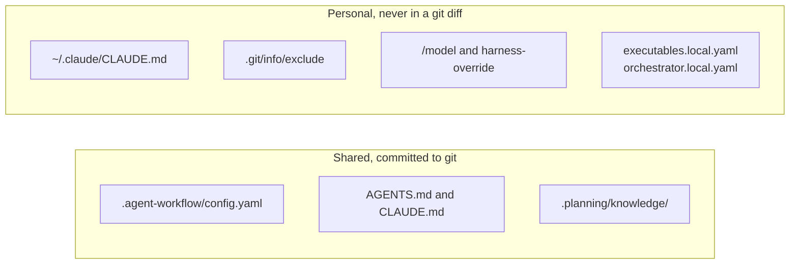

# Làm việc với Claude Code { #working-with-claude-code }

Giữ thiết lập cá nhân trong thư mục home và thiết lập của nhóm trong repository. Sau đó đổi context giữa các stage và cho mỗi session song song một worktree riêng. Hướng dẫn này bao gồm ba thói quen đó.

## Tùy biến cá nhân mà không ảnh hưởng nhóm { #personal-customization-without-affecting-the-team }

Mọi thứ bạn đặt trong repository sẽ được chia sẻ với nhóm sau khi commit. Mọi thứ trong thư mục home hoặc trong một file bị git bỏ qua chỉ nằm trên máy của bạn.



Dùng phía cá nhân cho những việc sau:

- `~/.claude/CLAUDE.md` chứa các chỉ dẫn mà Claude Code nạp trong mọi project, kể cả mọi worktree `.planning/worktrees/<id>`, nên không có gì rơi vào repository.
- `.git/info/exclude` bỏ qua các file nháp cá nhân trong repository mà không phải sửa `.gitignore` dùng chung.
- `/model` đổi model của session Claude Code của bạn. `gin setup harness-override --harness <name>` đặt một session override cho main harness, và `--clear` gỡ nó.
- `.agent-workflow/executables.local.yaml` và `.agent-workflow/orchestrator.local.yaml` ghi vị trí các CLI trên máy bạn khi chúng nằm ngoài `PATH`. Cả hai file đều bị git bỏ qua. Xem [cấu hình](../reference/config.md#executableslocalyaml).

Một `~/.claude/CLAUDE.md` trả lời bằng tiếng Việt và giữ nguyên phần văn bản kỹ thuật:

```markdown
## Response language

Reply in Vietnamese. Keep code, identifiers, file paths, commands, and log output verbatim.
```

Chia sẻ một bài học với nhóm qua `.planning/knowledge/` hoặc `bd remember`, không qua các file cá nhân. Bộ nhớ cá nhân nằm dưới `~/.claude/`.

## Vệ sinh context và thói quen làm việc theo session { #context-hygiene-and-session-habits }

Bắt đầu mỗi stage của vòng đời với một context nhỏ và liên quan. Một session dài mang các quyết định cũ vào công việc mới và tốn nhiều token hơn mỗi lượt.

- Chọn model trước khi chạy một skill của stage. Xem [Dùng AI hiệu quả](ai-strategy.md#model-and-effort-by-stage).
- Chạy `/clear` giữa các stage như `discuss`, `plan`, và `execute`. Mỗi stage đọc spec, plan, hoặc bead từ đĩa, nên không mất gì.
- Chạy `/compact` khi bạn tiếp tục trong cùng một stage và session đã dài ra.
- Tra cứu code bằng `codegraph explore "<symbols or question>"` trước khi grep. Xem [công cụ khuyến nghị](recommended-tools.md).
- Với các track không có `Human gate:`, in một goal bằng `gin goal --workflow-id <id>` và đưa nó cho `/goal`. Goal liệt kê các track đang mở theo thứ tự dependency và bỏ qua các track đang chờ con người.

`/model`, `/clear`, `/compact`, và `/goal` là các lệnh của Claude Code. Hành vi của chúng đến từ Claude Code, không phải từ gin-workflow.

## Chạy nhiều session song song { #running-several-sessions-in-parallel }

Cho mỗi session một worktree riêng ngay từ phút đầu. Một checkout chỉ có một `HEAD`, nên hai session trong cùng một checkout sẽ commit vào branch nào được chuyển tới sau cùng.

Đây là các quy ước, không có thiết lập workflow nào cưỡng chế chúng:

- Giữ main checkout ở base branch (`master` hoặc `main`). Không session nào đổi branch của nó.
- Tạo worktree của session trước khi `/gin:discuss` ghi spec, rồi mở Claude Code trong thư mục đó:
  ```bash
  git worktree add .claude/worktrees/<topic> -b feat/<topic> <base>
  ```
  Về sau `/gin:orchestrate` rẽ nhánh worktree của từng track từ `feat/<topic>` như thường lệ.
- Chạy các session nền hoặc theo lịch có sửa file trong một worktree, không bao giờ sửa trực tiếp tại chỗ.
- Nhớ những gì các worktree vẫn dùng chung: các branch (một branch chỉ được checkout trong một worktree tại một thời điểm), stash (không bao giờ chạy `git stash pop` trần), cơ sở dữ liệu Beads, và các plugin đã cài. Chạy `install.sh` sau khi một epic ship sẽ đổi các skill mà mọi session đang chạy sử dụng.
- Ship từng epic một. Merge vào base branch cần một checkout của nó, và hook `pre-push` chạy toàn bộ test suite ở mỗi lần push.
