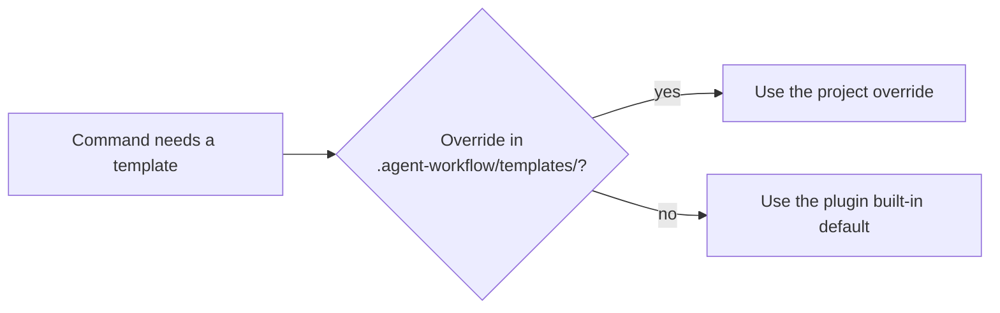

# Customizing templates

Override the templates gin-workflow and gin-qa write from, and the rules gin-qa follows, to match your team's formats.

## How overrides work

gin-workflow looks templates up in this order:



A command that needs a template checks `.agent-workflow/templates/` at the repository root first. A file with the same name there replaces the built-in default.

### Built-in templates

Print any built-in template with:

```bash
gin specs template <template-name>
```

Available templates:
- Specs, stories, and roadmap: `spec.md`, `spec-delta.md`, `proposal.md`, `design.md`, `design-spec.md`, `user-story.md`, `epic.md`, `task.md`, `roadmap.md`, `tests.md`, `adr.md`, `specs-README.md`, `iteration.md`, `activity.md`, `state.md`, `use-case.md`
- SRS export (`specs export`): `srs.html`, `srs-capability.html`
- Explain page (`specs explain`): `explain.html`
- Codebase documentation (`/gin:tech-doc`): `codebase/<FILE>.md`, for example `codebase/05-API.md`
- Team conventions: `team/pull_request_template.md`, `team/commit-msg`, `team/github-ci.yml`, `team/gitlab-ci.yml`

| Template | Used by | Override file |
|---|---|---|
| Roadmap | `/gin:roadmap` | `.agent-workflow/templates/roadmap.md` |
| Epic description | `/gin:roadmap` | `.agent-workflow/templates/epic.md` |
| Track bead description | `/gin:orchestrate` | `.agent-workflow/templates/task.md` |
| User story | `/gin:discuss` | `.agent-workflow/templates/user-story.md` |
| Design spec (legacy layout) | `/gin:discuss` | `.agent-workflow/templates/design-spec.md` |
| Proposal, spec delta, design, tests (SDD layout) | `specs new`, which `/gin:discuss` runs | `.agent-workflow/templates/proposal.md`, `spec-delta.md`, `design.md`, `tests.md` (unnumbered; `specs new` writes them as `01-proposal.md` and so on) |
| `spec.md` | `specs archive` (a new capability) and `/gin:migrate-specs` | `.agent-workflow/templates/spec.md` |
| `specs-README.md` | `specs archive` and `specs migrate` | `.agent-workflow/templates/specs-README.md` |
| Asset folder description (SDD layout) | `/gin:discuss` | `.agent-workflow/templates/iteration.md` |
| Activity and state diagrams (SDD layout) | `/gin:discuss` | `.agent-workflow/templates/activity.md`, `state.md` |
| Use cases (SDD layout) | `/gin:discuss` | `.agent-workflow/templates/use-case.md` |
| SRS document and chapter (SDD layout) | `specs export` | `.agent-workflow/templates/srs.html`, `srs-capability.html` |
| Explain page (SDD layout) | `specs explain` | `.agent-workflow/templates/explain.html` |
| `codebase/*` | `/gin:tech-doc` | `.agent-workflow/templates/codebase/<FILE>.md` |
| `team/*` | `gin team init` | `.agent-workflow/templates/team/<file>` |

## Spec, story, and roadmap templates

To override a template, create the `.agent-workflow/templates/` folder and put your version inside it. This example overrides the spec and user story templates.

1. Create the templates directory:
   ```bash
   mkdir -p .agent-workflow/templates
   ```

2. Export the default template:
   ```bash
   gin specs template spec.md > .agent-workflow/templates/spec.md
   ```

3. Edit `.agent-workflow/templates/spec.md`. You can add sections, compliance checklists, or asset guidelines:

   ```markdown
   # {{capability}}

   ## Purpose
   [Describe the business purpose and capability goals]

   ## Compliance & Security
   - GDPR / Data Privacy Level: [Standard | Sensitive]
   - Audit Logging Required: [Yes | No]

   ## Visual Assets & UI References
   Screenshots and wireframes are stored in `assets/`:
   <!-- Add diagrams or wireframe links here -->

   ## Requirements
   <!-- Living requirements will be appended or managed here -->
   ```

4. Customize user stories in `.agent-workflow/templates/user-story.md`:
   ```bash
   gin specs template user-story.md > .agent-workflow/templates/user-story.md
   ```
   Example format:
   ```markdown
   ### User Story: {{title}}
   AS A {{role}}
   I WANT TO {{action}}
   SO THAT {{benefit}}

   **Jira Ticket:** {{jira_id}}
   **Business Value:** [High | Medium | Low]

   #### Acceptance Criteria
   - [ ] Criteria 1
   ```

5. Verify the override by running `gin specs template spec.md`. It prints your version from `.agent-workflow/templates/spec.md`.

The `{{...}}` placeholders in `spec.md`, the SDD files, and the `team/*` files are filled by `gin` commands. The agent fills the story, roadmap, and epic templates, so placeholders you invent there stay as text for the agent to complete.

### SRS export templates

`gin specs export` fills `srs.html` once and `srs-capability.html` once per capability. `srs.html` takes `{{title}}`, `{{date}}`, `{{toc}}`, and `{{chapters}}`. `srs-capability.html` takes `{{cap}}` (the chapter's anchor), `{{capability}}`, `{{purpose}}`, `{{use_cases}}`, `{{diagrams}}`, `{{requirements}}`, and `{{assets}}`: reorder them to reorder a chapter, or delete one and its heading to drop that section. Each placeholder is filled once, so `{{...}}` written in a spec stays as text, and comments are removed from both templates. An overridden `srs-capability.html` shows no use cases until it adds `{{use_cases}}`; see [Use cases](sdd.md#use-cases).

Put the logo, the customer, and the product brief on the cover of `srs.html`:

```html
<section class="cover">
  
  <h1>{{title}}</h1>
  <p class="customer">Prepared for Example Corp</p>
  <p class="brief">One paragraph on what the product does and for whom.</p>
  <p class="date">{{date}}</p>
</section>
```

A relative `src` in either template is read from the repository root and embedded in the exported file; when the file is missing, outside the repository, or not an image, `specs export` exits 1 and names it.

### Explain page template

`gin specs explain` fills `explain.html` once. It takes `{{title}}`, `{{kind}}` (`capability`, `change`, or `legacy capability (<app>)`), `{{date}}`, `{{nav}}` (one link per section that has content), and `{{sections}}` (one `<section class="tab">` per section, in the order Overview, Requirements, Stories, Diagrams, Mockups and images). The built-in template's script shows the section named by the URL hash, filters the requirement cards, opens images in a viewer, and sends a screen id to an embedded mockup; keep it when you restyle the page. As in the SRS templates, each placeholder is filled once, comments are removed, and a relative `src` is read from the repository root and embedded.

The roadmap template's `## Constraints` has two lines that `gin milestone list` reads: `- Deadline: YYYY-MM-DD`, the project deadline the forecast is measured against, and `- AI capacity: <n> ...`, whose leading whole number is the default number of lanes. Keep both bullets when you override the template; free text after the number is ignored.

The template's `## Way of working` section (Foundation, Spec cadence, Build, Integration, Quality, Load) is filled by a plain `/gin:roadmap` from the skill's `references/way-of-working.md` and kept on re-runs. Each `## Milestone:` block opens with `Spec ready by:` and an `Integration point:` block (Integrates, Flags on, E2E scope, Exit criteria) that `/gin:roadmap --milestone` writes. A roadmap without these lines stays valid. Track beads created by `/gin:orchestrate` take their description from `task.md`, with the `Plan:`, `Files:`, `Route:`, `Acceptance:`, and `Notes:` label lines. Roadmap epics carry a `Complexity:` line (`low`, `medium`, or `high`) in both the roadmap file and the `epic.md` bead description.

## Test case guidelines and fields

The gin-qa add-on is customized through the guidelines file (`guidelines.md` in the [QA home](qa.md#the-qa-home)) and extra metadata fields.

### The guidelines file

`/gin-qa:setup` writes `guidelines.md` in the QA home from an interview; without it, `/gin-qa:cases` creates the file from the template on first use. The agent reads this file before drafting test cases, and its rules override the defaults.

Edit `guidelines.md` in the QA home to customize:
- Language: Enforce Vietnamese, English, or bilingual test steps.
- Types: the case types in use, one ``- `<type>`: <what it covers>`` line each under `## Types`, checked by [`gin-qa cases check`](../reference/cli.md#gin-qa-cases-check).
- Manual runs and bugs: the run reference `/gin-qa:run` proposes (`## Manual runs`), and whether a bug needs an external tracker reference (`## Bugs`).
- Extra fields: Declare team-specific metadata tags.
- End-to-end rules: Define sign-in mechanisms (such as `storageState`), test user fixtures, or locator strategies.

Example `guidelines.md`:
```markdown
# Test case guidelines

Rules for writing test cases in this repository:
- Language: English
- One user action per step.
- Priority: high | medium | low.

## Types
- `e2e`: browser flows.
- `api`: API and service tests.
- `manual`: walked by a tester.

## Extra Fields
- Jira: JIRA-NNNN ticket reference
- Severity: Blocker | Critical | Major | Minor
- Component: Frontend | Backend | PaymentGateway
- Automated: Yes | No

## E2E Rules (`/gin-qa:e2e`)
- Playwright: @playwright/test 1.49 or later.
- Authentication: Reuse authentication state from `playwright/.auth/user.json`.
- Locators: Always prefer `page.getByRole(...)` or `page.getByLabel(...)`.
```

### Extra fields

The gin-qa parser keeps any other field line in a case's header. The agent adds the extra fields declared in your guidelines when it writes test cases. Write them as `- **Key:** value` lines; the plain `Key: value` form also parses. The file name sets the type, so the case has no `Type:` line:

```markdown
# TC-AUTH-005: Lockout after 5 failed login attempts

- **REQ:** REQ-AUTH-003@8f2d1e0a
- **Priority:** high
- **Jira:** PROJ-1024
- **Severity:** Critical
- **Component:** Authentication
- **Automated:** Yes

**Preconditions:**
- User account `test@example.com` exists and is active.

**Test data:**
- User: `test@example.com`, password in environment variable `E2E_TEST_PASSWORD`

**Steps:**
1. Navigate to `/login`
2. Submit invalid password 5 consecutive times

**Expected:**
- Account is locked for 15 minutes
- Notification email is sent to `test@example.com`
```

Saved as `cases/auth/TC-AUTH-005-lockout.e2e.md` in the QA home.

`gin-qa cases export --format json` lists every custom field (`Jira`, `Severity`, `Component`, and others) under `fields` in its JSON output. `Result`, `Run`, and `Bug` are reserved for `gin-qa cases result`. `REQ`, `Source`, `Priority`, and `Type` keep their own meanings and stay out of `fields`.

## The end-to-end evidence fixture

`gin-qa e2e init`, which `/gin-qa:e2e` runs, copies the fixture to `e2e/evidence.ts` in the QA home. The file belongs to your repository, so edit it freely, but keep the shape of the `result.json` it writes: `gin-qa e2e check` and `gin-qa e2e export` read it.

The Playwright config template is copied the same way: `gin-qa e2e init` writes `playwright.config.ts` only when the Playwright folder has no `playwright.config.*`. That is the `e2e` folder of the QA home, or the repository root for an existing root setup. The written file 
