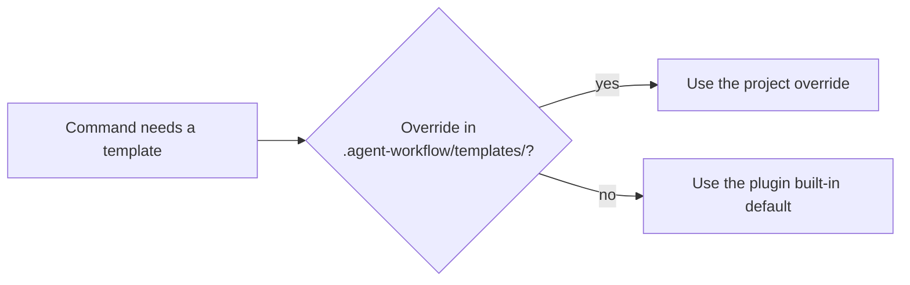

# Tùy biến template { #customizing-templates }

Ghi đè các template mà gin-workflow và gin-qa dùng để ghi, cùng các rule mà gin-qa tuân theo, để khớp với định dạng của nhóm bạn.

## Cách ghi đè hoạt động { #how-overrides-work }

`gin-workflow` tra cứu template theo thứ tự sau:



Một lệnh cần template sẽ kiểm tra `.agent-workflow/templates/` ở gốc repository trước. Một file cùng tên ở đó sẽ thay thế bản mặc định có sẵn.

### Template có sẵn { #built-in-templates }

In bất kỳ template có sẵn nào bằng:

```bash
gin-workflow specs template <template-name>
```

Các template khả dụng:
- Spec, story, và roadmap: `spec.md`, `spec-delta.md`, `proposal.md`, `design.md`, `design-spec.md`, `user-story.md`, `epic.md`, `roadmap.md`, `tests.md`, `adr.md`, `specs-README.md`, `iteration.md`, `activity.md`, `state.md`
- Tài liệu codebase (`/gin-workflow:tech-doc`): `codebase/<FILE>.md`, ví dụ `codebase/05-API.md`
- Quy ước của team: `team/pull_request_template.md`, `team/commit-msg`, `team/github-ci.yml`, `team/gitlab-ci.yml`

| Template | Được dùng bởi | File ghi đè |
|---|---|---|
| Roadmap | `/gin-workflow:roadmap` | `.agent-workflow/templates/roadmap.md` |
| Mô tả epic | `/gin-workflow:roadmap` | `.agent-workflow/templates/epic.md` |
| User story | `/gin-workflow:discuss` | `.agent-workflow/templates/user-story.md` |
| Design spec (layout legacy) | `/gin-workflow:discuss` | `.agent-workflow/templates/design-spec.md` |
| Proposal, spec delta, design, tests (layout SDD) | `specs new`, lệnh mà `/gin-workflow:discuss` chạy | `.agent-workflow/templates/proposal.md`, `spec-delta.md`, `design.md`, `tests.md` (không đánh số; `specs new` ghi chúng thành `01-proposal.md` và tiếp theo) |
| `spec.md` | `specs archive` (một capability mới) và `/gin-workflow:migrate-specs` | `.agent-workflow/templates/spec.md` |
| `specs-README.md` | `specs archive` và `specs migrate` | `.agent-workflow/templates/specs-README.md` |
| Mô tả thư mục asset (layout SDD) | `/gin-workflow:discuss` | `.agent-workflow/templates/iteration.md` |
| Sơ đồ activity và state (layout SDD) | `/gin-workflow:discuss` | `.agent-workflow/templates/activity.md`, `state.md` |
| `codebase/*` | `/gin-workflow:tech-doc` | `.agent-workflow/templates/codebase/<FILE>.md` |
| `team/*` | `gin-workflow team init` | `.agent-workflow/templates/team/<file>` |

## Template spec, story, và roadmap { #spec-story-and-roadmap-templates }

Để ghi đè một template, tạo thư mục `.agent-workflow/templates/` và đặt phiên bản của bạn vào trong. Ví dụ này ghi đè template spec và user story.

1. Tạo thư mục template:
   ```bash
   mkdir -p .agent-workflow/templates
   ```

2. Xuất template mặc định:
   ```bash
   gin-workflow specs template spec.md > .agent-workflow/templates/spec.md
   ```

3. Sửa `.agent-workflow/templates/spec.md`. Bạn có thể thêm các mục, checklist tuân thủ, hoặc hướng dẫn về asset:

   ```markdown
   # {{capability}}

   ## Purpose
   [Describe the business purpose and capability goals]

   ## Compliance & Security
   - GDPR / Data Privacy Level: [Standard | Sensitive]
   - Audit Logging Required: [Yes | No]

   ## Visual Assets & UI References
   Screenshots and wireframes are stored in `assets/`:
   <!-- Add diagrams or wireframe links here -->

   ## Requirements
   <!-- Living requirements will be appended or managed here -->
   ```

4. Tùy biến user story trong `.agent-workflow/templates/user-story.md`:
   ```bash
   gin-workflow specs template user-story.md > .agent-workflow/templates/user-story.md
   ```
   Định dạng ví dụ:
   ```markdown
   ### User Story: {{title}}
   AS A {{role}}
   I WANT TO {{action}}
   SO THAT {{benefit}}

   **Jira Ticket:** {{jira_id}}
   **Business Value:** [High | Medium | Low]

   #### Acceptance Criteria
   - [ ] Criteria 1
   ```

5. Xác minh việc ghi đè bằng cách chạy `gin-workflow specs template spec.md`. Nó in phiên bản của bạn từ `.agent-workflow/templates/spec.md`.

Các placeholder `{{...}}` trong `spec.md`, các file SDD, và các file `team/*` được các lệnh `gin-workflow` điền. Agent điền các template story, roadmap, và epic, nên các placeholder bạn tự đặt ở đó vẫn là văn bản để agent hoàn thành.

## Guideline và trường của test case { #test-case-guidelines-and-fields }

Add-on gin-qa được tùy biến qua file guidelines (`qa/guidelines.md`) và các trường metadata bổ sung.

### File guidelines { #the-guidelines-file }

`/gin-qa:setup` ghi `qa/guidelines.md` từ một buổi phỏng vấn; nếu chưa có, `/gin-qa:cases` tạo file từ template ở lần dùng đầu. Agent đọc file này trước khi soạn test case, và các rule của nó ghi đè mặc định.

Sửa `qa/guidelines.md` để tùy biến:
- Language: Ép buộc các bước test bằng tiếng Việt, tiếng Anh, hoặc song ngữ.
- Types: các loại case đang dùng, mỗi loại một dòng ``- `<type>`: <what it covers>`` dưới `## Types`, được kiểm tra bởi [`gin-qa cases check`](../reference/cli.md#gin-qa-cases-check).
- Manual runs và bugs: tham chiếu lần chạy mà `/gin-qa:run` đề xuất (`## Manual runs`), và liệu một bug có cần tham chiếu tracker bên ngoài hay không (`## Bugs`).
- Extra fields: Khai báo các tag metadata riêng của nhóm.
- End-to-end rules: Định nghĩa cơ chế đăng nhập (như `storageState`), fixture người dùng test, hoặc chiến lược locator.

Ví dụ `qa/guidelines.md`:
```markdown
# Test case guidelines

Rules for writing test cases in this repository:
- Language: English
- One user action per step.
- Priority: high | medium | low.

## Types
- `e2e`: browser flows.
- `api`: API and service tests.
- `manual`: walked by a tester.

## Extra Fields
- Jira: JIRA-NNNN ticket reference
- Severity: Blocker | Critical | Major | Minor
- Component: Frontend | Backend | PaymentGateway
- Automated: Yes | No

## E2E Rules (`/gin-qa:e2e`)
- Playwright: @playwright/test 1.49 or later.
- Authentication: Reuse authentication state from `playwright/.auth/user.json`.
- Locators: Always prefer `page.getByRole(...)` or `page.getByLabel(...)`.
```

### Trường bổ sung { #extra-fields }

Parser của gin-qa giữ mọi dòng trường khác trong header của một case. Agent thêm các trường bổ sung được khai báo trong guidelines của bạn khi nó viết test case. Viết chúng thành các dòng `- **Key:** value`; dạng thuần `Key: value` cũng được parse. Tên file đặt loại, nên case không có dòng `Type:`:

```markdown
# TC-AUTH-005: Lockout after 5 failed login attempts

- **REQ:** REQ-AUTH-003@8f2d1e0a
- **Priority:** high
- **Jira:** PROJ-1024
- **Severity:** Critical
- **Component:** Authentication
- **Automated:** Yes

**Preconditions:**
- User account `test@example.com` exists and is active.

**Test data:**
- User: `test@example.com`, password in environment variable `E2E_TEST_PASSWORD`

**Steps:**
1. Navigate to `/login`
2. Submit invalid password 5 consecutive times

**Expected:**
- Account is locked for 15 minutes
- Notification email is sent to `test@example.com`
```

Lưu thành `qa/cases/auth/TC-AUTH-005-lockout.e2e.md`.

`gin-qa cases export --format json` liệt kê mọi trường tùy chỉnh (`Jira`, `Severity`, `Component`, và các trường khác) dưới `fields` trong đầu ra JSON. `Result`, `Run`, và `Bug` được dành riêng cho `gin-qa cases result`. `REQ`, `Source`, `Priority`, và `Type` giữ ý nghĩa riêng và không nằm trong `fields`.

## Evidence fixture end-to-end { #the-end-to-end-evidence-fixture }

`gin-qa e2e init`, lệnh mà `/gin-qa:e2e` chạy, sao chép fixture vào `qa/e2e/evidence.ts`. File này thuộc về repository của bạn, nên cứ thoải mái sửa, nhưng hãy giữ nguyên cấu trúc của `result.json` mà nó ghi: `gin-qa e2e check` và `gin-qa e2e export` đọc file đó.

Template Playwright config được sao chép theo cách tương tự: `gin-qa e2e init` chỉ ghi `playwright.config.ts` khi gốc repository chưa có `playwright.config.*`, và file được ghi là của bạn để sửa.
