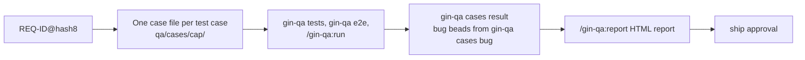

# QA add-on (`gin-qa`)

`gin-qa` is an optional plugin that writes test cases from your specs, walks a tester through the manual cases and files a bug bead for each failure, turns end-to-end cases into Playwright specs with recorded evidence, and reports on both in one offline HTML page. It needs `gin-workflow` and is not installed by default.



## Install

From a clone of this repository, or remotely:

```bash
./install.sh --plugin gin-qa          # or --plugin all for both plugins
curl -sSL https://raw.githubusercontent.com/giangdhwhtbr/gin-workflow/master/remote-install.sh | bash -s -- --plugin gin-qa
```

This installs the plugin for each harness and links the `gin-qa` launcher into `~/.local/bin`.

## Setup: `/gin-qa:setup`

`/gin-qa:setup` sets up QA in a repository from one interview. It reads what `qa/guidelines.md`, `qa/README.md`, and the case files already say, and asks only for what they leave open. The questions cover the case types, the language, the test command of each automated type, the manual run reference and cadence, the external tracker reference, and when a report is made. It shows each change before writing it:

- `qa/guidelines.md`: the `Language:` line and the sections `Types`, `Automated types`, `Manual runs`, and `Bugs`. Other sections, such as `E2E specs`, are left as they are.
- `qa/README.md`: the `Process` section.
- `.claude/skills/<name>-qa/SKILL.md`, where `<name>` is the repository folder name in lower case with each run of other characters replaced by `-`: a project skill that tells an agent which gin-qa skill runs each step, and points to the guidelines and README. It copies no rules, so editing the guidelines does not make it stale. After a gin-qa upgrade, rerun `/gin-qa:setup` to see its difference against the current template.

It ends with `gin-qa cases check`, plus `gin-qa tests check` when automated types are declared, and does not commit. The project skill is written for Claude Code; on another harness, copy the `.claude/skills/<name>-qa/` folder to the project skill folder that harness reads. In OpenCode the skill is `@gin-qa-setup`, so `@setup` stays gin-workflow's setup.

## Test cases: `/gin-qa:cases`

`/gin-qa:cases <capability>` (or `--change <epic>`) writes one file per case into `qa/cases/<capability>/` (`qa.cases`), following the team rules in `qa/guidelines.md` (`qa.guidelines`). On first use it creates the guidelines file and `qa/README.md`, a guide for testers, from templates.

```markdown
# TC-AUTH-004: Fifth failed login locks the account

- **REQ:** REQ-AUTH-003@1a2b3c4d
- **Priority:** high

**Preconditions:**
- a user with four failed attempts

**Test data:**
- the user from the preconditions, with the password in environment variable `E2E_AUTH_PASSWORD`

**Steps:**
1. Log in with a wrong password

**Expected:**
- the account is locked for fifteen minutes
```

Saved as `qa/cases/auth/TC-AUTH-004-fifth-failed-login.e2e.md`:

- The file name holds the case ID, an optional slug, and the type (`.e2e.md`, `.manual.md`). The file holds one case, and its heading repeats the ID.
- Fields are `- **Key:** value` lines. Sections are `**Preconditions:**`, `**Test data:**`, `**Steps:**`, and `**Expected:**`, in that order.
- `Test data` lists the records and values the case needs, as a value or a rule. Credentials appear only as environment variable names.
- `gin-qa cases plan` lists the work: requirements with no case (`missing`), cases whose requirement changed since they were pinned (`stale`), and cases whose requirement is gone (`obsolete`).
- IDs come from `gin-qa cases next-id <capability>`; `pin <TC-ID>` records the requirement's current hash after a case is updated.
- `gin-qa cases check` must exit 0. Obsolete cases are deleted only with your approval, and the skill never commits.
- `gin-qa cases result <TC-ID> <status> [--run <ref>] [--bug <id>|none]` writes the `Result`, `Run`, and `Bug` lines. Never edit them by hand.
- A flat `qa/cases/<capability>.md` file from earlier versions still works. `gin-qa cases split <capability>` writes one file per case and removes the flat file.
- In the legacy layout (no REQ-IDs) cases use `Source: <spec path>#<heading>` and `check` covers structure and IDs only.
- `gin-qa cases export --format json` lists every case with `result`, `run`, `bug`, and `test_data` for your own tooling; `/gin-qa:report` builds an HTML report from the same data.

Requirements and their hashes come from the living specs, so the [SDD layout](sdd.md) gives the most traceability.

The `## Types` section of the guidelines lists the case types in use, and [`gin-qa cases check`](../reference/cli.md#gin-qa-cases-check) checks each case against it.

## Manual runs: `/gin-qa:run`

`/gin-qa:run <capability>` shows each manual case (`Type: manual`) of the capability in ID order and asks the tester for `passed`, `failed`, `blocked`, or `skip`. It asks for a run reference once, `manual <YYYY-MM-DD>` by default, and writes it on every case it records. `skip` writes nothing. When the guidelines set `Run reference:` under `## Manual runs`, that format is the default instead.

A failure asks for what happened, evidence references, and an optional external tracker reference, then runs `gin-qa cases bug`:

- The bug is a bead filed through `gin-workflow task create`, linked to the case's epic with `discovered-from`. `gin-workflow usage collect` on that epic counts it in `quality.bugs`, and the [usage report](../reference/cli.md#gin-workflow-usage) shows the count from the last collect.
- The epic comes from the case's spec or change; see [`gin-qa cases bug`](../reference/cli.md#gin-qa-cases-bug) for the lookup. With no epic, the skill offers the open epics of the repository to pick from.
- The description holds the case file, the run, the preconditions, test data, steps, expected, the actual result, and the evidence.
- When the case's `Bug:` names a bead whose status is set and not `closed`, no bug is filed and the case keeps it; the new actual result and evidence are not added to it. A closed bug gets a new bug that names it as the previous bug; see [`gin-qa cases bug`](../reference/cli.md#gin-qa-cases-bug) for other values.
- Teams that track bugs in Jira or Linear file the ticket there and pass its key with `--external-ref`; the flag only records the key on the bead.
- When `## Bugs` in the guidelines says `External reference: required`, a failure is not filed without a reference, and the reference must match the pattern the line names.
- Priority follows the case: `high` → 1, `medium` → 2, `low` → 3, none → 2.

The skill never edits case files and never commits.

## End-to-end specs: `/gin-qa:e2e`

`/gin-qa:e2e <capability>` turns `.e2e.md` cases into Playwright specs under `qa/e2e/<capability>/` (`qa.e2e`), one spec per case:

- `gin-qa e2e init` copies the evidence fixture `qa/e2e/evidence.ts` (yours to edit), git-ignores `qa/evidence/`, and writes `playwright.config.ts` at the repository root when there is none: specs under `qa/e2e`, `baseURL` from `E2E_BASE_URL` or the `--base-url` value (default `http://localhost:3000`), CI retries, trace on first retry, `list` and `junit` reporters (the JUnit report lands in the run folder), and one `chromium` project.
- The skill builds each spec step by step against the running application, reading the ARIA snapshot (`NN.aria.yml`) and URL the fixture records after every step, and reviews the screenshots before reporting a case. Where the harness has subagents it gives each case to the `gin-qa:e2e-tester` agent at the middle model and `low` effort, several cases at a time (`--parallel N`, default 3).
- `gin-qa e2e run` runs them; each run leaves a screenshot per step and a `result.json` per case (and per Playwright project when the config names projects) under `qa/evidence/`. It records each case's result in its case file and lists them under `recorded` in the JSON output.
- `gin-qa e2e check --run <folder>` checks a run's evidence; `gin-qa e2e export --run <folder> --format json` exports it.

Your project provides `@playwright/test` 1.49 or later. `init` writes a starting Playwright config once; after that the config is yours (`baseURL`, browsers, video, trace, `webServer`), and `init` never overwrites it.

## Other automated tests: `/gin-qa:tests`

`/gin-qa:tests <capability> --type <type>` writes, runs, and checks the tests of cases whose type is neither `e2e` nor `manual`, such as `api` or `unit`, in the project's own test framework:

- `qa/guidelines.md` declares each such type under `## Automated types`: the globs of its test files (relative to the repository root, never absolute or containing `..`) and the command that runs them. The skill proposes the declaration when it is missing.

  ```markdown
  ## Automated types

  ### api
  - Tests: `backend/tests/**/test_*.py`
  - Run: `uv run --project backend pytest {files} --junitxml={junit}`
  ```

  `{junit}` (required) is the JUnit XML file the command must write; `{files}` (optional) is the test files of the cases being run. The command runs from the repository root, without a shell. `{files}` paths are relative to that root, so a runner option that changes folder (`uv run --directory`, `pnpm -C`) cannot take `{files}`.
- A test carries the marker `TC: <TC-ID>@<hash8>`, by convention in a comment line above it, and a name holding the TC-ID (`test_tc_auth_004_...`). `gin-qa tests plan` and `check` compare the marker with the case, as `gin-qa e2e` does with a spec's header; `gin-qa tests pin` updates it.
- `gin-qa tests run --type <type> [TC-ID|capability]` runs the command into `qa/evidence/<UTC time>-<type>/` and records each case's result in its case file. The [CLI reference](../reference/cli.md#gin-qa-tests) gives the result rules. Only `gin-qa e2e init` git-ignores `qa/evidence/`; without e2e, add it to `.gitignore`.

## Report: `/gin-qa:report`

`/gin-qa:report [capability]` runs `gin-qa report` and writes one folder you can zip and send:

- The folder is `qa/evidence/report-<UTC time>/`; `--out <dir>` picks another, which must be missing or empty. It holds `index.html` and a copy of each e2e screenshot the report shows, so it opens offline from any location. `gin-qa e2e init` git-ignores `qa/evidence/`, so reports stay out of git.
- The page counts cases per capability, type, priority, and result in four bar charts; a click on a bar filters the case table. The table has a search over ID and title and one filter per chart.
- A click on a case opens its fields, preconditions, test data, steps, expected results, result, run, and bug, and for an e2e case each step of the run its `Run` line names, per Playwright project: status, URL, error, and screenshot.
- Each case shows the run its `Run` line names. When that folder is gone, the case shows `evidence not found: <run>` and the command lists the run under `missing_evidence`. A `Run` outside `qa/evidence/`, such as a manual run reference, and a `gin-qa tests run` folder are shown as text.

## Prompts

### Cover a requirement in depth

> "/gin-qa:cases auth
> Please analyze `docs/specs/auth/spec.md` and generate test cases for each requirement. Include:
> - Happy paths (standard user flow)
> - Negative scenarios (invalid credentials, expired tokens, locked accounts)
> - Boundary values (empty inputs, max length passwords)
> - Security checks (SQL injection in input fields, brute force lockout)"

### Check a pull request against the cases

> "The developer has submitted pull request #45.
> Please inspect the diff against `docs/specs/auth/spec.md` and `qa/cases/auth/`. Verify that all scenarios described in the test cases are covered by unit, integration, or E2E tests."

### Diagnose an end-to-end failure

> "/gin-qa:e2e auth
> Run the E2E suite. If any test fails, inspect the screenshot in `qa/evidence/` and the ARIA snapshot, determine whether the failure is a test bug or a code regression, and propose the fix."

## Team rules

`/gin-qa:cases` and `/gin-qa:e2e` read `qa/guidelines.md` (`qa.guidelines`) first, and its rules override their defaults. Two example rules:

- Every requirement with a `Priority: high` case has at least one `.e2e.md` case.
- Steps start with an action verb: Navigate, Enter, Click, Verify.

File format, extra fields, and end-to-end rules: [customizing templates](customizing-templates.md).

## Ship approval checklist

With `team.approvals.ship` listing a tester role, the tester approves the latest commit of the developer's pull request after checking:

- `gin-qa cases plan` reports no `missing` and no `stale` cases.
- `gin-qa cases check` exits 0.
- `gin-qa e2e run` passes, and `gin-qa e2e check --run <folder>` exits 0 on its evidence.
- The approval comment names the evidence folder (a team convention).

A commit pushed after the approval needs a new approval ([team mode](team.md)).

## Commands

`gin-qa cases {plan,next-id,pin,result,bug,split,check,export}`, `gin-qa e2e {init,plan,pin,run,check,export}`, `gin-qa tests {plan,pin,check,run}`, and `gin-qa report [capability] [--out DIR]`; exit 0 ok, 1 findings, 2 usage or environment error. See [CLI](../reference/cli.md#gin-qa) and the [`qa` configuration keys](../reference/config.md#qa).
