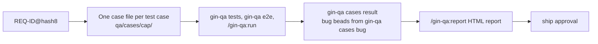

# Add-on QA (`gin-qa`) { #qa-add-on-gin-qa }

`gin-qa` là một plugin tùy chọn: nó viết test case từ spec của bạn, dẫn tester đi qua các case thủ công và tạo một bug bead cho mỗi lần thất bại, biến các case end-to-end thành Playwright spec kèm evidence được ghi lại, và báo cáo cả hai trong một trang HTML offline. Nó cần gin-workflow và không được cài theo mặc định.



## Cài đặt { #install }

Từ một bản clone của repository này, hoặc từ xa:

```bash
./install.sh --plugin gin-qa          # or --plugin all for both plugins
curl -sSL https://raw.githubusercontent.com/giangdhwhtbr/gin-workflow/master/remote-install.sh | bash -s -- --plugin gin-qa
```

Lệnh này cài plugin cho từng harness và liên kết launcher `gin-qa` vào `~/.local/bin`.

## Thiết lập: `/gin-qa:setup` { #setup-gin-qasetup }

`/gin-qa:setup` thiết lập QA trong một repository qua một buổi phỏng vấn. Nó đọc những gì `qa/guidelines.md`, `qa/README.md`, và các file case đã nói, và chỉ hỏi những gì chúng còn bỏ ngỏ. Các câu hỏi gồm các loại case, ngôn ngữ, lệnh test của từng loại tự động, tham chiếu lần chạy thủ công và nhịp chạy, tham chiếu tracker bên ngoài, và khi nào tạo báo cáo. Nó hiển thị từng thay đổi trước khi ghi:

- `qa/guidelines.md`: dòng `Language:` và các mục `Types`, `Automated types`, `Manual runs`, và `Bugs`. Các mục khác, như `E2E specs`, được giữ nguyên.
- `qa/README.md`: mục `Process`.
- `.claude/skills/<name>-qa/SKILL.md`, trong đó `<name>` là tên thư mục repository viết thường với mỗi chuỗi ký tự khác được thay bằng `-`: một project skill cho agent biết skill gin-qa nào chạy từng bước, và trỏ tới guidelines và README. Nó không sao chép rule nào, nên sửa guidelines không làm nó lỗi thời. Sau khi nâng cấp gin-qa, chạy lại `/gin-qa:setup` để xem khác biệt của nó so với template hiện tại.

Nó kết thúc bằng `gin-qa cases check`, cộng thêm `gin-qa tests check` khi có khai báo loại tự động, và không commit. Project skill được viết cho Claude Code; trên harness khác, hãy sao chép thư mục `.claude/skills/<name>-qa/` vào thư mục project skill mà harness đó đọc. Trong OpenCode, skill này là `@gin-qa-setup`, nên `@setup` vẫn là setup của gin-workflow.

## Test case: `/gin-qa:cases` { #test-cases-gin-qacases }

`/gin-qa:cases <capability>` (hoặc `--change <epic>`) ghi mỗi case một file vào `qa/cases/<capability>/` (`qa.cases`), theo các rule của nhóm trong `qa/guidelines.md` (`qa.guidelines`). Lần đầu dùng, nó tạo file guidelines và `qa/README.md`, một hướng dẫn cho tester, từ các template.

```markdown
# TC-AUTH-004: Fifth failed login locks the account

- **REQ:** REQ-AUTH-003@1a2b3c4d
- **Priority:** high

**Preconditions:**
- a user with four failed attempts

**Test data:**
- the user from the preconditions, with the password in environment variable `E2E_AUTH_PASSWORD`

**Steps:**
1. Log in with a wrong password

**Expected:**
- the account is locked for fifteen minutes
```

Lưu thành `qa/cases/auth/TC-AUTH-004-fifth-failed-login.e2e.md`:

- Tên file gồm case ID, một slug tùy chọn, và loại (`.e2e.md`, `.manual.md`). File chứa một case, và heading của nó lặp lại ID.
- Các trường là dòng `- **Key:** value`. Các mục là `**Preconditions:**`, `**Test data:**`, `**Steps:**`, và `**Expected:**`, theo đúng thứ tự đó.
- `Test data` liệt kê các bản ghi và giá trị mà case cần, dưới dạng một giá trị hoặc một quy tắc. Credential chỉ xuất hiện dưới dạng tên biến môi trường.
- `gin-qa cases plan` liệt kê công việc: requirement chưa có case (`missing`), case có requirement đã đổi kể từ lúc được pin (`stale`), và case có requirement đã biến mất (`obsolete`).
- ID lấy từ `gin-qa cases next-id <capability>`; `pin <TC-ID>` ghi lại hash hiện tại của requirement sau khi một case được cập nhật.
- `gin-qa cases check` phải thoát với mã 0. Case obsolete chỉ bị xóa khi bạn đồng ý, và skill không bao giờ commit.
- `gin-qa cases result <TC-ID> <status> [--run <ref>] [--bug <id>|none]` ghi các dòng `Result`, `Run`, và `Bug`. Không bao giờ sửa chúng bằng tay.
- Một file phẳng `qa/cases/<capability>.md` từ các phiên bản trước vẫn dùng được. `gin-qa cases split <capability>` ghi mỗi case một file và xóa file phẳng.
- Trong layout legacy (không có REQ-ID), case dùng `Source: <spec path>#<heading>` và `check` chỉ bao gồm cấu trúc và ID.
- `gin-qa cases export --format json` liệt kê mọi case cùng `result`, `run`, `bug`, và `test_data` cho công cụ của riêng bạn; `/gin-qa:report` dựng báo cáo HTML từ cùng dữ liệu.

Requirement và hash của chúng đến từ các living spec, nên [layout SDD](sdd.md) cho khả năng truy vết tốt nhất.

Mục `## Types` của guidelines liệt kê các loại case đang dùng, và [`gin-qa cases check`](../reference/cli.md#gin-qa-cases-check) kiểm tra từng case theo nó.

## Chạy thủ công: `/gin-qa:run` { #manual-runs-gin-qarun }

`/gin-qa:run <capability>` hiển thị từng case thủ công (`Type: manual`) của capability theo thứ tự ID và hỏi tester `passed`, `failed`, `blocked`, hoặc `skip`. Nó hỏi một tham chiếu lần chạy một lần, mặc định là `manual <YYYY-MM-DD>`, và ghi nó vào mọi case mà nó ghi nhận. `skip` không ghi gì. Khi guidelines đặt `Run reference:` dưới `## Manual runs`, định dạng đó trở thành mặc định.

Một lần thất bại sẽ hỏi chuyện gì đã xảy ra, các tham chiếu evidence, và một tham chiếu tracker bên ngoài tùy chọn, rồi chạy `gin-qa cases bug`:

- Bug là một bead được tạo qua `gin task create`, liên kết với epic của case bằng `discovered-from`. `gin usage collect` trên epic đó đếm nó vào `quality.bugs`, và [usage report](../reference/cli.md#gin-usage) hiển thị con số từ lần collect gần nhất.
- Epic lấy từ spec hoặc change của case; xem [`gin-qa cases bug`](../reference/cli.md#gin-qa-cases-bug) để biết cách tra cứu. Nếu không có epic, skill đưa ra các epic đang mở của repository để chọn.
- Mô tả chứa file case, lần chạy, precondition, test data, các bước, kết quả mong đợi, kết quả thực tế, và evidence.
- Khi `Bug:` của case nêu một bead có trạng thái đã đặt và không phải `closed`, không có bug nào được tạo và case giữ nguyên nó; kết quả thực tế và evidence mới không được thêm vào đó. Một bug đã đóng nhận một bug mới nêu nó là bug trước đó; xem [`gin-qa cases bug`](../reference/cli.md#gin-qa-cases-bug) cho các giá trị khác.
- Các nhóm theo dõi bug trong Jira hoặc Linear tạo ticket ở đó và truyền key của nó bằng `--external-ref`; cờ này chỉ ghi key vào bead.
- Khi `## Bugs` trong guidelines ghi `External reference: required`, một lần thất bại không được tạo nếu thiếu tham chiếu, và tham chiếu phải khớp với pattern mà dòng đó nêu.
- Mức ưu tiên theo case: `high` → 1, `medium` → 2, `low` → 3, không có → 2.

Skill không bao giờ sửa file case và không bao giờ commit.

## Spec end-to-end: `/gin-qa:e2e` { #end-to-end-specs-gin-qae2e }

`/gin-qa:e2e <capability>` biến các case `.e2e.md` thành Playwright spec dưới `qa/e2e/<capability>/` (`qa.e2e`), mỗi case một spec:

- `gin-qa e2e init` sao chép evidence fixture `qa/e2e/evidence.ts` (bạn tự sửa), cho git bỏ qua `qa/evidence/`, và ghi `playwright.config.ts` ở gốc repository khi chưa có: spec dưới `qa/e2e`, `baseURL` từ `E2E_BASE_URL` hoặc giá trị `--base-url` (mặc định `http://localhost:3000`), retry trên CI, trace ở lần retry đầu, reporter `list` và `junit` (báo cáo JUnit nằm trong thư mục lần chạy), và một project `chromium`.
- Skill dựng từng spec theo từng bước với ứng dụng đang chạy, đọc ARIA snapshot (`NN.aria.yml`) và URL mà fixture ghi lại sau mỗi bước, và xem lại các screenshot trước khi báo cáo một case. Nơi harness có subagent, nó giao mỗi case cho agent `gin-qa:e2e-tester` ở model trung bình và effort `low`, nhiều case cùng lúc (`--parallel N`, mặc định 3).
- `gin-qa e2e run` chạy chúng; mỗi lần chạy để lại một screenshot cho mỗi bước và một `result.json` cho mỗi case (và cho mỗi Playwright project khi config có đặt tên project) dưới `qa/evidence/`. Nó ghi kết quả của từng case vào file case và liệt kê chúng dưới `recorded` trong đầu ra JSON.
- `gin-qa e2e check --run <folder>` kiểm tra evidence của một lần chạy; `gin-qa e2e export --run <folder> --format json` xuất nó.

Dự án của bạn cung cấp `@playwright/test` 1.49 trở lên. `init` ghi một Playwright config khởi đầu một lần; sau đó config là của bạn (`baseURL`, trình duyệt, video, trace, `webServer`), và `init` không bao giờ ghi đè nó.

## Các test tự động khác: `/gin-qa:tests` { #other-automated-tests-gin-qatests }

`/gin-qa:tests <capability> --type <type>` viết, chạy, và kiểm tra test của các case có loại không phải `e2e` cũng không phải `manual`, như `api` hay `unit`, trong test framework riêng của dự án:

- `qa/guidelines.md` khai báo từng loại như vậy dưới `## Automated types`: các glob của file test (tương đối so với gốc repository, không bao giờ là đường dẫn tuyệt đối hay chứa `..`) và lệnh chạy chúng. Skill đề xuất khai báo khi nó còn thiếu.

  ```markdown
  ## Automated types

  ### api
  - Tests: `backend/tests/**/test_*.py`
  - Run: `uv run --project backend pytest {files} --junitxml={junit}`
  ```

  `{junit}` (bắt buộc) là file JUnit XML mà lệnh phải ghi; `{files}` (tùy chọn) là các file test của những case đang chạy. Lệnh chạy từ gốc repository, không qua shell. Các path của `{files}` tương đối so với gốc đó, nên một tùy chọn của runner đổi thư mục (`uv run --directory`, `pnpm -C`) không thể nhận `{files}`.
- Một test mang marker `TC: <TC-ID>@<hash8>`, theo quy ước nằm trong một dòng comment phía trên nó, và một tên chứa TC-ID (`test_tc_auth_004_...`). `gin-qa tests plan` và `check` so marker với case, như `gin-qa e2e` làm với header của một spec; `gin-qa tests pin` cập nhật nó.
- `gin-qa tests run --type <type> [TC-ID|capability]` chạy lệnh vào `qa/evidence/<UTC time>-<type>/` và ghi kết quả của từng case vào file case. [Tài liệu tham chiếu CLI](../reference/cli.md#gin-qa-tests) nêu các quy tắc về kết quả. Chỉ `gin-qa e2e init` cho git bỏ qua `qa/evidence/`; nếu không có e2e, hãy thêm nó vào `.gitignore`.

## Báo cáo: `/gin-qa:report` { #report-gin-qareport }

`/gin-qa:report [capability]` chạy `gin-qa report` và ghi một thư mục bạn có thể nén zip và gửi đi:

- Thư mục là `qa/evidence/report-<UTC time>/`; `--out <dir>` chọn nơi khác, nơi đó phải chưa tồn tại hoặc rỗng. Nó chứa `index.html` và một bản sao của mỗi screenshot e2e mà báo cáo hiển thị, nên mở được offline từ bất kỳ vị trí nào. `gin-qa e2e init` cho git bỏ qua `qa/evidence/`, nên báo cáo không vào git.
- Trang đếm số case theo capability, loại, mức ưu tiên, và kết quả trong bốn biểu đồ cột; nhấp vào một cột sẽ lọc bảng case. Bảng có ô tìm kiếm theo ID và tiêu đề, và một bộ lọc cho mỗi biểu đồ.
- Nhấp vào một case sẽ mở các trường, precondition, test data, các bước, kết quả mong đợi, kết quả, lần chạy, và bug của nó, và với một case e2e là từng bước của lần chạy mà dòng `Run` của nó nêu, theo từng Playwright project: trạng thái, URL, lỗi, và screenshot.
- Mỗi case hiển thị lần chạy mà dòng `Run` của nó nêu. Khi thư mục đó đã mất, case hiển thị `evidence not found: <run>` và lệnh liệt kê lần chạy dưới `missing_evidence`. Một `Run` nằm ngoài `qa/evidence/`, như tham chiếu lần chạy thủ công, và một thư mục `gin-qa tests run` được hiển thị dưới dạng văn bản.

## Prompt { #prompts }

Các prompt dưới đây được dán nguyên văn nên giữ tiếng Anh.

### Phủ sâu một requirement { #cover-a-requirement-in-depth }

> "/gin-qa:cases auth
> Please analyze `docs/specs/auth/spec.md` and generate test cases for each requirement. Include:
> - Happy paths (standard user flow)
> - Negative scenarios (invalid credentials, expired tokens, locked accounts)
> - Boundary values (empty inputs, max length passwords)
> - Security checks (SQL injection in input fields, brute force lockout)"

### Kiểm tra một pull request theo các case { #check-a-pull-request-against-the-cases }

> "The developer has submitted pull request #45.
> Please inspect the diff against `docs/specs/auth/spec.md` and `qa/cases/auth/`. Verify that all scenarios described in the test cases are covered by unit, integration, or E2E tests."

### Chẩn đoán một lỗi end-to-end { #diagnose-an-end-to-end-failure }

> "/gin-qa:e2e auth
> Run the E2E suite. If any test fails, inspect the screenshot in `qa/evidence/` and the ARIA snapshot, determine whether the failure is a test bug or a code regression, and propose the fix."

## Rule của nhóm { #team-rules }

`/gin-qa:cases` và `/gin-qa:e2e` đọc `qa/guidelines.md` (`qa.guidelines`) trước, và các rule của nó ghi đè mặc định của chúng. Hai rule ví dụ:

- Mọi requirement có một case `Priority: high` đều có ít nhất một case `.e2e.md`.
- Các bước bắt đầu bằng một động từ hành động: Navigate, Enter, Click, Verify.

Định dạng file, trường bổ sung, và rule end-to-end: [tùy biến template](customizing-templates.md).

## Checklist phê duyệt ship { #ship-approval-checklist }

Khi `team.approvals.ship` liệt kê một role tester, tester duyệt commit mới nhất của pull request của developer sau khi kiểm tra:

- `gin-qa cases plan` không báo case `missing` hay `stale` nào.
- `gin-qa cases check` thoát với mã 0.
- `gin-qa e2e run` pass, và `gin-qa e2e check --run <folder>` thoát với mã 0 trên evidence của nó.
- Bình luận phê duyệt nêu thư mục evidence (một quy ước của nhóm).

Một commit được push sau phê duyệt cần phê duyệt mới ([chế độ team](team.md)).

## Lệnh { #commands }

`gin-qa cases {plan,next-id,pin,result,bug,split,check,export}`, `gin-qa e2e {init,plan,pin,run,check,export}`, `gin-qa tests {plan,pin,check,run}`, và `gin-qa report [capability] [--out DIR]`; exit 0 ok, 1 có phát hiện, 2 lỗi cách dùng hoặc môi trường. Xem [CLI](../reference/cli.md#gin-qa) và các [khóa cấu hình `qa`](../reference/config.md#qa).
