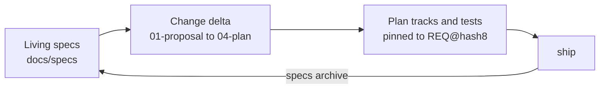

# Spec-driven development (SDD layout)

By default (`artifacts.layout: legacy`) each change gets a dated spec in `.planning/specs/` and a plan in `.planning/plans/`, and they stay where they were written. The SDD layout keeps **living specs** instead: one spec per capability that always describes current behavior, with numbered requirements that tests and beads point to. Every change proposes a delta to those specs, and shipping merges the delta in.

Setup proposes `artifacts.layout: sdd` for a greenfield project. An existing repository switches with `/gin:migrate-specs`, which moves its `.planning` specs and plans and sets the layout; `gin setup doctor` suggests it when legacy specs exist.



## Layout

```
docs/
  specs/                     living specs (artifacts.specs)
    README.md                capability index
    <capability>/spec.md     requirements for one capability
    <capability>/diagrams/   activity and state diagrams (Mermaid)
    <capability>/use-cases/  use cases (optional)
  changes/                   proposed changes (artifacts.changes)
    <epic>-<slug>/
      01-proposal.md         why and what
      02-spec-delta.md       ADDED / MODIFIED / REMOVED requirements
      03-design.md           how
      04-plan.md             the implementation plan
      05-tests.md            manual or QE cases only
    archive/                 shipped changes
  adr/NNNN-<slug>.md         architecture decisions (artifacts.adr)
```

The number prefix in a change folder is its reading order. A change folder created before numbering, open or archived, keeps its unnumbered names (`proposal.md`, `spec-delta.md`), and every `specs` command reads them. A plan written into such a folder later is still `04-plan.md`.

## Requirements

A requirement is a block in a spec or spec delta:

```markdown
### REQ-AUTH-003: Lock out after failed logins
WHEN a user fails to log in five times in ten minutes, the system SHALL lock the account for fifteen minutes.

#### Scenario: fifth failure locks
- GIVEN a user with four failed attempts
- WHEN the fifth attempt fails
- THEN the account is locked
```

- IDs are `REQ-<CAP>-<NNN>`; get the next free one with `gin specs next-id <cap>`.
- Each block has one `SHALL` or `MUST` statement and at least one GIVEN/WHEN/THEN scenario. The EARS patterns (`WHEN`, `WHILE`, `IF ... THEN`, `WHERE`) are preferred.
- A `MODIFIED` or `REMOVED` block puts `<!-- base: <hash> -->` on the line after its heading (`gin specs hash <REQ-ID>` prints it), so archive can tell whether the living block changed since the delta was written. A `REMOVED` block also needs `Reason: <why>`.
- `gin specs template <name>` prints the templates (`spec.md`, `spec-delta.md`, `proposal.md`, `design.md`, `tests.md`, `adr.md`, `iteration.md`, `activity.md`, `state.md`, `use-case.md`, `specs-README.md`).

## Images and mockups

A feature's requirements, its UI included, live in the feature's capability (`reports`, not `ui`). A `ui` capability holds only what spans pages: design system, layout, navigation, shared components. A project that wants another rule writes it in `docs/specs/README.md`, and discuss follows the README.

Keep screenshots and mockups for a capability in `docs/specs/<capability>/assets/`, one dated folder per batch of inputs, with file names that say the screen and state:

```text
docs/specs/reports/assets/
  2026-05-11/          # first requirements
    description.md     # Kind: new
    report-list.png
    mockup/
  2026-12-01/          # the customer's changes
    description.md     # Kind: change, Previous: assets/2026-05-11/
    report-filter.png
```

Name the folder by the ISO date the inputs arrived. By convention, a new batch of requirements, changes, or designs gets a new folder and an older folder is never edited, so the folders record the history of the capability's inputs. On a legacy project without design specs, add screenshots of the existing feature with `--legacy`, which puts them under `<date>/legacy/`, and describe how it behaves today in that folder's `description.md` with `Kind: legacy`.

`gin specs assets add <capability> <files> [--date D]` copies the files, from anywhere on disk, into the dated folder and writes `description.md` with `Kind:`, `Previous:`, and `Confirmed: no` when it is missing. `gin specs assets confirm <capability> --date D` sets `Confirmed:` to today. Both exit 2 on refusal; see the [CLI reference](../reference/cli.md#gin-specs).

`specs lint` reports a dated folder without `description.md`, a `Confirmed:` value that is neither `no` nor a date, and any change to a folder confirmed on the base branch. The base is `--against <ref>`, else the merge-base with `main` or `master`; without one, lint warns and skips that check. A folder confirmed on the current branch is checked only after it reaches the base, and `assets add` refuses it before that. Flat files under `assets/` and folders not named by an ISO date stay valid and are not checked.

Each `description.md` has a `Confirmed:` line. It reads `no` until the BA confirms the inputs, then the ISO date of that confirmation, and a confirmed folder is never edited. In discuss, the agent reads `description.md` and any `mockup/index.html` of each dated folder of the affected capabilities, cites only confirmed folders, and asks about the others. A requirement taken from an input adds a `Source:` line after its statement:

```markdown
### REQ-REPORTS-004: Filter reports by date
The system SHALL show only the reports created in the selected date range.
Source: `assets/2026-05-11/mockup/index.html#report-list`, `assets/2026-05-11/description.md`
```

`specs archive` copies the line into `spec.md` with the rest of the block, and `specs export` prints it. The [BA guide](ba.md) writes mockups and legacy descriptions in this shape.

`specs archive` copies the text of each requirement block into `docs/specs/<capability>/spec.md`, so write image paths relative to that file (`assets/2026-05-11/report-list.png`). In the change folder's `02-spec-delta.md` those links do not resolve until the change ships.

## Diagrams

Each feature has an activity diagram. An entity with three or more states, or a transition allowed only under a condition (a role, a field value, a time limit), also has a state diagram. Both are Mermaid files in the capability's folder:

```text
docs/specs/orders/
  spec.md                  ## Diagrams links the files below
  diagrams/
    checkout-activity.md   flowchart: one feature, from the trigger to each outcome
    order-state.md         stateDiagram-v2: one entity's states and transitions
```

Start them from `gin specs template activity.md` and `state.md`. Discuss edits them directly on the spec branch, as it does assets: they are not requirement blocks and never go through `02-spec-delta.md`. The change's `03-design.md` cites them under `## Data Flow` and `01-proposal.md` lists them under `## Capabilities Affected`, so they are committed and reviewed with the change. `specs archive` leaves them in place; when it creates `spec.md` for a new capability, it links every file in `diagrams/` under `## Diagrams`.

`specs lint` reports a `*-activity.md` without a mermaid block starting with `flowchart` or `graph`, and a `*-state.md` without one starting with `stateDiagram`; other files in `diagrams/` are not checked. `specs lint --change` also reports each capability with an `ADDED` or `MODIFIED` block but no `*-activity.md`. When an entity needs a state diagram is a convention that lint does not check.

## Use cases

A use case describes one actor's interaction with the system, step by step. It is optional: add one for a feature where an actor interacts with the system, or when the user asks for one. Each is a Markdown file in the capability's folder, started from `gin specs template use-case.md`:

```text
docs/specs/orders/
  spec.md                  ## Use Cases links the files below
  use-cases/
    place-order.md         actor, goal, main flow, alternative flows
```

Its `Requirements:` line names the REQ-IDs it covers. Discuss edits use cases directly on the spec branch, as it does diagrams: they are not requirement blocks and never go through `02-spec-delta.md`. `01-proposal.md` lists them under `## Capabilities Affected`. `specs archive` leaves them in place; when it creates `spec.md` for a new capability, it links every file in `use-cases/` under `## Use Cases`.

`specs lint` and `specs lint --change` check each file in `use-cases/` for a `# ` title, an `Actor:` line, a `Requirements:` line with at least one REQ-ID, and a `## Main flow` with a numbered list. Each REQ-ID must be in a living spec, or `ADDED` or `MODIFIED` in an open change's `02-spec-delta.md` (a REQ only `REMOVED` there is reported); otherwise lint reports `<REQ> is not in a living spec or an open change`.

## Exporting an SRS

`gin specs export <capability>` writes the capability's living spec into one HTML file, `srs-<capability>.html` at the repository root. `specs export --all` writes every capability into `srs.html`, one chapter each, sorted by name. `--out <file>` writes elsewhere in the repository. The file is generated, so each run overwrites it.

Each chapter holds the capability's `## Purpose`, its use cases, its diagrams, its requirement blocks with their scenarios, and its assets: each dated folder, oldest first (its `description.md`, then the images and file names it does not show), then the flat files. Images are embedded, so the file can be sent alone. Open it in a browser and print it to PDF; each chapter starts on a new page.

The file loads Mermaid from jsDelivr at a pinned version to draw the diagrams; without network access it shows their source instead. The export does not lint, so run `specs lint` first. A local image it cannot find, one outside the repository, or a file that is not an image shows as its alt text, and the command exits 1 naming it. The cover, logo, customer, and section order come from the templates `srs.html` and `srs-capability.html`; see [SRS export templates](customizing-templates.md#srs-export-templates).

## Explaining a capability

`/gin:explain <capability>` writes one interactive page about a capability. The agent reads its spec, diagrams, and dated folders, writes a short summary that cites REQ-IDs, and runs `gin specs explain <capability> --narrative <file>`. The page is `.agent-workflow/runtime/explain/<capability>.html`; `gin setup` ignores that folder, so the page is never committed, and each run overwrites it. Run the command alone to get the page without the summary.

The page has one tab per section with content:

- Overview: the summary, then `## Purpose`.
- Requirements: one card per requirement block, grouped by section, with a search box for text and REQ-IDs.
- Stories: the user stories of every active and archived change whose `REQ:` line names one of the capability's REQ-IDs, labelled with the change folder.
- Diagrams: each file in `diagrams/`.
- Mockups and images: each dated folder, oldest first, with its `description.md`, its images (click to enlarge), and each `mockup/index.html` running in a sandboxed frame with a screen picker.

A `Source:` path under `assets/<date>/` on a requirement opens that file on the page. A path with `#<screen-id>` also opens that screen of the mockup, and the screen picker follows the jump. This needs a mockup that switches screens on a URL hash change; its own `#screen` links also work inside the frame.

`gin specs explain <change>` does the same for an active change, named as `--change` takes it. The overview shows the proposal's `## Why` and `## What Changes`, and the requirements are grouped under ADDED, MODIFIED, and REMOVED. The diagrams start with `03-design.md`, and only the dated folders its `Source:` lines cite are shown. An archived change is not found; explain its capability instead.

Like the SRS, the page is one file with its images embedded, and it loads Mermaid from jsDelivr at a pinned version. An image or mockup it cannot embed is listed, and the command exits 1. The layout comes from the template `explain.html`; see [Explain page template](customizing-templates.md#explain-page-template).

## How the stages change

Every `state` and `record` call for the change passes `--workflow-id <epic>`. The `sdd` skill carries the exact steps.

| Stage | With the SDD layout |
|---|---|
| `discuss` | Creates the epic, after you confirm the capabilities table (capability, requirement groups, asset paths) in the design, then `specs new <slug> --epic <epic>` makes the change folder. Writes `01-proposal.md`, `02-spec-delta.md`, `03-design.md`, the capability's diagrams (and an ADR for an architecture decision). `specs lint --change <epic>` must pass. |
| spec review | `artifacts.spec_review: chat` records `requirement-confirmed` when you confirm in the chat. `pr` commits the change folder and the files it cites on `spec/<epic>-<slug>`, opens a pull request, and records the gate only after `specs status --change <epic>` reports it merged. |
| `plan` | Writes `<change>/04-plan.md`; each track lists `Requirements: REQ-...`, and every added or modified requirement belongs to a track. |
| `orchestrate` | Reuses the epic; each track bead gets `--spec-id <epic>-<slug>` and `req:<REQ-ID>` labels. |
| `execute` / review | New or changed tests carry the REQ-ID in the test name or a comment; the reviewer checks each scenario has a test. |
| `ship` | `specs archive --change <epic>` merges the delta into the living specs and moves the folder to `changes/archive/`. A conflict stops ship. |
| `quick` | Never creates a change folder; a change to behavior a requirement describes needs the full lifecycle. |

## Migrating

`/gin:migrate-specs` runs `gin specs migrate --dry-run`, shows the moves, and on approval migrates on a `chore/migrate-specs` branch. Uncommitted changes always stop it; an approved but unshipped workflow or an open worktree stops it unless you accept `--force`. It can then seed living specs one capability at a time, describing current behavior only, using the `tech-doc` output when `docs/codebase` is empty.

## Commands

See [`gin specs`](../reference/cli.md#gin-specs) for every command and its exit codes. The [QA add-on](qa.md) builds test cases from the same REQ-IDs.
