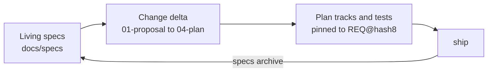

# Spec-driven development (SDD layout)

By default (`artifacts.layout: legacy`) each change gets a dated spec in `.planning/specs/` and a plan in `.planning/plans/`, and they stay where they were written. The SDD layout keeps **living specs** instead: one spec per capability that always describes current behavior, with numbered requirements that tests and beads point to. Every change proposes a delta to those specs, and shipping merges the delta in.

Setup proposes `artifacts.layout: sdd` for a greenfield project. An existing repository switches with `/gin-workflow:migrate-specs`, which moves its `.planning` specs and plans and sets the layout; `gin-workflow setup doctor` suggests it when legacy specs exist.



## Layout

```
docs/
  specs/                     living specs (artifacts.specs)
    README.md                capability index
    <capability>/spec.md     requirements for one capability
  changes/                   proposed changes (artifacts.changes)
    <epic>-<slug>/
      01-proposal.md         why and what
      02-spec-delta.md       ADDED / MODIFIED / REMOVED requirements
      03-design.md           how
      04-plan.md             the implementation plan
      05-tests.md            manual or QE cases only
    archive/                 shipped changes
  adr/NNNN-<slug>.md         architecture decisions (artifacts.adr)
```

The number prefix in a change folder is its reading order. A change folder created before numbering, open or archived, keeps its unnumbered names (`proposal.md`, `spec-delta.md`), and every `specs` command reads them. A plan written into such a folder later is still `04-plan.md`.

## Requirements

A requirement is a block in a spec or spec delta:

```markdown
### REQ-AUTH-003: Lock out after failed logins
WHEN a user fails to log in five times in ten minutes, the system SHALL lock the account for fifteen minutes.

#### Scenario: fifth failure locks
- GIVEN a user with four failed attempts
- WHEN the fifth attempt fails
- THEN the account is locked
```

- IDs are `REQ-<CAP>-<NNN>`; get the next free one with `gin-workflow specs next-id <cap>`.
- Each block has one `SHALL` or `MUST` statement and at least one GIVEN/WHEN/THEN scenario. The EARS patterns (`WHEN`, `WHILE`, `IF ... THEN`, `WHERE`) are preferred.
- A `MODIFIED` or `REMOVED` block puts `<!-- base: <hash> -->` on the line after its heading (`gin-workflow specs hash <REQ-ID>` prints it), so archive can tell whether the living block changed since the delta was written. A `REMOVED` block also needs `Reason: <why>`.
- `gin-workflow specs template <name>` prints the templates (`spec.md`, `spec-delta.md`, `proposal.md`, `design.md`, `tests.md`, `adr.md`, `iteration.md`, `specs-README.md`).

## Images and mockups

A feature's requirements, its UI included, live in the feature's capability (`reports`, not `ui`). A `ui` capability holds only what spans pages: design system, layout, navigation, shared components. A project that wants another rule writes it in `docs/specs/README.md`, and discuss follows the README.

Keep screenshots, mockups and diagrams for a capability in `docs/specs/<capability>/assets/`, one dated folder per batch of inputs, with file names that say the screen and state:

```text
docs/specs/reports/assets/
  2026-05-11/          # first requirements
    description.md     # Kind: new
    report-list.png
    mockup/
  2026-12-01/          # the customer's changes
    description.md     # Kind: change, Previous: assets/2026-05-11/
    report-filter.png
```

Name the folder by the ISO date the inputs arrived. By convention, a new batch of requirements, changes, or designs gets a new folder and an older folder is never edited, so the folders record the history of the capability's inputs. On a legacy project without design specs, put screenshots of the existing feature under `<date>/legacy/` and describe how it behaves today in that folder's `description.md` with `Kind: legacy`. Start every `description.md` from `gin-workflow specs template iteration.md`. `specs lint` reports a dated folder without `description.md`; flat files under `assets/` and folders not named by an ISO date stay valid and are not checked.

`specs archive` copies the text of each requirement block into `docs/specs/<capability>/spec.md`, so write image paths relative to that file (`assets/2026-05-11/report-list.png`). In the change folder's `02-spec-delta.md` those links do not resolve until the change ships.

## How the stages change

Every `state` and `record` call for the change passes `--workflow-id <epic>`. The `gin-sdd` skill carries the exact steps.

| Stage | With the SDD layout |
|---|---|
| `discuss` | Creates the epic, after you confirm the capabilities table (capability, requirement groups, asset paths) in the design, then `specs new <slug> --epic <epic>` makes the change folder. Writes `01-proposal.md`, `02-spec-delta.md`, `03-design.md` (and an ADR for an architecture decision). `specs lint --change <epic>` must pass. |
| spec review | `artifacts.spec_review: chat` records `requirement-confirmed` when you confirm in the chat. `pr` commits the change folder and the files it cites on `spec/<epic>-<slug>`, opens a pull request, and records the gate only after `specs status --change <epic>` reports it merged. |
| `plan` | Writes `<change>/04-plan.md`; each track lists `Requirements: REQ-...`, and every added or modified requirement belongs to a track. |
| `orchestrate` | Reuses the epic; each track bead gets `--spec-id <epic>-<slug>` and `req:<REQ-ID>` labels. |
| `execute` / review | New or changed tests carry the REQ-ID in the test name or a comment; the reviewer checks each scenario has a test. |
| `ship` | `specs archive --change <epic>` merges the delta into the living specs and moves the folder to `changes/archive/`. A conflict stops ship. |
| `quick` | Never creates a change folder; a change to behavior a requirement describes needs the full lifecycle. |

## Migrating

`/gin-workflow:migrate-specs` runs `gin-workflow specs migrate --dry-run`, shows the moves, and on approval migrates on a `chore/migrate-specs` branch. Uncommitted changes always stop it; an approved but unshipped workflow or an open worktree stops it unless you accept `--force`. It can then seed living specs one capability at a time, describing current behavior only, using the `tech-doc` output when `docs/codebase` is empty.

## Commands

See [`gin-workflow specs`](../reference/cli.md#gin-workflow-specs) for every command and its exit codes. The [QA add-on](qa.md) builds test cases from the same REQ-IDs.
