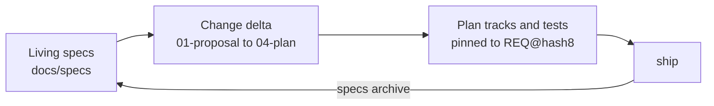

# Spec-driven development (SDD layout)

By default (`artifacts.layout: legacy`) each change gets a dated spec in `.planning/specs/` and a plan in `.planning/plans/`, and they stay where they were written. The SDD layout keeps **living specs** instead: one spec per capability that always describes current behavior, with numbered requirements that tests and beads point to. Every change proposes a delta to those specs, and shipping merges the delta in. A rewrite keeps the old system's behavior out of them; see [living specs during a migration](#living-specs-during-a-migration).

Setup proposes `artifacts.layout: sdd` for a greenfield project. An existing repository switches with `/gin:migrate-specs`, which moves its `.planning` specs and plans and sets the layout; `gin setup doctor` suggests it when legacy specs exist.



## Layout

```
docs/
  specs/                     living specs (artifacts.specs)
    README.md                capability index
    <capability>/spec.md     requirements for one capability
    <capability>/diagrams/   activity and state diagrams (Mermaid)
    <capability>/use-cases/  use cases (optional)
  changes/                   proposed changes (artifacts.changes)
    <epic>-<slug>/
      01-proposal.md         why and what
      02-spec-delta.md       ADDED / MODIFIED / REMOVED requirements
      03-design.md           how
      04-plan.md             the implementation plan
      05-tests.md            manual or QE cases only
    archive/                 shipped changes
  adr/NNNN-<slug>.md         architecture decisions (artifacts.adr)
```

The number prefix in a change folder is its reading order. A change folder created before numbering, open or archived, keeps its unnumbered names (`proposal.md`, `spec-delta.md`), and every `specs` command reads them. A plan written into such a folder later is still `04-plan.md`.

## Requirements

A requirement is a block in a spec or spec delta:

```markdown
### REQ-AUTH-003: Lock out after failed logins
WHEN a user fails to log in five times in ten minutes, the system SHALL lock the account for fifteen minutes.

#### Scenario: fifth failure locks
- GIVEN a user with four failed attempts
- WHEN the fifth attempt fails
- THEN the account is locked
```

- IDs are `REQ-<CAP>-<NNN>`; get the next free one with `gin specs next-id <cap>`, which scans the working tree, the worktrees, and the remote branches.
- In a [workspace](workspace.md), requirements and their REQ-IDs live only in the parent's specs, and the children only reference them.
- `gin specs lint --against <base>` reports an `ADDED` id that the base already uses, and `gin specs renumber` fixes it. The `sdd` skill runs that lint before the spec pull request and at ship.
- Each block has one `SHALL` or `MUST` statement and at least one GIVEN/WHEN/THEN scenario. The EARS patterns (`WHEN`, `WHILE`, `IF ... THEN`, `WHERE`) are preferred.
- A `MODIFIED` or `REMOVED` block puts `<!-- base: <hash> -->` on the line after its heading (`gin specs hash <REQ-ID>` prints it), so archive can tell whether the living block changed since the delta was written. A `REMOVED` block also needs `Reason: <why>`.
- `gin specs template <name>` prints the templates (`spec.md`, `spec-delta.md`, `proposal.md`, `design.md`, `tests.md`, `adr.md`, `iteration.md`, `activity.md`, `state.md`, `use-case.md`, `specs-README.md`).

## Requirement types { #requirement-types }

A requirement is functional unless it says otherwise. Right under its heading, a block may add a `Type:` line with one of three values: `functional` (the default), `non-functional`, or `business-rule`.

- A non-functional requirement adds `Category:`, one of `performance`, `security`, `reliability`, `usability`, `compatibility`, `maintainability`, `portability`, or `constraint`. It also needs either a `#### Scenario:` or a `Measure:` line with a measurable target. Use `Measure:` when one number says it all, and a scenario when the check has steps.
- A business rule keeps a scenario like a functional requirement. Use cases cite it on their `Requirements:` line.
- `Category:` and `Measure:` belong only to a non-functional requirement.

```markdown
### REQ-REPORTS-007: Report export time
Type: non-functional
Category: performance
Measure: the export of 10,000 rows finishes in under 5 seconds at the 95th percentile
The system SHALL export a report of 10,000 rows within the measured time.
```

`gin specs lint` reports these findings, the last one for a non-functional requirement with neither a scenario nor a `Measure:`:

- `<REQ>: Type must be one of functional, non-functional, business-rule`
- `<REQ>: Category must be one of performance, security, reliability, usability, compatibility, maintainability, portability, constraint`
- `<REQ>: Category and Measure are only for Type: non-functional`
- `<REQ>: needs at least one '#### Scenario:' or a 'Measure:' line`

A non-functional requirement needs no activity diagram, so it does not count toward the rules in [diagrams](#diagrams). A capability whose `ADDED` blocks are all non-functional needs none.

To reclassify an existing requirement, write a `MODIFIED` block with the new `Type:` (and `Category:` or `Measure:`) lines and the `<!-- base: <hash> -->` of the living block; see [changing a requirement after plan approval](#changing-a-requirement-after-plan-approval). [Exporting an SRS](#exporting-an-srs) shows how the types group in the document.

## Images and mockups

A feature's requirements, its UI included, live in the feature's capability (`reports`, not `ui`). A `ui` capability holds only what spans pages: design system, layout, navigation, shared components. A project that wants another rule writes it in `docs/specs/README.md`, and discuss follows the README.

Keep screenshots and mockups for a capability in `docs/specs/<capability>/assets/`, one dated folder per batch of inputs, with file names that say the screen and state:

```text
docs/specs/reports/assets/
  2026-05-11/          # first requirements
    description.md     # Kind: new
    report-list.png
    mockup/
  2026-12-01/          # the customer's changes
    description.md     # Kind: change, Previous: assets/2026-05-11/
    report-filter.png
```

Name the folder by the ISO date the inputs arrived. By convention, a new batch of requirements, changes, or designs gets a new folder and an older folder is never edited, so the folders record the history of the capability's inputs. On a legacy project without design specs, add screenshots of the existing feature with `--legacy`, which puts them under `<date>/legacy/`, and describe how it behaves today in that folder's `description.md` with `Kind: legacy`.

`gin specs assets add <capability> <files> [--date D]` copies the files, from anywhere on disk, into the dated folder and writes `description.md` with `Kind:`, `Previous:`, and `Confirmed: no` when it is missing. `gin specs assets confirm <capability> --date D` sets `Confirmed:` to today. Both exit 2 on refusal; see the [CLI reference](../reference/cli.md#gin-specs).

`specs lint` reports a dated folder without `description.md`, a `Confirmed:` value that is neither `no` nor a date, and any change to a folder confirmed on the base branch. The base is `--against <ref>`, else the merge-base with `main` or `master`; without one, lint warns and skips that check. A folder confirmed on the current branch is checked only after it reaches the base, and `assets add` refuses it before that. Flat files under `assets/` and folders not named by an ISO date stay valid and are not checked.

A confirmed folder has no branch of its own. `/gin:discuss` commits it with the change folder that cites it, on `spec/<epic>-<slug>`, so the spec approvers approve it with the spec ([pull requests](git-flow.md#pull-requests)). A confirmed folder that no change cites stays uncommitted.

Each `description.md` has a `Confirmed:` line. It reads `no` until the BA confirms the inputs, then the ISO date of that confirmation, and a confirmed folder is never edited. In discuss, the agent reads `description.md` and any `mockup/index.html` of each dated folder of the affected capabilities, cites only confirmed folders, and asks about the others. A requirement taken from an input adds a `Source:` line after its statement:

```markdown
### REQ-REPORTS-004: Filter reports by date
The system SHALL show only the reports created in the selected date range.
Source: `assets/2026-05-11/mockup/index.html#report-list`, `assets/2026-05-11/description.md`
```

`specs archive` copies the line into `spec.md` with the rest of the block, and `specs export` prints it. The [BA guide](ba.md) writes mockups and legacy descriptions in this shape.

`specs archive` copies the text of each requirement block into `docs/specs/<capability>/spec.md`, so write image paths relative to that file (`assets/2026-05-11/report-list.png`). In the change folder's `02-spec-delta.md` those links do not resolve until the change ships.

## Diagrams

Each feature has an activity diagram. An entity with three or more states, or a transition allowed only under a condition (a role, a field value, a time limit), also has a state diagram. Both are Mermaid files in the capability's folder:

```text
docs/specs/orders/
  spec.md                  ## Diagrams links the files below
  diagrams/
    checkout-activity.md   flowchart: one feature, from the trigger to each outcome
    order-state.md         stateDiagram-v2: one entity's states and transitions
```

Start them from `gin specs template activity.md` and `state.md`. Discuss edits them directly on the spec branch, as it does assets: they are not requirement blocks and never go through `02-spec-delta.md`. The change's `03-design.md` cites them under `## Data Flow` and `01-proposal.md` lists them under `## Capabilities Affected`, so they are committed and reviewed with the change. `specs archive` leaves them in place; when it creates `spec.md` for a new capability, it links every file in `diagrams/` under `## Diagrams`.

`specs lint` reports a `*-activity.md` without a mermaid block starting with `flowchart` or `graph`, and a `*-state.md` without one starting with `stateDiagram`; other files in `diagrams/` are not checked. When an entity needs a state diagram is a convention that lint does not check.

An activity diagram shows who does what in lanes. Write each lane as a `subgraph`, declare every node inside its lane, and put the edges after the last `end`. Mark the start `((Start))` and the end `(((End)))`. Label each edge that leaves a decision, starting with the flow ID of the use case (`-->|2a invalid|`). A diagram of a use case names it on a `Use case: <slug>` line. Mermaid places the lanes as boxes, not as aligned swimlanes.

`specs lint --change <epic>` checks the diagrams like this:

- Without `--against`, each capability with an `ADDED` or `MODIFIED` block needs one `*-activity.md`.
- With `--against <base>`, each capability with an `ADDED` block needs an activity diagram added or changed since the base. A change that only has `MODIFIED` blocks needs none.
- With `--against <base>`, each use case changed since the base that has an alternative or exception flow needs an activity diagram whose `Use case:` line names it.
- With `--against <base>`, each activity diagram changed since the base needs a label on every edge that leaves a decision.

## Use cases

A use case describes one actor's interaction with the system, step by step. It is optional: add one for a feature where an actor uses the system, or when the user asks for one. Each is a Markdown file in the capability's folder, started from `gin specs template use-case.md`:

```text
docs/specs/orders/
  spec.md                  ## Use Cases links the files below
  use-cases/
    place-order.md         actor, goal, main flow, alternative flows
```

The file name without `.md` is the use case's slug and its ID. Its `Requirements:` line names the REQ-IDs it covers. The optional lines are `Secondary actors:`, `Trigger:`, `Includes:`, `Extends:`, and `Specializes:` (comma-separated references to other use cases); the optional sections are `## Exception flows` and `## Business rules`. A reference is a slug for a use case of the same capability, or `<capability>/<slug>` for one of another capability, such as `Includes: auth/sign-in`. `Specializes: <slug>` marks a use case that is a special case of another one. A use case that another one includes, in any capability, may omit `Actor:`. The template's comment holds the writing rules: the step where an included use case runs says `Include <slug>`, an extension point and its condition go on `Trigger:`, a use case started on a schedule has the actor `Scheduler`, business rules cite REQ-IDs instead of restating them, and each flow ends with `Resume at step N` or `Use case ends`. Discuss edits use cases directly on the spec branch, as it does diagrams: they are not requirement blocks and never go through `02-spec-delta.md`. `01-proposal.md` lists them under `## Capabilities Affected`. `specs archive` leaves them in place; when it creates `spec.md` for a new capability, it links every file in `use-cases/` under `## Use Cases`.

`specs lint` and `specs lint --change` check each file in `use-cases/` for a `# ` title, an `Actor:` line, a `Requirements:` line with at least one REQ-ID, and a `## Main flow` with a numbered list. Each REQ-ID must be in a living spec, or `ADDED` or `MODIFIED` in an open change's `02-spec-delta.md` (a REQ only `REMOVED` there is reported); otherwise lint reports `<REQ> is not in a living spec or an open change`. Lint also reports an `Includes:`, `Extends:`, or `Specializes:` reference that names the file itself (`<key> names the use case itself`). It reports one that names no use case (`<key> names unknown use case '<reference>'`). A reference with more than one `/`, an empty part, or `.` or `..` as the capability is unknown. Use cases that specialize one another in a loop give `use case generalization cycle: <capability>/<slug>, ...`, once per loop. An activity diagram's `Use case:` line stays within its own capability. The [diagram rules](#diagrams) cover the use cases that need an activity diagram.

## Exporting an SRS

`gin specs export <capability>` writes the capability's living spec into one HTML file, `srs-<capability>.html` at the repository root. `specs export --all` writes every capability into `srs.html`, one chapter each, sorted by name. `--out <file>` writes elsewhere in the repository. The file is generated, so each run overwrites it.

Each chapter holds the capability's `## Purpose`, its use cases, its diagrams, its requirement blocks with their scenarios, and its assets: each dated folder, oldest first (its `description.md`, then the images and file names it does not show), then the flat files. Images are embedded, so the file can be sent alone. The use cases part opens with a use case diagram generated from the use cases. Actors sit outside the capability's box (names match without regard to case). There is an edge from `Actor:` to the use case and from the use case to each `Secondary actors:` entry, plus dotted `«include»` and `«extend»` edges. A use case of another capability that this one references appears in a dashed box titled with that capability. `Specializes:` draws a bold `is a` edge. When `actors.md` has an `Is a` column, the diagram also draws a bold `is a` edge from each actor to its parent, and on up the chain. A use case without `Actor:` has no actor edge. Open it in a browser and print it to PDF; each chapter starts on a new page.

Around the chapters the file carries document sections, in this order: Revision history, Sign-off, Contents, Glossary, Actors, Non-functional requirements, Business rules, the chapters, and the Traceability matrix.

- Revision history has one row per archived change folder named `<date>-<name>`, newest first, with the date, the `Epic:` line of its `01-proposal.md`, its title, the capabilities its `02-spec-delta.md` touches, and the REQ-IDs added, modified, and removed. Without changes it shows `No revisions yet.`
- Sign-off is a blank table of Prepared by, Reviewed by, and Approved by, with Name, Role, Signature, and Date columns to fill in by hand.
- Glossary lists the rows of `## Terms` in `<codebase>/11-GLOSSARY.md` whose `Status` is `confirmed`, sorted by English. Without them it shows `No glossary.`
- Actors lists each actor named by `Actor:` or `Secondary actors:` in the use cases, once per name (matched without regard to case), with the use cases it appears in and the description from the optional `<specs>/actors.md`. The section opens with a context diagram: the capabilities in the export inside one box, each actor outside it, a solid edge from an actor to each capability where it is the primary actor, a dotted edge where it is only a secondary actor, and the same `is a` edges. The table has the columns Actor, Is a, Description, and Use cases. Without actors it shows `No actors.` and no diagram.
  An `Is a` column in `actors.md` names the parent of an actor, such as `Admin` is a `User`; the parent may be a row of the table or an actor of a use case. Lint reports `actor '<name>' is a '<parent>', which is no actor` with the file and line, and `actor generalization cycle: <actor>, ...` for actors that are each other's ancestors. A table without the column is checked as before.
- Non-functional requirements lists each non-functional requirement by category, then capability and number, with its capability and `Measure:`. Without any it shows `No non-functional requirements.`
- Business rules lists each business rule with its capability, its statement, and the use cases that cite it on `Requirements:`. Without any it shows `No business rules.`
- The Traceability matrix has one row per living requirement: its type, its use cases (those whose `Requirements:` line names it), the test files that cite it, the QA cases that cite it, and a status of `covered` (a test file or a QA case cites it) or `missing`. Without requirements it shows `No requirements.`

Test files are the git-tracked files `specs trace` reads. QA cases are the files named `TC-<CAP>-<NNN>...` under `qa.cases`, or under `<qa.dir>/cases` (`qa/cases` when `qa.dir` is unset), inside the repository; a `qa.cases` that points outside it is ignored. A file that cannot be read as UTF-8 text is skipped. Each use case in a chapter prints its ID, `<capability>/<slug>`, under its heading, and the Actors and Traceability tables link to it.

In a chapter, requirements keep their file order while all of them are functional. When a capability has a non-functional requirement or a business rule, the chapter groups them under Functional requirements, Non-functional requirements (a sub-heading per category, with `other` for an unknown one), and Business rules. A requirement's `Type:`, `Category:`, and `Measure:` lines print as a table under its heading.

An export of one capability keeps only the revisions that touch it, its actors, and its requirements; the Glossary always lists every confirmed term. The Sign-off table is plain HTML in `srs.html`; see [SRS export templates](customizing-templates.md#srs-export-templates).

The file loads Mermaid from jsDelivr at a pinned version to draw the diagrams; without network access it shows their source instead. The export does not lint, so run `specs lint` first. A local image it cannot find, one outside the repository, or a file that is not an image shows as its alt text, and the command exits 1 naming it. The cover, logo, customer, and section order come from the templates `srs.html` and `srs-capability.html`; see [SRS export templates](customizing-templates.md#srs-export-templates).

## Explaining a capability

`/gin:explain <capability>` writes one interactive page about a capability. The agent reads its spec, diagrams, and dated folders, writes a short summary that cites REQ-IDs, and runs `gin specs explain <capability> --narrative <file>`. The page is `<explain>/<capability>/<capability>.html`, where `<explain>` is `artifacts.explain` (default `.agent-workflow/runtime/explain`); `gin setup` ignores that default folder, so the page is never committed, and each run overwrites it. `/gin:explain <capability> --legacy` writes one page per frozen workspace app instead, from the code of that app. Run the command alone to get the page without the summary.

The page has one tab per section with content:

- Overview: the summary, then `## Purpose`.
- Requirements: one card per requirement block, grouped by section, with a search box for text and REQ-IDs.
- Stories: the user stories of every active and archived change whose `REQ:` line names one of the capability's REQ-IDs, labelled with the change folder.
- Diagrams: each file in `diagrams/`.
- Mockups and images: each dated folder, oldest first, with its `description.md`, its images (click to enlarge), and each `mockup/index.html` running in a sandboxed frame with a screen picker.

A `Source:` path under `assets/<date>/` on a requirement opens that file on the page. A path with `#<screen-id>` also opens that screen of the mockup, and the screen picker follows the jump. This needs a mockup that switches screens on a URL hash change; its own `#screen` links also work inside the frame.

`gin specs explain <change>` does the same for an active change, named as `--change` takes it. The overview shows the proposal's `## Why` and `## What Changes`, and the requirements are grouped under ADDED, MODIFIED, and REMOVED. The diagrams start with `03-design.md`, and only the dated folders its `Source:` lines cite are shown. An archived change is not found; explain its capability instead.

Like the SRS, the page is one file with its images embedded, and it loads Mermaid from jsDelivr at a pinned version. An image or mockup it cannot embed is listed, and the command exits 1. The layout comes from the template `explain.html`; see [Explain page template](customizing-templates.md#explain-page-template).

## How the stages change

Every `state` and `record` call for the change passes `--workflow-id <epic>`. The `sdd` skill carries the exact steps.

| Stage | With the SDD layout |
|---|---|
| `discuss` | Creates the epic, after you confirm the capabilities table (capability, requirement groups, asset paths) in the design, then `specs new <slug> --epic <epic>` makes the change folder. Writes `01-proposal.md`, `02-spec-delta.md`, `03-design.md`, the capability's diagrams (and an ADR for an architecture decision). `specs lint --change <epic>` must pass. |
| spec review | `artifacts.spec_review: chat` records `requirement-confirmed` when you confirm in the chat. `pr` commits the change folder and the files it cites on `spec/<epic>-<slug>`, opens a pull request, and records the gate only after `specs status --change <epic>` reports it merged. |
| `plan` | Writes `<change>/04-plan.md`; each track lists `Requirements: REQ-...`, and every added or modified requirement belongs to a track. |
| `orchestrate` | Reuses the epic; each track bead gets `--spec-id <epic>-<slug>` and `req:<REQ-ID>` labels. |
| `execute` / review | New or changed tests carry the REQ-ID in the test name or a comment; the reviewer checks each scenario has a test. |
| `ship` | `specs archive --change <epic>` merges the delta into the living specs and moves the folder to `changes/archive/`. A conflict stops ship. The archive lands with the integration, and by team convention the BA reviews the living-spec diff ([pull requests](git-flow.md#pull-requests)). |
| `quick` | Never creates a change folder; a change to behavior a requirement describes needs the full lifecycle. |

## Epic kinds { #epic-kinds }

The [epic kinds](../concepts/lifecycle.md#epic-kinds) change the change folder as follows. `01-proposal.md` carries `Epic: <id>` and a `Kind:` line. `specs lint --change` reads the kind from the epic bead's `kind:` label first, then from `Kind:`, and reports a mismatch between them; without Beads, `Kind:` decides. `specs new --kind` writes the line and defaults to the epic's label.

- A `capability` change is as described above.
- A `technical` change writes `03-design.md` and needs no user stories, use cases, or activity diagrams. Its `02-spec-delta.md` may be missing or empty: `specs lint --change` passes, `specs trace` has nothing to trace, and `specs archive` moves the folder to `changes/archive/` without merging requirements. Any `ADDED`, `MODIFIED`, or `REMOVED` block it does contain is checked as usual, but the activity diagram rules above (one per capability, one per changed use case with branch flows, labelled decisions) do not apply to it, and any use case files are still checked.
- A `parity` change adds a `Parity with:` line to `01-proposal.md` that names the confirmed `Kind: legacy` asset folders as backticked paths relative to the repository root. Lint refuses a folder that is missing, not `Kind: legacy`, or not confirmed. Requirement blocks are written only for the deltas from that behavior.

## Living specs during a migration

During a rewrite, the living specs describe the shipped new system. The old system's behavior stays in `Kind: legacy` asset folders, which `/gin-ba:capture` or `gin specs assets add --legacy` writes. A requirement taken from that behavior names the folder in its `Source:` line. A project that is not rewritten seeds its living specs from current behavior, as [Migrating](#migrating) describes.

## Changing a requirement after plan approval

The approved change folder is never edited. Write a new change folder with a `MODIFIED` or `REMOVED` block whose `<!-- base: <hash> -->` comes from `gin specs hash <REQ-ID>`. That holds whether the requirement has shipped or another open change still adds it. For an unshipped requirement, the hash comes from the `ADDED` block of that change, and in text output the command prints a note on stderr; in JSON output the `change` key names that change.

For a `MODIFIED` or `REMOVED` block, `gin specs lint` reports `<REQ> is not in the living spec or an open change` when neither has the id, and `<REQ> is added by <a> and <b>; renumber one` when two open changes add it. `gin specs archive` of the new change stops with `<REQ> is added by <change>; archive <change> first` until that change is archived. With the [QA add-on](qa.md), `gin-qa cases plan` shows which test cases went stale.

## Migrating

`/gin:migrate-specs` runs `gin specs migrate --dry-run`, shows the moves, and on approval migrates on a `chore/migrate-specs` branch. Uncommitted changes always stop it; an approved but unshipped workflow or an open worktree stops it unless you accept `--force`. It can then seed living specs one capability at a time, describing current behavior only, using the `tech-doc` output when `docs/codebase` is empty.

## Commands

See [`gin specs`](../reference/cli.md#gin-specs) for every command and its exit codes. The [QA add-on](qa.md) builds test cases from the same REQ-IDs.
