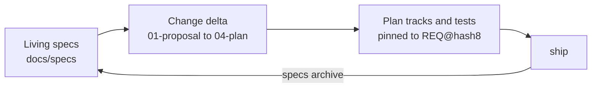

# Phát triển hướng đặc tả (layout SDD) { #spec-driven-development-sdd-layout }

Theo mặc định (`artifacts.layout: legacy`), mỗi thay đổi có một spec ghi ngày trong `.planning/specs/` và một plan trong `.planning/plans/`, và chúng nằm yên nơi được ghi. Layout SDD thay vào đó giữ các **living spec**: một spec cho mỗi capability luôn mô tả hành vi hiện tại, với các requirement được đánh số mà test và bead trỏ tới. Mỗi thay đổi đề xuất một delta cho các spec đó, và ship sẽ merge delta vào. Một dự án viết lại giữ hành vi của hệ thống cũ ra ngoài các spec đó; xem [living spec trong quá trình chuyển đổi](#living-specs-during-a-migration).

Setup đề xuất `artifacts.layout: sdd` cho dự án greenfield. Một repository có sẵn chuyển đổi bằng `/gin:migrate-specs`, lệnh này di chuyển các spec và plan trong `.planning` rồi đặt layout; `gin setup doctor` gợi ý nó khi có spec legacy.



## Layout { #layout }

```
docs/
  specs/                     living specs (artifacts.specs)
    README.md                capability index
    <capability>/spec.md     requirements for one capability
    <capability>/diagrams/   activity and state diagrams (Mermaid)
    <capability>/use-cases/  use cases (optional)
  changes/                   proposed changes (artifacts.changes)
    <epic>-<slug>/
      01-proposal.md         why and what
      02-spec-delta.md       ADDED / MODIFIED / REMOVED requirements
      03-design.md           how
      04-plan.md             the implementation plan
      05-tests.md            manual or QE cases only
    archive/                 shipped changes
  adr/NNNN-<slug>.md         architecture decisions (artifacts.adr)
```

Tiền tố số trong thư mục change là thứ tự đọc của nó. Một thư mục change được tạo trước khi có việc đánh số, đang mở hay đã archive, giữ các tên không đánh số (`proposal.md`, `spec-delta.md`), và mọi lệnh `specs` đều đọc chúng. Một plan được ghi vào thư mục như vậy về sau vẫn là `04-plan.md`.

## Requirement { #requirements }

Một requirement là một khối trong spec hoặc spec delta:

```markdown
### REQ-AUTH-003: Lock out after failed logins
WHEN a user fails to log in five times in ten minutes, the system SHALL lock the account for fifteen minutes.

#### Scenario: fifth failure locks
- GIVEN a user with four failed attempts
- WHEN the fifth attempt fails
- THEN the account is locked
```

- ID có dạng `REQ-<CAP>-<NNN>`; lấy ID trống kế tiếp bằng `gin specs next-id <cap>`, lệnh này quét cây làm việc, các worktree và các nhánh remote.
- Trong một [workspace](workspace.md), requirement và REQ-ID của chúng chỉ nằm trong spec của repository cha, còn các repository con chỉ tham chiếu tới chúng.
- `gin specs lint --against <base>` báo một id `ADDED` mà nhánh gốc đã dùng, và `gin specs renumber` sửa nó. Skill `sdd` chạy lệnh lint đó trước pull request của spec và khi ship.
- Mỗi khối có một câu `SHALL` hoặc `MUST` và ít nhất một scenario GIVEN/WHEN/THEN. Các mẫu EARS (`WHEN`, `WHILE`, `IF ... THEN`, `WHERE`) được ưu tiên.
- Một khối `MODIFIED` hoặc `REMOVED` đặt `<!-- base: <hash> -->` ở dòng sau heading của nó (`gin specs hash <REQ-ID>` in ra giá trị này), để archive biết living block có thay đổi kể từ lúc delta được viết hay không. Một khối `REMOVED` còn cần `Reason: <why>`.
- `gin specs template <name>` in các template (`spec.md`, `spec-delta.md`, `proposal.md`, `design.md`, `tests.md`, `adr.md`, `iteration.md`, `activity.md`, `state.md`, `use-case.md`, `specs-README.md`).

## Hình ảnh và mockup { #images-and-mockups }

Requirements của một feature, kể cả UI của nó, nằm trong capability của feature đó (`reports`, không phải `ui`). Capability `ui` chỉ giữ những gì dùng chung cho nhiều trang: design system, layout, navigation, component dùng chung. Project muốn quy tắc khác thì ghi vào `docs/specs/README.md`, và discuss theo README.

Giữ screenshot và mockup của một capability trong `docs/specs/<capability>/assets/`, mỗi đợt đầu vào một thư mục theo ngày, với tên file nói rõ màn hình và trạng thái:

```text
docs/specs/reports/assets/
  2026-05-11/          # requirements đầu tiên
    description.md     # Kind: new
    report-list.png
    mockup/
  2026-12-01/          # thay đổi của khách
    description.md     # Kind: change, Previous: assets/2026-05-11/
    report-filter.png
```

Đặt tên thư mục theo ngày ISO nhận đầu vào. Theo quy ước, một đợt requirements, thay đổi hay thiết kế mới thì vào một thư mục mới và thư mục cũ không bao giờ bị sửa, nên các thư mục ghi lại lịch sử đầu vào của capability. Với project legacy không có design spec, thêm screenshot của feature hiện có bằng `--legacy`, lệnh này đặt chúng trong `<date>/legacy/`, và mô tả hành vi hiện tại của nó trong `description.md` của thư mục đó với `Kind: legacy`.

`gin specs assets add <capability> <files> [--date D]` chép các file, từ bất kỳ đâu trên đĩa, vào thư mục có tên ngày và ghi `description.md` với `Kind:`, `Previous:` và `Confirmed: no` khi chưa có. `gin specs assets confirm <capability> --date D` đặt `Confirmed:` thành hôm nay. Cả hai thoát với mã 2 khi từ chối; xem [tham chiếu CLI](../reference/cli.md#gin-specs).

`specs lint` báo thư mục có tên ngày mà thiếu `description.md`, giá trị `Confirmed:` không phải `no` cũng không phải ngày, và mọi thay đổi trong thư mục đã xác nhận trên nhánh gốc. Nhánh gốc là `--against <ref>`, nếu không thì merge-base với `main` hoặc `master`; không có thì lint cảnh báo và bỏ qua kiểm tra này. Thư mục xác nhận trên nhánh hiện tại chỉ được kiểm tra sau khi nó vào nhánh gốc, và `assets add` từ chối nó trước đó. File phẳng trong `assets/` và thư mục không mang tên ngày ISO vẫn hợp lệ và không bị kiểm tra.

Thư mục đã xác nhận không có branch riêng. `/gin:discuss` commit nó cùng change folder trích dẫn nó, trên `spec/<epic>-<slug>`, để những người duyệt spec duyệt nó cùng spec ([pull request](git-flow.md#pull-requests)). Thư mục đã xác nhận mà không change nào trích dẫn thì không được commit.

Mỗi `description.md` có một dòng `Confirmed:`. Dòng này là `no` cho tới khi BA xác nhận đầu vào, sau đó là ngày ISO của lần xác nhận đó, và thư mục đã xác nhận không bao giờ bị sửa. Trong discuss, agent đọc `description.md` và `mockup/index.html` (nếu có) của từng thư mục có tên ngày của các capability bị ảnh hưởng, chỉ trích dẫn thư mục đã xác nhận, và hỏi về các thư mục còn lại. Một requirement lấy từ đầu vào thêm dòng `Source:` sau câu statement:

```markdown
### REQ-REPORTS-004: Filter reports by date
The system SHALL show only the reports created in the selected date range.
Source: `assets/2026-05-11/mockup/index.html#report-list`, `assets/2026-05-11/description.md`
```

`specs archive` sao chép dòng này vào `spec.md` cùng phần còn lại của khối, và `specs export` in nó ra. [Hướng dẫn cho BA](ba.md) viết mockup và mô tả hệ thống cũ theo đúng dạng này.

`specs archive` sao chép văn bản của từng khối requirement vào `docs/specs/<capability>/spec.md`, nên hãy viết đường dẫn ảnh tương đối so với file đó (`assets/2026-05-11/report-list.png`). Trong `02-spec-delta.md` của thư mục change, các liên kết đó không resolve được cho tới khi change ship.

## Sơ đồ { #diagrams }

Mỗi feature có một activity diagram. Một entity có từ ba trạng thái trở lên, hoặc có chuyển trạng thái chỉ được phép khi thỏa một điều kiện (một role, một giá trị field, một giới hạn thời gian), có thêm state diagram. Cả hai là file Mermaid trong thư mục của capability:

```text
docs/specs/orders/
  spec.md                  ## Diagrams links the files below
  diagrams/
    checkout-activity.md   flowchart: one feature, from the trigger to each outcome
    order-state.md         stateDiagram-v2: one entity's states and transitions
```

Bắt đầu từ `gin specs template activity.md` và `state.md`. Discuss sửa chúng trực tiếp trên spec branch, như với asset: chúng không phải requirement block và không bao giờ đi qua `02-spec-delta.md`. `03-design.md` của change trích dẫn chúng trong `## Data Flow` và `01-proposal.md` liệt kê chúng trong `## Capabilities Affected`, nên chúng được commit và review cùng change. `specs archive` để nguyên chúng; khi tạo `spec.md` cho một capability mới, nó link mọi file trong `diagrams/` dưới `## Diagrams`.

`specs lint` báo `*-activity.md` không có khối mermaid bắt đầu bằng `flowchart` hoặc `graph`, và `*-state.md` không có khối bắt đầu bằng `stateDiagram`; các file khác trong `diagrams/` không bị kiểm tra. `specs lint --change` còn báo mỗi capability có block `ADDED` hoặc `MODIFIED` mà không có `*-activity.md`. Khi nào một entity cần state diagram là quy ước mà lint không kiểm tra.

## Use case { #use-cases }

Một use case mô tả tương tác của một actor với hệ thống, từng bước. Nó là tùy chọn: thêm khi một feature có actor tương tác với hệ thống, hoặc khi người dùng yêu cầu. Mỗi use case là một file Markdown trong thư mục của capability, bắt đầu từ `gin specs template use-case.md`:

```text
docs/specs/orders/
  spec.md                  ## Use Cases links the files below
  use-cases/
    place-order.md         actor, goal, main flow, alternative flows
```

Dòng `Requirements:` của nó nêu các REQ-ID mà nó bao phủ. Discuss sửa use case trực tiếp trên spec branch, như với sơ đồ: chúng không phải requirement block và không bao giờ đi qua `02-spec-delta.md`. `01-proposal.md` liệt kê chúng trong `## Capabilities Affected`. `specs archive` để nguyên chúng; khi tạo `spec.md` cho một capability mới, nó link mọi file trong `use-cases/` dưới `## Use Cases`.

`specs lint` và `specs lint --change` kiểm tra mỗi file trong `use-cases/` có tiêu đề `# `, dòng `Actor:`, dòng `Requirements:` với ít nhất một REQ-ID, và `## Main flow` có danh sách đánh số. Mỗi REQ-ID phải có trong một living spec, hoặc là `ADDED` hay `MODIFIED` trong `02-spec-delta.md` của một change đang mở (REQ chỉ `REMOVED` ở đó vẫn bị báo); nếu không, lint báo `<REQ> is not in a living spec or an open change`.

## Xuất SRS { #exporting-an-srs }

`gin specs export <capability>` ghi living spec của capability vào một file HTML, `srs-<capability>.html` ở gốc repository. `specs export --all` ghi mọi capability vào `srs.html`, mỗi capability một chương, sắp theo tên. `--out <file>` ghi ra chỗ khác trong repository. File là file sinh ra, nên mỗi lần chạy sẽ ghi đè nó.

Mỗi chương gồm `## Purpose` của capability, các use case, các sơ đồ, các requirement block cùng scenario, và các asset: từng thư mục theo ngày, cũ nhất trước (`description.md` của nó, rồi các ảnh và tên file nó chưa hiển thị), rồi các file phẳng. Ảnh được nhúng vào file, nên có thể gửi riêng file đó. Mở file trong trình duyệt và in ra PDF; mỗi chương bắt đầu ở một trang mới.

File tải Mermaid từ jsDelivr ở một phiên bản cố định để vẽ sơ đồ; khi không có mạng, nó hiển thị mã nguồn của sơ đồ. Lệnh xuất không lint, nên hãy chạy `specs lint` trước. Một ảnh local không tìm thấy, nằm ngoài repository, hoặc không phải ảnh hiển thị bằng alt text, và lệnh thoát với mã 1 kèm tên ảnh đó. Trang bìa, logo, khách hàng, và thứ tự các phần lấy từ template `srs.html` và `srs-capability.html`; xem [Template xuất SRS](customizing-templates.md#srs-export-templates).

## Giải thích một capability { #explaining-a-capability }

`/gin:explain <capability>` viết một trang tương tác về một capability. Agent đọc spec, sơ đồ, và các thư mục theo ngày của nó, viết một đoạn tóm tắt ngắn có trích REQ-ID, rồi chạy `gin specs explain <capability> --narrative <file>`. Trang là `<explain>/<capability>/<capability>.html`, với `<explain>` là `artifacts.explain` (mặc định `.agent-workflow/runtime/explain`); `gin setup` bỏ qua thư mục mặc định đó, nên trang không bao giờ được commit, và mỗi lần chạy sẽ ghi đè nó. `/gin:explain <capability> --legacy` thay vào đó ghi một trang cho mỗi ứng dụng frozen của workspace, từ mã của ứng dụng đó. Chạy riêng lệnh để có trang mà không có đoạn tóm tắt.

Trang có một tab cho mỗi phần có nội dung:

- Overview: đoạn tóm tắt, rồi `## Purpose`.
- Requirements: mỗi requirement block một thẻ, nhóm theo section, có ô tìm kiếm theo nội dung và REQ-ID.
- Stories: user story của mọi change đang mở và đã archive có dòng `REQ:` nêu một REQ-ID của capability, ghi kèm tên thư mục change.
- Diagrams: từng file trong `diagrams/`.
- Mockups and images: từng thư mục theo ngày, cũ nhất trước, với `description.md`, các ảnh (bấm để phóng to), và mỗi `mockup/index.html` chạy trong một khung sandbox có ô chọn màn hình.

Một đường dẫn `Source:` dưới `assets/<date>/` trên requirement mở file đó trên trang. Đường dẫn có `#<screen-id>` còn mở đúng màn hình đó của mockup, và ô chọn màn hình đổi theo. Việc này cần mockup đổi màn hình theo thay đổi của URL hash; các link `#screen` của chính mockup cũng chạy trong khung.

`gin specs explain <change>` làm tương tự cho một change đang mở, gọi theo tên như `--change` nhận. Phần overview hiển thị `## Why` và `## What Changes` của proposal, và các requirement được nhóm dưới ADDED, MODIFIED, và REMOVED. Phần sơ đồ bắt đầu bằng `03-design.md`, và chỉ hiển thị các thư mục theo ngày mà dòng `Source:` của nó trích. Change đã archive thì không tìm thấy; hãy giải thích capability của nó.

Giống SRS, trang là một file có ảnh nhúng sẵn, và tải Mermaid từ jsDelivr ở một phiên bản cố định. Ảnh hoặc mockup không nhúng được sẽ được liệt kê, và lệnh thoát với mã 1. Bố cục lấy từ template `explain.html`; xem [Template trang explain](customizing-templates.md#explain-page-template).

## Các stage thay đổi thế nào { #how-the-stages-change }

Mọi lời gọi `state` và `record` cho change đều truyền `--workflow-id <epic>`. Skill `sdd` chứa các bước chính xác.

| Stage | Với layout SDD |
|---|---|
| `discuss` | Tạo epic, sau khi bạn xác nhận bảng capability (capability, nhóm requirement, đường dẫn asset) trong design, rồi `specs new <slug> --epic <epic>` tạo thư mục change. Ghi `01-proposal.md`, `02-spec-delta.md`, `03-design.md`, các sơ đồ của capability (và một ADR cho quyết định kiến trúc). `specs lint --change <epic>` phải pass. |
| spec review | `artifacts.spec_review: chat` ghi `requirement-confirmed` khi bạn xác nhận trong chat. `pr` commit thư mục change và các file nó trích dẫn lên `spec/<epic>-<slug>`, mở một pull request, và chỉ ghi gate sau khi `specs status --change <epic>` báo nó đã merge. |
| `plan` | Ghi `<change>/04-plan.md`; mỗi track liệt kê `Requirements: REQ-...`, và mọi requirement được thêm hoặc sửa đều thuộc về một track. |
| `orchestrate` | Tái sử dụng epic; mỗi track bead nhận `--spec-id <epic>-<slug>` và các label `req:<REQ-ID>`. |
| `execute` / review | Test mới hoặc đã đổi mang REQ-ID trong tên test hoặc trong một comment; reviewer kiểm tra mỗi scenario đều có test. |
| `ship` | `specs archive --change <epic>` merge delta vào các living spec và chuyển thư mục sang `changes/archive/`. Xung đột sẽ dừng ship. Archive vào cùng lúc với tích hợp, và theo quy ước của nhóm, BA review phần diff của living spec ([pull request](git-flow.md#pull-requests)). |
| `quick` | Không bao giờ tạo thư mục change; thay đổi hành vi mà một requirement mô tả cần vòng đời đầy đủ. |

## Loại epic { #epic-kinds }

Các [loại epic](../concepts/lifecycle.md#epic-kinds) thay đổi change folder như sau. `01-proposal.md` mang `Epic: <id>` và một dòng `Kind:`, và label `kind:` của epic bead phải khớp với nó.

- Một thay đổi `capability` như đã mô tả ở trên.
- Một thay đổi `technical` viết `03-design.md` và không cần user story, use case hay activity diagram. `02-spec-delta.md` của nó có thể vắng hoặc rỗng: `specs lint --change` vẫn qua, `specs trace` không có gì để trace, và `specs archive` chuyển folder sang `changes/archive/` mà không gộp requirement. Mọi khối `ADDED`, `MODIFIED` hoặc `REMOVED` nó có vẫn được kiểm tra như thường.
- Một thay đổi `parity` thêm dòng `Parity with:` vào `01-proposal.md`, gọi tên các folder asset `Kind: legacy` đã xác nhận dưới dạng path trong backtick, tính từ gốc repository. Lint từ chối folder không tồn tại, không phải `Kind: legacy`, hoặc chưa xác nhận. Khối requirement chỉ viết cho phần khác biệt so với hành vi đó.

## Living spec trong quá trình chuyển đổi { #living-specs-during-a-migration }

Khi viết lại hệ thống, các living spec mô tả hệ thống mới đã ship. Hành vi của hệ thống cũ nằm trong các thư mục asset `Kind: legacy`, do `/gin-ba:capture` hoặc `gin specs assets add --legacy` ghi. Một requirement lấy từ hành vi đó nêu tên thư mục trong dòng `Source:`. Một dự án không viết lại thì gieo living spec từ hành vi hiện tại, như [Chuyển đổi](#migrating) mô tả.

## Thay đổi requirement sau khi plan được duyệt { #changing-a-requirement-after-plan-approval }

Không bao giờ sửa change folder đã duyệt. Hãy viết một change folder mới có khối `MODIFIED` hoặc `REMOVED` mà `<!-- base: <hash> -->` lấy từ `gin specs hash <REQ-ID>`. Điều này đúng dù requirement đã ship hay một change đang mở khác vẫn còn thêm nó. Với requirement chưa ship, hash lấy từ khối `ADDED` của change đó; với đầu ra dạng text, lệnh in một ghi chú ra stderr; với đầu ra JSON, khóa `change` nêu tên change đó.

Với khối `MODIFIED` hoặc `REMOVED`, `gin specs lint` báo `<REQ> is not in the living spec or an open change` khi cả hai đều không có id, và `<REQ> is added by <a> and <b>; renumber one` khi hai change đang mở cùng thêm nó. `gin specs archive` của change mới dừng với `<REQ> is added by <change>; archive <change> first` cho tới khi change kia được archive. Với [add-on QA](qa.md), `gin-qa cases plan` cho biết test case nào đã lỗi thời.

## Chuyển đổi { #migrating }

`/gin:migrate-specs` chạy `gin specs migrate --dry-run`, hiển thị các thao tác di chuyển, và khi được duyệt thì chuyển đổi trên branch `chore/migrate-specs`. Thay đổi chưa commit luôn làm nó dừng; một workflow đã duyệt nhưng chưa ship hoặc một worktree đang mở cũng làm nó dừng trừ khi bạn chấp nhận `--force`. Sau đó nó có thể gieo các living spec từng capability một, chỉ mô tả hành vi hiện tại, dùng đầu ra `tech-doc` khi `docs/codebase` còn trống.

## Lệnh { #commands }

Xem [`gin specs`](../reference/cli.md#gin-specs) cho mọi lệnh và exit code của chúng. [Add-on QA](qa.md) dựng test case từ cùng các REQ-ID này.
