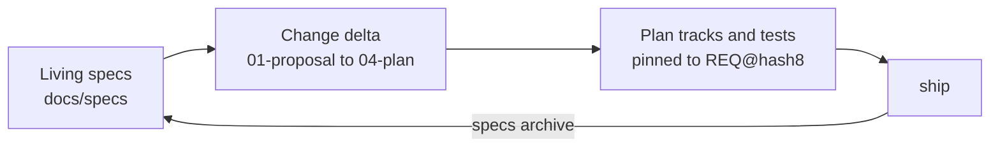

# Phát triển hướng đặc tả (layout SDD) { #spec-driven-development-sdd-layout }

Theo mặc định (`artifacts.layout: legacy`), mỗi thay đổi có một spec ghi ngày trong `.planning/specs/` và một plan trong `.planning/plans/`, và chúng nằm yên nơi được ghi. Layout SDD thay vào đó giữ các **living spec**: một spec cho mỗi capability luôn mô tả hành vi hiện tại, với các requirement được đánh số mà test và bead trỏ tới. Mỗi thay đổi đề xuất một delta cho các spec đó, và ship sẽ merge delta vào.

Setup đề xuất `artifacts.layout: sdd` cho dự án greenfield. Một repository có sẵn chuyển đổi bằng `/gin-workflow:migrate-specs`, lệnh này di chuyển các spec và plan trong `.planning` rồi đặt layout; `gin-workflow setup doctor` gợi ý nó khi có spec legacy.



## Layout { #layout }

```
docs/
  specs/                     living specs (artifacts.specs)
    README.md                capability index
    <capability>/spec.md     requirements for one capability
  changes/                   proposed changes (artifacts.changes)
    <epic>-<slug>/
      01-proposal.md         why and what
      02-spec-delta.md       ADDED / MODIFIED / REMOVED requirements
      03-design.md           how
      04-plan.md             the implementation plan
      05-tests.md            manual or QE cases only
    archive/                 shipped changes
  adr/NNNN-<slug>.md         architecture decisions (artifacts.adr)
```

Tiền tố số trong thư mục change là thứ tự đọc của nó. Một thư mục change được tạo trước khi có việc đánh số, đang mở hay đã archive, giữ các tên không đánh số (`proposal.md`, `spec-delta.md`), và mọi lệnh `specs` đều đọc chúng. Một plan được ghi vào thư mục như vậy về sau vẫn là `04-plan.md`.

## Requirement { #requirements }

Một requirement là một khối trong spec hoặc spec delta:

```markdown
### REQ-AUTH-003: Lock out after failed logins
WHEN a user fails to log in five times in ten minutes, the system SHALL lock the account for fifteen minutes.

#### Scenario: fifth failure locks
- GIVEN a user with four failed attempts
- WHEN the fifth attempt fails
- THEN the account is locked
```

- ID có dạng `REQ-<CAP>-<NNN>`; lấy ID trống kế tiếp bằng `gin-workflow specs next-id <cap>`.
- Mỗi khối có một câu `SHALL` hoặc `MUST` và ít nhất một scenario GIVEN/WHEN/THEN. Các mẫu EARS (`WHEN`, `WHILE`, `IF ... THEN`, `WHERE`) được ưu tiên.
- Một khối `MODIFIED` hoặc `REMOVED` đặt `<!-- base: <hash> -->` ở dòng sau heading của nó (`gin-workflow specs hash <REQ-ID>` in ra giá trị này), để archive biết living block có thay đổi kể từ lúc delta được viết hay không. Một khối `REMOVED` còn cần `Reason: <why>`.
- `gin-workflow specs template <name>` in các template (`spec.md`, `spec-delta.md`, `proposal.md`, `design.md`, `tests.md`, `adr.md`, `iteration.md`, `specs-README.md`).

## Hình ảnh và mockup { #images-and-mockups }

Requirements của một feature, kể cả UI của nó, nằm trong capability của feature đó (`reports`, không phải `ui`). Capability `ui` chỉ giữ những gì dùng chung cho nhiều trang: design system, layout, navigation, component dùng chung. Project muốn quy tắc khác thì ghi vào `docs/specs/README.md`, và discuss theo README.

Giữ screenshot, mockup và sơ đồ của một capability trong `docs/specs/<capability>/assets/`, mỗi đợt đầu vào một thư mục theo ngày, với tên file nói rõ màn hình và trạng thái:

```text
docs/specs/reports/assets/
  2026-05-11/          # requirements đầu tiên
    description.md     # Kind: new
    report-list.png
    mockup/
  2026-12-01/          # thay đổi của khách
    description.md     # Kind: change, Previous: assets/2026-05-11/
    report-filter.png
```

Đặt tên thư mục theo ngày ISO nhận đầu vào. Theo quy ước, một đợt requirements, thay đổi hay thiết kế mới thì vào một thư mục mới và thư mục cũ không bao giờ bị sửa, nên các thư mục ghi lại lịch sử đầu vào của capability. Với project legacy không có design spec, đặt screenshot của feature hiện có trong `<date>/legacy/` và mô tả hành vi hiện tại của nó trong `description.md` của thư mục đó với `Kind: legacy`. Mọi `description.md` bắt đầu từ `gin-workflow specs template iteration.md`. `specs lint` báo thư mục có tên ngày mà thiếu `description.md`; file phẳng trong `assets/` và thư mục không mang tên ngày ISO vẫn hợp lệ và không bị kiểm tra.

`specs archive` sao chép văn bản của từng khối requirement vào `docs/specs/<capability>/spec.md`, nên hãy viết đường dẫn ảnh tương đối so với file đó (`assets/2026-05-11/report-list.png`). Trong `02-spec-delta.md` của thư mục change, các liên kết đó không resolve được cho tới khi change ship.

## Các stage thay đổi thế nào { #how-the-stages-change }

Mọi lời gọi `state` và `record` cho change đều truyền `--workflow-id <epic>`. Skill `gin-sdd` chứa các bước chính xác.

| Stage | Với layout SDD |
|---|---|
| `discuss` | Tạo epic, sau khi bạn xác nhận bảng capability (capability, nhóm requirement, đường dẫn asset) trong design, rồi `specs new <slug> --epic <epic>` tạo thư mục change. Ghi `01-proposal.md`, `02-spec-delta.md`, `03-design.md` (và một ADR cho quyết định kiến trúc). `specs lint --change <epic>` phải pass. |
| spec review | `artifacts.spec_review: chat` ghi `requirement-confirmed` khi bạn xác nhận trong chat. `pr` commit thư mục change và các file nó trích dẫn lên `spec/<epic>-<slug>`, mở một pull request, và chỉ ghi gate sau khi `specs status --change <epic>` báo nó đã merge. |
| `plan` | Ghi `<change>/04-plan.md`; mỗi track liệt kê `Requirements: REQ-...`, và mọi requirement được thêm hoặc sửa đều thuộc về một track. |
| `orchestrate` | Tái sử dụng epic; mỗi track bead nhận `--spec-id <epic>-<slug>` và các label `req:<REQ-ID>`. |
| `execute` / review | Test mới hoặc đã đổi mang REQ-ID trong tên test hoặc trong một comment; reviewer kiểm tra mỗi scenario đều có test. |
| `ship` | `specs archive --change <epic>` merge delta vào các living spec và chuyển thư mục sang `changes/archive/`. Xung đột sẽ dừng ship. |
| `quick` | Không bao giờ tạo thư mục change; thay đổi hành vi mà một requirement mô tả cần vòng đời đầy đủ. |

## Chuyển đổi { #migrating }

`/gin-workflow:migrate-specs` chạy `gin-workflow specs migrate --dry-run`, hiển thị các thao tác di chuyển, và khi được duyệt thì chuyển đổi trên branch `chore/migrate-specs`. Thay đổi chưa commit luôn làm nó dừng; một workflow đã duyệt nhưng chưa ship hoặc một worktree đang mở cũng làm nó dừng trừ khi bạn chấp nhận `--force`. Sau đó nó có thể gieo các living spec từng capability một, chỉ mô tả hành vi hiện tại, dùng đầu ra `tech-doc` khi `docs/codebase` còn trống.

## Lệnh { #commands }

Xem [`gin-workflow specs`](../reference/cli.md#gin-workflow-specs) cho mọi lệnh và exit code của chúng. [Add-on QA](qa.md) dựng test case từ cùng các REQ-ID này.
