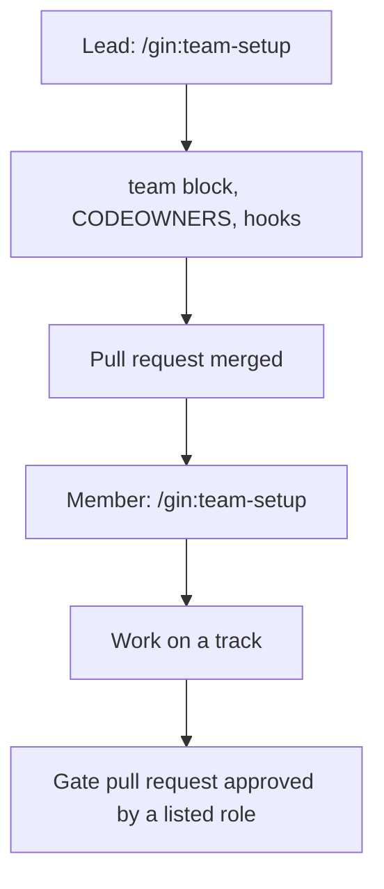

# Team mode

Solo use needs nothing here: without a `team:` section in `.agent-workflow/config.yaml`, every stage behaves as described in [Lifecycle](../concepts/lifecycle.md). Team mode is opt-in. It adds member identity, gates proven by approved pull requests (GitHub) or merge requests (GitLab), areas with owners, per-member claims, and optionally a shared Beads database. For how a PM, a BA, developers, and testers split the work, see [Team roles](../roles.md).



## Enable it (lead)

Run `/team-setup` and answer as the lead. It asks for:

- the host (`github` or `gitlab`) and the commit convention (`conventional` or `none`);
- members: git email, roles, and host login for each person;
- areas: a name, path globs (including the area's tests), the `lead` role, and optionally the `roles` allowed to own tracks;
- approvals: which roles approve `requirement_confirmed`, `ship`, and the `/roadmap` pull request (`roadmap`), and `area_lead` or roles for `plan_approved` (`[]` for none);
- optionally shared Beads: a separate repository used as `team.beads_sync.remote`.

It writes the `team:` block with `gin setup configure`, then runs `gin team init` to generate CODEOWNERS, the pull request template, the commit-msg hook, and with `--ci` a CI workflow that checks commit messages against the convention and, when the repository variable `GIN_WORKFLOW_INSTALL` holds an install command, runs `team codeowners --check` and (SDD layout) `specs lint`. Commit those on a branch. On the host, protect the base branch: require a pull request with an approval and code-owner review.

```yaml
team:
  host: github
  commit_convention: conventional
  members:
    an@example.com: {roles: [ba], login: an-ba}
    lan@example.com: {roles: [pm], login: lan-pm}
    binh@example.com: {roles: [be_lead, be_dev], login: binh-dev}
  areas:
    backend: {paths: ["services/**"], lead: be_lead, roles: [be_dev]}
  approvals:
    requirement_confirmed: [ba, be_lead]
    plan_approved: area_lead
    ship: [qe]
    roadmap: [pm]
```

## Join it (member)

Install the [prerequisites](../getting-started.md#prerequisites) first, and do not run `/gin:setup`: the lead has already configured the repository.

Run `/team-setup` as a member: `gin team whoami` must find your `git config user.email`; `gin team hooks` installs the commit-msg hook; log in with `gh auth login` or `glab auth login`; with shared Beads, `bd init --remote <remote>`. `gin setup doctor` reports anything still missing.

## What changes in each stage

The `team` skill carries the exact steps.

| Stage | In team mode |
|---|---|
| gates | `record` and `unblock` take the actor from your git email. A gate with roles in `team.approvals` takes `--evidence <PR url>`: `record` checks the pull request is merged (open is enough for `ship`) and approved by a member with a listed role who is not its author. The pull request must belong to this repository and change the gate's artifact (`--plan`/`--spec` pick one when it changes several); the plan gate also runs `check-plan`. A rejection lists the missing approvals; it is never worked around with other evidence or a waiver. |
| `discuss` | When `requirement_confirmed` has roles, the spec goes through a pull request (`spec/<topic>`, or the SDD `pr` flow) and the gate is recorded after it merges. A member with no technical role (no area `lead` and no role in an area's `roles`; `gin team whoami` shows `technical: no`) gets business questions only: the `team` skill has `discuss` write each technical point as `- TQ-<n>: <question>` under the design doc's `## Open Technical Questions`. |
| `plan` | Each track adds `Area:` and `Owner:` (optional only with shared Beads; reassigning a track means a new plan PR); a track's files stay inside its area. `team check-plan <plan>` must pass. With `plan_approved: area_lead`, the plan merges through a pull request approved by the area lead. `plan` first settles each open `TQ-<n>` with the member running it and writes `Decision:` under it. The plan pull request carries those lines and, with the SDD layout, the filled `03-design.md` sections. |
| `orchestrate` | Track beads get `track:<N>` and `area:<area>` labels and the owner as assignee. With shared Beads the lead orchestrates once; otherwise each member creates beads only for the tracks they own, and a dependency on someone else's track becomes an `external: <plan>#<N>` placeholder. |
| `execute` | `team deps` closes placeholders whose track has merged; pick work from `team ready`, claim it with `team claim <bead>` (a lease of `team.claim_ttl_hours`, renewed by claiming again; an expired lease lets another member take the bead; so does a bead assigned without a lease or with unreadable `claim` metadata), and in the track worktree `team deps --bead <bead>` must pass before implementation. The `team` skill names track branches `feat/<topic>-t<N>`; the pull request template's `Plan:` and `Tracks:` fields are read by other members' `team deps`. The [brownfield starter](../starters/brownfield.md#execute) shows claims, leases, and handing a track over. |
| `ship` | When `ship` has roles in `team.approvals`, only the pull request and keep options are offered, and that role approves the latest commit of the pull request before merge (`team check --gate ship <url>`); a later push needs a new approval. In team mode `record` also writes the gate's PR proof to the epic bead's `gates` metadata (see the [brownfield starter](../starters/brownfield.md#ship)). GitLab needs "Reset approvals on push". Merging follows the host's rules (CODEOWNERS, branch protection). With shared Beads, `team sync` after closing beads. The old key `verification_passed` is deprecated and maps to `ship`. |

Milestone writes follow `team.permissions.milestone`, and with shared Beads they pull first and push after. Details are in the [milestone command](../reference/cli.md#gin-milestone).

To hand a track over (a member runs out of quota or is away), push the track branch, then the current assignee or the area lead runs `gin team reassign <bead> <email>`. The new assignee must be allowed to own tracks in the bead's areas; the bead keeps its status, gets a note `reassigned <from> -> <to> by <you>`, and with shared Beads the change is pushed. The new owner checks out the pushed branch and continues. The plan's `Owner:` field is not changed, and the review ledger travels with the branch only if it was committed.

`gin team check --gate <gate> <url>` re-checks a teammate's gate without recording it.

A member's ship covers only their own tracks. The lead declares the feature complete once every track pull request has merged (the `team` skill's rule).

## Host settings

- GitHub: branch protection on the integration branch and CODEOWNERS per area (`team init`). Recommended: "Dismiss stale pull request approvals when new commits are pushed". The `ship` gate counts only approvals made on the latest commit either way.
- GitLab: "Reset approvals on push" (`reset_approvals_on_push`), required for `ship`; without it the gate rejects the approval.

## CI (optional)

`gin team init --ci` writes a CI job for the host. Commit it with the rest of `team init`'s files.

| Host | File | Runs on |
|---|---|---|
| GitHub Actions | `.github/workflows/gin-workflow.yml` (job `conventions`) | every pull request |
| GitLab CI | `.gitlab/ci/gin-workflow.yml` (job `gin-workflow-conventions`, stage `test`) | every merge request |

GitLab does not pick the file up by itself: add `include: { local: .gitlab/ci/gin-workflow.yml }` to the root `.gitlab-ci.yml`.

The job always checks commit messages against `team.commit_convention` (skipped for `none`). It also runs `gin team codeowners --check` and, with the SDD layout, `gin specs lint`, but only when the variable `GIN_WORKFLOW_INSTALL` holds a shell command that installs `gin` on the CI runner; without it those two checks are skipped and the job still passes.

- GitHub: Settings, Secrets and variables, Actions, tab **Variables** (a Variable, not a Secret).
- GitLab: Settings, CI/CD, Variables.
- Example value: `curl -sSL https://raw.githubusercontent.com/giangdhwhtbr/gin-workflow/master/remote-install.sh | bash -s -- --platform claude`.

## Commands

See [`gin team`](../reference/cli.md#gin-team) and the [`team` configuration keys](../reference/config.md#team).
