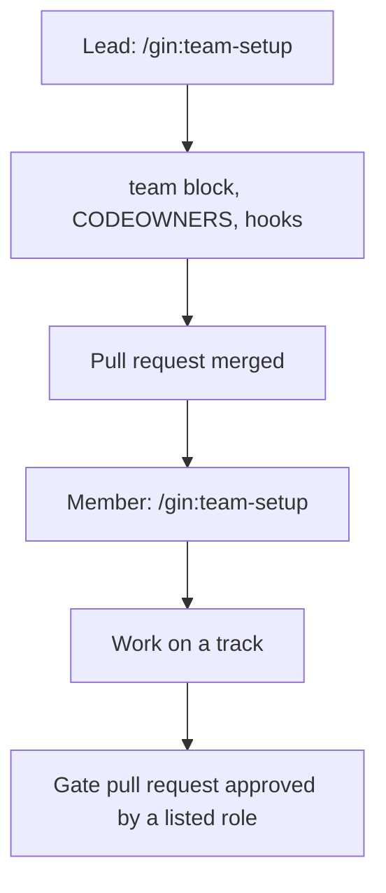

# Chế độ team { #team-mode }

Dùng một mình thì không cần gì ở đây: nếu không có mục `team:` trong `.agent-workflow/config.yaml`, mọi stage hoạt động như mô tả trong [Vòng đời](../concepts/lifecycle.md). Chế độ team là tùy chọn bật thêm. Nó thêm danh tính thành viên, các cổng được chứng minh bằng pull request (GitHub, Gitea, AWS CodeCommit) hoặc merge request (GitLab) đã được duyệt, các area có owner, claim theo từng thành viên, và tùy chọn một cơ sở dữ liệu Beads dùng chung. Về cách PM, BA, developer và tester chia việc, xem [Vai trò trong nhóm](../roles.md). Quy tắc về branch, pull request, review và merge nằm trong [thoả thuận git của team](git-flow.md).



## Bật chế độ team (lead) { #enable-it-lead }

Chạy `/team-setup` và trả lời với tư cách lead. Nó hỏi:

- host (`github`, `gitlab`, `gitea` hoặc `codecommit`) và commit convention (`conventional` hoặc `none`);
- thành viên: git email, các role, và host login của từng người (với `codecommit` thì hỏi `aws_identity` thay cho login);
- area: một tên, các path glob (gồm cả test của area), role `lead`, và tùy chọn các `roles` được phép sở hữu track;
- phê duyệt: role nào duyệt `requirement_confirmed`, `ship`, và pull request của `/roadmap` (`roadmap`), cùng `area_lead` hoặc các role cho `plan_approved` (`[]` nếu không có);
- tùy chọn Beads dùng chung: một repository riêng được dùng làm `team.beads_sync.remote`.

Nó ghi khối `team:` bằng `gin setup configure`, rồi chạy `gin team init` để sinh CODEOWNERS, template pull request, hook commit-msg, và với `--ci` là một CI workflow kiểm tra commit message theo convention và, khi biến repository `GIN_WORKFLOW_INSTALL` chứa một lệnh cài đặt, chạy `team codeowners --check` và (layout SDD) `specs lint`. Commit các file đó trên một branch. Trên host, hãy bảo vệ base branch: yêu cầu pull request có một phê duyệt và review của code owner.

```yaml
team:
  host: github
  commit_convention: conventional
  members:
    an@example.com: {roles: [ba], login: an-ba}
    lan@example.com: {roles: [pm], login: lan-pm}
    binh@example.com: {roles: [be_lead, be_dev], login: binh-dev}
  areas:
    backend: {paths: ["services/**"], lead: be_lead, roles: [be_dev]}
  approvals:
    requirement_confirmed: [ba, be_lead]
    plan_approved: area_lead
    ship: [qe]
    roadmap: [pm]
```

## Chính sách phê duyệt { #approval-policies }

Chính sách của một cổng có ba dạng. Danh sách role cần một thành viên giữ một role trong danh sách duyệt. `{all: [roles], any: [roles]}` cần mọi role `all` và một role `any`, và cần gin-workflow 3.1 trở lên. `plan_approved: area_lead` cần lead của từng area mà plan chạm tới. Riêng `requirement_confirmed` còn nhận [một map theo loại epic](#policy-per-epic-kind).

```yaml
  approvals:
    ship: {all: [qe], any: [be_lead, fe_lead]}
```

Không cổng nào do tác giả pull request duyệt. Khi tác giả là người giữ duy nhất của một role `all` và chính sách có role `any`, role `all` bị bỏ qua và `team check` in "<role> skipped: the author is its only holder"; role `any` vẫn phải duyệt. Không có role `any` thì check từ chối: "<role> has no holder other than the author; add a holder or an `any` role". Với `plan_approved: area_lead`, lead area duy nhất là tác giả bị bỏ qua khi lead của một area khác đã duyệt. `gin setup doctor` ghi chú mỗi role `all` và mỗi lead area chỉ có đúng một thành viên giữ.

Khi người giữ role vắng mặt, người dùng quyết định cho `requirement_confirmed` và `plan_approved`: một thành viên giữ role trong chính sách của cổng đó có thể chạy `gin unblock --gate <gate> --reason ...`. `ship` không thể waive: thêm người giữ thứ hai của role vào `team.members` rồi chạy lại check.

### Chính sách theo loại epic { #policy-per-epic-kind }

`requirement_confirmed` có thể giữ một chính sách cho mỗi [loại epic](../concepts/lifecycle.md#epic-kinds). Viết một map với khóa `capability` (bắt buộc) và tùy chọn `technical`, `parity`. Không khóa nào khác hợp lệ.

```yaml
  approvals:
    requirement_confirmed:
      capability: {all: [ba], any: [be_lead, fe_lead]}
      technical: [be_lead, fe_lead]
      parity: [ba]
```

Loại không có khóa dùng chính sách `capability`. Một chính sách đơn, như các ví dụ trên, áp dụng cho mọi loại. Dạng map cần gin-workflow 3.1 trở lên. gin cũ hơn từ chối config ở bước kiểm tra schema, nên hãy cập nhật cho mọi thành viên trước.

gin lấy loại từ label `kind:<kind>` của epic bead:

- `gin team check --gate requirement_confirmed <url> --workflow-id <epic>` áp dụng chính sách của loại epic đó, và JSON của nó có thêm `kind`.
- `gin record requirement-confirmed --workflow-id <epic>` chọn cùng chính sách đó.
- `gin unblock --gate requirement_confirmed` chấp nhận người giữ một role trong chính sách của loại đó. Khi gin không đọc được loại, nó dùng chính sách `capability`.

Spec đi qua pull request khi bất kỳ loại nào có chính sách. Với layout SDD, một thay đổi technical có thể không có `02-spec-delta.md`, nên `01-proposal.md` của pull request là artifact spec mà check tìm.

## Tham gia (member) { #join-it-member }

Cài [điều kiện tiên quyết](../getting-started.md#prerequisites) trước, và đừng chạy `/gin:setup`: lead đã cấu hình repository rồi.

Chạy `/team-setup` với tư cách member: `gin team whoami` phải tìm thấy `git config user.email` của bạn; `gin team hooks` cài hook commit-msg; đăng nhập bằng `gh auth login`, `glab auth login`, `gt auth login --host <instance URL>`, hoặc `aws configure` hoặc `aws sso login`, tùy host; với Beads dùng chung, chạy `bd init --remote <remote>`. `gin setup doctor` báo bất cứ thứ gì còn thiếu.

## Mỗi stage thay đổi gì { #what-changes-in-each-stage }

Skill `team` chứa các bước chính xác.

| Stage | Trong chế độ team |
|---|---|
| gates | `record` và `unblock` lấy actor từ git email của bạn. Một gate có role trong `team.approvals` nhận `--evidence <PR url>`: `record` kiểm tra pull request đã merge (với `ship` thì đang mở là đủ) và được duyệt bởi một thành viên có role nằm trong danh sách và không phải tác giả của nó. Pull request phải thuộc repository này và thay đổi artifact của gate (`--plan`/`--spec` chọn một khi nó thay đổi nhiều artifact); gate plan còn chạy `check-plan`. Một lần bị từ chối sẽ liệt kê các phê duyệt còn thiếu; không bao giờ lách bằng bằng chứng khác hay một waiver. |
| `discuss` | Khi `requirement_confirmed` có role, spec đi qua một pull request (`spec/<topic>`, hoặc flow `pr` của SDD) và gate được ghi sau khi nó merge. Thành viên không có vai trò kỹ thuật khi không là `lead` của area nào và không có role trong `roles` của area nào; khi đó `gin team whoami` hiện `technical: no`. Thành viên đó chỉ được hỏi câu hỏi nghiệp vụ, và skill `team` bảo `discuss` ghi mỗi điểm kỹ thuật thành `- TQ-<n>: <question>` dưới `## Open Technical Questions` của tài liệu thiết kế. |
| `plan` | Mỗi track thêm `Area:` và `Owner:` (chỉ là tùy chọn khi dùng Beads dùng chung; gán lại một track nghĩa là một plan PR mới); file của một track nằm trong area của nó. `team check-plan <plan>` phải pass. Với `plan_approved: area_lead`, plan được merge qua một pull request do area lead duyệt. Trước hết `plan` giải quyết từng `TQ-<n>` còn mở cùng thành viên đang chạy nó và ghi `Decision:` bên dưới. Pull request của plan mang các dòng đó và, với layout SDD, các phần đã điền của `03-design.md`. |
| `orchestrate` | Các track bead nhận label `track:<N>` và `area:<area>` và owner làm assignee. Với Beads dùng chung, lead orchestrate một lần; nếu không, mỗi thành viên chỉ tạo bead cho các track mình sở hữu, và dependency tới track của người khác trở thành một placeholder `external: <plan>#<N>`. |
| `execute` | `team deps` đóng các placeholder mà track của nó đã merge; chọn việc từ `team ready`, claim bằng `team claim <bead>` (một lease dài `team.claim_ttl_hours`, gia hạn bằng cách claim lại; lease hết hạn cho phép thành viên khác lấy bead; bead được gán mà không có lease hoặc với metadata `claim` không đọc được cũng vậy), và trong worktree của track, `team deps --bead <bead>` phải pass trước khi triển khai. Skill `team` đặt tên branch của track là `feat/<topic>-t<N>`; các trường `Plan:` và `Tracks:` của template pull request được `team deps` của các thành viên khác đọc. [Starter brownfield](../starters/brownfield.md#execute) minh họa claim, lease, và bàn giao một track. |
| `ship` | Khi `ship` có role trong `team.approvals`, chỉ các lựa chọn pull request và keep được đưa ra, và role đó duyệt commit mới nhất của pull request trước khi merge (`team check --gate ship <url>`); một lần push sau đó cần phê duyệt mới. Trong chế độ team, `record` còn ghi bằng chứng PR của gate vào metadata `gates` của epic bead (xem [starter brownfield](../starters/brownfield.md#ship)). GitLab cần "Reset approvals on push", Gitea cần "Dismiss stale approvals", còn CodeCommit gắn approval với revision (xem [Thiết lập trên host](#host-settings)). Việc merge theo luật của host (CODEOWNERS, branch protection). Với Beads dùng chung, chạy `team sync` sau khi đóng bead. Khóa cũ `verification_passed` đã deprecated và ánh xạ sang `ship`. |

Việc ghi milestone theo `team.permissions.milestone`, và với Beads dùng chung thì pull trước và push sau. Chi tiết nằm ở [lệnh milestone](../reference/cli.md#gin-milestone).

Để bàn giao một track (một thành viên hết quota hoặc vắng mặt), assignee hiện tại hoặc area lead chạy `gin team handoff <bead> <email>` từ main checkout. Lệnh từ chối khi worktree của track còn file chưa commit hoặc chưa track. Nếu không, lệnh push branch của track và review ref, ghi branch lên bead, và reassign với lease mới. `gin team handoff <bead> --release` trả bead về pool: bead mất assignee và lease, mở lại, và nhận label `released`. Mọi thành viên khi đó thấy nó trong `gin team ready` và có thể claim dù thuộc area nào. Owner mới chạy `gin team takeover <bead>` trong main checkout của clone của mình: lệnh fetch branch, checkout tại `.planning/worktrees/<bead>`, fetch review ref, và claim. Trường `Owner:` của plan không bị đổi.

`gin team check --gate <gate> <url>` kiểm tra lại gate của đồng đội mà không ghi nó.

Ship của một thành viên chỉ bao gồm các track của chính họ. Lead tuyên bố tính năng hoàn tất khi mọi pull request của track đã merge (quy tắc của skill `team`).

## Prep task { #prep-tasks }

Prep task (việc capture, mockup, spike và câu hỏi trước discuss; xem [vòng đời](../concepts/lifecycle.md#prep-tasks)) do `/gin:allocate` của lead tạo và cần `team.beads_sync`. Thiếu nó, chúng chỉ nằm trong cơ sở dữ liệu của lead và không thành viên nào thấy. Skill chạy `gin team sync` trước và sau khi ghi, và người được giao chạy lệnh này sau khi đóng task.

Một learning đăng dưới dạng comment `[gin learn]` chỉ đến các máy khác sau `gin team sync`: đăng trước, rồi sync.

`gin team ready` liệt kê prep task của thành viên cùng với việc sẵn sàng khác, theo thứ tự priority ([lệnh](../reference/cli.md#gin-team)).

## Thiết lập trên host { #host-settings }

Mỗi host cần một CLI đã đăng nhập và branch protection trên integration branch. Các lệnh login là `gh auth login`, `glab auth login`, `gt auth login --host <instance URL>`, và `aws configure` hoặc `aws sso login`. File `references/hosts.md` của skill `team` liệt kê chúng cùng lệnh mở pull request và các thiết lập của từng host. `gin setup doctor` báo CLI hoặc login còn thiếu cùng cách sửa.

- GitHub: branch protection trên integration branch và CODEOWNERS theo từng area (`team init`). Khuyến nghị: "Dismiss stale pull request approvals when new commits are pushed". Dù thế nào, gate `ship` chỉ tính các phê duyệt được thực hiện trên commit mới nhất.
- GitLab: "Reset approvals on push" (`reset_approvals_on_push`), bắt buộc với `ship`; không có nó, gate từ chối phê duyệt.

### Gitea { #gitea }

Đặt `team.host: gitea`. `team init` ghi `.gitea/CODEOWNERS` và `.gitea/PULL_REQUEST_TEMPLATE.md`. Bảo vệ integration branch bằng số approval bắt buộc và bật "Dismiss stale approvals". Dù thế nào, gate `ship` chỉ tính các phê duyệt trên head commit.

`gt` là CLI của Gitea và cần Gitea 28 trở lên. Đăng nhập một lần cho mỗi instance, và đưa cả subpath vào URL:

```bash
gt auth login --host https://example.com/gitea --oauth
gt auth login --host https://example.com/gitea --with-token < token.txt
```

Với instance nằm sau access proxy, `gt auth login` còn nhận `--header` và `--client-cert`. Certificate tự ký phải được hệ thống tin cậy, vì gin không truyền tùy chọn certificate nào cho `gt`.

`gin setup doctor` chạy các kiểm tra Gitea sau:

- `gt` trên `PATH` là CLI của Gitea. Graphite cũng đặt tên CLI là `gt`, và kiểm tra phân biệt hai CLI qua output của `gt --version`.
- `gt` đã đăng nhập vào instance của `origin`. Remote https cho biết instance. Với remote SSH, gin tìm instance đã đăng nhập có cùng tên host; nếu có nhiều kết quả, chỉ đăng nhập một instance hoặc dùng remote https.
- Instance chạy Gitea 28 trở lên.

Có hai giới hạn. gin nhận diện repository Gitea theo host, owner và tên repository, nên không chạy hai instance Gitea trên cùng một host với cùng path repository. `gin team deps` và `gin specs trace` quét 500 pull request mới nhất và tối đa 100 kết quả tìm kiếm.

### AWS CodeCommit { #aws-codecommit }

Đặt `team.host: codecommit`. CodeCommit không có file CODEOWNERS, template pull request hay CI workflow, nên `team init` chỉ ghi hook commit-msg, và `team init --ci` bị từ chối với exit 2: dùng CodeBuild hoặc CodePipeline cho CI.

Mỗi thành viên có approving role cần `aws_identity`, giá trị gin so khớp với người approve. Đó là tên IAM user, hoặc `<role>/<session>` với assumed role (`arn:aws:sts::<account>:assumed-role/Dev/alice` khớp với `Dev/alice`). gin so khớp cả role, nên một session tên `alice` dưới role khác không phải là alice. Ai được assume cùng role vẫn tự chọn được session name: dùng AWS SSO (session name do SSO đặt) hoặc điều kiện `sts:RoleSessionName` trong trust policy của role. Session name trần như `alice` không khớp assumed role nào, nên phải thêm role phía trước. `gin team check` báo lỗi khi người approve thiếu giá trị này.

```yaml
team:
  host: codecommit
  members:
    alice@example.com: {roles: [be_lead], aws_identity: Dev/alice}
```

gin gọi `aws` với môi trường hiện tại, nên cần credentials (`aws configure` hoặc `aws sso login`) và region. Region lấy từ remote `origin` (`codecommit::<region>://<repo>` hoặc dạng https `git-codecommit.<region>.amazonaws.com`), nếu không thì từ `AWS_REGION`, nếu không nữa thì từ `AWS_DEFAULT_REGION`. Khi remote là `codecommit://<profile>@<repo>`, đặt `AWS_PROFILE` thành profile đó, vì gin không đọc profile từ remote.

CodeCommit không áp dụng code owner. Tạo một approval rule template và gắn vào repository, để pull request cần đủ approval trước khi merge:

```bash
aws codecommit create-approval-rule-template \
  --approval-rule-template-name team-approvals \
  --approval-rule-template-content '{"Version":"2018-11-08","DestinationReferences":["refs/heads/main"],"Statements":[{"Type":"Approvers","NumberOfApprovalsNeeded":1,"ApprovalPoolMembers":["arn:aws:sts::<account>:assumed-role/Dev/*"]}]}'
aws codecommit associate-approval-rule-template-with-repository \
  --approval-rule-template-name team-approvals --repository-name <repo>
```

Approval thuộc về một revision của pull request. Gate `ship` chỉ tính approval của revision hiện tại có source commit trùng `HEAD` local.

## CI (tùy chọn) { #ci-optional }

`gin team init --ci` ghi một CI job cho host. Commit nó cùng các file khác của `team init`.

| Host | File | Chạy khi |
|---|---|---|
| GitHub Actions | `.github/workflows/gin-workflow.yml` (job `conventions`) | mọi pull request |
| GitLab CI | `.gitlab/ci/gin-workflow.yml` (job `gin-workflow-conventions`, stage `test`) | mọi merge request |
| Gitea Actions | `.gitea/workflows/gin-workflow.yml` (job `conventions`) | mọi pull request |

CodeCommit không có file CI. GitLab không tự nhận file này: thêm `include: { local: .gitlab/ci/gin-workflow.yml }` vào `.gitlab-ci.yml` ở gốc.

Job luôn kiểm tra commit message theo `team.commit_convention` (bỏ qua với `none`). Nó cũng chạy `gin team codeowners --check` và, với layout SDD, `gin specs lint`, nhưng chỉ khi biến `GIN_WORKFLOW_INSTALL` chứa một lệnh shell cài gin-workflow trên CI runner; nếu không có, hai kiểm tra đó bị bỏ qua và job vẫn pass.

- GitHub: Settings, Secrets and variables, Actions, tab **Variables** (là Variable, không phải Secret).
- GitLab: Settings, CI/CD, Variables.
- Gitea: Settings, Actions, Variables của repository.
- Giá trị ví dụ: `curl -sSL https://raw.githubusercontent.com/giangdhwhtbr/gin-workflow/master/remote-install.sh | bash -s -- --platform claude`.

## Lệnh { #commands }

Xem [`gin team`](../reference/cli.md#gin-team) và các [khóa cấu hình `team`](../reference/config.md#team).
