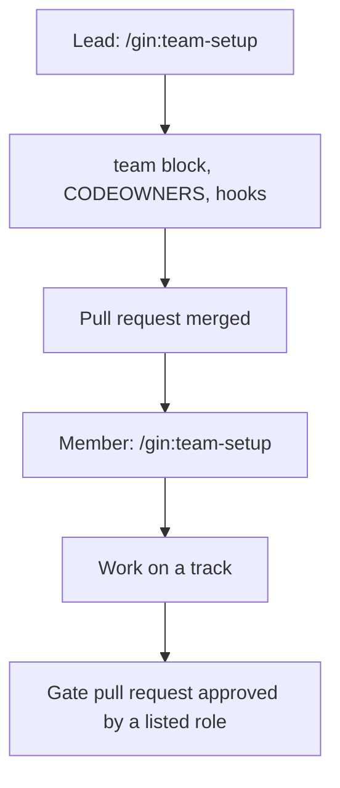

# Chế độ team { #team-mode }

Dùng một mình thì không cần gì ở đây: nếu không có mục `team:` trong `.agent-workflow/config.yaml`, mọi stage hoạt động như mô tả trong [Vòng đời](../concepts/lifecycle.md). Chế độ team là tùy chọn bật thêm. Nó thêm danh tính thành viên, các cổng được chứng minh bằng pull request (GitHub) hoặc merge request (GitLab) đã được duyệt, các area có owner, claim theo từng thành viên, và tùy chọn một cơ sở dữ liệu Beads dùng chung. Về cách PM, BA, developer và tester chia việc, xem [Vai trò trong nhóm](../roles.md).



## Bật chế độ team (lead) { #enable-it-lead }

Chạy `/team-setup` và trả lời với tư cách lead. Nó hỏi:

- host (`github` hoặc `gitlab`) và commit convention (`conventional` hoặc `none`);
- thành viên: git email, các role, và host login của từng người;
- area: một tên, các path glob (gồm cả test của area), role `lead`, và tùy chọn các `roles` được phép sở hữu track;
- phê duyệt: role nào duyệt `requirement_confirmed`, `ship`, và pull request của `/roadmap` (`roadmap`), cùng `area_lead` hoặc các role cho `plan_approved` (`[]` nếu không có);
- tùy chọn Beads dùng chung: một repository riêng được dùng làm `team.beads_sync.remote`.

Nó ghi khối `team:` bằng `gin setup configure`, rồi chạy `gin team init` để sinh CODEOWNERS, template pull request, hook commit-msg, và với `--ci` là một CI workflow kiểm tra commit message theo convention và, khi biến repository `GIN_WORKFLOW_INSTALL` chứa một lệnh cài đặt, chạy `team codeowners --check` và (layout SDD) `specs lint`. Commit các file đó trên một branch. Trên host, hãy bảo vệ base branch: yêu cầu pull request có một phê duyệt và review của code owner.

```yaml
team:
  host: github
  commit_convention: conventional
  members:
    an@example.com: {roles: [ba], login: an-ba}
    lan@example.com: {roles: [pm], login: lan-pm}
    binh@example.com: {roles: [be_lead, be_dev], login: binh-dev}
  areas:
    backend: {paths: ["services/**"], lead: be_lead, roles: [be_dev]}
  approvals:
    requirement_confirmed: [ba, be_lead]
    plan_approved: area_lead
    ship: [qe]
    roadmap: [pm]
```

## Tham gia (member) { #join-it-member }

Cài [điều kiện tiên quyết](../getting-started.md#prerequisites) trước, và đừng chạy `/gin:setup`: lead đã cấu hình repository rồi.

Chạy `/team-setup` với tư cách member: `gin team whoami` phải tìm thấy `git config user.email` của bạn; `gin team hooks` cài hook commit-msg; đăng nhập bằng `gh auth login` hoặc `glab auth login`; với Beads dùng chung, chạy `bd init --remote <remote>`. `gin setup doctor` báo bất cứ thứ gì còn thiếu.

## Mỗi stage thay đổi gì { #what-changes-in-each-stage }

Skill `team` chứa các bước chính xác.

| Stage | Trong chế độ team |
|---|---|
| gates | `record` và `unblock` lấy actor từ git email của bạn. Một gate có role trong `team.approvals` nhận `--evidence <PR url>`: `record` kiểm tra pull request đã merge (với `ship` thì đang mở là đủ) và được duyệt bởi một thành viên có role nằm trong danh sách và không phải tác giả của nó. Pull request phải thuộc repository này và thay đổi artifact của gate (`--plan`/`--spec` chọn một khi nó thay đổi nhiều artifact); gate plan còn chạy `check-plan`. Một lần bị từ chối sẽ liệt kê các phê duyệt còn thiếu; không bao giờ lách bằng bằng chứng khác hay một waiver. |
| `discuss` | Khi `requirement_confirmed` có role, spec đi qua một pull request (`spec/<topic>`, hoặc flow `pr` của SDD) và gate được ghi sau khi nó merge. Thành viên không có vai trò kỹ thuật (không là `lead` của area nào và không có role trong `roles` của area nào; `gin team whoami` hiện `technical: no`) chỉ được hỏi câu hỏi nghiệp vụ: skill `team` bảo `discuss` ghi mỗi điểm kỹ thuật thành `- TQ-<n>: <question>` dưới `## Open Technical Questions` của tài liệu thiết kế. |
| `plan` | Mỗi track thêm `Area:` và `Owner:` (chỉ là tùy chọn khi dùng Beads dùng chung; gán lại một track nghĩa là một plan PR mới); file của một track nằm trong area của nó. `team check-plan <plan>` phải pass. Với `plan_approved: area_lead`, plan được merge qua một pull request do area lead duyệt. Trước hết `plan` giải quyết từng `TQ-<n>` còn mở cùng thành viên đang chạy nó và ghi `Decision:` bên dưới. Pull request của plan mang các dòng đó và, với layout SDD, các phần đã điền của `03-design.md`. |
| `orchestrate` | Các track bead nhận label `track:<N>` và `area:<area>` và owner làm assignee. Với Beads dùng chung, lead orchestrate một lần; nếu không, mỗi thành viên chỉ tạo bead cho các track mình sở hữu, và dependency tới track của người khác trở thành một placeholder `external: <plan>#<N>`. |
| `execute` | `team deps` đóng các placeholder mà track của nó đã merge; chọn việc từ `team ready`, claim bằng `team claim <bead>` (một lease dài `team.claim_ttl_hours`, gia hạn bằng cách claim lại; lease hết hạn cho phép thành viên khác lấy bead; bead được gán mà không có lease hoặc với metadata `claim` không đọc được cũng vậy), và trong worktree của track, `team deps --bead <bead>` phải pass trước khi triển khai. Skill `team` đặt tên branch của track là `feat/<topic>-t<N>`; các trường `Plan:` và `Tracks:` của template pull request được `team deps` của các thành viên khác đọc. [Starter brownfield](../starters/brownfield.md#execute) minh họa claim, lease, và bàn giao một track. |
| `ship` | Khi `ship` có role trong `team.approvals`, chỉ các lựa chọn pull request và keep được đưa ra, và role đó duyệt commit mới nhất của pull request trước khi merge (`team check --gate ship <url>`); một lần push sau đó cần phê duyệt mới. Trong chế độ team, `record` còn ghi bằng chứng PR của gate vào metadata `gates` của epic bead (xem [starter brownfield](../starters/brownfield.md#ship)). GitLab cần "Reset approvals on push". Việc merge theo luật của host (CODEOWNERS, branch protection). Với Beads dùng chung, chạy `team sync` sau khi đóng bead. Khóa cũ `verification_passed` đã deprecated và ánh xạ sang `ship`. |

Việc ghi milestone theo `team.permissions.milestone`, và với Beads dùng chung thì pull trước và push sau. Chi tiết nằm ở [lệnh milestone](../reference/cli.md#gin-milestone).

Để bàn giao một track (một thành viên hết quota hoặc vắng mặt), push branch của track, rồi assignee hiện tại hoặc area lead chạy `gin team reassign <bead> <email>`. Assignee mới phải được phép sở hữu track trong các area của bead; bead giữ nguyên trạng thái, nhận một ghi chú `reassigned <from> -> <to> by <you>`, và với Beads dùng chung thì thay đổi được push. Owner mới checkout branch đã push và tiếp tục. Trường `Owner:` của plan không bị đổi, và review ledger chỉ đi theo branch nếu nó đã được commit.

`gin team check --gate <gate> <url>` kiểm tra lại gate của đồng đội mà không ghi nó.

Ship của một thành viên chỉ bao gồm các track của chính họ. Lead tuyên bố tính năng hoàn tất khi mọi pull request của track đã merge (quy tắc của skill `team`).

## Thiết lập trên host { #host-settings }

- GitHub: branch protection trên integration branch và CODEOWNERS theo từng area (`team init`). Khuyến nghị: "Dismiss stale pull request approvals when new commits are pushed". Dù thế nào, gate `ship` chỉ tính các phê duyệt được thực hiện trên commit mới nhất.
- GitLab: "Reset approvals on push" (`reset_approvals_on_push`), bắt buộc với `ship`; không có nó, gate từ chối phê duyệt.

## CI (tùy chọn) { #ci-optional }

`gin team init --ci` ghi một CI job cho host. Commit nó cùng các file khác của `team init`.

| Host | File | Chạy khi |
|---|---|---|
| GitHub Actions | `.github/workflows/gin-workflow.yml` (job `conventions`) | mọi pull request |
| GitLab CI | `.gitlab/ci/gin-workflow.yml` (job `gin-workflow-conventions`, stage `test`) | mọi merge request |

GitLab không tự nhận file này: thêm `include: { local: .gitlab/ci/gin-workflow.yml }` vào `.gitlab-ci.yml` ở gốc.

Job luôn kiểm tra commit message theo `team.commit_convention` (bỏ qua với `none`). Nó cũng chạy `gin team codeowners --check` và, với layout SDD, `gin specs lint`, nhưng chỉ khi biến `GIN_WORKFLOW_INSTALL` chứa một lệnh shell cài gin-workflow trên CI runner; nếu không có, hai kiểm tra đó bị bỏ qua và job vẫn pass.

- GitHub: Settings, Secrets and variables, Actions, tab **Variables** (là Variable, không phải Secret).
- GitLab: Settings, CI/CD, Variables.
- Giá trị ví dụ: `curl -sSL https://raw.githubusercontent.com/giangdhwhtbr/gin-workflow/master/remote-install.sh | bash -s -- --platform claude`.

## Lệnh { #commands }

Xem [`gin team`](../reference/cli.md#gin-team) và các [khóa cấu hình `team`](../reference/config.md#team).
