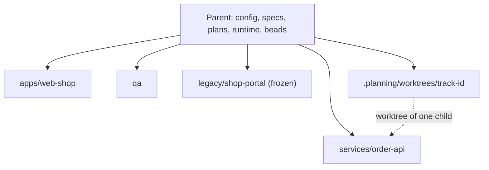

# Workspace

A workspace is a parent repository that lists several child repositories in its configuration. The parent keeps the specs, plans, configuration, runtime state, and Beads; each child keeps its own code, hooks, branches, and worktrees. Use it when a product spans several repositories (services, apps, a legacy system, an automation repository) and you want one workflow over all of them without git submodules. A single-repository project needs none of this: without a `workspace` key every command behaves as before.

This page says which directory each role opens and which commands it runs at each stage. For a worked example, see the [brownfield starter](../starters/brownfield.md); for the keys, see [configuration](../reference/config.md#workspace) and the [CLI reference](../reference/cli.md#gin-workspace).

## Layout

The parent holds `docs/` and `.planning/`. Every child is a plain clone at the path the manifest gives it, and each path is listed in the parent `.gitignore`, so the parent tracks no child.

```yaml
workspace:
  repos:
    - {path: legacy/shop-portal, url: git@github.com:acme/shop-portal.git, frozen: true}
    - path: services/order-api
      url: git@github.com:acme/order-api.git
      shape: backend
      verify: {checks: {test: mvn -q test, build: mvn -q package}}
    - {path: apps/web-shop, url: git@github.com:acme/web-shop.git, shape: frontend,
       verify: {checks: {lint: npm run lint, test: npm test, build: npm run build}}}
    - {path: qa, url: git@github.com:acme/qa.git, shape: qa}
    - {path: .beads, url: git@github.com:acme/beads.git, shape: beads}
```

- `frozen: true` marks a read-only repository. It is cloned shallow and never gets hooks, tracks, or worktrees.
- `shape: qa` marks the automation repository. It is the [QA home](qa.md#the-qa-home): `gin-qa` writes `cases/`, `e2e/`, and `evidence/` into it.
- `shape: beads` at `.beads` holds the shared Beads database.
- `verify.checks` are the commands the hooks of that repository run, in that repository.



## Setup once

The tech lead does this.

1. Create the parent repository with `docs/` and `.planning/`.
2. Run `/gin:setup` in the parent and answer `workspace`.
3. Fill `workspace.repos` in `.agent-workflow/config.yaml`.
4. Run `gin workspace clone --all`.
5. Run `gin hooks install --all-repos`.
6. In team mode, run `/gin:team-setup` and define one area per repository, for example `services/order-api/**` with lead `be_lead`.
7. Run `gin setup doctor`. Its `workspace:` actions name a missing clone, a `frontend`, `backend`, or `qa` repository with no checks, a cloned repository with `verify.checks` whose hook is missing, stale, or occupied, a path missing from `.gitignore`, or a path that is still a git submodule. A hook owned by another tool (husky, lefthook) stays as it is: add `exec gin hooks run <hook> "$@"` to the file the action names, and `gin` runs after it.

Run `/gin:setup` only in the parent, never in a child.

## Onboarding

Every engineer does this.

1. Clone the parent.
2. Run `gin workspace clone <path>` for the repositories you work on. A backend engineer clones one or two services; the frozen legacy only when they need to read it.
3. Run `gin hooks install` inside each clone.
4. Open the IDE on the child directory, never on the parent.

A PM or a BA clones the parent only.

## PM and BA

Open: the parent. Everything happens there, from a parent session worktree.

| Stage | Command |
|---|---|
| Roadmap and milestones | `/gin:roadmap`, `/gin:roadmap --milestone` |
| Requirements | `/gin:discuss` |
| Documenting the current system | `/gin:tech-doc` (reads `legacy/shop-portal` when it is present) |
| Spec review | the review of the spec pull request |
| Progress | `/gin:progress`, `/gin:report` |
| Questions during build | answer `[gin question]` comments; see [during the build](ba.md#during-the-build) |
| Acceptance | `[gin accept]` per epic |

Specs and plans are committed to the parent. Requirements and their REQ-IDs live only in the parent's specs; children reference them in tests, and `gin specs trace` scans every cloned child ([REQ-IDs](sdd.md#requirements)).

## Tech lead

Open: the parent for setup, plan, orchestrate, and ship.

| Stage | Command |
|---|---|
| Plan | `/gin:plan` writes tracks that each carry `Repo: <path>`; `gin record plan-approved` refuses a track with no `Repo:`, an unknown or frozen repository, the beads entry, or files outside its repository |
| Orchestrate | `/gin:orchestrate` creates one worktree per track inside the named child; a missing clone stops with the exact `gin workspace clone <path>` command |
| Ship | `/gin:ship` from the parent integrates one repository at a time, the parent last; `team check --gate ship` and `record shipped` accept a child's pull request. They compare it with the HEAD of the child checkout or track worktree you run them from, else the child's main checkout; the parent's integration carries the archive into the living spec, and by team convention the BA reviews that diff |

For a standalone bead, `gin record shipped --evidence "<repo>:<merge commit>; ...; parent:<merge commit>"` records one merge commit per repository; gin does not check that each repository was merged. An epic is shipped when its parent bead is closed after the human-confirmed merges.

## Backend and frontend engineers

Open: `<parent>/.planning/worktrees/<track-id>`. It is a worktree of one service or one app, nothing else.

| Stage | Command |
|---|---|
| Find a track | `gin task` or `/gin:progress` from anywhere in the workspace lists ready tracks; the worktree of a track is `<parent>/.planning/worktrees/<track-id>` |
| Implement | `/gin:execute` in the worktree; commit and push to that repository |
| Review | `/gin:review` in the worktree |
| Small change | `/gin:quick` inside the child; it commits on a branch of the child and runs that child's checks |

Read the spec and plan from the parent path the bead links. A track edits nothing in the parent. Hooks in the child run that repository's `verify.checks` only.

## QA

Open: the `qa` child, the QA home. Config, specs, and Beads stay in the parent; gin-qa reads them through `gin specs reqs`. If the child is not cloned, run `gin workspace clone <path>`.

| Stage | Command |
|---|---|
| Setup | `/gin-qa:setup` once |
| Test cases | `/gin-qa:cases` |
| Automated tests | `/gin-qa:tests` |
| End-to-end | `/gin-qa:e2e`, `/gin-qa:run` |
| Report | `/gin-qa:report` |

## Contract

The confirmed spec of a capability's epic is its API contract, and `requirement_confirmed` is the moment it is frozen. When the contract uses an OpenAPI file, the file lives in the parent repository and the spec links it. The service track and the app track of the epic read the same spec; the app track generates its mocks from it. A contract change after plan approval goes back through `/discuss`, so the spec, the plan, and both tracks change together. The roadmap adds one `<capability> integration` epic per capability, blocked by the build epics, for the day the flag turns on.

## Commands

| Command | Does |
|---|---|
| `gin workspace clone [PATH ...\|--all]` | Clones the named entries or all of them at their manifest paths; a frozen entry is cloned shallow; adds each path to the parent `.gitignore`; entries already present are reported as `present` |
| `gin workspace status` | Prints one line per entry: path, present or missing, branch, clean or dirty, frozen. Add `--json` for scripts |
| `gin hooks install --all-repos` | Installs the hooks in every cloned repository except frozen and beads entries; an occupied hook is kept and the file to chain into is named; a missing hooks directory is reported |
| `gin hooks status --all-repos` | Prints the hook states and check names of every cloned repository that has `verify.checks`, except frozen and beads entries, as JSON; exits 1 when one is not ok |
| `gin worktree create --repository <repo> <track-id> <branch> [base]` | Creates the track worktree of one child under the parent `.planning/worktrees/` |
| `gin worktree cleanup --repository <repo> <track-id>` | Removes it |
| `gin state --format json` | The `workspace` key is `null` outside a workspace; otherwise it holds `root`, `current_repo`, and `repos[]` with `path`, `shape`, `frozen`, `present`, and `branch` |

All of them run from anywhere inside the workspace, including a child. `gin state` inside a child prints the same gates and epic as in the parent. See the [CLI reference](../reference/cli.md#gin-workspace).

## Limits

- One track per repository. A capability that needs a service and an app is one epic with two tracks, one in each repository; a track never spans two repositories.
- `project.packages` is ignored for workspace entries.
- There is no version pinning: the parent does not record which commit of a child it expects.
- A child cloned outside its manifest path, or a repository not in the manifest, is standalone. `gin` treats it as an ordinary repository and `gin workspace status` shows the entry as missing.
