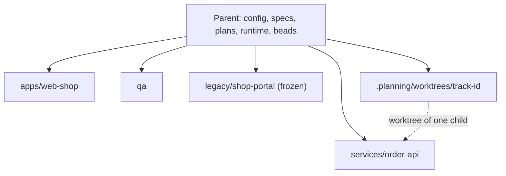

# Workspace { #workspace }

Workspace là một repository cha liệt kê nhiều repository con trong cấu hình của nó. Repository cha giữ spec, plan, cấu hình, trạng thái runtime và Beads; mỗi repository con giữ code, hook, branch và worktree của riêng nó. Dùng nó khi một sản phẩm trải trên nhiều repository (service, app, hệ thống legacy, repository automation) và bạn muốn một workflow duy nhất cho tất cả mà không dùng git submodule. Dự án một repository không cần gì ở đây: khi không có khóa `workspace`, mọi lệnh hoạt động như trước.

Trang này nói mỗi vai trò mở thư mục nào và chạy lệnh nào ở từng stage. Để xem ví dụ đầy đủ, xem [starter brownfield](../starters/brownfield.md); về các khóa, xem [cấu hình](../reference/config.md#workspace) và [tham chiếu CLI](../reference/cli.md#gin-workspace).

## Bố cục { #layout }

Repository cha chứa `docs/` và `.planning/`. Mỗi repository con là một bản clone thường tại path mà manifest chỉ định, và mỗi path nằm trong `.gitignore` của repository cha, nên repository cha không theo dõi repository con nào.

```yaml
workspace:
  repos:
    - {path: legacy/shop-portal, url: git@github.com:acme/shop-portal.git, frozen: true}
    - path: services/order-api
      url: git@github.com:acme/order-api.git
      shape: backend
      verify: {checks: {test: mvn -q test, build: mvn -q package}}
    - {path: apps/web-shop, url: git@github.com:acme/web-shop.git, shape: frontend,
       verify: {checks: {lint: npm run lint, test: npm test, build: npm run build}}}
    - {path: qa, url: git@github.com:acme/qa.git, shape: qa}
    - {path: .beads, url: git@github.com:acme/beads.git, shape: beads}
```

- `frozen: true` đánh dấu repository chỉ đọc. Nó được clone nông (shallow) và không bao giờ có hook, track hay worktree.
- `shape: qa` đánh dấu repository automation. `gin-qa` ghi `qa/cases/`, `qa/e2e/` và `qa/evidence/` vào đó.
- `shape: beads` tại `.beads` giữ cơ sở dữ liệu Beads dùng chung.
- `verify.checks` là các lệnh mà hook của repository đó chạy, trong chính repository đó.



## Thiết lập một lần { #setup-once }

Tech lead thực hiện phần này.

1. Tạo repository cha với `docs/` và `.planning/`.
2. Chạy `/gin:setup` trong repository cha và trả lời `workspace`.
3. Điền `workspace.repos` trong `.agent-workflow/config.yaml`.
4. Chạy `gin workspace clone --all`.
5. Chạy `gin hooks install --all-repos`.
6. Ở chế độ team, chạy `/gin:team-setup` và định nghĩa một area cho mỗi repository, ví dụ `services/order-api/**` với lead `be_lead`.
7. Chạy `gin setup doctor`. Các action `workspace:` của nó nêu rõ bản clone bị thiếu, repository không có check, path thiếu trong `.gitignore`, hoặc path vẫn còn là git submodule.

Chỉ chạy `/gin:setup` trong repository cha, không bao giờ trong repository con.

## Onboarding { #onboarding }

Mọi kỹ sư thực hiện phần này.

1. Clone repository cha.
2. Chạy `gin workspace clone <path>` cho các repository bạn làm việc. Kỹ sư backend clone một hoặc hai service; legacy `frozen` chỉ khi họ cần đọc nó.
3. Chạy `gin hooks install` bên trong từng bản clone.
4. Mở IDE trên thư mục của repository con, không bao giờ trên repository cha.

PM hoặc BA chỉ clone repository cha.

## PM và BA { #pm-and-ba }

Mở: repository cha. Mọi việc diễn ra ở đó, từ một session worktree của repository cha.

| Stage | Lệnh |
|---|---|
| Roadmap và milestone | `/gin:roadmap`, `/gin:roadmap --milestone` |
| Yêu cầu | `/gin:discuss` |
| Mô tả hệ thống hiện tại | `/gin:tech-doc` (đọc `legacy/shop-portal` khi nó có mặt) |
| Review spec | review pull request của spec |
| Tiến độ | `/gin:progress`, `/gin:report` |

Spec và plan được commit vào repository cha.

## Tech lead { #tech-lead }

Mở: repository cha cho setup, plan, orchestrate và ship.

| Stage | Lệnh |
|---|---|
| Plan | `/gin:plan` ghi các track, mỗi track mang `Repo: <path>`; `gin record plan-approved` từ chối track không có `Repo:`, repository không xác định hoặc `frozen`, mục beads, hoặc file nằm ngoài repository của nó |
| Orchestrate | `/gin:orchestrate` tạo một worktree cho mỗi track bên trong repository con được nêu; thiếu bản clone thì dừng kèm đúng lệnh `gin workspace clone <path>` |
| Ship | `/gin:ship` từ repository cha tích hợp từng repository một, repository cha sau cùng |

Với một bead độc lập, `gin record shipped --evidence "<repo>:<merge commit>; ...; parent:<merge commit>"` ghi một merge commit cho mỗi repository; gin không kiểm tra từng repository đã được merge hay chưa. Một epic là shipped khi bead cha của nó được đóng sau các lần merge do con người xác nhận.

## Kỹ sư backend và frontend { #backend-and-frontend-engineers }

Mở: `<parent>/.planning/worktrees/<track-id>`. Đó là worktree của một service hoặc một app, không có gì khác.

| Stage | Lệnh |
|---|---|
| Tìm track | `gin task` hoặc `/gin:progress` từ bất kỳ đâu trong workspace liệt kê các track sẵn sàng; worktree của một track là `<parent>/.planning/worktrees/<track-id>` |
| Triển khai | `/gin:execute` trong worktree; commit và push vào repository đó |
| Review | `/gin:review` trong worktree |
| Thay đổi nhỏ | `/gin:quick` bên trong repository con; nó commit trên một branch của repository con và chạy check của repository con đó |

Đọc spec và plan từ đường dẫn của repository cha mà bead liên kết tới. Một track không sửa gì trong repository cha. Hook trong repository con chỉ chạy `verify.checks` của repository đó.

## QA { #qa }

Mở: repository `qa`. Đó là repository automation, nên test case, spec và evidence nằm trong đó.

| Stage | Lệnh |
|---|---|
| Setup | `/gin-qa:setup` một lần |
| Test case | `/gin-qa:cases` |
| Test tự động | `/gin-qa:tests` |
| End-to-end | `/gin-qa:e2e`, `/gin-qa:run` |
| Báo cáo | `/gin-qa:report` |

## Lệnh { #commands }

| Lệnh | Làm gì |
|---|---|
| `gin workspace clone [PATH ...\|--all]` | Clone các mục được nêu hoặc tất cả tại path manifest của chúng; mục `frozen` được clone nông; thêm mỗi path vào `.gitignore` của repository cha; mục đã có được báo là `present` |
| `gin workspace status` | In một dòng cho mỗi mục: path, present hoặc missing, branch, clean hoặc dirty, frozen. Thêm `--json` cho script |
| `gin hooks install --all-repos` | Cài hook trong mọi repository đã clone trừ mục frozen và beads |
| `gin worktree create --repository <repo> <track-id> <branch> [base]` | Tạo worktree của track cho một repository con dưới `.planning/worktrees/` của repository cha |
| `gin worktree cleanup --repository <repo> <track-id>` | Gỡ nó |
| `gin state --format json` | Khóa `workspace` là `null` ngoài workspace; nếu không nó chứa `root`, `current_repo` và `repos[]` với `path`, `shape`, `frozen`, `present` và `branch` |

Tất cả chạy được từ bất kỳ đâu trong workspace, kể cả trong một repository con. `gin state` bên trong repository con in cùng các gate và epic như ở repository cha. Xem [tham chiếu CLI](../reference/cli.md#gin-workspace).

## Giới hạn { #limits }

- Một epic nằm trong một repo con. Thay đổi cần cả service lẫn app là hai epic, hoặc hai track của một epic có phụ thuộc trong Beads; một track không bao giờ trải trên hai repo.
- Một repository cho mỗi track. Một thay đổi đụng tới hai repository là hai track.
- `project.packages` bị bỏ qua với các mục workspace.
- Không có ghim phiên bản: repository cha không ghi lại commit nào của repository con mà nó mong đợi.
- Một repository con được clone ngoài path manifest của nó, hoặc một repository không có trong manifest, là độc lập. `gin` coi nó là repository thông thường và `gin workspace status` hiển thị mục đó là missing.
