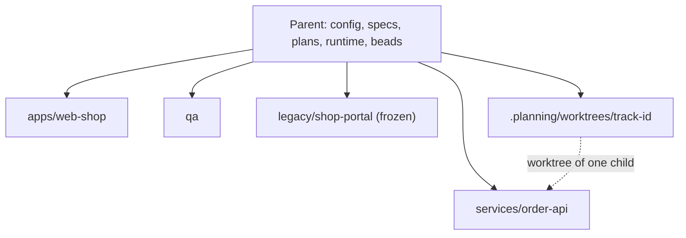

# Workspace { #workspace }

Workspace là một repository cha liệt kê nhiều repository con trong cấu hình của nó. Repository cha giữ spec, plan, cấu hình, trạng thái runtime và Beads; mỗi repository con giữ code, hook, branch và worktree của riêng nó. Dùng nó khi một sản phẩm trải trên nhiều repository (service, app, hệ thống legacy, repository automation) và bạn muốn một workflow duy nhất cho tất cả mà không dùng git submodule. Dự án một repository không cần gì ở đây: khi không có khóa `workspace`, mọi lệnh hoạt động như trước.

Trang này nói mỗi vai trò mở thư mục nào và chạy lệnh nào ở từng stage. Để xem ví dụ đầy đủ, xem [starter brownfield](../starters/brownfield.md); về các khóa, xem [cấu hình](../reference/config.md#workspace) và [tham chiếu CLI](../reference/cli.md#gin-workspace).

## Bố cục { #layout }

Repository cha chứa `docs/` và `.planning/`. Mỗi repository con là một bản clone thường tại path mà manifest chỉ định, và mỗi path nằm trong `.gitignore` của repository cha, nên repository cha không theo dõi repository con nào.

```yaml
workspace:
  repos:
    - {path: legacy/shop-portal, url: git@github.com:acme/shop-portal.git, frozen: true}
    - path: services/order-api
      url: git@github.com:acme/order-api.git
      shape: backend
      verify: {checks: {test: mvn -q test, build: mvn -q package}}
    - {path: apps/web-shop, url: git@github.com:acme/web-shop.git, shape: frontend,
       verify: {checks: {lint: npm run lint, test: npm test, build: npm run build}}}
    - {path: qa, url: git@github.com:acme/qa.git, shape: qa}
    - {path: .beads, url: git@github.com:acme/beads.git, shape: beads}
```

- `frozen: true` đánh dấu repository chỉ đọc. Nó được clone nông (shallow) và không bao giờ có hook, track hay worktree.
- `shape: qa` đánh dấu repository automation. Nó là [QA home](qa.md#the-qa-home): `gin-qa` ghi `cases/`, `e2e/` và `evidence/` vào đó.
- `shape: beads` tại `.beads` giữ cơ sở dữ liệu Beads dùng chung.
- `verify.checks` là các lệnh mà hook của repository đó chạy, trong chính repository đó.

`gin workspace clone` cũng nhận một repository mới, còn rỗng: nó trỏ `HEAD` vào `default_branch`, và commit đầu tiên bạn push sẽ tạo branch đó.



## Cài đặt theo từng mục { #per-entry-settings }

`shape`, `verify.checks` và `rules.packs` của mỗi mục chỉ áp dụng bên trong repository đó. Từ một repository con hoặc worktree của nó, `gin state` báo mục này dưới dạng `workspace.current`. `gin evidence run` chạy các check của mục, `gin rules` cộng packs của mục vào packs của repository cha, và `gin setup doctor` báo cáo về check và rule của mục. Các skill execute và worktrees đọc shape và lệnh test từ `workspace.current`. Các khóa nằm trong [cấu hình](../reference/config.md#workspace) và các lệnh nằm trong [tham chiếu CLI](../reference/cli.md).

## Thiết lập một lần { #setup-once }

Tech lead thực hiện phần này.

1. Tạo repository cha với `docs/` và `.planning/`.
2. Chạy `/gin:setup` trong repository cha và trả lời `workspace`.
3. Đăng ký từng repository bằng `gin workspace add <path> --url <url>` (setup sẽ hỏi các giá trị này, còn các flag nằm trong [tham chiếu CLI](../reference/cli.md#gin-workspace)).
4. Chạy `gin workspace clone --all`. Lệnh này cài các verify hook của mục có check và, ở chế độ team, commit-msg hook.
5. Ở chế độ team, chạy `/gin:team-setup` và định nghĩa một area cho mỗi repository, ví dụ `services/order-api/**` với lead `be_lead`. Sau đó chạy `gin team init --all-repos`, rồi commit và mở pull request trong từng repository con.
6. Chạy `gin setup doctor`. Các action `workspace:` của nó nêu rõ bản clone bị thiếu, repository `frontend`, `backend` hoặc `qa` không có check, repository đã clone có `verify.checks` mà hook bị thiếu, cũ (stale) hoặc bị chiếm, path thiếu trong `.gitignore`, hoặc path vẫn còn là git submodule. Hook do công cụ khác sở hữu (husky, lefthook) được giữ nguyên: thêm `exec gin hooks run <hook> "$@"` vào file mà action nêu tên, và `gin` chạy sau nó.

Chỉ chạy `/gin:setup` trong repository cha, không bao giờ trong repository con.

## Onboarding { #onboarding }

Mọi kỹ sư thực hiện phần này.

1. Clone repository cha.
2. Chạy `gin workspace clone <path>` cho các repository bạn làm việc. Kỹ sư backend clone một hoặc hai service; legacy `frozen` chỉ khi họ cần đọc nó.
3. Mở IDE trên thư mục mà công việc cần. Với một track, đó là worktree `<parent>/.planning/worktrees/<track-id>`. Ở team mode, `<track-id>` là `<epic>-<lane>`, worktree của lane. Với setup, roadmap, discuss, plan, orchestrate và ship, đó là repository cha. Với `/gin:quick` trong một repository con, với QA, và với repository mà track khác đọc, đó là checkout chính của repository con đó.

Bước clone cài các verify hook của mục có check và, ở chế độ team, commit-msg hook. Ngoài repository cha, mỗi vai trò clone thêm:

- Developer: các repository con cần làm việc.
- QA: mục `shape: qa`.
- PM: không cần gì thêm, hoặc `.beads` khi workspace có mục `shape: beads`.
- BA: những gì PM clone, cộng với các mục legacy `frozen` mà tech-doc, capture và explain đọc.

## PM và BA { #pm-and-ba }

Mở: checkout của repository cha. Mọi việc diễn ra ở đó; `/gin:roadmap` tự tạo branch `roadmap/<topic>` của nó.

| Stage | Lệnh |
|---|---|
| Roadmap và milestone | `/gin:roadmap`, `/gin:roadmap --milestone` |
| Yêu cầu | `/gin:discuss` |
| Mô tả hệ thống hiện tại | `/gin:tech-doc` (đọc `legacy/shop-portal` khi nó có mặt; nếu không thì in `gin workspace clone <path>`) |
| Review spec | review pull request của spec |
| Tiến độ | `/gin:progress` |
| Câu hỏi trong lúc build | trả lời các comment `[gin question]`; xem [trong lúc build](ba.md#during-the-build) |
| Nghiệm thu | `[gin accept]` cho mỗi epic |

Ai chạy discuss cho loại epic nào được nêu ở [ai sở hữu gì](../roles.md#who-owns-what).

Spec và plan được commit vào repository cha. Requirement và REQ-ID của chúng chỉ nằm trong spec của repository cha; các repository con tham chiếu tới chúng trong test, và `gin specs trace` quét mọi repository con đã clone ([REQ-ID](sdd.md#requirements)).

## Tech lead { #tech-lead }

Mở: repository cha cho setup, plan, orchestrate và ship.

| Stage | Lệnh |
|---|---|
| Plan | `/gin:plan` ghi các track, mỗi track mang `Repo: <path>`; `gin record plan-approved` từ chối track có `Repo:` không xác định, `frozen` hoặc là repository beads, hoặc có file nằm ngoài repository đó. Track có `Repo: .` hoặc không có `Repo:` thuộc về parent và chỉ bị từ chối khi có file nằm trong một child. Một track còn có thể mang `Reads: <paths>`, các repository nó chỉ đọc và không bao giờ sửa. `gin team check-plan` và `gin record plan-approved` từ chối path không nằm trong `workspace.repos`, mục beads, hoặc `Repo:` của chính track. Repository `frozen` được chấp nhận, và việc nó đã clone hay chưa không được kiểm tra ở đó |
| Orchestrate | `/gin:orchestrate` tạo một worktree cho mỗi track bên trong repository con được nêu; thiếu bản clone thì dừng kèm đúng lệnh `gin workspace clone <path>`. Nó ghi `Reads: <paths>` vào bead của track và, ngoài team mode, dừng theo cách tương tự khi một repository trong `Reads:` chưa được clone. Ở [team mode](team.md) nó không tạo branch hay worktree của repository con và push `feat/<topic>` của repository cha; `gin team claim` của mỗi thành viên tạo worktree của lane của họ |
| Ship | `/gin:ship` từ repository cha tích hợp từng repository một, repository cha sau cùng (ở team mode, mỗi lane và `feat/<topic>` của repository cha đi qua pull request, rồi area lead chạy `gin team complete <epic>`); `team check --gate ship` và `record shipped` nhận pull request của repository con, và `team check --gate ship` so nó với HEAD của checkout repository con hoặc worktree của track nơi chạy lệnh, nếu không thì checkout chính của repository con; `gin team deps` tìm pull request của track của repository con trong repository mà `Repo:` chỉ tới; phần tích hợp của repository cha đưa archive vào living spec, và theo quy ước của nhóm, BA review phần diff đó |

Với một bead độc lập ở team mode có chính sách `ship`, lặp `gin record shipped --evidence <pull request URL>`, mỗi repository một URL: gin kiểm tra từng pull request và ghi chúng cùng nhau. Không có chính sách `ship`, bằng chứng là văn bản tự do, ví dụ một merge commit cho mỗi repository, và gin không kiểm tra. Một epic là shipped khi bead cha của nó được đóng sau các lần merge do con người xác nhận.

## Kỹ sư backend và frontend { #backend-and-frontend-engineers }

Mở: `<parent>/.planning/worktrees/<track-id>`. Ở team mode, `<track-id>` là `<epic>-<lane>`, worktree của lane. Đó là worktree của một service hoặc một app, không có gì khác.

| Stage | Lệnh |
|---|---|
| Tìm track | `gin task` hoặc `/gin:progress` từ bất kỳ đâu trong workspace liệt kê các track sẵn sàng; worktree của một track là `<parent>/.planning/worktrees/<track-id>` (`<epic>-<lane>` ở team mode) |
| Triển khai | `/gin:execute` trong worktree; commit và push vào repository đó. Ở team mode, chạy `gin team claim <bead>` từ checkout của repository cha (hoặc một worktree của nó) trên `feat/<topic>`; lệnh tạo worktree của lane `.planning/worktrees/<epic>-<lane>` |
| Review | `/gin:review` trong worktree. Khi review ledger bật, ledger được ghi vào `.planning/reviews/<bead>/` của repository cha; ở team mode, chạy `git pull --rebase` trước và commit rồi push thư mục đó sau mỗi phiên ledger (quy ước của skill `team`) |
| Thay đổi nhỏ | `/gin:quick` bên trong repository con; nó commit trên một branch của repository con và chạy check của repository con đó |

Đọc spec và plan từ đường dẫn của repository cha mà bead liên kết tới. Một track không sửa gì trong repository cha, ngoài review ledger của nó khi ledger bật. Hook trong repository con chỉ chạy `verify.checks` của repository đó.

### Đọc repository khác { #reading-another-repository }

Track cần đọc một repository mà nó không sửa thì nêu repository đó trong `Reads:` của plan. Khi chạy `/gin:execute`, skill yêu cầu agent lấy dòng của từng repository được nêu từ `gin workspace status --json`. Nếu repository chưa được clone trên máy này, agent dừng kèm `gin workspace clone <path>`. Nếu không, developer nhận `checkout`, `branch` và `commit` của dòng đó làm ngữ cảnh chỉ đọc.

Checkout được đọc đúng như hiện có. Không lệnh gin nào chuyển branch hay pull nó, và developer được dặn không làm vậy; cần trạng thái mới hơn thì tự pull. Chỉ đọc là một chỉ dẫn cho developer: gin không chặn việc ghi vào đó. Harness giới hạn quyền đọc trong thư mục làm việc sẽ yêu cầu quyền truy cập path này.

## Chạy các dependency của một track { #running-a-tracks-dependencies }

gin không có lệnh hay cấu hình nào cho service, database, compose hoặc environment, và không khởi động gì. Đây là các quy ước của nhóm:

- Mỗi repository tự ghi lệnh chạy của nó.
- Tổ hợp các service và database chạy bằng công cụ của nhóm: một file compose trong repository cha, hoặc preview environment của host cho một pull request.
- Track trong plan nêu các lệnh nó cần làm lệnh validation.

## QA { #qa }

Mở: repository con `qa`, tức QA home. Config, spec và Beads nằm ở repository cha; gin-qa đọc chúng qua `gin specs reqs`. Nếu repository con chưa được clone, chạy `gin workspace clone <path>`.

Để test một track, checkout branch của track trong từng repository con cần test. Khởi động tổ hợp bằng công cụ của nhóm, hoặc dùng preview environment, như trong [chạy các dependency của một track](#running-a-tracks-dependencies). Trong workspace, `run.json` của `gin-qa e2e run` và `gin-qa tests run` ghi `checkouts`: trạng thái checkout của máy đã chạy test, không phải bản mà preview environment đã deploy. Các field nằm trong [tham chiếu CLI](../reference/cli.md#gin-qa-cases-export-and-gin-qa-e2e-run). Theo quy ước, người test một preview environment nêu URL pull request của từng repository trong comment nghiệm thu.

| Stage | Lệnh |
|---|---|
| Setup | `/gin-qa:setup` một lần |
| Test case | `/gin-qa:cases` |
| Test tự động | `/gin-qa:tests` |
| End-to-end | `/gin-qa:e2e`, `/gin-qa:run` |
| Báo cáo | `/gin-qa:report` |

## Hợp đồng { #contract }

Spec của epic một capability là API contract của nó. Phần nghiệp vụ của spec được đóng băng tại `requirement_confirmed`. Trong [team mode](team.md), khi người chạy discuss không có vai trò kỹ thuật, `/gin:discuss` ghi mỗi chi tiết của contract (path, method, field, mã lỗi) thành `- TQ-<n>:` dưới `## Open Technical Questions`. `/gin:plan` trả lời từng câu bằng một dòng `Decision:`, và `plan_approved` đóng băng các chi tiết đó; lead của mỗi khu vực mà plan đụng tới phê duyệt plan (`plan_approved: area_lead`), nên cả khu vực cung cấp lẫn khu vực tiêu thụ đều phê duyệt chúng. Nếu không, người chạy chốt các chi tiết contract ngay trong discuss, và `requirement_confirmed` đóng băng chúng cùng phần còn lại của spec. Khi contract dùng file OpenAPI, file nằm trong repository cha và spec liên kết tới nó. Track của service và track của app trong epic đọc cùng một spec; track của app sinh mock từ đó. Thay đổi contract sau khi plan được duyệt quay lại `/discuss`, để spec, plan và cả hai track thay đổi cùng nhau. Roadmap thêm một epic `<capability> integration` cho mỗi capability, bị chặn bởi các epic build, cho ngày bật flag.

## Package dùng chung { #shared-packages }

Package dùng chung là một mục `shape: library` của `workspace.repos`. Thay đổi nó là một track trong repository đó, nằm trong epic capability cần nó. Mỗi app áp dụng thay đổi làm việc đó trong track riêng, track này phụ thuộc vào track của library (`gin task dep add <blocked> <blocker>`). Việc publish package và nâng phiên bản trong các app theo thực hành release của nhóm, một quy ước mà gin không ép buộc. gin không ghim phiên bản của repository con; xem [Giới hạn](#limits).

## Lệnh { #commands }

| Lệnh | Làm gì |
|---|---|
| `gin workspace clone [PATH ...\|--all]` | Clone các mục được nêu hoặc tất cả tại path manifest của chúng; mục `frozen` được clone nông; thêm mỗi path vào `.gitignore` của repository cha; mục đã có được báo là `present` |
| `gin workspace status` | In một dòng cho mỗi mục: path, present hoặc missing, branch, clean hoặc dirty, frozen. Thêm `--json` cho script |
| `gin hooks install --all-repos` | Cài hook trong mọi repository đã clone trừ mục frozen và beads; hook bị chiếm được giữ nguyên và file cần chain vào được nêu tên; thư mục hooks bị thiếu được báo |
| `gin hooks status --all-repos` | In trạng thái hook và tên check của mọi repository đã clone có `verify.checks`, trừ mục frozen và beads, dưới dạng JSON; exit 1 khi có một repository không ok |
| `gin worktree create --repository <repo> <track-id> <branch> [base]` | Tạo worktree của track cho một repository con dưới `.planning/worktrees/` của repository cha |
| `gin worktree cleanup --repository <repo> <track-id>` | Gỡ nó |
| `gin state --format json` | Khóa `workspace` là `null` ngoài workspace; nếu không nó chứa `root`, `current_repo`, `current` (mục bạn đang chạy lệnh, hoặc `null` ở repository cha) và `repos[]` với `path`, `shape`, `frozen`, `present` và `branch` |

Tất cả chạy được từ bất kỳ đâu trong workspace, kể cả trong một repository con. `gin state` bên trong repository con in cùng các gate và epic như ở repository cha. Xem [tham chiếu CLI](../reference/cli.md#gin-workspace).

## Giới hạn { #limits }

- Một epic capability có ít nhất một track trong mỗi repository nó thay đổi, và một track không bao giờ trải trên hai repository; một repository có thể giữ nhiều track của epic. Công việc QA cho capability là một hoặc nhiều track trong repository `shape: qa`, nằm trong cùng epic, không phải một epic riêng.
- `project.packages` bị bỏ qua với các mục workspace.
- Không có ghim phiên bản: repository cha không ghi lại commit nào của repository con mà nó mong đợi.
- Một repository con được clone ngoài path manifest của nó, hoặc một repository không có trong manifest, là độc lập. `gin` coi nó là repository thông thường và `gin workspace status` hiển thị mục đó là missing.
