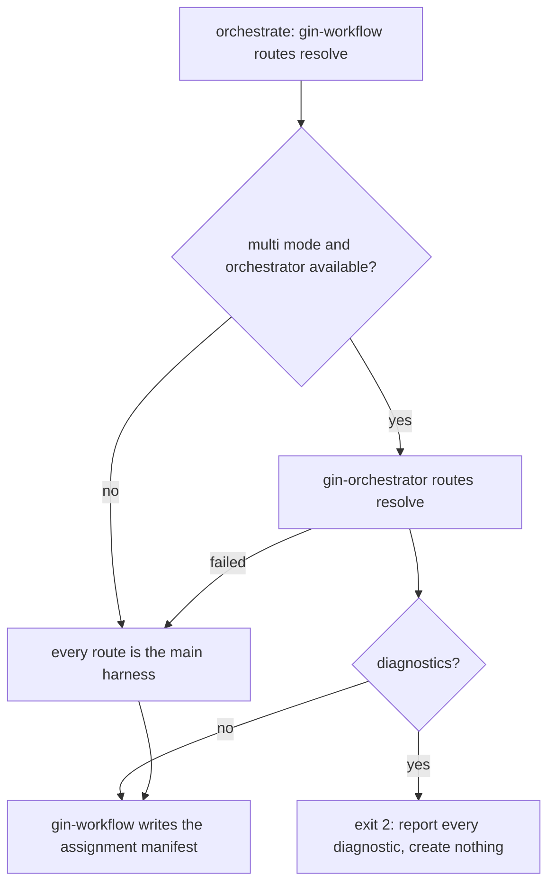

# Routing and configuration

This page is part of the [gin-orchestrator](README.md) guide. It covers how roles and catalog routes (a model and an effort) become harnesses and models. Everything here applies only when gin-orchestrator is installed and `provider_mode: multi` is set; otherwise every route is the main harness.

## Setting it up

Run `/gin-orchestrator:providers`. It asks, one question at a time:

1. which installed harnesses may run work, and each one's executable;
2. which models each harness may run, weakest first, and its efforts, lowest first, offered from `gin-orchestrator models --provider <name>`;
3. the preferred and fallback harnesses per role, and per tier where a tier differs;
4. the concurrency of each harness;
5. the queue, worker, and circuit-breaker limits, which keep their defaults unless you change them.

It previews the change with `gin-orchestrator configure --dry-run` and applies it after your approval. It then writes the catalog and turns on `provider_mode: multi` and `routing.review.independence: provider` with `gin-workflow setup configure`, and probes each harness with `gin-workflow setup doctor --probe`. Do not edit the two files below by hand.

## Configuration

Worker routing lives under `orchestrator:` in `.agent-workflow/config.yaml`, which is committed. `gin-workflow` passes that section through without validating it; `gin-orchestrator` owns it.

```yaml
provider_mode: multi

routing:
  review:
    role: review
    require_independent: true
    independence: provider     # the reviewer's provider must differ from the implementer's
    max_cycles: 3

orchestrator:
  roles:
    backend:
      preferred: [claude]
      fallback: [codex]
    frontend:
      preferred: [antigravity]
      fallback: [codex, claude]
    review:
      preferred: [codex]
      fallback: [antigravity]
  concurrency: {claude: 2, codex: 2, antigravity: 1}
```

Roles are responsibilities such as `backend`, `frontend`, `docs`, `review`, or `general`; each lists harnesses (`claude`, `codex`, `antigravity`, `opencode`, or `main_harness`) in preference order. A role may add `by_tier.<tier>`, a list that replaces `preferred` for that tier. A track's tier comes from its model's rank in the main harness's catalog: `low` for the weakest, `high` for the strongest, and `medium` for any other or for a one-entry catalog. Plans name a role, a model, and an effort, never a harness. Other keys: `queue`, `worker`, and `circuit_breaker` ([Configuration](../reference/config.md#orchestrator)).

The models and efforts of each harness come from the [model catalog](../reference/config.md#models) under `models:` in `.agent-workflow/config.yaml`. Only the executable of each harness is machine-local, in `.agent-workflow/orchestrator.local.yaml` (git-ignored):

```yaml
schema_version: "2.9"
providers:
  claude:
    executable: claude
  codex:
    executable: codex
```

A full example ships with the plugin: `plugins/gin-orchestrator/src/examples/orchestrator.local.example.yaml`. Before schema 2.8 this file was `providers.local.yaml` and the worker keys sat under `routing`; `gin-workflow setup update --to-version 2.8 --approve` moves them ([upgrade notes](../reference/upgrade-2.0.md), [2.1](../reference/upgrade-2.1.md)). The schema 2.9 migration moves tier `models:` from this file into the catalog ([Versions and migration](../reference/config.md#versions-and-migration)).

## Rank mapping

A plan's model and effort come from the main harness's catalog. A candidate on another harness runs the route of the same rank in its own catalog:

- Model: the model at index `p` of a source list of length `n` maps to index `round(p * (m - 1) / (n - 1))`, rounded half up, of a target list of length `m`. A one-entry source list maps to index `floor((m - 1) / 2)`.
- Effort: an effort the target lists keeps its name; any other effort maps by rank the same way. A target without efforts gets none.

With the built-in Claude catalog `[haiku, sonnet, opus]` and an Antigravity catalog of three models, a track planned at `sonnet` runs on Antigravity at its middle model. A Claude effort `max` runs on Codex at `xhigh`.

Review uses the same mapping from the implementer's catalog: a reviewer on the implementer's harness keeps the implementer's final route, and any other harness gets it mapped.

## How routes are resolved

`gin-workflow` always owns the front door; gin-orchestrator answers when it can.



1. `orchestrate` runs `gin-workflow routes resolve` for every track of the approved plan.
2. When delegating, `gin-orchestrator routes resolve` expands each role into its `preferred` then `fallback` harnesses (or its `by_tier.<tier>` list); each candidate needs an executable in `orchestrator.local.yaml` and runs at the track's route mapped into its catalog.
3. If any track cannot be resolved, every diagnostic is reported and nothing durable is created.
4. `gin-workflow` writes the routes to the runtime assignment manifest `.agent-workflow/runtime/assignments/<workflow>.yaml`. Provider names never enter the plan or the task tracker; the plan names only catalog models.

Reviews follow the same path: the `review` skill calls `gin-workflow reviewer`, which delegates to `gin-orchestrator reviewer` with the implementer's final model and effort for provider-independent routes.

## Resilience

Health checks, the circuit breaker, capacity limits, and the rule that a fallback keeps the route's rank are described in [Dispatch and fallback](README.md#dispatch-and-fallback). The wire format of every command is in the [orchestrator contract](../reference/orchestrator-contract.md).
