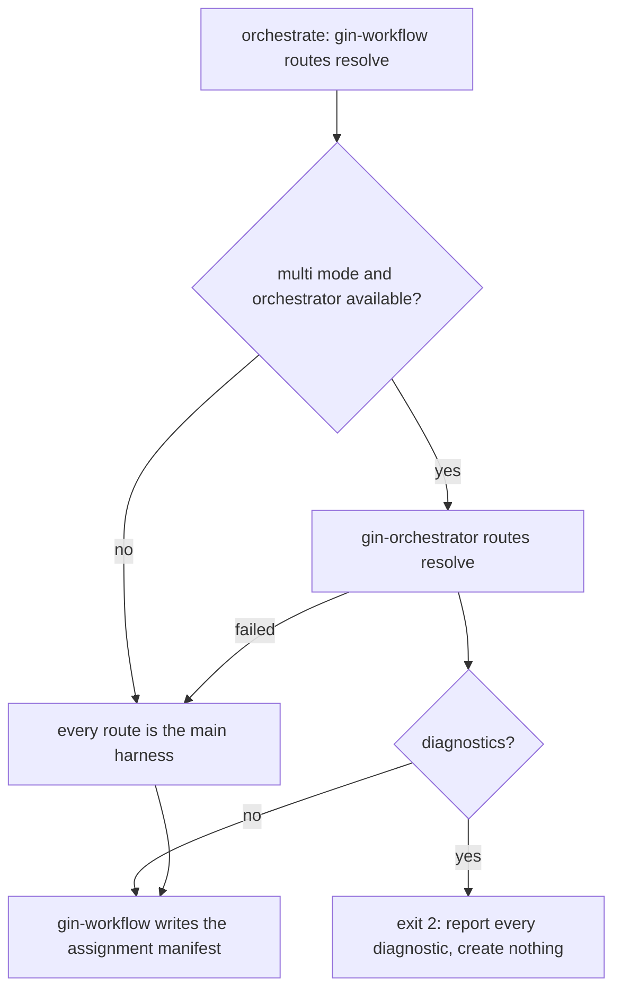

# Routing and configuration

This page is part of the [gin-orchestrator](README.md) guide. It covers how roles and reasoning tiers become harnesses and models. Everything here applies only when gin-orchestrator is installed and `provider_mode: multi` is set; otherwise every route is the main harness.

## Setting it up

Run `/gin-orchestrator:providers`. It asks, one question at a time:

1. which installed harnesses may run work, and each one's executable;
2. which model runs each tier (`low`, `medium`, `high`), offered from `gin-orchestrator models --provider <name>`;
3. the preferred and fallback harnesses per role and tier;
4. the concurrency of each harness;
5. the queue, worker, and circuit-breaker limits, which keep their defaults unless you change them.

It previews the change with `gin-orchestrator configure --dry-run`, applies it after your approval, turns on `provider_mode: multi` and `routing.review.independence: provider`, and probes each harness with `gin-workflow setup doctor --probe`. Do not edit the two files below by hand.

## Configuration

Worker routing lives under `orchestrator:` in `.agent-workflow/config.yaml`, which is committed. `gin-workflow` passes that section through without validating it; `gin-orchestrator` owns it.

```yaml
provider_mode: multi

routing:
  review:
    role: review
    require_independent: true
    independence: provider     # the reviewer's provider must differ from the implementer's
    max_cycles: 3

orchestrator:
  roles:
    backend:
      preferred: [claude]
      fallback: [codex]
    frontend:
      preferred: [antigravity]
      fallback: [codex, claude]
    review:
      preferred: [codex]
      fallback: [antigravity]
  concurrency: {claude: 2, codex: 2, antigravity: 1}
```

Roles are responsibilities such as `backend`, `frontend`, `docs`, `review`, or `general`; each lists harnesses (`claude`, `codex`, `antigravity`, `opencode`, or `main_harness`) in preference order. A role may add `by_tier.<tier>`, a list that replaces `preferred` for that tier. Plans name a role and a reasoning tier, never a harness or model. Other keys: `queue`, `worker`, and `circuit_breaker` ([Configuration](../reference/config.md#orchestrator)).

The executable and the models per tier of each harness are machine-local, in `.agent-workflow/orchestrator.local.yaml` (git-ignored):

```yaml
providers:
  claude:
    executable: claude
    models:
      low: <model>
      medium: <model>
      high: <model>
  codex:
    executable: codex
    models:
      high: {model: <model>, effort: high}
```

A full example ships with the plugin: `plugins/gin-orchestrator/src/examples/orchestrator.local.example.yaml`. Before schema 2.8 this file was `providers.local.yaml` and the worker keys sat under `routing`; `gin-workflow setup update --to-version 2.8 --approve` moves them ([upgrade notes](../reference/upgrade-2.0.md), [2.1](../reference/upgrade-2.1.md)).

## How routes are resolved

`gin-workflow` always owns the front door; gin-orchestrator answers when it can.



1. `orchestrate` runs `gin-workflow routes resolve` for every track of the approved plan.
2. When delegating, `gin-orchestrator routes resolve` expands each role into its `preferred` then `fallback` harnesses (or its `by_tier.<tier>` list); each candidate needs an executable and a model for that tier in `orchestrator.local.yaml`.
3. If any track cannot be resolved, every diagnostic is reported and nothing durable is created.
4. `gin-workflow` writes the routes to the runtime assignment manifest `.agent-workflow/runtime/assignments/<workflow>.yaml`. Provider and model names never enter the plan or the task tracker.

Reviews follow the same path: the `review` skill calls `gin-workflow reviewer`, which delegates to `gin-orchestrator reviewer` for provider-independent routes.

## Resilience

Health checks, the circuit breaker, capacity limits, and the rule that a fallback never lowers the reasoning tier are described in [Dispatch and fallback](README.md#dispatch-and-fallback). The wire format of every command is in the [orchestrator contract](../reference/orchestrator-contract.md).
