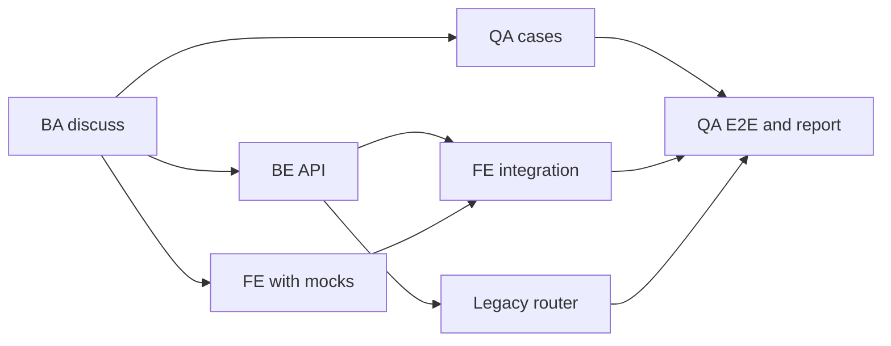

# Skills reference

Every skill is also a slash command: `/gin:<name>` (Claude Code) or the harness equivalent, `/gin-qa:<name>` for the QA add-on, `/gin-ba:<name>` for the BA add-on, and `/gin-orchestrator:<name>` for the worker harnesses add-on. In OpenCode, invoke a skill by id with `@<name>` (for example `@plan`; `learn` is `@gin-learn` and `report` is `@gin-report`, as for the other six generic skills, see [Troubleshooting](troubleshooting.md#opencode-does-not-show-the-gin-skills)); the lifecycle stages still run through the `gin` CLI. In GitHub Copilot CLI the skills register under their plain names (`setup`, `workflow`, `plan`, ...), as `copilot skill list` shows.

## gin: lifecycle stages

Run these in order for a feature. `workflow` picks the next one for you.

| Skill | Purpose | Ends with |
|---|---|---|
| `discuss` | Clarify a requirement into a confirmed design spec before any planning, tasks, or code | `requirement_confirmed` |
| `plan` | Turn the confirmed spec into an implementation plan with routed tracks | `plan_approved` |
| `orchestrate` | Mirror the plan into Beads tracks, resolve provider routes, and prepare an isolated workspace (a worktree unless isolation is disabled with approval) | `orchestration_ready` |
| `execute` | Implement and validate one ready track, directly or through a routed worker | track closed |
| `review` | Request or perform an independent review recorded in the review ledger | approved ledger |
| `ship` | Offer merge, PR, keep, or discard; run the chosen one; close beads and ledgers | `shipped` |

## gin: entry points and status

| Skill | Purpose |
|---|---|
| `workflow` | Route the current state to exactly one lifecycle stage, or diagnose a held workflow |
| `quick` | Small, low-risk change without plan or beads: confirm, implement, verify per rigor, report |
| `progress` | Report task status, blockers, open waivers, and next ready work without changing anything; for a milestone it lists the epics with `task list --parent <milestone-id>` |
| `report` | Report AI usage per bead, epic or milestone (`--milestone <id>`: tokens, cost, quality signals) without changing anything |
| `setup` | First-time repository configuration and requested setup maintenance |

## gin: supporting skills

Stages load these when needed; you can also invoke them directly.

| Skill | Purpose |
|---|---|
| `debugging` | Find the root cause of a bug, test failure, or build failure before fixing it |
| `review-response` | Handle review findings: verify each, then fix, dispute, defer, or clarify in the ledger |
| `worktrees` | Detect or create an isolated git worktree and check a clean test baseline |
| `parallel-agents` | Work several independent tasks concurrently, one bounded agent per domain |
| `learn` | Capture durable decisions and lessons, and reconcile project knowledge at ship |
| `sdd` | Stage rules for `artifacts.layout: sdd`: change folders, REQ-IDs, trace, spec review, archive ([guide](../guides/sdd.md)) |
| `qa-track` | Rules for a track routed to the `qa` provider role: the matching gin-qa skill, gin-qa validation, and the commit |
| `team` | Stage rules for team mode: identity, PR-proven gates, areas and owners, claims, Beads sync ([guide](../guides/team.md)) |

## gin: setup and maintenance

| Skill | Purpose |
|---|---|
| `team-setup` | Set up or join team mode: members, roles, areas, approvals, conventions, hooks, shared Beads |
| `migrate-specs` | Move a legacy `.planning` specs and plans layout into the SDD `docs/` layout |
| `beads-migration` | Move a repository's `.beads` directory into `~/gin-beads/<repo>` and symlink it back |
| `roadmap` | Turn the tech-doc set or a product brief into a confirmed roadmap and dependent Beads epics with a project deadline and an estimate per epic; reconcile both on re-run; propose the team's way of working (Foundation, Spec cadence, Build, Integration, Quality, Load) for the PM to confirm; rate each epic's complexity; report the `gin milestone list` forecast; with the SDD layout each epic carries `Capabilities:`; `--milestone <id>` plans a dated milestone with its own lanes, a `Spec ready by:` date, and an integration point |

## gin: documentation

| Skill | Purpose |
|---|---|
| `write-doc` | Write or update a standalone document (README, runbook or guide, ADR, changelog) from its template, and check it with `gin docs check` |
| `tech-doc` | Write technical documentation (features, API, stack, architecture, conventions, testing, and a glossary of non-English business terms) from repository evidence, or reground existing pages against the code, on request only |
| `explain` | Write one interactive HTML page that explains an SDD capability or an active change: a short narrative, then its requirements, stories, diagrams, and dated asset folders ([guide](../guides/sdd.md#explaining-a-capability)) |

## gin-qa (optional add-on)

See [QA](../guides/qa.md).

| Skill | Purpose |
|---|---|
| `cases` | Write or update test cases from specs, one file per case under `cases/<capability>/` of the [QA home](../guides/qa.md#the-qa-home), traced to REQ-IDs |
| `e2e` | Write, run, and check Playwright specs for `Type: e2e` cases by exploring the running application |
| `report` | Write an offline HTML report of the test cases, with charts, filters, and per-step e2e screenshots |
| `run` | Walk the manual cases of a capability with a tester, record each result, and file a bug bead linked to the case's epic for each failure |
| `setup` | Set up QA in a repository from one interview: the guidelines, `README.md` in the QA home, and a project QA skill (`gin-qa-setup` in OpenCode) |
| `tests` | Write, run, and check tests of declared automated types other than e2e (`api`, `unit`, ...) in the project's own test framework |

Where the harness has subagents, `e2e` gives each case to the add-on's `e2e-tester` agent at the middle model and `low` effort.

## gin-ba (optional add-on)

Skills for the BA's inputs to a capability, written into its dated asset folders with the SDD layout. Neither has a CLI. See [BA](../guides/ba.md).

| Skill | Purpose |
|---|---|
| `capture` | Describe an existing feature from screenshots under `assets/<date>/legacy/`: per-screen fields, rules, and open questions in `description.md` |
| `mockup` | Build a self-contained interactive HTML mockup at `assets/<date>/mockup/index.html`, one section per screen, revised until the BA confirms |

Each skill sets `Confirmed: <date>` in `description.md` only after the BA confirms; SDD discuss cites only confirmed folders.

## gin-orchestrator (optional add-on)

See the [orchestrator contract](orchestrator-contract.md).

| Skill | Purpose |
|---|---|
| `providers` | Configure worker harnesses: which harnesses may run work, the model catalog of each harness, preferred and fallback harnesses per role, concurrency, and limits |

## Prompt templates

Copy a prompt, replace the placeholders in angle brackets, and run it in your harness. The examples use the seven-person `shop-portal` team of the [brownfield starter](../starters/brownfield.md#the-scenario), which defines the members, areas, and approvals.

The tracks of the migration epic depend on each other as follows. After the BA confirms the spec, QA cases, the backend API, and the frontend with mocks run in parallel.



Which model and effort each stage needs is in [Using AI effectively](../guides/ai-strategy.md#model-and-effort-by-stage).

### Setup and team

`setup` (Tech Lead, once):

```text
/gin:setup
Stage: brownfield. Shape: fullstack. Monorepo: yes.
Directories: legacy/ (Struts, subtree), services/api/ (Maven), apps/web/ (npm), qa/.
```

`team-setup` as lead:

```text
/gin:team-setup
Host: github. Commit convention: conventional.
Members: lan@example.com pm; an@example.com ba; binh@example.com be_lead; em@example.com and dung@example.com be_dev; hoa@example.com fe_dev; chi@example.com qe.
Areas: legacy legacy/**, api services/api/**, web apps/web/**, qa qa/**, each led by be_lead.
Approvals: requirement_confirmed [ba, be_lead], plan_approved area_lead, ship [qe, be_lead], roadmap [pm, be_lead].
Permissions: milestone [pm].
```

`team-setup` as member:

```text
/gin:team-setup
I am a member. My git email is <email>.
```

### Documentation and roadmap

`tech-doc`:

```text
/gin:tech-doc whole repository
Entry points: web.xml and the Struts config. Database: Oracle. First modules to replace: catalog, cart, checkout.
```

`roadmap` (Lan, on a Premium seat):

```text
/gin:roadmap Goal: replace the catalog, cart and checkout JSP flows with the Spring Boot REST API and the React SPA.
Deadline: 2027-05-28.
Constraints: the Oracle schema stays; no downtime; each module cuts over behind the facade.
Non-goals: reporting screens.
```

`roadmap --milestone`, after creating the milestone:

```bash
gin milestone create "M1 Catalog read path" --start 2026-11-10 --end 2026-11-28 --lanes 3
```

```text
/gin:roadmap --milestone <milestone-id>
Milestone goal: customers browse the catalog on the new API behind the facade.
Leave out: the cart and checkout epics.
```

### Spec, plan, and execution

`discuss` (An):

```text
/gin:discuss <epic-id>
Replace the catalog JSP flow. Describe the legacy edge cases and validation rules, give an explicit REST contract per endpoint, and state what is out of scope.
```

`plan` (Binh, on a Premium seat):

```text
/gin:plan
Split the epic into single-area tracks, each with Area, Owner, Provider role, Model, Effort, and Files.
Track 1: Area qa, Owner chi@example.com, Provider role general, Files: Create qa/cases/catalog/**. Cases for the catalog capability, one file per case.
Track 2: Area api, Owner em@example.com, Provider role backend, Files: Create services/api/... Spring Boot API, facade, and parity tests.
Track 3: Area web, Owner hoa@example.com, Provider role frontend, Files: Create apps/web/... React UI against contract mocks.
Track 4: Area web, Owner hoa@example.com, Dependencies: Track 2, Track 3, Files: Modify apps/web/... Replace the mocks with real API calls.
Track 5: Area legacy, Owner binh@example.com, Dependencies: Track 2, Files: Modify legacy/... Router cutover to the facade, opus and high.
Track 6: Area qa, Owner chi@example.com, Dependencies: Track 1, Track 4, Track 5, Provider role general, Files: Create qa/e2e/catalog/... API tests, E2E, manual runs, and the HTML report.
Bounded tracks run at sonnet and medium or haiku and low. Check the plan with gin team check-plan.
```

`orchestrate`:

```text
/gin:orchestrate
Create one track bead per track, including the QA tracks. Members claim them with gin team claim.
```

`execute`:

```text
/gin:execute <track-bead-id>
Work test-first inside the track's Files. Stop and tell me if a change would leave the track's area.
```

### QA

`/gin-qa:setup` (Chi, once):

```text
/gin-qa:setup
Case types: api, e2e, manual. The api type runs with <test command>. Bugs go to the epic as bug beads.
```

`/gin-qa:cases`:

```text
/gin-qa:cases catalog
Cover every requirement of the catalog spec and the legacy behaviors the new API must match.
```

`/gin-qa:tests`:

```text
/gin-qa:tests catalog --type api
```

`/gin-qa:run` (files a bug bead with `gin-qa cases bug` for each failed manual case):

```text
/gin-qa:run catalog
```

`/gin-qa:e2e`:

```text
/gin-qa:e2e catalog
Base URL: <url>. Accounts come from environment variables <names>. Flows: browse, search, open a product.
```

`/gin-qa:report` (writes the HTML report):

```text
/gin-qa:report catalog
```

### Close and review

`ship`:

```text
/gin:ship
Epic: <epic-id>. Open a pull request; do not merge yet.
```

`report`:

```text
/gin:report --milestone <milestone-id>
Show cost and quality signals per epic.
```
