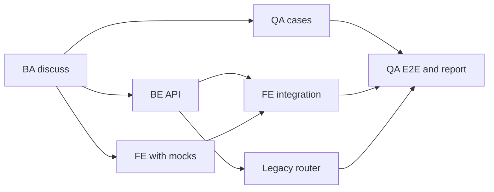

# Tham chiếu skill

Mỗi skill cũng là một slash command: `/gin:<name>` (Claude Code) hoặc tương đương của harness, `/gin-qa:<name>` cho add-on QA, và `/gin-orchestrator:<name>` cho add-on worker harness. Trong OpenCode, gọi một skill theo id bằng `@<name>` (ví dụ `@plan`; `learn` là `@gin-learn` và `report` là `@gin-report`, như sáu skill chung khác, xem [Xử lý sự cố](troubleshooting.md#opencode-does-not-show-the-gin-skills)); các stage của lifecycle vẫn chạy qua CLI `gin`. Trong GitHub Copilot CLI, các skill được đăng ký dưới tên thuần (`setup`, `workflow`, `plan`, ...), như `copilot skill list` hiển thị.

## gin: các stage của lifecycle { #gin-lifecycle-stages }

Chạy chúng theo thứ tự cho một tính năng. `workflow` chọn stage kế tiếp giúp bạn.

| Skill | Mục đích | Kết thúc bằng |
|---|---|---|
| `discuss` | Làm rõ một yêu cầu thành design spec đã xác nhận trước mọi việc lập plan, task hay code | `requirement_confirmed` |
| `plan` | Biến spec đã xác nhận thành plan triển khai với các track đã định tuyến | `plan_approved` |
| `orchestrate` | Phản chiếu plan thành các track Beads, xác định các provider route, và chuẩn bị workspace cô lập (một worktree, trừ khi việc cô lập bị tắt có phê duyệt) | `orchestration_ready` |
| `execute` | Triển khai và kiểm chứng một track sẵn sàng, trực tiếp hoặc qua một worker được định tuyến | track được đóng |
| `review` | Yêu cầu hoặc thực hiện một review độc lập được ghi trong review ledger | ledger được duyệt |
| `ship` | Đưa ra các lựa chọn merge, PR, giữ hoặc bỏ; chạy lựa chọn được chọn; đóng bead và ledger | `shipped` |

## gin: điểm vào và trạng thái { #gin-entry-points-and-status }

| Skill | Mục đích |
|---|---|
| `workflow` | Điều hướng trạng thái hiện tại tới đúng một stage của lifecycle, hoặc chẩn đoán một workflow đang bị giữ |
| `quick` | Thay đổi nhỏ, rủi ro thấp không cần plan hay bead: xác nhận, triển khai, kiểm chứng theo rigor, báo cáo |
| `progress` | Báo cáo trạng thái task, blocker, waiver đang mở và công việc sẵn sàng kế tiếp mà không thay đổi gì; với milestone, nó liệt kê các epic bằng `task list --parent <milestone-id>` |
| `report` | Báo cáo mức sử dụng AI theo bead, epic hoặc milestone (`--milestone <id>`: token, chi phí, tín hiệu chất lượng) mà không thay đổi gì |
| `setup` | Cấu hình repository lần đầu và bảo trì setup khi được yêu cầu |

## gin: các skill hỗ trợ { #gin-supporting-skills }

Các stage nạp những skill này khi cần; bạn cũng có thể gọi trực tiếp.

| Skill | Mục đích |
|---|---|
| `debugging` | Tìm nguyên nhân gốc của lỗi, test thất bại hoặc build thất bại trước khi sửa |
| `review-response` | Xử lý các phát hiện của review: kiểm chứng từng cái, rồi sửa, phản biện, hoãn hoặc làm rõ trong ledger |
| `worktrees` | Phát hiện hoặc tạo một git worktree cô lập và kiểm tra baseline test sạch |
| `parallel-agents` | Làm nhiều task độc lập đồng thời, mỗi domain một agent có phạm vi rõ |
| `learn` | Ghi lại các quyết định và bài học lâu dài, và đối chiếu tri thức dự án khi ship |
| `sdd` | Quy tắc stage cho `artifacts.layout: sdd`: change folder, REQ-ID, trace, spec review, archive ([hướng dẫn](../guides/sdd.md)) |
| `team` | Quy tắc stage cho chế độ nhóm: danh tính, cổng được chứng minh bằng PR, khu vực và owner, claim, đồng bộ Beads ([hướng dẫn](../guides/team.md)) |

## gin: setup và bảo trì { #gin-setup-and-maintenance }

| Skill | Mục đích |
|---|---|
| `team-setup` | Thiết lập hoặc tham gia chế độ nhóm: thành viên, vai trò, khu vực, phê duyệt, quy ước, hook, Beads dùng chung |
| `migrate-specs` | Chuyển layout spec và plan `.planning` cũ sang layout SDD `docs/` |
| `beads-migration` | Chuyển thư mục `.beads` của repository vào `~/gin-beads/<repo>` và tạo symlink ngược lại |
| `roadmap` | Biến bộ tech-doc hoặc một product brief thành roadmap đã xác nhận cùng các epic Beads phụ thuộc nhau; đối chiếu cả hai khi chạy lại; với layout SDD mỗi epic mang dòng `Capabilities:`; `--milestone <id>` lập kế hoạch cho một milestone có ngày |

## gin: tài liệu { #gin-documentation }

| Skill | Mục đích |
|---|---|
| `write-doc` | Viết hoặc cập nhật một tài liệu độc lập (README, runbook hoặc guide, ADR, changelog) từ template của nó, và kiểm tra bằng `gin docs check` |
| `tech-doc` | Viết tài liệu kỹ thuật (tính năng, API, stack, kiến trúc, quy ước, testing, và bảng thuật ngữ cho các thuật ngữ nghiệp vụ không phải tiếng Anh) từ bằng chứng trong repository, hoặc đối chiếu lại các trang hiện có với code, chỉ khi được yêu cầu |

## gin-qa (add-on tùy chọn) { #gin-qa-optional-add-on }

Xem [QA](../guides/qa.md).

| Skill | Mục đích |
|---|---|
| `cases` | Viết hoặc cập nhật test case từ spec, mỗi case một file dưới `qa/cases/<capability>/`, truy vết tới REQ-ID |
| `e2e` | Viết, chạy và kiểm tra các Playwright spec cho các case `Type: e2e` bằng cách khám phá ứng dụng đang chạy |
| `report` | Viết báo cáo HTML offline của các test case, kèm biểu đồ, bộ lọc và ảnh chụp e2e theo từng bước |
| `run` | Cùng tester đi qua các manual case của một capability, ghi từng kết quả, và tạo một bug bead liên kết với epic của case cho mỗi lỗi |
| `setup` | Thiết lập QA trong repository từ một buổi phỏng vấn: các guideline, `qa/README.md`, và một skill QA của dự án (`gin-qa-setup` trong OpenCode) |
| `tests` | Viết, chạy và kiểm tra test của các loại tự động đã khai báo ngoài e2e (`api`, `unit`, ...) trong test framework riêng của dự án |

Ở harness có subagent, `e2e` giao mỗi case cho agent `e2e-tester` của add-on ở model tầm trung và effort `low`.

## gin-ba (add-on tùy chọn) { #gin-ba-optional-add-on }

Các skill cho đầu vào của BA cho một capability, ghi vào các thư mục asset có tên ngày của nó với layout SDD. Cả hai đều không có CLI. Xem hướng dẫn BA.

| Skill | Mục đích |
|---|---|
| `capture` | Mô tả một feature hiện có từ screenshot trong `assets/<date>/legacy/`: các field, rule và câu hỏi mở theo từng màn hình trong `description.md` |
| `mockup` | Dựng một mockup HTML tương tác tự chứa tại `assets/<date>/mockup/index.html`, mỗi màn hình một section, sửa tới khi BA xác nhận |

Mỗi skill chỉ đặt `Confirmed: <date>` trong `description.md` sau khi BA xác nhận; discuss của SDD chỉ trích dẫn thư mục đã xác nhận.

## gin-orchestrator (add-on tùy chọn) { #gin-orchestrator-optional-add-on }

Xem [orchestrator contract](orchestrator-contract.md).

| Skill | Mục đích |
|---|---|
| `providers` | Cấu hình các worker harness: harness nào được chạy công việc, danh mục model của từng harness, harness ưu tiên và dự phòng theo vai trò, mức đồng thời và giới hạn |

## Prompt templates { #prompt-templates }

Sao chép một prompt, thay các placeholder trong dấu ngoặc nhọn, rồi chạy trong harness của bạn. Các ví dụ dùng nhóm `shop-portal` bảy người của [starter brownfield](../starters/brownfield.md#the-scenario), nơi định nghĩa các thành viên, khu vực và phê duyệt.

Các track của epic migration phụ thuộc nhau như sau. Sau khi BA xác nhận spec, các QA case, backend API và frontend với mock chạy song song.



Mỗi stage cần model và effort nào được nêu trong [Dùng AI hiệu quả](../guides/ai-strategy.md#model-and-effort-by-stage).

### Setup và team { #setup-and-team }

`setup` (Tech Lead, một lần):

```text
/gin:setup
Stage: brownfield. Shape: fullstack. Monorepo: yes.
Directories: legacy/ (Struts, subtree), services/api/ (Maven), apps/web/ (npm), qa/.
```

`team-setup` với tư cách lead:

```text
/gin:team-setup
Host: github. Commit convention: conventional.
Members: lan@example.com pm; an@example.com ba; binh@example.com be_lead; em@example.com and dung@example.com be_dev; hoa@example.com fe_dev; chi@example.com qe.
Areas: legacy legacy/**, api services/api/**, web apps/web/**, qa qa/**, each led by be_lead.
Approvals: requirement_confirmed [ba, be_lead], plan_approved area_lead, ship [qe, be_lead], roadmap [pm, be_lead].
Permissions: milestone [pm].
```

`team-setup` với tư cách thành viên:

```text
/gin:team-setup
I am a member. My git email is <email>.
```

### Tài liệu và roadmap { #documentation-and-roadmap }

`tech-doc`:

```text
/gin:tech-doc whole repository
Entry points: web.xml and the Struts config. Database: Oracle. First modules to replace: catalog, cart, checkout.
```

`roadmap` (Lan, trên seat Premium):

```text
/gin:roadmap Goal: replace the catalog, cart and checkout JSP flows with a Spring Boot API and a React SPA within two quarters. Constraints: the Oracle schema stays; no downtime. Non-goals: reporting screens.
Team: 7 members. Premium seats: lan, binh. Standard seats: an, em, dung, hoa, chi.
Areas: legacy, api, web, qa. Epics must split into single-area tracks.
```

`roadmap --milestone`:

```text
/gin:roadmap --milestone <milestone-id>
Capacity: 3 developers, 1 QE, 15 working days. Sizes: S=3 M=6 L=10 days. Pick only epics with no open blockers; the API facade lands first.
```

### Spec, plan và thực thi { #spec-plan-and-execution }

`discuss` (An):

```text
/gin:discuss <epic-id>
Replace the catalog JSP flow. Describe the legacy edge cases and validation rules, give an explicit REST contract per endpoint, and state what is out of scope.
```

`plan` (Binh, trên seat Premium):

```text
/gin:plan
Split the epic into single-area tracks, each with Area, Owner, Provider role, Model, Effort, and Files.
Track 1: Area qa, Owner chi@example.com, Provider role general, Files: Create qa/cases/catalog/**. Cases for the catalog capability, one file per case.
Track 2: Area api, Owner em@example.com, Provider role backend, Files: Create services/api/... Spring Boot API, facade, and parity tests.
Track 3: Area web, Owner hoa@example.com, Provider role frontend, Files: Create apps/web/... React UI against contract mocks.
Track 4: Area web, Owner hoa@example.com, Dependencies: Track 2, Track 3, Files: Modify apps/web/... Replace the mocks with real API calls.
Track 5: Area legacy, Owner binh@example.com, Dependencies: Track 2, Files: Modify legacy/... Router cutover to the facade, opus and high.
Track 6: Area qa, Owner chi@example.com, Dependencies: Track 1, Track 4, Track 5, Provider role general, Files: Create qa/e2e/catalog/... API tests, E2E, manual runs, and the HTML report.
Bounded tracks run at sonnet and medium or haiku and low. Check the plan with gin team check-plan.
```

`orchestrate`:

```text
/gin:orchestrate
Create one track bead per track, including the QA tracks. Members claim them with gin team claim.
```

`execute`:

```text
/gin:execute <track-bead-id>
Work test-first inside the track's Files. Stop and tell me if a change would leave the track's area.
```

### QA { #qa }

`/gin-qa:setup` (Chi, một lần):

```text
/gin-qa:setup
Case types: api, e2e, manual. The api type runs with <test command>. Bugs go to the epic as bug beads.
```

`/gin-qa:cases`:

```text
/gin-qa:cases catalog
Cover every requirement of the catalog spec and the legacy behaviors the new API must match.
```

`/gin-qa:tests`:

```text
/gin-qa:tests catalog --type api
```

`/gin-qa:run` (tạo một bug bead bằng `gin-qa cases bug` cho mỗi manual case thất bại):

```text
/gin-qa:run catalog
```

`/gin-qa:e2e`:

```text
/gin-qa:e2e catalog
Base URL: <url>. Accounts come from environment variables <names>. Flows: browse, search, open a product.
```

`/gin-qa:report` (ghi báo cáo HTML):

```text
/gin-qa:report catalog
```

### Đóng và review { #close-and-review }

`ship`:

```text
/gin:ship
Epic: <epic-id>. Open a pull request; do not merge yet.
```

`report`:

```text
/gin:report --milestone <milestone-id>
Show cost and quality signals per epic.
```
