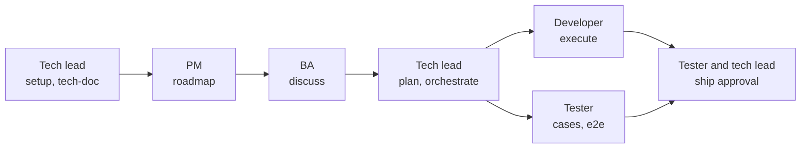

# Team roles

In [team mode](guides/team.md) each member holds roles, each area of the repository has a lead role, and a gate can require approval from listed roles. This page suggests how a PM, a BA, developers and testers split the work, and what each of them reads. gin-workflow enforces only what `team.areas` and `team.approvals` configure.

## Who owns what

| Role | Skills | Files | Branch | Approves |
|---|---|---|---|---|
| PM | `/gin:roadmap`, `/gin:progress`, `/gin:report`; `/gin:roadmap --milestone` writes milestones, limited by `team.permissions.milestone` | `.planning/roadmap.md` (`docs/roadmap.md` with the SDD layout) | `roadmap/<topic>` | `roadmap` |
| BA | `/gin-ba:capture`, `/gin-ba:mockup`, `/gin:discuss`, `/gin:explain`, `/gin:tech-doc`, `/gin:progress` | `.planning/specs/` (`docs/specs/` and `docs/changes/` with the SDD layout) | `spec/<topic>` (`spec/<epic>-<slug>` with the SDD layout) | `requirement_confirmed` |
| Tech lead | `/gin:setup`, `/gin:team-setup` (as lead), `/gin:tech-doc`, `/gin:plan`, `/gin:orchestrate`, `/gin:review`, `/gin:ship` | `.agent-workflow/config.yaml`, `.planning/codebase/` (`docs/codebase/` with the SDD layout), `.planning/plans/` (`04-plan.md` with the SDD layout), area source and test paths | `chore/team-setup`, `plan/<topic>`, `feat/<topic>-t<N>` | `plan_approved` for the areas they lead; the [sole-holder fallback](guides/team.md#approval-policies) covers a role whose only holder is the author |
| Frontend lead | `/gin:plan` (reviews it for their areas), `/gin:review`, `/gin:ship`, plus the developer skills | source and test paths of the app areas they lead | `feat/<topic>-t<N>` | `plan_approved` for the app areas they lead; may be one of the `any` roles of `ship` |
| Developer | `/gin:execute`, `/gin:review`, `/gin:ship` for their own tracks, `/gin:quick`, `/gin:progress` | source and unit and integration test paths in their areas; in a workspace, the child repository of the track | `feat/<topic>-t<N>` per track | peer code reviews |
| Tester | `/gin-qa:setup`, `/gin-qa:cases`, `/gin-qa:run`, `/gin-qa:e2e`, `/gin-qa:tests`, `/gin-qa:report`, `/gin:progress` | `cases/`, `e2e/`, `evidence/` in the [QA home](guides/qa.md#the-qa-home) | reviews the developer's pull request | `ship` |

## What each role reads

Everyone except the tech lead starts from [joining a team](guides/team.md#join-it-member), which links the install steps. Running `/gin:setup` again over the lead's configuration is the mistake to avoid.

### Tech lead

1. [Getting started](getting-started.md)
2. [Enabling team mode](guides/team.md#enable-it-lead)
3. [Brownfield starter](starters/brownfield.md)
4. [Rule packs](guides/rules.md)
5. [Using AI effectively](guides/ai-strategy.md)

### PM

1. [Joining a team](guides/team.md#join-it-member)
2. The Roadmap overview, Milestone planning, and Milestone review and spill-over sections of the [brownfield starter](starters/brownfield.md)
3. [AI usage report](guides/usage-report.md)
4. [Skills reference](reference/skills.md)

### BA

1. [Business analyst](guides/ba.md)
2. [Joining a team](guides/team.md#join-it-member)
3. [Team git agreement](guides/git-flow.md)
4. [SDD living specs](guides/sdd.md)
5. [Customizing templates](guides/customizing-templates.md)
6. The Discuss an epic section of the [brownfield starter](starters/brownfield.md#discuss-an-epic)

### Developer

1. [Joining a team](guides/team.md#join-it-member)
2. [Rule packs](guides/rules.md)
3. The Execute section of the [brownfield starter](starters/brownfield.md#execute)
4. [Working with Claude Code](guides/claude-workflow.md)

### Tester

1. [Joining a team](guides/team.md#join-it-member)
2. [Team git agreement](guides/git-flow.md)
3. [QA add-on](guides/qa.md)
4. The Requirements section of [SDD living specs](guides/sdd.md#requirements)
5. The Test cases and E2E sections of the [brownfield starter](starters/brownfield.md#test-cases)

## Keeping work apart

- Branches, pull requests, review, and merge: follow the [team git agreement](guides/git-flow.md).
- Requirement changes after plan approval (a team convention): do not edit the in-flight spec. With the SDD layout, see [changing a requirement after plan approval](guides/sdd.md#changing-a-requirement-after-plan-approval); `gin-qa cases plan` shows which test cases went stale.
- Tests (a team convention): developers own unit and integration tests next to the code; testers own acceptance cases and end-to-end specs under `qa/`. Give each its own area in `team.areas`, so plans keep them apart.
- Worktrees: each track runs in its own worktree created by `/gin:orchestrate`.
- Technical questions: in team mode a member with no technical role is asked business questions only in `/gin:discuss`. Each technical point becomes an open `TQ-<n>` that `/gin:plan` settles, and `record plan-approved` refuses while one is open ([team mode](guides/team.md) has the split).
- Claims, hand-overs and approvals ([team mode](guides/team.md) has the details):
  - a claim fails while someone else holds the bead;
  - `gin team reassign` hands a track over;
  - a gate with roles is recorded only with an approved pull request, never approved by its author.
