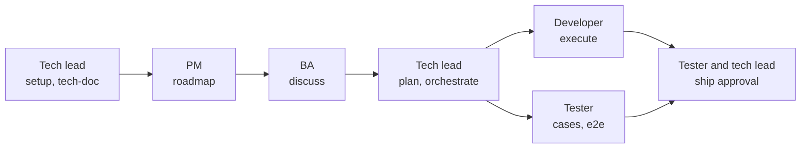

# Vai trò trong nhóm

Trong [chế độ nhóm](guides/team.md), mỗi thành viên giữ các vai trò, mỗi khu vực của repository có một vai trò lead, và một cổng có thể yêu cầu phê duyệt từ các vai trò được liệt kê. Trang này gợi ý cách PM, BA, developer và tester chia việc, và mỗi người đọc gì. gin-workflow chỉ cưỡng chế những gì `team.areas` và `team.approvals` cấu hình.

## Ai sở hữu gì { #who-owns-what }

| Vai trò | Skill | File | Branch | Phê duyệt |
|---|---|---|---|---|
| PM | `/gin:roadmap`, `/gin:progress`, `/gin:report`; `/gin:roadmap --milestone` ghi milestone, giới hạn bởi `team.permissions.milestone` | `.planning/roadmap.md` (`docs/roadmap.md` với layout SDD) | `roadmap/<topic>` | `roadmap` |
| BA | `/gin-ba:capture`, `/gin-ba:mockup`, `/gin:discuss`, `/gin:explain`, `/gin:tech-doc`, `/gin:progress` | `.planning/specs/` (`docs/specs/` và `docs/changes/` với layout SDD) | `spec/<topic>` (`spec/<epic>-<slug>` với layout SDD) | `requirement_confirmed` |
| Tech lead | `/gin:setup`, `/gin:team-setup` (với tư cách lead), `/gin:tech-doc`, `/gin:plan`, `/gin:orchestrate`, `/gin:review`, `/gin:ship` | `.agent-workflow/config.yaml`, `.planning/codebase/` (`docs/codebase/` với layout SDD), `.planning/plans/` (`04-plan.md` với layout SDD), đường dẫn source và test của khu vực | `chore/team-setup`, `plan/<topic>`, `feat/<topic>-t<N>` | `plan_approved`; người phê duyệt dự phòng cho `roadmap`, `requirement_confirmed` và `ship` khi một vai trò chỉ có một người giữ |
| Developer | `/gin:execute`, `/gin:review`, `/gin:ship` cho các track của chính mình, `/gin:quick`, `/gin:progress` | đường dẫn source và unit test, integration test trong khu vực của họ | `feat/<topic>-t<N>` cho mỗi track | peer code review |
| Tester | `/gin-qa:setup`, `/gin-qa:cases`, `/gin-qa:run`, `/gin-qa:e2e`, `/gin-qa:tests`, `/gin-qa:report`, `/gin:progress` | `cases/`, `e2e/`, `evidence/` trong [QA home](guides/qa.md#the-qa-home) | review pull request của developer | `ship` |

## Mỗi vai trò đọc gì { #what-each-role-reads }

Mọi người trừ tech lead bắt đầu từ [tham gia nhóm](guides/team.md#join-it-member), trang này dẫn tới các bước cài đặt. Lỗi cần tránh là chạy lại `/gin:setup` đè lên cấu hình của lead.

### Tech lead { #tech-lead }

1. [Bắt đầu](getting-started.md)
2. [Bật chế độ nhóm](guides/team.md#enable-it-lead)
3. [Starter brownfield](starters/brownfield.md)
4. [Rule pack](guides/rules.md)
5. [Dùng AI hiệu quả](guides/ai-strategy.md)

### PM { #pm }

1. [Tham gia nhóm](guides/team.md#join-it-member)
2. Các mục Roadmap overview, Milestone planning, và Milestone review and spill-over của [starter brownfield](starters/brownfield.md)
3. [Báo cáo sử dụng AI](guides/usage-report.md)
4. [Tham chiếu skill](reference/skills.md)

### BA { #ba }

1. [Business analyst](guides/ba.md)
2. [Tham gia nhóm](guides/team.md#join-it-member)
3. [Thoả thuận git của team](guides/git-flow.md)
4. [Living spec SDD](guides/sdd.md)
5. [Tùy biến template](guides/customizing-templates.md)
6. Mục Discuss an epic của [starter brownfield](starters/brownfield.md#discuss-an-epic)

### Developer { #developer }

1. [Tham gia nhóm](guides/team.md#join-it-member)
2. [Rule pack](guides/rules.md)
3. Mục Execute của [starter brownfield](starters/brownfield.md#execute)
4. [Làm việc với Claude Code](guides/claude-workflow.md)

### Tester { #tester }

1. [Tham gia nhóm](guides/team.md#join-it-member)
2. [Thoả thuận git của team](guides/git-flow.md)
3. [Add-on QA](guides/qa.md)
4. Mục Requirements của [living spec SDD](guides/sdd.md#requirements)
5. Các mục Test cases và E2E của [starter brownfield](starters/brownfield.md#test-cases)

## Giữ công việc tách biệt { #keeping-work-apart }

- Branch, pull request, review và merge: tuân theo [thoả thuận git của team](guides/git-flow.md).
- Thay đổi yêu cầu sau khi plan được duyệt (một quy ước của nhóm): đừng sửa spec đang chạy. Với layout SDD, thay đổi nằm trong một change folder mới có khối `MODIFIED` mang base hash của requirement mà nó thay thế, và `gin-qa cases plan` cho biết test case nào đã lỗi thời.
- Test (một quy ước của nhóm): developer sở hữu unit test và integration test nằm cạnh code; tester sở hữu acceptance case và end-to-end spec dưới `qa/`. Hãy cho mỗi loại một khu vực riêng trong `team.areas` để plan giữ chúng tách biệt.
- Worktree: mỗi track chạy trong worktree riêng do `/gin:orchestrate` tạo.
- Câu hỏi kỹ thuật: ở chế độ nhóm, thành viên không có vai trò kỹ thuật chỉ được hỏi câu hỏi nghiệp vụ trong `/gin:discuss`. Mỗi điểm kỹ thuật trở thành một `TQ-<n>` còn mở để `/gin:plan` giải quyết, và `record plan-approved` từ chối khi còn một câu mở ([chế độ nhóm](guides/team.md) có chi tiết về cách chia).
- Claim, bàn giao và phê duyệt ([chế độ nhóm](guides/team.md) có chi tiết):
  - claim thất bại khi người khác đang giữ bead;
  - `gin team reassign` bàn giao một track;
  - một cổng có vai trò chỉ được ghi nhận cùng một pull request đã duyệt, và không bao giờ do chính tác giả duyệt.
