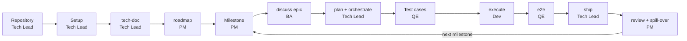
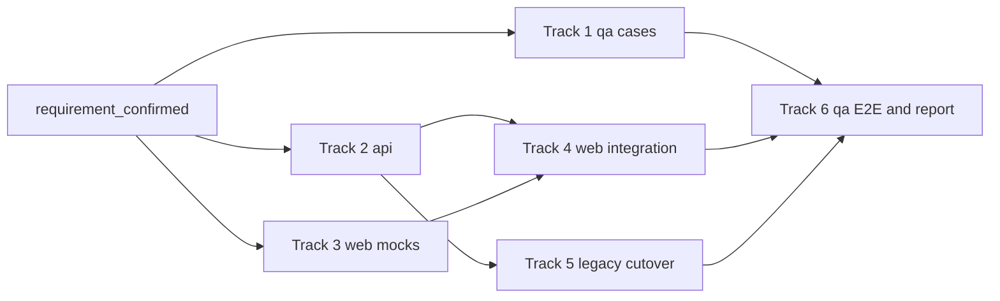

# Brownfield: from a legacy JSP monolith to milestone delivery

This page follows one team from "we inherited a legacy system" to the first milestone shipped and the next one planned. Each stage lists who runs it, the prompt to paste, what to put in the prompt, what you get, the gate or approval, and the mistakes to avoid.

In an existing codebase the code is often the only specification, so preventing regressions comes first. The modernization strategy here (strangler fig, parity tests, data migration) is a convention your team follows. `gin-workflow` enforces only track areas (`team.areas`) and the requirement hashes that `gin-qa` test cases pin.

## The scenario

`shop-portal` is a Java 8 JSP and Struts monolith on Oracle. The team replaces it behind a facade with a Spring Boot REST API and a React SPA, in one monorepo:

| Directory | Content |
|---|---|
| `legacy/` | the Struts application, brought in as a git subtree |
| `services/api/` | the Spring Boot API and the facade |
| `apps/web/` | the React SPA |
| `qa/` | test cases, end-to-end specs, evidence |

The team has seven people. Lan and Binh hold the two Claude Team Premium seats, so they take the work that needs the strongest model: the roadmap and milestones, the plan, reviews, and the hardest migration track. An, Em, Dung, Hoa, and Chi hold the five Standard seats and take bounded tracks. Seat allocation is a team choice, not a setting.

| Person | Role | Reads | Does |
|---|---|---|---|
| Lan | `pm` | [PM](../roles.md#pm) | Roadmap, milestones, milestone report |
| An | `ba` | [BA](../roles.md#ba) | Specs and user stories |
| Binh | `be_lead` | [Tech lead](../roles.md#tech-lead) | Setup, plan, orchestrate, ship, cutover |
| Em | `be_dev` | [Developer](../roles.md#developer) | API work |
| Dung | `be_dev` | [Developer](../roles.md#developer) | API and legacy work |
| Hoa | `fe_dev` | [Developer](../roles.md#developer) | React SPA work |
| Chi | `qe` | [Tester](../roles.md#tester) | Test cases, E2E, ship approval |

The `team:` block in `.agent-workflow/config.yaml` (written by `/gin-workflow:team-setup`):

```yaml
team:
  host: github
  commit_convention: conventional
  members:
    lan@example.com: {roles: [pm], login: lan-pm}
    an@example.com: {roles: [ba], login: an-ba}
    binh@example.com: {roles: [be_lead], login: binh-dev}
    em@example.com: {roles: [be_dev], login: em-dev}
    dung@example.com: {roles: [be_dev], login: dung-dev}
    hoa@example.com: {roles: [fe_dev], login: hoa-dev}
    chi@example.com: {roles: [qe], login: chi-qe}
  areas:
    legacy: {paths: ["legacy/**"], lead: be_lead, roles: [be_dev]}
    api: {paths: ["services/api/**"], lead: be_lead, roles: [be_dev]}
    web: {paths: ["apps/web/**"], lead: be_lead, roles: [fe_dev]}
    qa: {paths: ["qa/**"], lead: be_lead, roles: [qe]}
  approvals:
    requirement_confirmed: [ba, be_lead]
    plan_approved: area_lead
    ship: [qe, be_lead]
    roadmap: [pm, be_lead]
  permissions: {milestone: [pm]}
```

The areas do not overlap, so every plan track stays inside one of them. A gate is never approved by the author of its pull request, so each approving role needs a second holder. Lan has no second `pm` and An no second `ba`, so Binh approves their roadmap and spec pull requests. For the same reason `ship` lists `be_lead` next to `qe`: Binh approves Chi's own QA track pull requests, and Chi approves the developers'. Only Lan, the one `pm`, may run `gin-workflow milestone` writes.

## The flow at a glance



## Repository and workspace setup

**Who:** Tech Lead, once.

**Prompt**
```bash
git subtree add --prefix=legacy git@github.com:acme/shop-portal.git main
mkdir -p services/api apps/web qa
```
```text
/gin-workflow:setup
```
Answer `stage: brownfield`, `shape: fullstack`, `monorepo: true`.

Put in the prompt: the directories above and the stack of each (Maven for the API, npm for the SPA).

Keep the legacy code and its replacement in one monorepo, so a facade change, a parity test, and a legacy removal land in one pull request and one history. `git subtree` copies the legacy history under a directory and leaves nothing for teammates to initialize. Pull later vendor fixes with:

```bash
git subtree pull --prefix=legacy git@github.com:acme/shop-portal.git main
```

Git submodules are a poor fit: every checkout inside a submodule dirties the parent repository, and each member must keep two commits in step. A legacy repository stays separate when another team owns its deploy pipeline, when compliance requires its history or access list to stay apart, or when it is too large to carry in every clone.

Setup detects `packages` only from JavaScript workspaces. For this Maven and npm mix, add a `project.packages` entry for `services/api` and one for `apps/web` yourself in `.agent-workflow/config.yaml`, each with `path`, `shape`, and `verify.checks`. Hooks then run a package's checks in its directory ([configuration](../reference/config.md#verifychecks)).

**You get:** the legacy history under `legacy/`, and `.agent-workflow/config.yaml` with the project settings and your `project.packages` entries.

**Gate or approval:** none.

**Common mistakes:** a submodule instead of a subtree; no `project.packages` entry for a package, so its checks never run.

## Setup and team setup

**Who:** Tech Lead once per repository, then every member once on their own clone. Members do not register themselves: the lead lists every member, role, area, and approval in the `team:` block. Chi also runs `/gin-qa:setup` once.

**Prompt (Tech Lead)**
```text
/gin-workflow:team-setup
```

**Prompt (each member, after pulling the merged branch)**
```text
/gin-workflow:team-setup
```

**Prompt (Chi, once)**
```text
/gin-qa:setup
```

Put in the prompt: the seven members with their git emails and roles, the four areas with their paths, and `permissions: {milestone: [pm]}` so only the PM changes milestones. For `/gin-qa:setup`: the case types `api`, `e2e`, and `manual`, and the test command of the `api` type.

The lead answers `team-setup` as lead. It writes the `team:` block, runs `gin-workflow team init` (add `--ci` for a CI workflow), then you commit on a branch, push, and open a pull request. Merge it. A member answers as a member: it checks `gin-workflow team whoami` finds your `git config user.email`, installs the commit-msg hook (`gin-workflow team hooks`), asks you to log in (`gh auth login` or `glab auth login`), runs `bd init --remote <remote>` when the team shares Beads, and ends with `gin-workflow setup doctor`. Nothing is written back to the repository.

`/gin-qa:setup` reads what `qa/` already says and writes `qa/guidelines.md` (the `## Types`, `## Automated types`, `## Manual runs`, and `## Bugs` sections), `qa/README.md`, and a project QA skill under `.claude/skills/`. See the [QA add-on](../guides/qa.md#setup-gin-qasetup).

**You get:** the `team:` block, `.github/CODEOWNERS` (`.gitlab/CODEOWNERS` on GitLab), a pull request template, a commit-msg hook on every clone, and the QA guidelines.

**Gate or approval:** none. The lead protects the base branch on the host (pull request, one approval, "Require review from Code Owners") and, for the CI job to run `team codeowners --check`, sets the repository variable `GIN_WORKFLOW_INSTALL` (see [CI](../guides/team.md#ci-optional)).

**Common mistakes:** forgetting a member or the PM in `members` (the `roadmap` approval then fails with "role pm is held by no member" and the fix is another pull request); a git email that differs from the one in `members` (`team whoami` finds nothing); skipping the host login.

## Survey the legacy system

**Who:** Tech Lead.

**Prompt**
```text
/gin-workflow:tech-doc whole repository
```

Put in the prompt: the entry points you know (`web.xml`, the Struts config), the database, and the modules you plan to replace first.

**You get:** the tech-doc set under `.planning/codebase/` (or `docs/codebase/` with the SDD layout), one file per topic (`OVERVIEW`, `FEATURES`, `API`, `STACK`, `INTEGRATIONS`, `ARCHITECTURE`, `STRUCTURE`, `CONVENTIONS`, `TESTING`, `CONCERNS`).

**Gate or approval:** none. Review it with the team; the roadmap is only as good as this survey.

**Common mistakes:** documenting only the parts you plan to touch first; the roadmap needs the whole as-is picture to place dependencies, such as the Oracle stored procedures the checkout JSPs call.

## Roadmap overview

**Who:** PM.

**Prompt**
```text
/gin-workflow:roadmap Goal: replace the catalog, cart and checkout JSP flows with the REST API and the React SPA within two quarters; the Oracle schema stays; no downtime. Non-goals: reporting screens.
```

Put in the prompt: the goal and its deadline, the constraints that cannot move (here the schema and zero downtime), and the non-goals.

**You get:** the skill reads the tech-doc set, asks about goals, team and AI capacity, and constraints, proposes two or three ways to split the work, and shows the roadmap for your confirmation. After you confirm it writes `.planning/roadmap.md` (`docs/roadmap.md` with the SDD layout) on branch `roadmap/<topic>` and, after the sync, one epic per item with its dependencies in Beads. Read the result as a graph:

```bash
gin-workflow task graph --all
```

The gin-console Dependencies page shows the same graph. Choose what goes first from it: epics with no open blocker, and the one that unblocks the most others (here the API facade).

**Gate or approval:** with `team.approvals.roadmap: [pm, be_lead]`, the roadmap goes through a pull request that Binh approves (Lan cannot approve her own). Run the prompt again with the PR URL; the skill checks it with `gin-workflow team check <url> --gate roadmap`, then creates the epics.

**Common mistakes:** editing epic ids in the roadmap file later (ids never change once written); expecting the roadmap to close or delete epics you remove from the file (it only reports them); starting with the epic that has the most users instead of the one that unblocks the rest.

## Milestone planning

**Who:** PM.

**Prompt**
```bash
gin-workflow milestone create "M1 Catalog read path" --start 2026-11-10 --end 2026-11-28
```
```text
/gin-workflow:roadmap --milestone <id>
```
Use the id that `milestone create` prints. Put in the prompt: "Capacity: 3 developers, 1 QE, 15 working days. Sizes: S=3 M=6 L=10 days. Pick only epics with no open blockers; the API facade lands first."

Then fix the kick-off date and read the schedule:

```bash
gin-workflow milestone kickstart <id> --date 2026-11-10
gin-workflow milestone show <id>
```

**You get:** the chosen epics under the milestone, each with an estimate in working days, and a schedule with warnings (`overflow`, `late`, `unestimated`, `external_blocker`). A milestone is a Beads bead with a start and an end date, not a label.

**Gate or approval:** `permissions.milestone: [pm]` lets only Lan write; the roadmap pull request gate of the previous stage still applies to roadmap changes.

**Common mistakes:** picking an epic whose blocker sits in a later milestone (`external_blocker`); leaving epics without an estimate (`unestimated`); planning past the end date (`overflow`).

## Discuss an epic

**Who:** BA.

**Prompt**
```text
/gin-workflow:discuss <epic-id>
```

Put in the prompt: the user-visible behavior of the JSP flow you replace, its edge cases and validation rules (see [Capture current behavior first](#capture-current-behavior-first)), the REST API contract the new service must meet, and what is out of scope.

**You get:** the discussion starts from the epic and its roadmap entry and reuses it (no new epic). The spec is built from the `design-spec.md` template (or `proposal.md` with the SDD layout) and has a `## User Stories` section. Every story has acceptance criteria and, with REQ-IDs, a `REQ:` line.

**Gate or approval:** the spec is committed on `spec/<topic>` and opened as a pull request. With `requirement_confirmed: [ba, be_lead]`, Binh approves it (An cannot approve his own); the gate is recorded with the PR URL after the merge. Once it is confirmed, backend, frontend, and QA can work in parallel against the same contract.

**Common mistakes:** creating a second epic by hand; stories without acceptance criteria; skipping the legacy edge cases.

### Capture current behavior first

Before changing a capability, describe its current behavior as living specs, including the legacy edge cases, validation rules, and error codes. See [migrating to the SDD layout](../guides/sdd.md#migrating) for the setup.

```markdown
### REQ-AUTH-001: Legacy password hashing support
The authentication service MUST verify legacy MD5/SHA1 hashes while upgrading authenticated users to bcrypt/argon2id.
```

Write the REST contract of each endpoint the same way (path, method, request, response, error codes), so the new API and the SPA mocks are built from one source.

## Plan and orchestrate

**Who:** Tech Lead.

**Prompt**
```text
/gin-workflow:plan
/gin-workflow:orchestrate
```

Put in the prompt: the constraints of the migration (facade first, dual-write or backfill, rollback criteria), which tracks may run in parallel, and who holds a Premium seat.

**You get:** a plan with tracks per area and owner (`gin-workflow team check-plan <plan>` must pass), then one track bead per track under the reused epic, including the QA tracks, an isolated worktree per track, and dependencies. Members claim their beads with `gin-workflow team claim <bead>`.

**Gate or approval:** with `plan_approved: area_lead`, the area lead approves the plan pull request.

**Common mistakes:** a track that touches two areas, for example `services/api/` and `apps/web/`; run `gin-workflow team check-plan <plan>` before asking for approval.

### Strangler Fig

Modernize one bounded context at a time behind a stable facade or router instead of an all-at-once rewrite. Traffic for modernized endpoints goes to the new implementation while unmigrated requests pass through to the legacy core. The facade or gateway is your own infrastructure; `gin-workflow` does not provide one. The `team.areas` above keep a track inside either the legacy or the modernized paths.

In `/gin-workflow:discuss`, settle the data migration strategy (dual-write or backfill) and the rollback criteria, and in `/gin-workflow:plan` split the epic into single-area tracks:

| Track | Area | Owner | Work |
|---|---|---|---|
| 1 | `qa` | Chi | Test cases for the catalog capability, one file per case |
| 2 | `api` | Em | Spring Boot API, facade, and parity tests against the contract |
| 3 | `web` | Hoa | React UI built against contract mocks |
| 4 | `web` | Hoa | Integration: replace the mocks with real API calls |
| 5 | `legacy` | Binh | Router cutover to the new facade, on a Premium seat with a high effort |
| 6 | `qa` | Chi | API tests, E2E, manual runs, and the report |



Parity and data validation scripts run in the `pre-push` hook when the `verify.checks.test` command runs them ([configuration](../reference/config.md#verifychecks)).

## Test cases

**Who:** QE.

**Prompt**
```text
/gin-qa:cases catalog
/gin-qa:tests catalog --type api
```

Put in the prompt: the epic, and the legacy behaviors that the new API must match.

Passing unit tests does not show that the new code behaves like the old. Parity tests compare the two:

1. Capture recorded production or staging payloads (Golden Master).
2. Run each payload against both the legacy and the modern implementation.
3. Assert zero unexpected difference in the responses.

**You get:** one file per case under `qa/cases/catalog/`, for example `TC-CATALOG-001-list-products.api.md`, `TC-CATALOG-002-search-by-name.e2e.md`, and `TC-CATALOG-003-legacy-pagination.manual.md`. Each case is tied to a requirement and its content hash, and `gin-qa cases pin` records the hash again after a case is updated; `gin-qa cases plan` flags cases that went stale. The types `api`, `e2e`, and `manual` are listed under `## Types` in `qa/guidelines.md`. `/gin-qa:tests` writes and runs the `api` tests from the `Tests:` globs and the `Run:` command declared under `## Automated types`. A repository that still has the flat per-capability case file converts it once with `gin-qa cases split catalog`.

**Gate or approval:** none.

**Common mistakes:** writing cases before the spec is merged, because they point at requirements that can still change; an `api` type with no `Tests:` and `Run:` declaration.

## Execute

**Who:** Developer (Em and Dung for the API and legacy tracks, Hoa for the SPA tracks).

**Prompt**
```bash
gin-workflow team ready
gin-workflow team claim <bead>
```
```text
/gin-workflow:execute
```

Put in the prompt: the track bead to work on, if you want to choose it yourself.

`team ready` lists the beads in your areas. `team claim` writes a lease of `team.claim_ttl_hours` (default 48); claim again to renew it, and an expired lease lets another member take the bead. If a member is away or out of quota, push the track branch and run:

```bash
gin-workflow team reassign <bead> dung@example.com
```

The new assignee must be allowed to own tracks in the bead's areas, then checks out the pushed branch and continues.

**You get:** one track implemented test-first in the worktree, an independent review, a closed track bead, and a pushed feature branch.

**Gate or approval:** `execute` refuses a `roadmap` epic that has no confirmed spec; run [Discuss an epic](#discuss-an-epic) first. The claim fails if a teammate holds a valid lease.

**Common mistakes:** working outside the track's file scope; letting a lease expire while the work continues; closing the bead before the review finishes.

## E2E

**Who:** QE.

**Prompt**
```text
/gin-qa:e2e catalog
/gin-qa:run catalog
/gin-qa:report catalog
```

Put in the prompt: the base URL of the SPA, the test accounts (as environment variable names), and the flows to cover.

**You get:**
- `gin-qa e2e init` writes `playwright.config.ts` when the repository has none, and the evidence fixture.
- `/gin-qa:e2e` writes Playwright specs under `qa/e2e/catalog/` and records evidence under `qa/evidence/`.
- `/gin-qa:run` walks the manual cases, records each result with `gin-qa cases result`, and files a bug bead per failure through `gin-qa cases bug`, linked to the epic with `discovered-from`.
- `/gin-qa:report` writes an offline HTML report folder under `qa/evidence/` that you can zip and send.

**Gate or approval:** with `ship: [qe, be_lead]`, Chi approves the latest commit of a developer's pull request before it merges, and Binh approves Chi's. A later push needs a new approval. See the [ship approval checklist](../guides/qa.md#ship-approval-checklist).

**Common mistakes:** approving before the last commit; a push after approval silently invalidates it.

## Ship

**Who:** Tech Lead.

**Prompt**
```text
/gin-workflow:ship
```

Put in the prompt: the epic and whether to merge now or keep the branch.

**You get:** the merged deliverable. In team mode the gate's PR proof is written to the epic bead's `gates` metadata, so teammates see it in `gin-workflow state` without your local event store.

**Gate or approval:** merging into the base branch needs explicit approval; the `ship` approval on the latest commit is checked first.

**Common mistakes:** shipping one member's track as if the feature were complete; the lead declares the epic done once every track pull request has merged.

## Milestone review and spill-over

**Who:** PM, on the milestone's end date.

**Prompt**
```bash
gin-workflow milestone show <id>
gin-workflow milestone create "M2 Cart and checkout" --start 2026-12-01 --end 2026-12-18
gin-workflow milestone move <open-epic>... --to <next-id>
gin-workflow milestone close <id> --reason "Catalog read path shipped; checkout epic moved to M2"
```
```text
/gin-workflow:report --milestone <id>
/gin-workflow:progress milestone <id>
```
```bash
gin-workflow milestone kickstart <next-id> --date 2026-12-01
```

Put in the prompt: the milestone id, and for the report the question you need answered (cost, quality signals, or both).

**You get:** `milestone show` lists the open epics and the warnings; `move` re-parents the unfinished epics and records `{from, to, at, actor}` in each epic's `milestone_moves` metadata, so the history of an epic that slipped stays readable; `close` stores your reason as the bead's close reason. `report` gives the cost and usage of the milestone's epics and their tracks, and `progress` lists the milestone's epics with `gin-workflow task list --parent <id>` and the status of each epic's tracks. Then you run `kickstart` for the next milestone, and plan it as in [Milestone planning](#milestone-planning).

**Gate or approval:** `milestone close` is refused while the milestone has open epics, and `--reason` is required.

**Common mistakes:** closing an unfinished epic so the milestone can close, when it should move; moving epics without a reason on the close.

## Customizing outputs

Every artifact starts from a template you can override; test cases follow `qa/guidelines.md`. See [customizing templates](../guides/customizing-templates.md).

## Solo variant

One person plays every role, so the flow shrinks:

- No `team-setup`, no `team:` block, no pull requests for gates: you confirm in chat.
- The `milestone` commands work the same; without a `permissions` key nothing restricts them.
- Roadmap: `/gin-workflow:roadmap` writes the file after you confirm it and creates the epics directly.
- Execute: pick work with `gin-workflow task ready` instead of `gin-workflow team ready`, and skip claims.
- Everything else is the same: `/gin-workflow:discuss <epic-id>`, `plan`, `orchestrate`, `execute`, `ship`.
