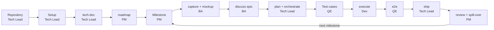
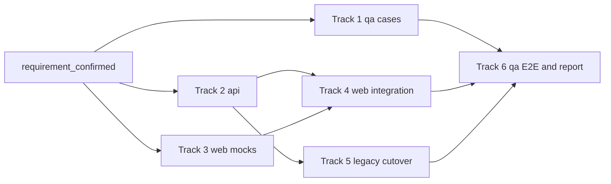

# Brownfield: from a legacy JSP monolith to milestone delivery

This page follows one team from "we inherited a legacy system" to the first milestone shipped and the next one planned. Each stage lists who runs it, the prompt to paste, what to put in the prompt, what you get, the gate or approval, and the mistakes to avoid.

In an existing codebase the code is often the only specification, so preventing regressions comes first. The modernization strategy here (strangler fig, parity tests, data migration) is a convention your team follows. gin-workflow enforces only track areas (`team.areas`) and the requirement hashes that `gin-qa` test cases pin.

## The scenario

`shop-portal` is a Java 8 JSP and Struts monolith on Oracle. The team replaces it behind a facade with a Spring Boot REST API and a React SPA, under one parent repository (a workspace):

| Directory | Content |
|---|---|
| `legacy/shop-portal/` | the Struts application, a `frozen` read-only repository |
| `services/order-api/` | the Spring Boot order API and the facade |
| `services/catalog-api/` | the Spring Boot catalog API |
| `apps/web-shop/` | the React SPA for customers |
| `apps/web-admin/` | the React SPA for administrators |
| `qa/` | the automation repository: test cases, end-to-end specs, evidence |
| `.beads/` | the shared Beads database |

The team has seven people. Lan and Binh hold the two Claude Team Premium seats, so they take the work that needs the strongest model: the roadmap and milestones, the plan, reviews, and the hardest migration track. An, Em, Dung, Hoa, and Chi hold the five Standard seats and take bounded tracks. Seat allocation is a team choice, not a setting.

| Person | Role | Reads | Does |
|---|---|---|---|
| Lan | `pm` | [PM](../roles.md#pm) | Roadmap, milestones, milestone report |
| An | `ba` | [BA](../roles.md#ba) | Specs and user stories |
| Binh | `be_lead` | [Tech lead](../roles.md#tech-lead) | Setup, plan, orchestrate, ship, cutover |
| Em | `be_dev` | [Developer](../roles.md#developer) | API work |
| Dung | `be_dev` | [Developer](../roles.md#developer) | API work |
| Hoa | `fe_lead`, `fe_dev` | [Frontend lead](../roles.md#who-owns-what) | React SPA work, web plan approval |
| Chi | `qe` | [Tester](../roles.md#tester) | Test cases, E2E, ship approval |

The `team:` block in `.agent-workflow/config.yaml` (written by `/gin:team-setup`):

```yaml
team:
  host: github
  commit_convention: conventional
  members:
    lan@example.com: {roles: [pm], login: lan-pm}
    an@example.com: {roles: [ba], login: an-ba}
    binh@example.com: {roles: [be_lead], login: binh-dev}
    em@example.com: {roles: [be_dev], login: em-dev}
    dung@example.com: {roles: [be_dev], login: dung-dev}
    hoa@example.com: {roles: [fe_lead, fe_dev], login: hoa-dev}
    chi@example.com: {roles: [qe], login: chi-qe}
  areas:
    legacy: {paths: ["legacy/shop-portal/**"], lead: be_lead, roles: [be_dev]}  # read-only: for tech-doc reading, no track targets it
    api: {paths: ["services/**"], lead: be_lead, roles: [be_dev]}
    web: {paths: ["apps/**"], lead: fe_lead, roles: [fe_dev]}
    qa: {paths: ["qa/**"], lead: be_lead, roles: [qe]}
  approvals:
    requirement_confirmed: [ba, be_lead]
    plan_approved: area_lead
    ship: {all: [qe], any: [be_lead, fe_lead]}
    roadmap: [pm, be_lead]
  permissions: {milestone: [pm]}
```

The areas do not overlap, so every plan track stays inside one of them. A gate is never approved by the author of its pull request. Lan has no second `pm` and An no second `ba`, so Binh approves their roadmap and spec pull requests. The `ship` policy uses the object form, which needs gin-workflow 3.1 or later: `all` roles must each approve, and one `any` role must approve. Chi is the only `qe`, so on Chi's own QA pull request the `qe` role is skipped with a note, and Binh or Hoa approves. Binh and Hoa each lead an area, so `gin setup doctor` notes that `qe`, `be_lead`, and `fe_lead` have one holder. The fallback applies only while the author is the sole holder; add a second holder to remove it. Only Lan, the one `pm`, may run `gin milestone` writes.

## The flow at a glance



## Repository and workspace setup

**Who:** Tech Lead, once.

**Where:** the parent repository, which holds `docs/` and `.planning/`. Its siblings are plain clones under it, not submodules.

**Prompt**
```text
/gin:setup
Repositories: legacy/shop-portal (Struts, frozen), services/order-api and services/catalog-api (Spring Boot, Maven), apps/web-shop and apps/web-admin (React, npm), qa (automation), .beads (shared Beads database).
Checks: mvn -q test and mvn -q package for the services; npm run lint, npm test and npm run build for the apps.
```
Answer `stage: brownfield`, `shape: fullstack`, and `workspace` for the repository layout. Then set `artifacts.layout: sdd` and fill `workspace.repos` in `.agent-workflow/config.yaml`:

```yaml
artifacts:
  layout: sdd
  test_globs: ["**/src/test/**", "**/test_*.py", "**/*_test.py", "**/*.test.*", "**/*.spec.*", "tests/**", "__tests__/**"]
workspace:
  repos:
    - {path: legacy/shop-portal, url: git@github.com:acme/shop-portal.git, frozen: true}
    - path: services/order-api
      url: git@github.com:acme/order-api.git
      shape: backend
      verify: {checks: {test: mvn -q test, build: mvn -q package}}
    - path: services/catalog-api
      url: git@github.com:acme/catalog-api.git
      shape: backend
      verify: {checks: {test: mvn -q test, build: mvn -q package}}
    - {path: apps/web-shop, url: git@github.com:acme/web-shop.git, shape: frontend,
       verify: {checks: {lint: npm run lint, test: npm test, build: npm run build}}}
    - {path: apps/web-admin, url: git@github.com:acme/web-admin.git, shape: frontend,
       verify: {checks: {lint: npm run lint, test: npm test, build: npm run build}}}
    - {path: qa, url: git@github.com:acme/qa.git, shape: qa}
    - {path: .beads, url: git@github.com:acme/beads.git, shape: beads}
```

The `test_globs` list is the default globs plus the Maven test tree, because a configured list replaces the defaults. This lets `gin specs trace` find the services' tests.

Then clone everything and install the hooks in each repository:

```bash
gin workspace clone --all
gin hooks install --all-repos
gin setup doctor
```

Put in the prompt: the six repositories above with the stack of each (Maven for the services, npm for the apps), and the shared Beads repository.

`legacy/shop-portal` is `frozen`: it is cloned shallow, read for the survey and the parity tests, and never gets hooks, tracks, or worktrees. `.beads` is the entry that holds the shared Beads database. `qa` is the automation repository, so it is the [QA home](../guides/qa.md#the-qa-home) and `gin-qa` keeps writing `cases/`, `e2e/`, and `evidence/` into it. Every path is added to the parent `.gitignore`, so the parent tracks no child. Each engineer clones only the repositories they work on; see the [workspace guide](../guides/workspace.md).

The alternative is one repository with the legacy code as a git subtree:

```bash
git subtree add --prefix=legacy git@github.com:acme/shop-portal.git main
mkdir -p services/api apps/web qa
```

In that variant, answer `monorepo: true` in `/gin:setup` and add a `project.packages` entry for `services/api` and one for `apps/web` yourself, each with `path`, `shape`, and `verify.checks` ([configuration](../reference/config.md#verifychecks)). Choose it when a facade change, a parity test, and a legacy removal must land in one pull request and one history, when the team is small enough to share one deploy pipeline, and when nobody needs to deploy a service on its own. Pull later vendor fixes with `git subtree pull --prefix=legacy git@github.com:acme/shop-portal.git main`. The rest of this page assumes the workspace.

**You get:** every repository cloned at its path, a pre-commit and pre-push hook in each cloned repository except frozen and beads entries that runs that repository's checks, and `.agent-workflow/config.yaml` with `workspace.repos`.

**Gate or approval:** none.

**Common mistakes:** running `/gin:setup` inside a child instead of the parent; leaving a path in `.gitmodules` while it is also in `workspace.repos` (`gin setup doctor` reports it as still a submodule); forgetting `gin hooks install --all-repos`, so a child has no hooks.

## Setup and team setup

**Who:** Tech Lead once per repository, then every member once on their own clone. Members do not register themselves: the lead lists every member, role, area, and approval in the `team:` block. Chi also runs `/gin-qa:setup` once.

**Where:** the parent.

**Prompt (Tech Lead)**
```text
/gin:team-setup
Members: lan@example.com (pm), an@example.com (ba), binh@example.com (be_lead), em@example.com and dung@example.com (be_dev), hoa@example.com (fe_lead and fe_dev), chi@example.com (qe).
Areas: legacy is legacy/shop-portal/** and read-only; api is services/**; web is apps/**; qa is qa/**. Binh leads legacy, api, and qa; Hoa leads web.
Approvals: requirement_confirmed by ba and be_lead; plan_approved by the area lead; ship by qe and one of be_lead or fe_lead; roadmap by pm and be_lead.
Permissions: only the pm changes milestones.
```

**Prompt (each member, after pulling the merged branch)**
```text
/gin:team-setup
I am Em (em@example.com), a be_dev. The team: block is merged on master.
```

**Prompt (Chi, once)**
```text
/gin-qa:setup
Case types: api, e2e and manual.
The api type: tests under qa/api/, run with npm test.
```

Put in the prompt: the seven members with their git emails and roles, the four areas with their paths, and `permissions: {milestone: [pm]}` so only the PM changes milestones. For `/gin-qa:setup`: the case types `api`, `e2e`, and `manual`, and the test command of the `api` type.

The lead answers `team-setup` as lead. It writes the `team:` block, runs `gin team init` (add `--ci` for a CI workflow), then you commit on a branch, push, and open a pull request. Merge it. A member answers as a member: it checks `gin team whoami` finds your `git config user.email`, installs the commit-msg hook (`gin team hooks`), asks you to log in (`gh auth login` or `glab auth login`), runs `bd init --remote <remote>` when the team shares Beads, and ends with `gin setup doctor`. Nothing is written back to the repository.

`/gin-qa:setup` reads what the QA home already says and writes its `guidelines.md` (the `## Types`, `## Automated types`, `## Manual runs`, and `## Bugs` sections), `README.md`, and a project QA skill under `.claude/skills/`. See the [QA add-on](../guides/qa.md#setup-gin-qasetup).

**You get:** the `team:` block, `.github/CODEOWNERS` (`.gitlab/CODEOWNERS` on GitLab), a pull request template, a commit-msg hook on every clone, and the QA guidelines.

**Gate or approval:** none. The lead protects the base branch on the host (pull request, one approval, "Require review from Code Owners") and, for the CI job to run `team codeowners --check`, sets the repository variable `GIN_WORKFLOW_INSTALL` (see [CI](../guides/team.md#ci-optional)).

**Common mistakes:** forgetting a member or the PM in `members` (the `roadmap` approval then fails with "role pm is held by no member" and the fix is another pull request); a git email that differs from the one in `members` (`team whoami` finds nothing); skipping the host login.

## Survey the legacy system

**Who:** Tech Lead.

**Where:** the parent.

**Prompt**
```text
/gin:tech-doc whole repository
Entry points: web.xml and struts-config.xml in legacy/shop-portal.
Database: Oracle; the checkout JSPs call stored procedures.
Replace first: the catalog, then the cart and checkout.
```

Put in the prompt: the entry points you know (`web.xml`, the Struts config), the database, and the modules you plan to replace first.

**You get:** the tech-doc set under `.planning/codebase/` (or `docs/codebase/` with the SDD layout), one file per topic (`OVERVIEW`, `FEATURES`, `API`, `STACK`, `INTEGRATIONS`, `ARCHITECTURE`, `STRUCTURE`, `CONVENTIONS`, `TESTING`, `CONCERNS`, `GLOSSARY`).

When the legacy system uses a language other than English, the set also holds `11-GLOSSARY.md`: each business term with a proposed English term, the identifiers that carry it, and its evidence. Before the first `/gin:discuss`, set the translations you accept to `confirmed`, resolve the `Conflicts` table, and add `glossary` to `rules.packs` in `.agent-workflow/config.yaml`. Specs, plans, code, and reviews then use the same terms, and later `/gin:tech-doc` runs never change a confirmed one.

**Gate or approval:** none. Review it with the team; the roadmap is only as good as this survey.

**Common mistakes:** documenting only the parts you plan to touch first; the roadmap needs the whole as-is picture to place dependencies, such as the Oracle stored procedures the checkout JSPs call.

## Roadmap overview

**Who:** PM.

**Where:** the parent.

**Prompt**
```text
/gin:roadmap Goal: replace the catalog, cart and checkout JSP flows with the Spring Boot REST API and the React SPA.
Deadline: 2027-05-28.
Constraints: the Oracle schema stays; no downtime; each module cuts over behind the facade.
Non-goals: reporting screens.
```

Put in the prompt: the goal, the deadline, the constraints that cannot move (here the schema, zero downtime, and the facade), and the non-goals. Sequencing and the way of working are not input: the skill proposes both and the PM confirms them.

**You get:** the skill reads the tech-doc set and asks about the goal, the deadline, the constraints, and the AI capacity. The `AI capacity:` line starts with the number of lanes, the streams of work that each run one epic at a time. The skill proposes two or three ways to split the work and a way of working, then shows the roadmap, with an `Estimate:` in working days per epic, for your confirmation. With no closed roadmap epic to measure a pace from, it asks for one day value per size (small, medium, large) and marks the estimates `(assumed)`.

After you confirm, it writes `.planning/roadmap.md` (`docs/roadmap.md` with the SDD layout) on branch `roadmap/<topic>`. `Deadline:` and `AI capacity:` sit under `## Constraints`, and the confirmed way of working sits under `## Way of working`. After the sync it creates one epic per item with its dependencies in Beads and stores each estimate with `gin milestone estimate`. Its report compares the forecast from `gin milestone list` with the deadline: the finish date, the spare or overflow working days, and the number of epics without an estimate. An overflow is reported and never blocks. Read the result as a graph:

```bash
gin task graph --all
```

The gin-console Dependencies page shows the same graph. Choose what goes first from it: epics with no open blocker, and the one that unblocks the most others (here the API facade).

**Gate or approval:** with `team.approvals.roadmap: [pm, be_lead]`, the roadmap goes through a pull request that Binh approves (Lan cannot approve her own). Run the prompt again with the PR URL; the skill checks it with `gin team check <url> --gate roadmap`, then creates the epics.

**Common mistakes:** editing epic ids in the roadmap file later (ids never change once written); expecting the roadmap to close or delete epics you remove from the file (it only reports them); starting with the epic that has the most users instead of the one that unblocks the rest; reading a forecast built on `(assumed)` estimates as a commitment.

## Milestone planning

**Who:** PM.

**Where:** the parent.

**Prompt**
```bash
gin milestone create "M1 Catalog read path" --start 2026-11-10 --end 2026-11-28 --lanes 3
```
```text
/gin:roadmap --milestone <id>
Milestone goal: customers browse the catalog on the new API behind the facade.
Leave out: the cart and checkout epics.
```

Use the id that `milestone create` prints. Put in the prompt: the milestone goal and the epics to leave out. The skill picks the ready epics itself.

`--lanes` is the capacity of this milestone and may differ from the project's `AI capacity:` number. Without it, the milestone uses that number, then the count of `team.members`, then 1.

Then fix the kick-off date, read the forecast, and read the schedule:

```bash
gin milestone kickstart <id> --date 2026-11-10
gin milestone list
gin milestone show <id>
```

**You get:** the chosen epics under the milestone, each with an `Estimate:` in working days. The roadmap file groups them under `## Milestone: <title>`, which opens with `Spec ready by:` (the kick-off date, else the start date) and an `Integration point:` block. The integration point is a date in the roadmap file only; Beads does not store it.

`gin milestone list` prints one forecast line over every open epic, assigned or not. `gin milestone show` prints the schedule and the warnings (`overflow`, `late`, `unestimated`, `external_blocker`, `spec_not_ready`). After the kick-off, `spec_not_ready` marks an open epic whose spec is not confirmed, so the BA sees which spec is due.

Repeat for each milestone. As milestones close, the open epic count in the forecast line falls and the finish date moves, because the remaining epics are scheduled again from today. A milestone is a Beads bead with a start and an end date, not a label.

**Gate or approval:** `permissions.milestone: [pm]` lets only Lan write; the roadmap pull request gate of the previous stage still applies to roadmap changes.

**Common mistakes:** picking an epic whose blocker sits in a later milestone (`external_blocker`); leaving epics without an estimate (`unestimated`); planning past the end date (`overflow`); kicking off a milestone whose epics have no confirmed spec (`spec_not_ready`).

## Capture and mockup (BA)

**Who:** BA.

**Where:** the parent.

**Prompt**
```text
/gin-ba:capture catalog --date 2026-11-12
Screenshots: the JSP catalog list and the product detail page, from the legacy system.
```
```text
/gin-ba:mockup catalog
```

Put in the prompt: the legacy screenshots of the catalog list and the product detail page. Run `/gin-ba:mockup catalog` only when the new UI differs from the legacy one.

**You get:** a dated folder under `docs/specs/catalog/assets/` with `Kind: legacy` in its `description.md`, and a mockup folder when the UI changes. The screenshots sit under `legacy/` in the dated folder. Both skills leave the folders uncommitted.

**Gate or approval:** none. The BA confirms each folder with `gin specs assets confirm catalog --date 2026-11-12`. `/gin:discuss` cites only confirmed folders and commits them with the change folder, as [images and mockups](../guides/sdd.md#images-and-mockups) describes. See also [living specs during a migration](../guides/sdd.md#living-specs-during-a-migration) and the [BA guide](../guides/ba.md).

**Common mistakes:** committing an asset folder on its own branch; running discuss before the folders are confirmed.

## Discuss an epic

**Who:** BA.

**Where:** the parent.

**Prompt**
```text
/gin:discuss shop-portal-catalog-read
Replace the JSP catalog list and product detail pages.
Legacy rules: hidden products never show; the price comes from the customer's price list and falls back to the list price; out-of-stock items show "Notify me".
API contract: GET /api/products?category=&page= and GET /api/products/{id}, with the same fields as the JSP model.
Out of scope: search and reviews.
```

Put in the prompt: the user-visible behavior of the JSP flow you replace, its edge cases and validation rules (see [Legacy behavior and living specs](#legacy-behavior-and-living-specs)), the REST API contract the new service must meet, and what is out of scope.

**You get:** the discussion starts from the epic and its roadmap entry and reuses it (no new epic). The spec is built from the `design-spec.md` template (or `proposal.md` with the SDD layout) and has a `## User Stories` section. Every story has acceptance criteria and, with REQ-IDs, a `REQ:` line.

**Gate or approval:** the spec is committed on `spec/<topic>` and opened as a pull request. With `requirement_confirmed: [ba, be_lead]`, Binh approves it (An cannot approve his own); the gate is recorded with the PR URL after the merge. Once it is confirmed, backend, frontend, and QA can work in parallel against the same contract.

**Common mistakes:** creating a second epic by hand; stories without acceptance criteria; skipping the legacy edge cases.

### Legacy behavior and living specs

Living specs describe the new system. The legacy behavior stays in the confirmed `Kind: legacy` folders, and each requirement taken from it names its folder in a `Source:` line. See [living specs during a migration](../guides/sdd.md#living-specs-during-a-migration).

```markdown
### REQ-CATALOG-001: Hide unpublished products
The catalog API SHALL omit hidden products from the product list.
Source: `assets/2026-11-12/description.md`
```

Write the REST contract of each endpoint the same way (path, method, request, response, error codes), so the new API and the SPA mocks are built from one source.

## Plan and orchestrate

**Who:** Tech Lead.

**Where:** the parent.

**Prompt**
```text
/gin:plan shop-portal-catalog-read
Migration: the facade comes first; the catalog API reads the existing Oracle tables, so no dual-write and no backfill.
Rollback: route the facade back to the JSP pages when the parity tests fail after cutover.
Parallel: QA cases, the catalog API, and the SPA against contract mocks.
Seats: the router cutover track goes to Binh on a Premium seat.
Each track names its repository, for example Repo: services/catalog-api.
```
```text
/gin:orchestrate shop-portal-catalog-read
Create the track beads and worktrees from the approved plan.
Leave every track bead unassigned; members take theirs with gin team claim.
```

Put in the prompt: the constraints of the migration (facade first, dual-write or backfill, rollback criteria), which tracks may run in parallel, and who holds a Premium seat. Each track carries `Repo: <path>`, for example `Repo: services/order-api`.

**You get:** a plan with tracks per area and owner (`gin team check-plan <plan>` must pass), then one track bead per track under the reused epic, including the QA tracks, an isolated worktree per track, and dependencies. Members claim their beads with `gin team claim <bead>`.

**Gate or approval:** with `plan_approved: area_lead`, the area lead approves the plan pull request.

**Common mistakes:** a track that touches two areas, for example `services/` and `apps/`; run `gin team check-plan <plan>` before asking for approval.

### Strangler Fig

Modernize one bounded context at a time behind a stable facade or router instead of an all-at-once rewrite. Traffic for modernized endpoints goes to the new implementation while unmigrated requests pass through to the legacy core. The facade or gateway is your own infrastructure; gin-workflow does not provide one. The `team.areas` above keep every track inside the modernized repositories; the frozen `legacy` area exists only so `/gin:tech-doc` can read it, and no track targets it.

In `/gin:discuss`, settle the data migration strategy (dual-write or backfill) and the rollback criteria, and in `/gin:plan` split the epic into single-area tracks:

| Track | Area | Owner | Work |
|---|---|---|---|
| 1 | `qa` | Chi | Test cases for the catalog capability, one file per case |
| 2 | `api` | Em | Spring Boot API, facade, and parity tests against the contract |
| 3 | `web` | Hoa | React UI built against contract mocks |
| 4 | `web` | Hoa | Integration: replace the mocks with real API calls |
| 5 | `api` (`services/order-api`) | Binh | Router cutover to the new facade, on a Premium seat with a high effort |
| 6 | `qa` | Chi | API tests, E2E, manual runs, and the report |



Parity and data validation scripts run in the `pre-push` hook when the `verify.checks.test` command runs them ([configuration](../reference/config.md#verifychecks)).

## Test cases

**Who:** QE.

**Where:** the `qa` repository.

**Prompt**
```text
/gin-qa:cases catalog
Epic: shop-portal-catalog-read.
Legacy behaviors the new API must match: hidden products never listed; customer price list with list-price fallback; the legacy pagination; the "Notify me" button on out-of-stock items.
```
```text
/gin-qa:tests catalog --type api
Compare the new API with the legacy pages on payloads recorded from staging.
```

Put in the prompt: the epic, and the legacy behaviors that the new API must match.

Passing unit tests does not show that the new code behaves like the old. Parity tests compare the two:

1. Capture recorded production or staging payloads (Golden Master).
2. Run each payload against both the legacy and the modern implementation.
3. Assert zero unexpected difference in the responses.

**You get:** one file per case under `qa/cases/catalog/`, for example `TC-CATALOG-001-list-products.api.md`, `TC-CATALOG-002-search-by-name.e2e.md`, and `TC-CATALOG-003-legacy-pagination.manual.md`. Each case is tied to a requirement and its content hash, and `gin-qa cases pin` records the hash again after a case is updated; `gin-qa cases plan` flags cases that went stale. The types `api`, `e2e`, and `manual` are listed under `## Types` in `qa/guidelines.md`. `/gin-qa:tests` writes and runs the `api` tests from the `Tests:` globs and the `Run:` command declared under `## Automated types`. A repository that still has the flat per-capability case file converts it once with `gin-qa cases split catalog`.

**Gate or approval:** none.

**Common mistakes:** writing cases before the spec is merged, because they point at requirements that can still change; an `api` type with no `Tests:` and `Run:` declaration.

## Execute

**Who:** Developer (Em and Dung for the API tracks, Hoa for the SPA tracks).

**Where:** the track worktree `<parent>/.planning/worktrees/<track-id>` (one service or one app).

**Prompt**
```bash
gin team ready
gin team claim shop-portal-catalog-read.2
```
```text
/gin:execute
Track: shop-portal-catalog-read.2, the catalog API track in services/catalog-api.
Stay inside that repository and run its checks before closing the track.
```

Put in the prompt: the track bead to work on, if you want to choose it yourself.

`team ready` lists the beads in your areas. `team claim` writes a lease of `team.claim_ttl_hours` (default 48); claim again to renew it, and an expired lease lets another member take the bead. If a member is away or out of quota, push the track branch and run:

```bash
gin team reassign <bead> dung@example.com
```

The new assignee must be allowed to own tracks in the bead's areas, then checks out the pushed branch and continues.

**You get:** one track implemented test-first in the worktree, an independent review, a closed track bead, and a pushed feature branch.

**Gate or approval:** `execute` refuses a `roadmap` epic that has no confirmed spec; run [Discuss an epic](#discuss-an-epic) first. The claim fails if a teammate holds a valid lease.

**Common mistakes:** working outside the track's file scope; letting a lease expire while the work continues; closing the bead before the review finishes.

## E2E

**Who:** QE.

**Where:** the `qa` repository.

**Prompt**
```text
/gin-qa:e2e catalog
Base URL: the web-shop staging URL, read from BASE_URL.
Accounts: SHOP_USER and SHOP_PASSWORD for a customer.
Flows: browse a category, open a product page, join the "Notify me" list of an out-of-stock product.
```
```text
/gin-qa:run catalog
Manual cases only; start with TC-CATALOG-003.
```
```text
/gin-qa:report catalog
Include the evidence of this run; the report goes to the product owner as a zip.
```

Put in the prompt: the base URL of the SPA, the test accounts (as environment variable names), and the flows to cover.

**You get:**
- `gin-qa e2e init` writes `playwright.config.ts` when the repository has none, and the evidence fixture.
- `/gin-qa:e2e` writes Playwright specs under `qa/e2e/catalog/` and records evidence under `qa/evidence/`.
- `/gin-qa:run` walks the manual cases, records each result with `gin-qa cases result`, and files a bug bead per failure through `gin-qa cases bug`, linked to the epic with `discovered-from`.
- `/gin-qa:report` writes an offline HTML report folder under `qa/evidence/` that you can zip and send.

**Gate or approval:** with `ship: {all: [qe], any: [be_lead, fe_lead]}`, a developer's pull request needs Chi and one lead (Binh or Hoa) to approve its latest commit before it merges. Chi's own QA pull request needs only a lead. A later push needs a new approval. See the [ship approval checklist](../guides/qa.md#ship-approval-checklist).

**Common mistakes:** approving before the last commit; a push after approval silently invalidates it.

## Ship

**Who:** Tech Lead.

**Where:** the parent.

**Prompt**
```text
/gin:ship
Epic: shop-portal-catalog-read.
Open a pull request instead of merging locally; Chi approves the latest commit first.
```

Put in the prompt: the epic and whether to merge now or keep the branch.

**You get:** the merged deliverable. In team mode the gate's PR proof is written to the epic bead's `gates` metadata, so teammates see it in `gin state` without your local event store.

**Gate or approval:** merging into the base branch needs explicit approval; the `ship` approval on the latest commit is checked first.

**Common mistakes:** shipping one member's track as if the feature were complete; the lead declares the epic done once every track pull request has merged.

## Milestone review and spill-over

**Who:** PM, on the milestone's end date.

**Where:** the parent.

**Prompt**
```bash
gin milestone show <id>
gin milestone create "M2 Cart and checkout" --start 2026-12-01 --end 2026-12-18
gin milestone move <open-epic>... --to <next-id>
gin milestone close <id> --reason "Catalog read path shipped; checkout epic moved to M2"
```
```text
/gin:report --milestone <id>
Question: what did the catalog epics cost, and which of them were reopened or had bugs found later?
```
```text
/gin:progress milestone <id>
Question: which epics are still open, and which tracks block them?
```
```bash
gin milestone kickstart <next-id> --date 2026-12-01
```

Put in the prompt: the milestone id, and for the report the question you need answered (cost, quality signals, or both).

**You get:** `milestone show` lists the open epics and the warnings; `move` re-parents the unfinished epics and records `{from, to, at, actor}` in each epic's `milestone_moves` metadata, so the history of an epic that slipped stays readable; `close` stores your reason as the bead's close reason. `report` gives the cost and usage of the milestone's epics and their tracks, and `progress` lists the milestone's epics with `gin task list --parent <id>` and the status of each epic's tracks. Then you run `kickstart` for the next milestone, and plan it as in [Milestone planning](#milestone-planning).

**Gate or approval:** `milestone close` is refused while the milestone has open epics, and `--reason` is required.

**Common mistakes:** closing an unfinished epic so the milestone can close, when it should move; moving epics without a reason on the close.

## Customizing outputs

Every artifact starts from a template you can override; test cases follow `qa/guidelines.md`. See [customizing templates](../guides/customizing-templates.md).

## Solo variant

One person plays every role, so the flow shrinks:

- No `team-setup`, no `team:` block, no pull requests for gates: you confirm in chat.
- The `milestone` commands work the same; without a `permissions` key nothing restricts them.
- Roadmap: `/gin:roadmap` writes the file after you confirm it and creates the epics directly.
- Execute: pick work with `gin task ready` instead of `gin team ready`, and skip claims.
- Everything else is the same: `/gin:discuss <epic-id>`, `plan`, `orchestrate`, `execute`, `ship`.
