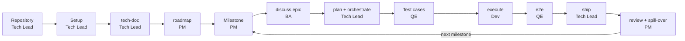
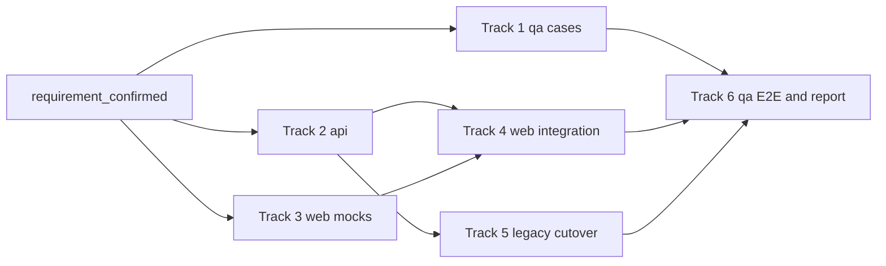

# Brownfield: từ monolith JSP legacy tới giao hàng theo milestone { #brownfield-from-a-legacy-jsp-monolith-to-milestone-delivery }

Trang này theo chân một nhóm từ lúc "chúng tôi thừa hưởng một hệ thống legacy" tới khi milestone đầu tiên được ship và milestone kế tiếp được lập kế hoạch. Mỗi giai đoạn nêu ai chạy nó, prompt cần dán, nội dung đưa vào prompt, kết quả nhận được, cổng hoặc phê duyệt, và các lỗi cần tránh.

Trong một codebase có sẵn, code thường là đặc tả duy nhất, nên ngăn regression là việc đặt lên đầu. Chiến lược hiện đại hóa ở đây (strangler fig, parity test, data migration) là quy ước mà nhóm của bạn tuân theo. gin-workflow chỉ cưỡng chế các khu vực của track (`team.areas`) và các requirement hash mà test case của `gin-qa` ghim lại.

## Kịch bản { #the-scenario }

`shop-portal` là một monolith Java 8 JSP và Struts chạy trên Oracle. Nhóm thay thế nó phía sau một facade bằng REST API Spring Boot và React SPA, dưới một repository cha (workspace):

| Thư mục | Nội dung |
|---|---|
| `legacy/shop-portal/` | ứng dụng Struts, repository `frozen` chỉ để đọc |
| `services/order-api/` | Spring Boot API cho đơn hàng và facade |
| `services/catalog-api/` | Spring Boot API cho danh mục |
| `apps/web-shop/` | React SPA cho khách hàng |
| `apps/web-admin/` | React SPA cho quản trị |
| `qa/` | repository automation: test case, end-to-end spec, evidence |
| `.beads/` | cơ sở dữ liệu Beads dùng chung |

Nhóm có bảy người. Lan và Binh giữ hai seat Claude Team Premium, nên nhận các việc cần model mạnh nhất: roadmap và milestone, plan, review, và track migration khó nhất. An, Em, Dung, Hoa và Chi giữ năm seat Standard và nhận các track có phạm vi rõ. Việc phân bổ seat là lựa chọn của nhóm, không phải một thiết lập.

| Người | Vai trò | Đọc | Làm |
|---|---|---|---|
| Lan | `pm` | [PM](../roles.md#pm) | Roadmap, milestone, báo cáo milestone |
| An | `ba` | [BA](../roles.md#ba) | Spec và user story |
| Binh | `be_lead` | [Tech lead](../roles.md#tech-lead) | Setup, plan, orchestrate, ship, cutover |
| Em | `be_dev` | [Developer](../roles.md#developer) | Công việc API |
| Dung | `be_dev` | [Developer](../roles.md#developer) | Công việc API |
| Hoa | `fe_dev` | [Developer](../roles.md#developer) | Công việc React SPA |
| Chi | `qe` | [Tester](../roles.md#tester) | Test case, E2E, phê duyệt ship |

Khối `team:` trong `.agent-workflow/config.yaml` (do `/gin:team-setup` ghi):

```yaml
team:
  host: github
  commit_convention: conventional
  members:
    lan@example.com: {roles: [pm], login: lan-pm}
    an@example.com: {roles: [ba], login: an-ba}
    binh@example.com: {roles: [be_lead], login: binh-dev}
    em@example.com: {roles: [be_dev], login: em-dev}
    dung@example.com: {roles: [be_dev], login: dung-dev}
    hoa@example.com: {roles: [fe_dev], login: hoa-dev}
    chi@example.com: {roles: [qe], login: chi-qe}
  areas:
    legacy: {paths: ["legacy/shop-portal/**"], lead: be_lead, roles: [be_dev]}  # read-only: for tech-doc reading, no track targets it
    api: {paths: ["services/**"], lead: be_lead, roles: [be_dev]}
    web: {paths: ["apps/**"], lead: be_lead, roles: [fe_dev]}
    qa: {paths: ["qa/**"], lead: be_lead, roles: [qe]}
  approvals:
    requirement_confirmed: [ba, be_lead]
    plan_approved: area_lead
    ship: [qe, be_lead]
    roadmap: [pm, be_lead]
  permissions: {milestone: [pm]}
```

Các khu vực không chồng lấn, nên mọi track của plan đều nằm trong một khu vực. Một cổng không bao giờ do tác giả của pull request duyệt, nên mỗi vai trò phê duyệt cần người giữ thứ hai. Lan không có `pm` thứ hai và An không có `ba` thứ hai, nên Binh duyệt pull request roadmap và spec của họ. Vì lý do tương tự, `ship` liệt kê `be_lead` bên cạnh `qe`: Binh duyệt các pull request track QA của chính Chi, và Chi duyệt của các developer. Chỉ Lan, `pm` duy nhất, được chạy các lệnh ghi của `gin milestone`.

## Toàn cảnh luồng làm việc { #the-flow-at-a-glance }



## Thiết lập repository và workspace { #repository-and-workspace-setup }

**Ai làm:** Tech Lead, một lần.

**Làm ở đâu:** repository cha, nơi chứa `docs/` và `.planning/`. Các repository con là bản clone thường nằm dưới nó, không phải submodule.

**Prompt**
```text
/gin:setup
```
Trả lời `stage: brownfield`, `shape: fullstack`, và `workspace` cho kiểu bố trí repository. Sau đó điền `workspace.repos` trong `.agent-workflow/config.yaml`:

```yaml
workspace:
  repos:
    - {path: legacy/shop-portal, url: git@github.com:acme/shop-portal.git, frozen: true}
    - path: services/order-api
      url: git@github.com:acme/order-api.git
      shape: backend
      verify: {checks: {test: mvn -q test, build: mvn -q package}}
    - path: services/catalog-api
      url: git@github.com:acme/catalog-api.git
      shape: backend
      verify: {checks: {test: mvn -q test, build: mvn -q package}}
    - {path: apps/web-shop, url: git@github.com:acme/web-shop.git, shape: frontend,
       verify: {checks: {lint: npm run lint, test: npm test, build: npm run build}}}
    - {path: apps/web-admin, url: git@github.com:acme/web-admin.git, shape: frontend,
       verify: {checks: {lint: npm run lint, test: npm test, build: npm run build}}}
    - {path: qa, url: git@github.com:acme/qa.git, shape: qa}
    - {path: .beads, url: git@github.com:acme/beads.git, shape: beads}
```

Sau đó clone tất cả và cài hook trong từng repository:

```bash
gin workspace clone --all
gin hooks install --all-repos
gin setup doctor
```

Đưa vào prompt: sáu repository ở trên cùng stack của từng cái (Maven cho các service, npm cho các app), và repository Beads dùng chung.

`legacy/shop-portal` là `frozen`: nó được clone nông (shallow), chỉ để đọc cho bước khảo sát và các parity test, và không bao giờ có hook, track hay worktree. `.beads` là mục giữ cơ sở dữ liệu Beads dùng chung. `qa` là repository automation, nên `gin-qa` vẫn ghi `qa/cases/`, `qa/e2e/` và `qa/evidence/` vào đó. Mỗi path được thêm vào `.gitignore` của repository cha, nên repository cha không theo dõi repository con nào. Mỗi kỹ sư chỉ clone các repository họ làm việc; xem [hướng dẫn workspace](../guides/workspace.md).

Phương án thay thế là một repository duy nhất với code legacy dưới dạng git subtree:

```bash
git subtree add --prefix=legacy git@github.com:acme/shop-portal.git main
mkdir -p services/api apps/web qa
```

Ở biến thể này, trả lời `monorepo: true` trong `/gin:setup` và tự thêm một mục `project.packages` cho `services/api` và một cho `apps/web`, mỗi mục có `path`, `shape` và `verify.checks` ([cấu hình](../reference/config.md#verifychecks)). Chọn nó khi một thay đổi facade, một parity test và một lần gỡ legacy phải nằm trong cùng một pull request và một lịch sử, khi nhóm đủ nhỏ để dùng chung một pipeline deploy, và khi không ai cần deploy một service riêng lẻ. Kéo các bản sửa của vendor về sau bằng `git subtree pull --prefix=legacy git@github.com:acme/shop-portal.git main`. Phần còn lại của trang này giả định bạn dùng workspace.

**Kết quả:** mọi repository được clone tại path của nó, một hook pre-commit và pre-push trong từng repository đã clone (trừ mục frozen và beads) chạy check của chính repository đó, và `.agent-workflow/config.yaml` với `workspace.repos`.

**Cổng hoặc phê duyệt:** không có.

**Lỗi thường gặp:** chạy `/gin:setup` trong một repository con thay vì repository cha; để một path trong `.gitmodules` trong khi nó cũng có trong `workspace.repos` (`gin setup doctor` báo là vẫn còn submodule); quên `gin hooks install --all-repos` nên một repository con không có hook.

## Setup và team setup { #setup-and-team-setup }

**Ai làm:** Tech Lead một lần cho mỗi repository, sau đó mỗi thành viên một lần trên bản clone của mình. Thành viên không tự đăng ký: lead liệt kê mọi thành viên, vai trò, khu vực và phê duyệt trong khối `team:`. Chi cũng chạy `/gin-qa:setup` một lần.

**Làm ở đâu:** repository cha.

**Prompt (Tech Lead)**
```text
/gin:team-setup
```

**Prompt (mỗi thành viên, sau khi pull branch đã merge)**
```text
/gin:team-setup
```

**Prompt (Chi, một lần)**
```text
/gin-qa:setup
```

Đưa vào prompt: bảy thành viên cùng git email và vai trò của họ, bốn khu vực cùng đường dẫn, và `permissions: {milestone: [pm]}` để chỉ PM thay đổi milestone. Với `/gin-qa:setup`: các loại case `api`, `e2e` và `manual`, và lệnh test của loại `api`.

Lead trả lời `team-setup` với tư cách lead. Nó ghi khối `team:`, chạy `gin team init` (thêm `--ci` cho một workflow CI), rồi bạn commit trên một branch, push và mở pull request. Hãy merge nó. Một thành viên trả lời với tư cách thành viên: nó kiểm tra `gin team whoami` tìm thấy `git config user.email` của bạn, cài commit-msg hook (`gin team hooks`), yêu cầu bạn đăng nhập (`gh auth login` hoặc `glab auth login`), chạy `bd init --remote <remote>` khi nhóm dùng chung Beads, và kết thúc bằng `gin setup doctor`. Không có gì được ghi ngược vào repository.

`/gin-qa:setup` đọc những gì `qa/` đã nói và ghi `qa/guidelines.md` (các mục `## Types`, `## Automated types`, `## Manual runs` và `## Bugs`), `qa/README.md`, và một skill QA của dự án dưới `.claude/skills/`. Xem [add-on QA](../guides/qa.md#setup-gin-qasetup).

**Kết quả:** khối `team:`, `.github/CODEOWNERS` (`.gitlab/CODEOWNERS` trên GitLab), một pull request template, một commit-msg hook trên mỗi bản clone, và các QA guideline.

**Cổng hoặc phê duyệt:** không có. Lead bảo vệ base branch trên host (pull request, một lượt duyệt, "Require review from Code Owners") và, để job CI chạy được `team codeowners --check`, đặt biến repository `GIN_WORKFLOW_INSTALL` (xem [CI](../guides/team.md#ci-optional)).

**Lỗi thường gặp:** quên một thành viên hoặc PM trong `members` (khi đó phê duyệt `roadmap` thất bại với "role pm is held by no member" và cách sửa là một pull request khác); git email khác với email trong `members` (`team whoami` không tìm thấy gì); bỏ qua bước đăng nhập host.

## Khảo sát hệ thống legacy { #survey-the-legacy-system }

**Ai làm:** Tech Lead.

**Làm ở đâu:** repository cha.

**Prompt**
```text
/gin:tech-doc whole repository
```

Đưa vào prompt: các entry point bạn biết (`web.xml`, cấu hình Struts), cơ sở dữ liệu, và các module bạn định thay thế trước.

**Kết quả:** bộ tech-doc dưới `.planning/codebase/` (hoặc `docs/codebase/` với layout SDD), mỗi chủ đề một file (`OVERVIEW`, `FEATURES`, `API`, `STACK`, `INTEGRATIONS`, `ARCHITECTURE`, `STRUCTURE`, `CONVENTIONS`, `TESTING`, `CONCERNS`, `GLOSSARY`).

Khi hệ thống legacy dùng một ngôn ngữ khác tiếng Anh, bộ này còn có `11-GLOSSARY.md`: mỗi thuật ngữ nghiệp vụ kèm thuật ngữ tiếng Anh đề xuất, các identifier mang nó, và bằng chứng. Trước `/gin:discuss` đầu tiên, hãy đặt các bản dịch bạn chấp nhận thành `confirmed`, giải quyết bảng `Conflicts`, và thêm `glossary` vào `rules.packs` trong `.agent-workflow/config.yaml`. Khi đó spec, plan, code, và review dùng cùng thuật ngữ, và các lần chạy `/gin:tech-doc` sau không bao giờ đổi một thuật ngữ đã confirmed.

**Cổng hoặc phê duyệt:** không có. Hãy review nó cùng nhóm; roadmap chỉ tốt bằng bản khảo sát này.

**Lỗi thường gặp:** chỉ ghi lại những phần bạn định đụng tới trước; roadmap cần toàn bộ bức tranh as-is để đặt các dependency, chẳng hạn các stored procedure Oracle mà các JSP checkout gọi tới.

## Tổng quan roadmap { #roadmap-overview }

**Ai làm:** PM.

**Làm ở đâu:** repository cha.

**Prompt**
```text
/gin:roadmap Goal: replace the catalog, cart and checkout JSP flows with the REST API and the React SPA within two quarters; the Oracle schema stays; no downtime. Non-goals: reporting screens.
```

Đưa vào prompt: mục tiêu và thời hạn, các ràng buộc không thể dịch chuyển (ở đây là schema và zero downtime), và các non-goal.

**Kết quả:** skill đọc bộ tech-doc, hỏi về mục tiêu, nhóm và năng lực AI, cùng các ràng buộc, đề xuất hai hoặc ba cách chia công việc, và hiển thị roadmap để bạn xác nhận. Sau khi bạn xác nhận, nó ghi `.planning/roadmap.md` (`docs/roadmap.md` với layout SDD) trên branch `roadmap/<topic>` và, sau khi đồng bộ, tạo mỗi mục một epic cùng dependency của nó trong Beads. Đọc kết quả dưới dạng đồ thị:

```bash
gin task graph --all
```

Trang Dependencies của gin-console hiển thị cùng đồ thị đó. Từ đó chọn việc làm trước: các epic không có blocker đang mở, và epic mở khóa được nhiều epic khác nhất (ở đây là API facade).

**Cổng hoặc phê duyệt:** với `team.approvals.roadmap: [pm, be_lead]`, roadmap đi qua một pull request mà Binh duyệt (Lan không thể tự duyệt). Chạy lại prompt với URL của PR; skill kiểm tra nó bằng `gin team check <url> --gate roadmap`, rồi tạo các epic.

**Lỗi thường gặp:** sửa epic id trong file roadmap về sau (id không bao giờ đổi một khi đã ghi); mong roadmap đóng hoặc xóa các epic bạn bỏ khỏi file (nó chỉ báo cáo chúng); bắt đầu với epic có nhiều người dùng nhất thay vì epic mở khóa phần còn lại.

## Lập kế hoạch milestone { #milestone-planning }

**Ai làm:** PM.

**Làm ở đâu:** repository cha.

**Prompt**
```bash
gin milestone create "M1 Catalog read path" --start 2026-11-10 --end 2026-11-28
```
```text
/gin:roadmap --milestone <id>
```
Dùng id mà `milestone create` in ra. Đưa vào prompt: "Capacity: 3 developers, 1 QE, 15 working days. Sizes: S=3 M=6 L=10 days. Pick only epics with no open blockers; the API facade lands first."

Sau đó chốt ngày kick-off và đọc lịch:

```bash
gin milestone kickstart <id> --date 2026-11-10
gin milestone show <id>
```

**Kết quả:** các epic được chọn nằm dưới milestone, mỗi epic có ước lượng theo ngày làm việc, và một lịch kèm các cảnh báo (`overflow`, `late`, `unestimated`, `external_blocker`). Một milestone là một bead của Beads có ngày bắt đầu và ngày kết thúc, không phải một label.

**Cổng hoặc phê duyệt:** `permissions.milestone: [pm]` chỉ cho Lan ghi; cổng pull request roadmap của giai đoạn trước vẫn áp dụng cho các thay đổi roadmap.

**Lỗi thường gặp:** chọn một epic có blocker nằm ở milestone sau (`external_blocker`); để epic không có ước lượng (`unestimated`); lập kế hoạch vượt quá ngày kết thúc (`overflow`).

## Discuss một epic { #discuss-an-epic }

**Ai làm:** BA.

**Làm ở đâu:** repository cha.

**Prompt**
```text
/gin:discuss <epic-id>
```

Đưa vào prompt: hành vi người dùng nhìn thấy của luồng JSP bạn thay thế, các edge case và quy tắc validation của nó (xem [Ghi lại hành vi hiện tại trước](#capture-current-behavior-first)), hợp đồng REST API mà service mới phải đáp ứng, và những gì nằm ngoài phạm vi.

**Kết quả:** cuộc thảo luận bắt đầu từ epic và mục roadmap của nó và dùng lại epic đó (không tạo epic mới). Spec được dựng từ template `design-spec.md` (hoặc `proposal.md` với layout SDD) và có mục `## User Stories`. Mỗi story có acceptance criteria và, với REQ-ID, một dòng `REQ:`.

**Cổng hoặc phê duyệt:** spec được commit trên `spec/<topic>` và mở dưới dạng pull request. Với `requirement_confirmed: [ba, be_lead]`, Binh duyệt nó (An không thể tự duyệt); cổng được ghi nhận cùng URL của PR sau khi merge. Một khi đã được xác nhận, backend, frontend và QA có thể làm song song trên cùng một hợp đồng.

**Lỗi thường gặp:** tạo epic thứ hai bằng tay; story không có acceptance criteria; bỏ qua các edge case của legacy.

### Ghi lại hành vi hiện tại trước { #capture-current-behavior-first }

Trước khi thay đổi một capability, hãy mô tả hành vi hiện tại của nó dưới dạng living spec, gồm các edge case của legacy, quy tắc validation và mã lỗi. Xem [chuyển sang layout SDD](../guides/sdd.md#migrating) để biết cách thiết lập.

```markdown
### REQ-AUTH-001: Legacy password hashing support
The authentication service MUST verify legacy MD5/SHA1 hashes while upgrading authenticated users to bcrypt/argon2id.
```

Hãy viết hợp đồng REST của từng endpoint theo cách tương tự (path, method, request, response, mã lỗi), để API mới và các mock của SPA được xây từ cùng một nguồn.

## Plan và orchestrate { #plan-and-orchestrate }

**Ai làm:** Tech Lead.

**Làm ở đâu:** repository cha.

**Prompt**
```text
/gin:plan
/gin:orchestrate
```

Đưa vào prompt: các ràng buộc của migration (facade trước, dual-write hay backfill, tiêu chí rollback), các track nào có thể chạy song song, và ai giữ seat Premium. Mỗi track mang `Repo: <path>`, ví dụ `Repo: services/order-api`.

**Kết quả:** một plan với các track theo khu vực và owner (`gin team check-plan <plan>` phải qua), rồi mỗi track một track bead dưới epic được dùng lại, gồm cả các track QA, một worktree cô lập cho mỗi track, và các dependency. Thành viên claim bead của mình bằng `gin team claim <bead>`.

**Cổng hoặc phê duyệt:** với `plan_approved: area_lead`, area lead duyệt pull request của plan.

**Lỗi thường gặp:** một track đụng tới hai khu vực, ví dụ `services/` và `apps/`; hãy chạy `gin team check-plan <plan>` trước khi xin duyệt.

### Strangler Fig { #strangler-fig }

Hiện đại hóa từng bounded context một phía sau một facade hoặc router ổn định thay vì viết lại tất cả cùng lúc. Traffic của các endpoint đã hiện đại hóa đi tới bản triển khai mới, còn các request chưa migrate được chuyển tiếp xuống lõi legacy. Facade hoặc gateway là hạ tầng của riêng bạn; gin-workflow không cung cấp. Các `team.areas` ở trên giữ mọi track trong các repository đã hiện đại hóa; khu vực `legacy` bị đóng băng chỉ tồn tại để `/gin:tech-doc` đọc, và không track nào nhắm tới nó.

Trong `/gin:discuss`, hãy chốt chiến lược data migration (dual-write hoặc backfill) và tiêu chí rollback, còn trong `/gin:plan` hãy chia epic thành các track một khu vực:

| Track | Khu vực | Owner | Công việc |
|---|---|---|---|
| 1 | `qa` | Chi | Test case cho capability catalog, mỗi case một file |
| 2 | `api` | Em | Spring Boot API, facade và parity test theo hợp đồng |
| 3 | `web` | Hoa | React UI xây dựa trên contract mock |
| 4 | `web` | Hoa | Tích hợp: thay các mock bằng lời gọi API thật |
| 5 | `api` (`services/order-api`) | Binh | Router cutover sang facade mới, trên seat Premium với effort cao |
| 6 | `qa` | Chi | API test, E2E, manual run và báo cáo |



Các script kiểm tra parity và dữ liệu chạy trong hook `pre-push` khi lệnh `verify.checks.test` chạy chúng ([cấu hình](../reference/config.md#verifychecks)).

## Test case { #test-cases }

**Ai làm:** QE.

**Làm ở đâu:** repository `qa`.

**Prompt**
```text
/gin-qa:cases catalog
/gin-qa:tests catalog --type api
```

Đưa vào prompt: epic, và các hành vi legacy mà API mới phải khớp.

Unit test qua không chứng tỏ code mới hành xử như code cũ. Parity test so sánh hai bên:

1. Thu thập các payload production hoặc staging đã ghi lại (Golden Master).
2. Chạy từng payload trên cả bản triển khai legacy lẫn bản hiện đại.
3. Khẳng định không có khác biệt ngoài dự kiến nào trong các response.

**Kết quả:** mỗi case một file dưới `qa/cases/catalog/`, ví dụ `TC-CATALOG-001-list-products.api.md`, `TC-CATALOG-002-search-by-name.e2e.md` và `TC-CATALOG-003-legacy-pagination.manual.md`. Mỗi case gắn với một requirement và content hash của nó, và `gin-qa cases pin` ghi lại hash sau khi một case được cập nhật; `gin-qa cases plan` đánh dấu các case đã lỗi thời. Các loại `api`, `e2e` và `manual` được liệt kê dưới `## Types` trong `qa/guidelines.md`. `/gin-qa:tests` viết và chạy các test `api` từ các glob `Tests:` và lệnh `Run:` khai báo dưới `## Automated types`. Một repository vẫn còn file case phẳng theo từng capability thì chuyển nó một lần bằng `gin-qa cases split catalog`.

**Cổng hoặc phê duyệt:** không có.

**Lỗi thường gặp:** viết case trước khi spec được merge, vì chúng trỏ tới các requirement vẫn có thể thay đổi; loại `api` không có khai báo `Tests:` và `Run:`.

## Execute { #execute }

**Ai làm:** Developer (Em và Dung cho các track API, Hoa cho các track SPA).

**Làm ở đâu:** worktree của track `<parent>/.planning/worktrees/<track-id>` (một service hoặc một app).

**Prompt**
```bash
gin team ready
gin team claim <bead>
```
```text
/gin:execute
```

Đưa vào prompt: track bead cần làm, nếu bạn muốn tự chọn.

`team ready` liệt kê các bead trong khu vực của bạn. `team claim` ghi một lease dài `team.claim_ttl_hours` (mặc định 48); claim lại để gia hạn, và khi lease hết hạn thì thành viên khác có thể nhận bead. Nếu một thành viên vắng mặt hoặc hết quota, hãy push track branch và chạy:

```bash
gin team reassign <bead> dung@example.com
```

Người nhận mới phải được phép sở hữu track trong các khu vực của bead, sau đó checkout branch đã push và tiếp tục.

**Kết quả:** một track được triển khai test-first trong worktree, một review độc lập, một track bead đã đóng, và một feature branch đã push.

**Cổng hoặc phê duyệt:** `execute` từ chối một epic `roadmap` chưa có spec được xác nhận; hãy chạy [Discuss một epic](#discuss-an-epic) trước. Claim thất bại nếu đồng đội đang giữ một lease còn hiệu lực.

**Lỗi thường gặp:** làm việc ngoài phạm vi file của track; để lease hết hạn trong khi công việc vẫn tiếp diễn; đóng bead trước khi review xong.

## E2E { #e2e }

**Ai làm:** QE.

**Làm ở đâu:** repository `qa`.

**Prompt**
```text
/gin-qa:e2e catalog
/gin-qa:run catalog
/gin-qa:report catalog
```

Đưa vào prompt: base URL của SPA, các tài khoản test (dưới dạng tên biến môi trường), và các luồng cần phủ.

**Kết quả:**
- `gin-qa e2e init` ghi `playwright.config.ts` khi repository chưa có, cùng evidence fixture.
- `/gin-qa:e2e` viết các Playwright spec dưới `qa/e2e/catalog/` và ghi evidence dưới `qa/evidence/`.
- `/gin-qa:run` đi qua các manual case, ghi từng kết quả bằng `gin-qa cases result`, và tạo một bug bead cho mỗi lỗi qua `gin-qa cases bug`, liên kết với epic bằng `discovered-from`.
- `/gin-qa:report` ghi một thư mục báo cáo HTML offline dưới `qa/evidence/` mà bạn có thể nén và gửi đi.

**Cổng hoặc phê duyệt:** với `ship: [qe, be_lead]`, Chi duyệt commit mới nhất của pull request của developer trước khi nó merge, và Binh duyệt của Chi. Một lần push sau đó cần duyệt lại. Xem [checklist phê duyệt ship](../guides/qa.md#ship-approval-checklist).

**Lỗi thường gặp:** duyệt trước commit cuối; một lần push sau khi duyệt âm thầm làm phê duyệt mất hiệu lực.

## Ship { #ship }

**Ai làm:** Tech Lead.

**Làm ở đâu:** repository cha.

**Prompt**
```text
/gin:ship
```

Đưa vào prompt: epic, và liệu có merge ngay hay giữ branch.

**Kết quả:** sản phẩm bàn giao đã merge. Ở chế độ nhóm, bằng chứng PR của cổng được ghi vào metadata `gates` của epic bead, để đồng đội thấy nó trong `gin state` mà không cần event store cục bộ của bạn.

**Cổng hoặc phê duyệt:** merge vào base branch cần phê duyệt rõ ràng; phê duyệt `ship` trên commit mới nhất được kiểm tra trước.

**Lỗi thường gặp:** ship track của một thành viên như thể tính năng đã hoàn tất; lead tuyên bố epic xong khi mọi pull request của track đã merge.

## Review milestone và spill-over { #milestone-review-and-spill-over }

**Ai làm:** PM, vào ngày kết thúc của milestone.

**Làm ở đâu:** repository cha.

**Prompt**
```bash
gin milestone show <id>
gin milestone create "M2 Cart and checkout" --start 2026-12-01 --end 2026-12-18
gin milestone move <open-epic>... --to <next-id>
gin milestone close <id> --reason "Catalog read path shipped; checkout epic moved to M2"
```
```text
/gin:report --milestone <id>
/gin:progress milestone <id>
```
```bash
gin milestone kickstart <next-id> --date 2026-12-01
```

Đưa vào prompt: milestone id, và với báo cáo thì là câu hỏi bạn cần trả lời (chi phí, tín hiệu chất lượng, hoặc cả hai).

**Kết quả:** `milestone show` liệt kê các epic đang mở và các cảnh báo; `move` chuyển parent của các epic chưa xong và ghi `{from, to, at, actor}` vào metadata `milestone_moves` của mỗi epic, để lịch sử của một epic bị trượt vẫn đọc được; `close` lưu lý do của bạn làm close reason của bead. `report` cho biết chi phí và mức sử dụng của các epic trong milestone cùng các track của chúng, còn `progress` liệt kê các epic của milestone bằng `gin task list --parent <id>` và trạng thái các track của từng epic. Sau đó bạn chạy `kickstart` cho milestone kế tiếp, và lập kế hoạch nó như trong [Lập kế hoạch milestone](#milestone-planning).

**Cổng hoặc phê duyệt:** `milestone close` bị từ chối khi milestone còn epic đang mở, và `--reason` là bắt buộc.

**Lỗi thường gặp:** đóng một epic chưa xong để milestone đóng được, trong khi lẽ ra nó phải được chuyển; chuyển epic mà không ghi lý do khi close.

## Tùy biến đầu ra { #customizing-outputs }

Mỗi artifact bắt đầu từ một template bạn có thể ghi đè; test case theo `qa/guidelines.md`. Xem [tùy biến template](../guides/customizing-templates.md).

## Biến thể làm một mình { #solo-variant }

Một người đóng mọi vai trò, nên luồng được rút gọn:

- Không có `team-setup`, không có khối `team:`, không có pull request cho các cổng: bạn xác nhận trong chat.
- Các lệnh `milestone` hoạt động như cũ; không có khóa `permissions` thì không gì hạn chế chúng.
- Roadmap: `/gin:roadmap` ghi file sau khi bạn xác nhận và tạo các epic trực tiếp.
- Execute: chọn việc bằng `gin task ready` thay vì `gin team ready`, và bỏ qua claim.
- Mọi thứ còn lại giống nhau: `/gin:discuss <epic-id>`, `plan`, `orchestrate`, `execute`, `ship`.
