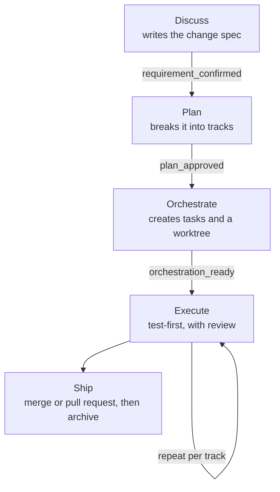

# Starter dự án greenfield

Hướng dẫn này khởi tạo một dự án mới bằng Claude Code và `gin-workflow`, từ repository trống tới tính năng đầu tiên.

---

## Điều kiện tiên quyết và khởi tạo { #prerequisites-and-initialization }

Hãy cài [các dependency](https://github.com/giangdhwhtbr/gin-workflow/blob/master/README.md#dependencies) trước; Beads là tùy chọn.

```bash
# 1. Initialize a new git repository
git init my-awesome-project
cd my-awesome-project

# 2. Install the gin-workflow plugin for Claude Code
curl -sSL https://raw.githubusercontent.com/giangdhwhtbr/gin-workflow/master/remote-install.sh | bash -s -- --platform claude
```

Kiểm tra cài đặt:

```bash
gin-workflow --version
```

---

## Thiết lập một lần { #one-time-setup }

Trong Claude Code, chạy setup:

```text
/gin-workflow:setup
```

Setup phát hiện môi trường của bạn và hỏi:
- Loại dự án: xác nhận stage `greenfield`, shape (`frontend`, `backend`, `fullstack` hoặc `library`) và stack.
- Rigor: setup gợi ý `easy` (không worktree, review tự kiểm). `standard` thêm worktree cho công việc song song và review độc lập; `strict` luôn dùng worktree và review ledger.
- Stack intent: các công nghệ bạn dự định dùng, ví dụ TypeScript, Python, React hoặc FastAPI. Setup hỏi điều này thay cho verify commands, vốn bạn có thể thêm sau trong `.agent-workflow/config.yaml`.
- Theo dõi task: `markdown` (file cục bộ) hoặc `beads`, cần `bd`. Markdown là mặc định.

Mọi thứ chạy trong harness bạn đã mở (`provider_mode: single`).

Hãy commit `.agent-workflow/config.yaml` được tạo vào repository:

```bash
git add .agent-workflow/config.yaml
git commit -m "chore: setup gin-workflow configuration"
```

---

## Nền tảng kiến trúc { #architectural-baseline }

Trước khi viết các tính năng nghiệp vụ, hãy dựng phần nền: cấu trúc thư mục, dependency cốt lõi, kết nối cơ sở dữ liệu và CI.

### Làm rõ kiến trúc trong discuss { #clarify-the-architecture-in-discuss }
Dùng `/gin-workflow:discuss` để xác định kiến trúc ở mức tổng quan:

```text
/gin-workflow:discuss Project architecture, folder structure, and tech stack foundation
```

Claude đề xuất 2-3 hướng tiếp cận, cân nhắc đánh đổi và viết một spec vào `.planning/specs/` (với layout SDD là một change folder dưới `docs/changes/`, cộng một Architecture Decision Record trong `docs/adr/` cho quyết định kiến trúc). Review và xác nhận thiết kế để ghi nhận `requirement-confirmed`.

### Lập plan cho các track nền tảng { #plan-the-foundation-tracks }
Chạy `/gin-workflow:plan` để chia phần nền thành các track có thể kiểm thử:

```text
/gin-workflow:plan project-scaffolding
```

Các track điển hình:
1. Cấu trúc thư mục & cấu hình cốt lõi (`tsconfig`, linter, formatter).
2. Migration schema cơ sở dữ liệu & thiết lập connection pool.
3. Application server cơ bản với endpoint `/health` và logging.
4. File workflow CI để tự động chạy kiểm tra test.

Duyệt plan để ghi nhận `plan-approved`.

### Orchestrate và execute { #orchestrate-and-execute }
Chạy `/gin-workflow:orchestrate` và `/gin-workflow:execute` để xây phần nền theo hướng test-first:

```text
/gin-workflow:orchestrate project-scaffolding
/gin-workflow:execute
```

Claude triển khai từng track trong một Git worktree cô lập, viết test trước, review, rồi đóng track.

### Ship phần nền tảng { #ship-the-foundation }
```text
/gin-workflow:ship
```

Chọn merge cục bộ để merge phần nền vào `master` hoặc `main`.

---

## Quy trình tính năng với spec-driven development { #feature-flow-with-spec-driven-development }

Với dự án greenfield, setup đề xuất layout Spec-Driven Development (SDD); để đặt hoặc đổi nó, hãy sửa `.agent-workflow/config.yaml`:

```yaml
project:
  stage: greenfield
artifacts:
  layout: sdd
```

Mỗi tính năng đi qua cùng một chu trình:



1. `/gin-workflow:discuss <feature>` tạo change folder `docs/changes/<epic>-<slug>/` chứa `01-proposal.md`, `02-spec-delta.md` và `03-design.md`, với các requirement ID có thể truy vết (`REQ-<MODULE>-001`).
2. `/gin-workflow:plan <feature>` ánh xạ requirement tới track và file.
3. `/gin-workflow:orchestrate <feature>` thiết lập các task của track và một Git worktree cô lập.
4. `/gin-workflow:execute` xây các track theo hướng test-first với các điểm review độc lập.
5. `/gin-workflow:ship` lưu trữ spec delta của change vào living spec của dự án (`docs/specs/<capability>/spec.md`) trên feature branch, rồi merge hoặc mở pull request.

---

## Bước tiếp theo { #next-steps }

- Nhiều epic: bắt đầu từ một product brief với `/gin-workflow:roadmap`.
- Một nhóm: [vai trò trong nhóm](../roles.md).
- End-to-end test tự động: [add-on QA](../guides/qa.md).
