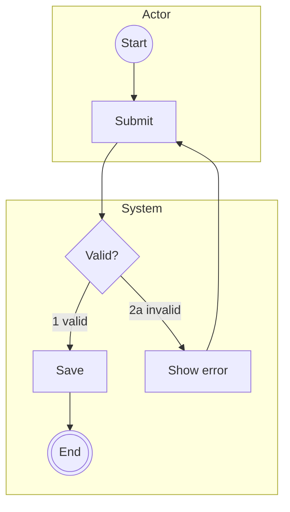

# {{title}}

<!-- Activity diagram of one feature: docs/specs/<capability>/diagrams/<feature>-activity.md. One flowchart
     from the trigger to each outcome. One subgraph per lane (an actor or the system): declare every node inside
     its lane, and write the edges after the last `end`, so no node lands in the wrong lane. Start ((Start)),
     end (((End))). Decisions are {question?} nodes; each edge leaving one carries its condition, starting with
     the use case's flow ID when there is one: -->|2a invalid|. Use case: the slug of the use case this diagram
     draws, in the same capability; delete the line when there is none. Cite the file in 03-design.md
     ## Data Flow and link it from spec.md ## Diagrams. specs lint needs a mermaid block starting with
     flowchart, and checks the slug and, in a change, the decision labels. -->

Use case: <slug>

What the flow covers, in one or two sentences.

