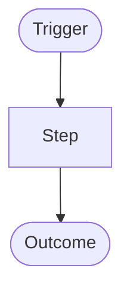

# {{title}}

<!-- Activity diagram of one feature: docs/specs/<capability>/diagrams/<feature>-activity.md. One flowchart
     from the trigger to each outcome; decisions as {question?} nodes. Cite it in 03-design.md ## Data Flow and
     link it from spec.md ## Diagrams. specs lint needs a mermaid block starting with flowchart. -->

What the flow covers, in one or two sentences.

